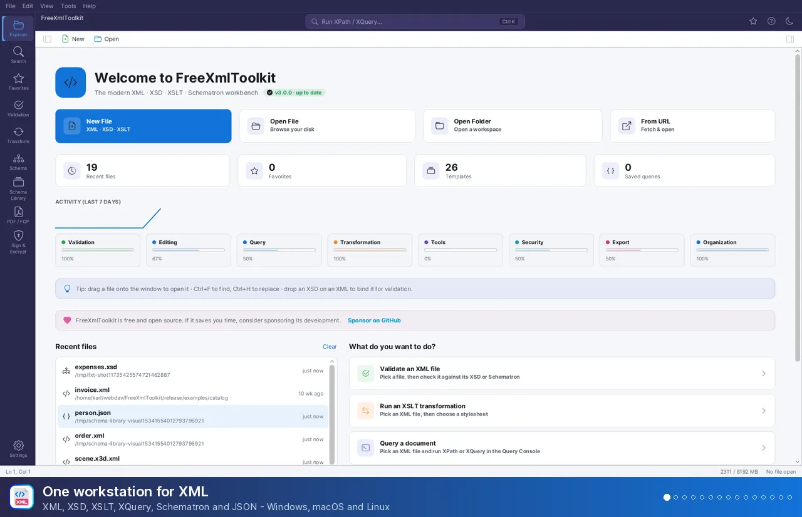
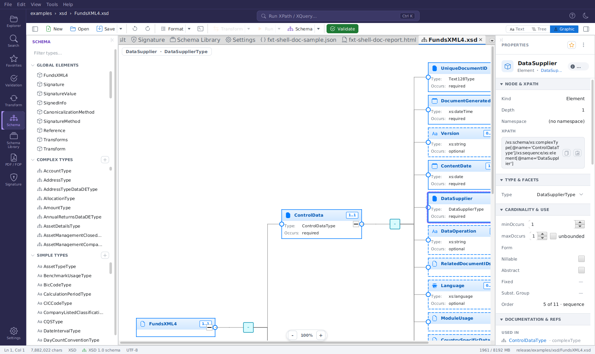
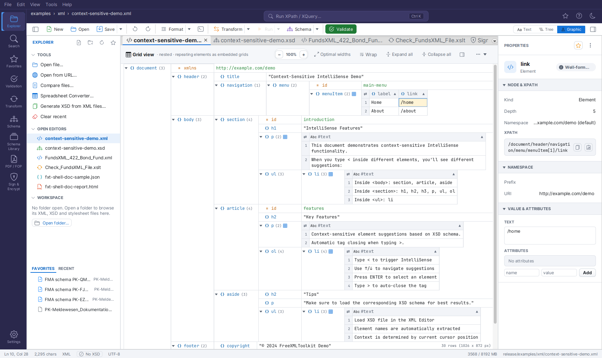
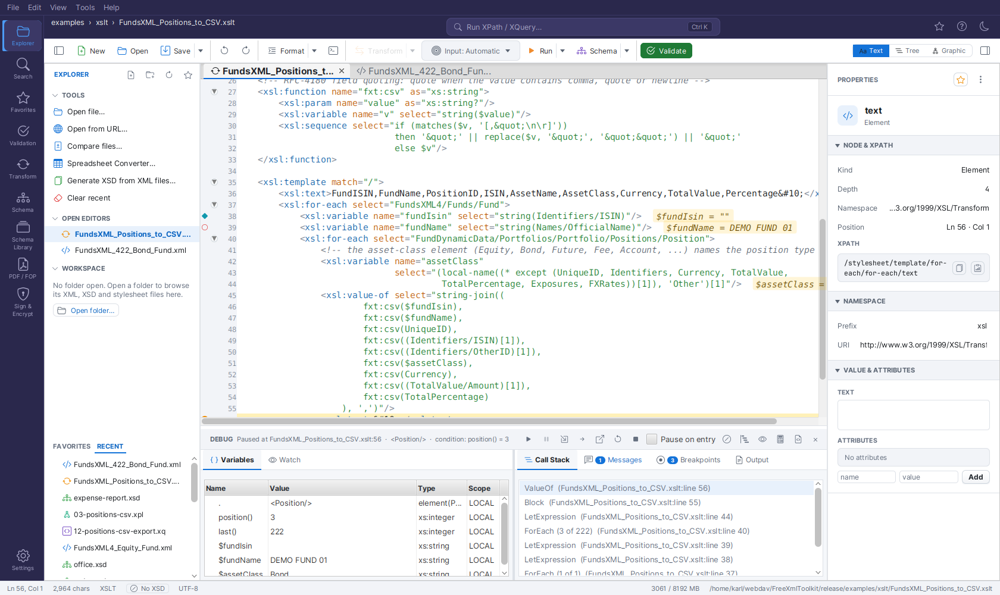
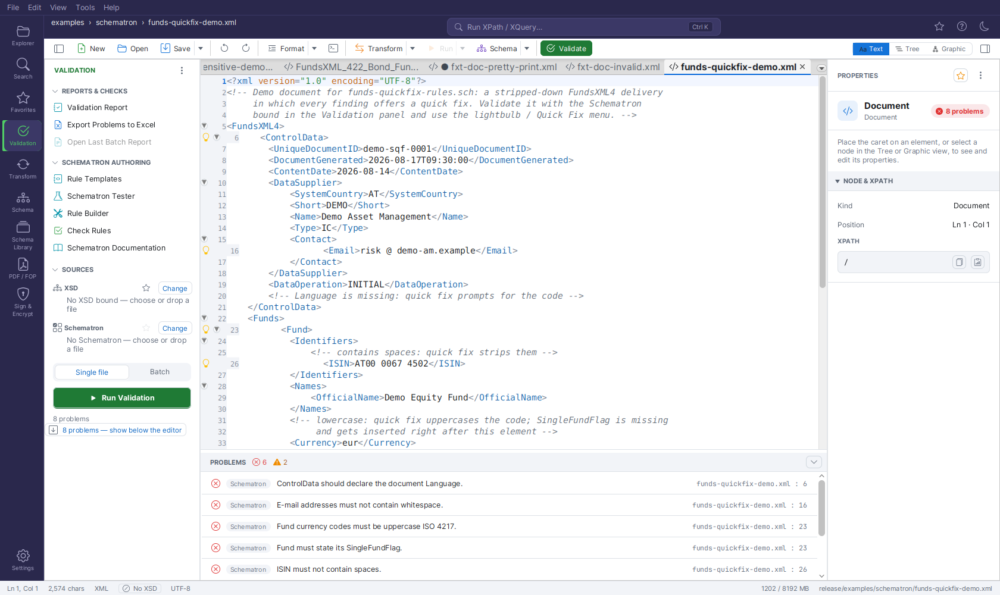
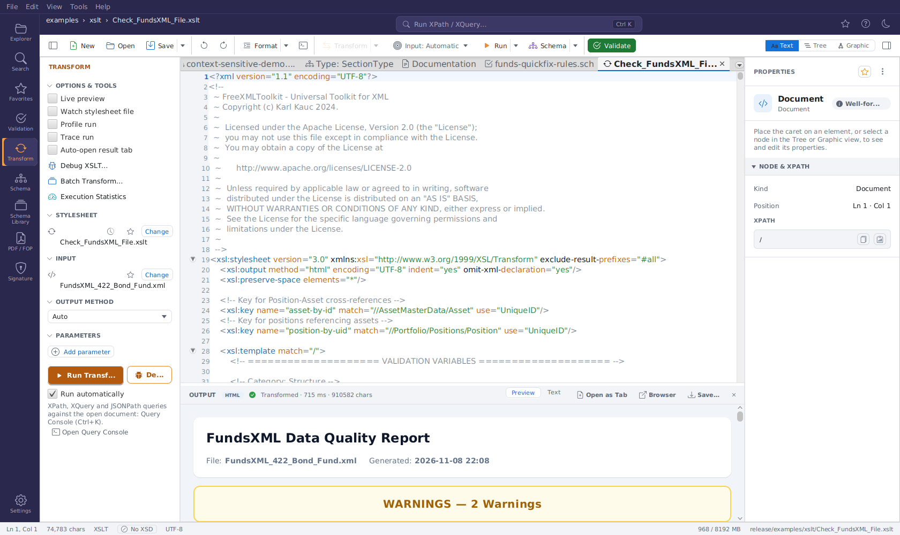
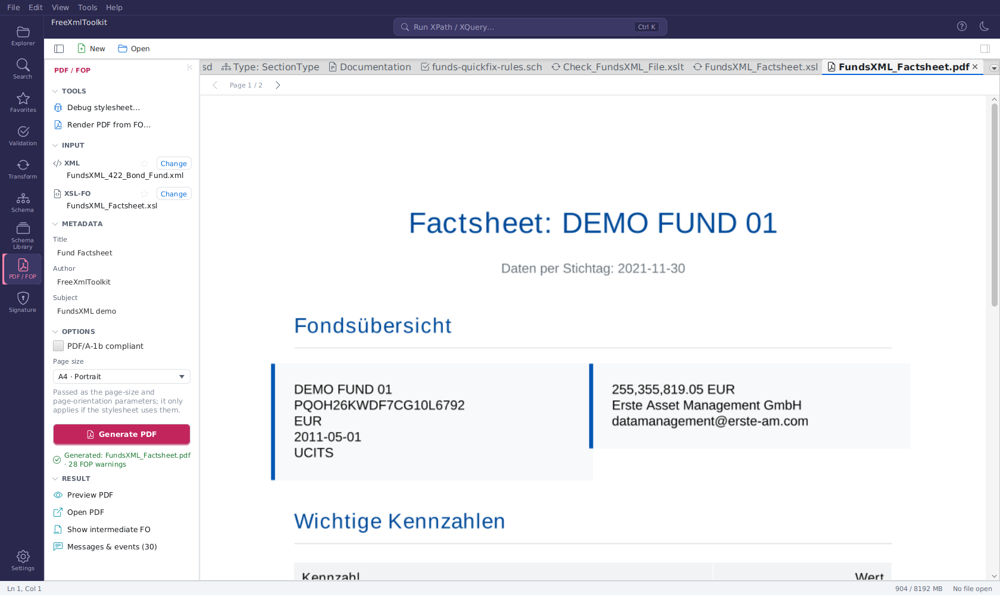
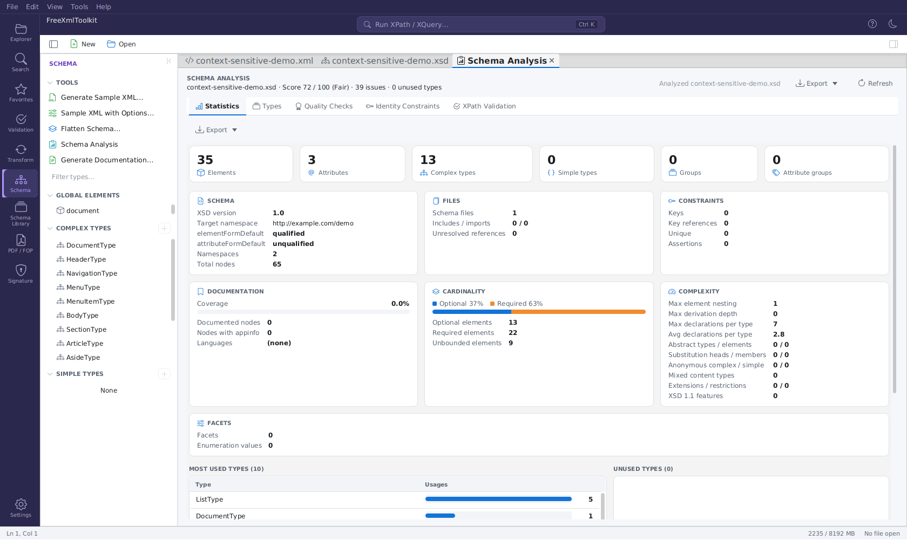
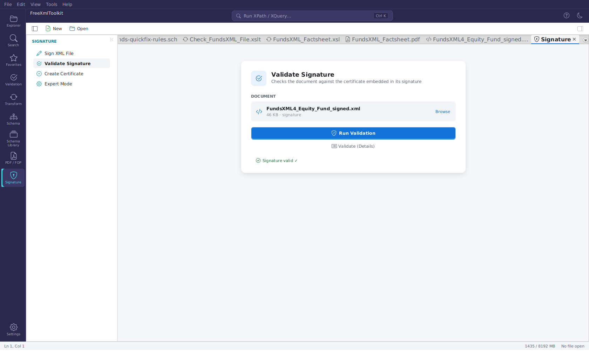

# FreeXmlToolkit - Your Complete XML Workstation

[](https://openjdk.org/)
[](https://openjfx.io/)
[](https://github.com/karlkauc/FreeXmlToolkit/actions/workflows/tests.yml)
[](https://github.com/karlkauc/FreeXmlToolkit/actions/workflows/tests.yml)
[](LICENSE.md)
[](https://github.com/sponsors/karlkauc)

**FreeXmlToolkit** is a free, open-source desktop workstation for XML: edit, validate, transform, debug and
document XML, XSD, XSLT, XQuery, Schematron and JSON in one application - on Windows, macOS and Linux.



**[⬇ Download the latest release](https://github.com/karlkauc/FreeXmlToolkit/releases/latest)** – Windows (.exe/.msi/portable), macOS (.dmg/.pkg, Apple Silicon & Intel), Linux (.deb/.rpm/portable) – or via `scoop install freexmltoolkit` / `brew install --cask karlkauc/tap/freexmltoolkit` ([details](#install-with-a-package-manager)). Full guide: [karlkauc.github.io/FreeXmlToolkit](https://karlkauc.github.io/FreeXmlToolkit/).

## Highlights

<table>
  <tr>
    <td width="50%"><b><a href="https://karlkauc.github.io/FreeXmlToolkit/xsd-tools/">Visual XSD editor</a></b><br>Design schemas as a graphical diagram or a tree, with type editor, facets, documentation and undo for every change. XSD 1.0 and 1.1.</td>
    <td width="50%"><a href="docs/img/unified-shell-schema-graphic.png"></a></td>
  </tr>
  <tr>
    <td width="50%"><b><a href="https://karlkauc.github.io/FreeXmlToolkit/grid/">Schema-aware XML editor</a></b><br>IntelliSense that offers only what the schema allows at the caret, live validation while you type, and three views of one document: Text, Tree and a <b>Grid</b> that shows repeating elements as editable tables.</td>
    <td width="50%"><a href="docs/img/unified-shell-xml-grid.png"></a></td>
  </tr>
  <tr>
    <td width="50%"><b><a href="https://karlkauc.github.io/FreeXmlToolkit/debugger/">XSLT, XQuery and Schematron debugger</a></b><br>Breakpoints (conditional, hit counts, logpoints), stepping, variables, watches, call stack, inline values and coverage - right in the editor.</td>
    <td width="50%"><a href="docs/img/xslt-debugger-paused.png"></a></td>
  </tr>
  <tr>
    <td width="50%"><b><a href="https://karlkauc.github.io/FreeXmlToolkit/schematron-quick-fixes/">Validation that explains itself</a></b><br>XSD 1.1, Schematron with <b>Quick Fixes</b> (SQF), JSON Schema, batch validation of whole folders, and a Schema Library with OASIS XML catalogs that resolves imports without touching your files.</td>
    <td width="50%"><a href="docs/img/xml-editor-schematron.png"></a></td>
  </tr>
  <tr>
    <td width="50%"><b><a href="https://karlkauc.github.io/FreeXmlToolkit/transform-panel/">Transformations</a></b><br>XSLT 3.0, XPath 3.1 and XQuery 3.1 with Saxon, live preview, XProc 3.0 pipelines, and a Query Console for ad-hoc XPath/XQuery (Ctrl+K).</td>
    <td width="50%"><a href="docs/img/xslt-developer-overview.png"></a></td>
  </tr>
  <tr>
    <td width="50%"><b><a href="https://karlkauc.github.io/FreeXmlToolkit/pdf-generator/">PDF with Apache FOP</a></b><br>XSL-FO to PDF with in-app preview, the intermediate FO and every FOP message at hand, and PDF/A-1b output.</td>
    <td width="50%"><a href="docs/img/fop-pdf-preview.png"></a></td>
  </tr>
  <tr>
    <td width="50%"><b><a href="https://karlkauc.github.io/FreeXmlToolkit/xsd-tools/">Schema documentation, analysis and test data</a></b><br>HTML, PDF or Word documentation from XSD, schema analysis with quality score and reports, and sample XML generated from any schema.</td>
    <td width="50%"><a href="docs/img/unified-shell-schema-statistics.png"></a></td>
  </tr>
  <tr>
    <td width="50%"><b><a href="https://karlkauc.github.io/FreeXmlToolkit/digital-signatures/">XML digital signatures</a></b><br>Sign and verify documents, create certificates.</td>
    <td width="50%"><a href="docs/img/signature-validation.png"></a></td>
  </tr>
</table>

## How It Compares

| | FreeXmlToolkit | Oxygen XML Editor | XMLSpy | XMLBlueprint |
|---|:-:|:-:|:-:|:-:|
| License | **Free, open source** | Commercial | Commercial | Commercial |
| Windows · macOS · Linux | ✓ ✓ ✓ | ✓ ✓ ✓ | ✓ ◐ – | ✓ – – |
| Graphical XSD editor (XSD 1.1) | ✓ | ✓ | ✓ | – |
| Schematron + Quick Fixes | ✓ | ✓ | – | ◐ |
| XSLT 3.0 · XQuery | ✓ | ✓ | ✓ | ◐ |
| XSLT / XQuery debugger | ✓ | ✓ | ✓ | – |
| XSLT / XQuery profiler | ✓ | ✓ | ✓ | – |
| XProc 3 · XSpec | ✓ | ✓ | – | ◐ |
| XSL-FO to PDF | ✓ | ✓ | ✓ | – |
| XML compare · 3-way merge | ✓ | ✓ | ✓ | – |
| XML digital signatures | ✓ | ✓ | ✓ | – |
| JSON · JSON Schema · XML↔JSON | ✓ | ✓ | ✓ | ◐ |
| Command line included | ✓ | ◐ | ◐ | ✓ |

✓ supported · ◐ partly or as a separate product · – not found in the publisher's documentation. As of November 2026; details, sources and trademarks: [Comparison with Other Editors](https://karlkauc.github.io/FreeXmlToolkit/comparison/).

## Features

### XML and JSON Editing

- **Text, Tree and Grid views** of one document with a shared undo history
- **Context-sensitive IntelliSense** from the bound XSD: elements, attributes and enumeration values
- **Properties Inspector** showing the schema facts (type, cardinality, facets, documentation) of the
  node at the caret
- Code folding, syntax highlighting, formatting, search across all views
- **JSON** (and JSON5) with the same Text / Tree / Grid views and JSON Schema validation
- **Templates** for new files and **Favorites** for the files you use often

### Schemas

- **Graphical and tree editing** of XSD with a type library, type editor and facet panel
- **Schema Library**: namespace-to-schema mappings, OASIS catalogs and a schema cache; imports and
  includes resolve transitively (local, HTTP or by namespace URL)
- **HTML documentation**, **schema analysis** (statistics, quality checks, identity constraints;
  export as CSV, JSON, HTML, PDF or Excel), **sample XML generation** and schema flattening

### Validation

- **XSD 1.0 / 1.1** validation with line-precise problems, live while you type
- **Schematron** (ISO, via SchXslt) with **Schematron Quick Fixes** applied as one undo step
- **JSON Schema** (Draft-07, 2019-09, 2020-12)
- **DTD and RELAX NG** (XML and compact syntax): against the grammar a document declares or one you
  bind, with IntelliSense; DTDs load only from files, catalogs or the schema cache
- **Batch validation** of whole folders

### Transform, Query and Debug

- **XSLT 3.0 / XPath 3.1 / XQuery 3.1** (Saxon HE) with live preview, parameters and HTML/text/XML output
- **XProc 3.0** pipelines (XML Calabash)
- **Query Console** for XPath/XQuery against the open document
- **Interactive debugger** for XSLT, XQuery and Schematron: conditional breakpoints, logpoints,
  stepping, watches, call stack, "explain match", output-to-source mapping and coverage

### Output and Security

- **PDF generation** with Apache FOP, in-app preview, PDF/A-1b
- **XML digital signatures**: sign, verify, create certificates

### Compare, Convert and Large Files

- **XML-aware compare** (structure, namespaces, attribute order, whitespace, element order),
  **folder comparison** and **three-way merge**
- **XML ↔ JSON ↔ YAML** conversion
- **Large File Viewer** for files of any size (1 GB opens in seconds) with search, structure tree,
  record table and streaming validation
- **XSLT profiler** (hot spots, call tree, flame graph) and **XSpec** tests for XSLT, XQuery and Schematron

### Projects, Plugins and Industry Standards

- **Projects** (`.fxtproj`): schema bindings by file pattern, catalogs, named transformation scenarios
- **Plugins**: activities, menu items, validators and schemas from jar files; a documented API and a
  sample project
- Optional **industry plugins**: FundsXML (data-quality checks, grid formulas), ISO 20022 / SEPA,
  ebInterface, FinDatEx EMT/EET/EPT/TPT, XBRL (with Arelle)

### Enterprise

- **English and German** user interface
- **Administrator policies** (locked and default settings, telemetry and updates switchable
  machine-wide), silent installation, SBOM with every release, documented threat model
- **Accessibility**: screen-reader names, WCAG AA contrast, keyboard alternatives

### Command Line

- **`fxt-cli`** for build pipelines and scripts: `validate` (XSD, DTD, RELAX NG, Schematron, JSON
  Schema; text, JSON, JUnit and SARIF reports), `transform` (XSLT, XQuery, XProc, profiling),
  `xsd-doc`, `xspec`, `scenario`, `compare`, `merge`, `convert`, `fop`; installed with the
  application. See [Command Line](https://karlkauc.github.io/FreeXmlToolkit/command-line/).

## Getting Started

### Download

1. Go to the [Releases page](https://github.com/karlkauc/FreeXmlToolkit/releases/latest) (or use the download buttons on the [documentation home page](https://karlkauc.github.io/FreeXmlToolkit/))
2. Download the package for your operating system:
    - **Windows** (x64): `.exe` installer (no administrator rights required), `.msi` for managed deployments, or the portable `…windows-x64-app-image….zip`
    - **macOS** (Apple Silicon `arm64` or Intel `x64`): `.dmg` (drag to Applications), `.pkg` installer, or the portable app-image `.zip` — all signed with a Developer ID and notarized by Apple
    - **Linux** (x64): `.deb` (`sudo dpkg -i …`), `.rpm` (`sudo rpm -i …`), or the portable app-image `.zip`
3. Run the installer, or extract the portable ZIP to a folder and start `FreeXmlToolkit` from there

The packages bundle their own Java runtime - nothing else to install.

### Install with a Package Manager

**Windows – [Scoop](https://scoop.sh/)**

```powershell
scoop bucket add karlkauc https://github.com/karlkauc/scoop-bucket
scoop install freexmltoolkit
```

**macOS – [Homebrew](https://brew.sh/)**

```bash
brew install --cask karlkauc/tap/freexmltoolkit
```

Package-manager installations are updated by the package manager (`scoop update freexmltoolkit`,
`brew upgrade --cask freexmltoolkit`). The app still tells you when a new version is out and shows
the matching command, but it does not replace its own files.

**Coming soon:** `winget` (Windows) and [Flathub](https://flathub.org/) (Linux) – the submissions are in preparation.

### Build from Source

Requires JDK 25 with JavaFX (e.g. Liberica Full JDK):

```bash
git clone https://github.com/karlkauc/FreeXmlToolkit.git
cd FreeXmlToolkit
./gradlew run
```

### First Steps

The window is a single workspace: the **activity bar** on the left switches the side panel
(Explorer, Search, Favorites, Validation, Transform, Schema, Schema Library, PDF/FOP, Signature,
Settings), the center holds your file tabs with **Text / Tree / Graphic** views, the
**Properties** inspector sits on the right, and the **menu bar** (File · Edit · View · Tools · Help)
has every action.

- **Open** a file with Ctrl+O, the Explorer panel, or drag and drop
- **Validate** with F8 - problems appear in the Validation panel
- **Run** an XSLT, XQuery or XProc document with Ctrl+Enter, or pick a stylesheet in the **Transform** panel
- **Debug** a stylesheet, query or Schematron with Shift+F5
- On first start, **Open an Example** on the welcome page loads ready-made sample files; more are in the
  `examples` folder of the installation

All shortcuts: [Keyboard Shortcuts](https://karlkauc.github.io/FreeXmlToolkit/keyboard-shortcuts/).

## Getting Help

- **Documentation**: the [user guide](https://karlkauc.github.io/FreeXmlToolkit/), including
  [What's New](https://karlkauc.github.io/FreeXmlToolkit/whats-new/) and
  [FAQ & Troubleshooting](https://karlkauc.github.io/FreeXmlToolkit/faq/)
- **In the app**: the **Help** menu (F1)
- **Bugs, ideas and questions**: the [Issues page](https://github.com/karlkauc/FreeXmlToolkit/issues)

### Privacy

FreeXmlToolkit sends anonymous usage statistics and error reports (never file names, paths or document content). Both are on by default and can be switched off under **Settings → Privacy**. See [Privacy & Anonymous Telemetry](https://karlkauc.github.io/FreeXmlToolkit/telemetry/) for exactly what is sent.

### Code Signing

Code signing for the Windows releases is provided by SignPath Foundation (being set up); the [Code Signing Policy](https://karlkauc.github.io/FreeXmlToolkit/code-signing-policy/) describes what is signed, by whom, and which network connections the application makes.

## Support the Project

FreeXmlToolkit is free and open source, and it will stay that way. If it saves you time at work, please consider
**[sponsoring its development on GitHub](https://github.com/sponsors/karlkauc)** — sponsorships directly fund
maintenance, bug fixes and new features.

Not able to sponsor? You can still help a lot:

- ⭐ **Star** the repository on GitHub
- 🐞 **Report bugs** and suggest features
- 📣 **Tell colleagues** who work with XML about it

Inside the app you find the sponsor link under **Help → Sponsor this Project**, in the **About** dialog and in
**Settings → Support the Project**.

## Contributing

Contributions are welcome - bug reports, feature ideas, documentation and code. Please read the
[Contributing Guide](CONTRIBUTING.md) for the development setup, coding guidelines and the pull request
workflow; for larger changes, open an issue first. Everyone taking part agrees to follow our
[Code of Conduct](CODE_OF_CONDUCT.md). Security issues: see the [Security Policy](.github/SECURITY.md).

## License

This project is licensed under the Apache License 2.0 - see the [LICENSE.md](LICENSE.md) file for details.

## Acknowledgments

FreeXmlToolkit is built on many excellent open-source projects, among them **JavaFX**, **Saxon** (XSLT/XQuery),
**XML Calabash** (XProc), **Apache Xerces** (XSD 1.1), **ph-schematron**, **Apache FOP**, **Apache Santuario**
and **RichTextFX**. The [full list with licenses](https://karlkauc.github.io/FreeXmlToolkit/licenses/) is part of the documentation.
