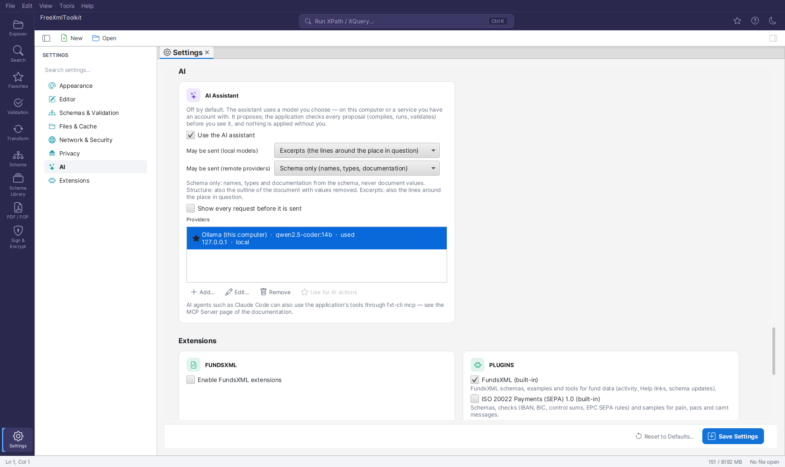
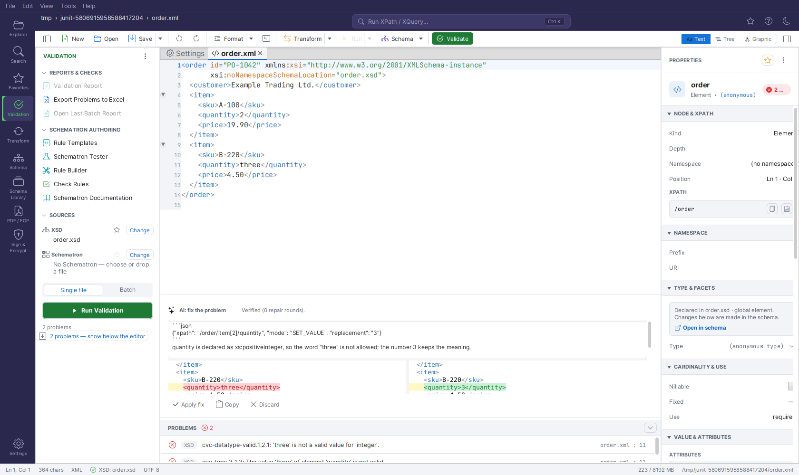

# AI Assistant

FreeXmlToolkit can ask a language model for help with three tasks: fixing a validation problem, turning a question
into an XPath or XQuery query, and writing an XSLT stylesheet from a source document and a target sample. What
makes it different from a chat: **every answer is checked by the application before you see it** — it compiles,
runs, validates and compares, and sends the errors back to the model for up to three repair rounds. Nothing is
applied or saved without you.

The assistant is **off by default**. You choose the model: one that runs on your computer (Ollama, LM Studio) or a
service you have an account with (OpenAI-compatible APIs, Anthropic). FreeXmlToolkit ships no model, needs no account
of its own and sends nothing to anyone you did not configure.

For AI agents that work on your files themselves (for example Claude Code), the application offers its tools through
the [MCP Server](mcp-server.md) instead — that needs no setting here.

## Setting it up

1. **Settings → AI → Use the AI assistant.**
2. **Add…** a provider:
   - **Ollama** (`http://localhost:11434/v1`) or **LM Studio** (`http://localhost:1234/v1`): start the server, press
     **Load models**, pick one. No key is needed. Models that are good at code and support tool calls work best.
   - **OpenAI** or another OpenAI-compatible service: the base URL, a model, and a key.
   - **Anthropic**: a model and a key.
   - **Custom**: any server that speaks OpenAI-compatible *Chat Completions* — vLLM, a company gateway, Azure OpenAI
     (v1 API; choose the `API_KEY` key header).
3. **Keys:** prefer **Key from variable** — the name of an environment variable that holds the key (for example
   `ANTHROPIC_API_KEY`). A key typed into the dialog is stored encrypted in your settings, like the proxy password.
4. **Test** sends a one-line request and shows the model, the time it took and whether the host counts as *local*.
5. With several providers, **Use for AI actions** picks the one the actions use.



## What is sent {#data-levels}

Every request is built for the task, within a size limit, and contains only what the data level allows:

| Level | What may be sent |
|---|---|
| **Schema only** | Names, types and documentation from the schema; the place of the problem; your question; error messages with document values removed |
| **Structure** | Also the outline of the document (element paths, counts) with values removed |
| **Excerpts** | Also the lines around the place in question (for a fix) or sample values (for a query or a stylesheet) |

- *May be sent (local models)* applies to providers on this computer; default **Excerpts**.
- *May be sent (remote providers)* caps every other provider; default **Schema only**.
- The document is never sent whole. Large documents are outlined, not read.
- Text from your documents and schemas is marked as data in the request: the model is told that it is never an
  instruction (a document cannot steer the assistant).
- **Show every request before it is sent** (on by default) shows the exact text, the provider, *local* or *remote*
  and the data level, with **Send** and **Cancel**. The first request to every provider is always shown; the first
  use of a remote provider asks once, naming the host.

## The actions

### Fix or explain a validation problem

Right-click a problem in the **Problems** list or the Validation panel → **Fix with AI** or **Explain with AI**.

- *Explain* answers in a few sentences what the schema expects there (not verified — it is an explanation).
- *Fix* asks for the smallest change. The application applies it to a copy, validates the copy against the same
  schema (and Schematron), and accepts it only when **the problem is gone, no new problem appeared and no content was
  removed**. The AI panel at the bottom shows the change side by side and the checks; **Apply** makes it one edit
  (Ctrl+Z undoes it). Quick fixes from the Schematron stay first in the menu: they are deterministic.



### A question → XPath or XQuery

In the **Query Console**: **Ask AI…**, describe what you want ("the names of the funds in EUR"). The query is checked
against the active document — it compiles and runs; the item count and the first results are shown — and
**Insert into the console** puts it into the input field. Running it stays your action. The query uses `*:name`
instead of namespace prefixes, so it runs in the console as it was checked.

### A stylesheet from a target sample

**Transform panel → Generate stylesheet…**: the source is the panel's input document; choose a **target sample** (a
document with the structure you want), optionally its **schema**, the XSLT version and notes in your own words. The
stylesheet is compiled, run on the source in a sandbox (nothing is written), and the output is checked to be
well-formed — and valid, when you gave a schema; the differences to the sample are reported. A verified stylesheet
opens as a new, unsaved document.

### When the checks do not pass

After three repair rounds the panel shows the last proposal as **not verified** with the report. **Apply
unverified…** asks once more; use it only after checking the proposal yourself.

## What to expect from which model

Run the evaluation set yourself against the model you want to use:

```bash
./gradlew aiEval -Pai.baseUrl=http://localhost:11434/v1 -Pai.model=<model>
FXT_AI_KEY=… ./gradlew aiEval -Pai.kind=anthropic -Pai.baseUrl=https://api.anthropic.com -Pai.model=<model>
```

It runs 22 cases (XPath, XQuery, XSLT, fixes) through the same generate–check–repair loop and writes
`build/ai-eval.md`: verified on the first try, after repair, or not at all, and whether a query's result is the
expected one (the report also shows each query the model wrote).

Measured on 2026-11-10 with a small local model, `qwen2.5-coder:3b` on Ollama (CPU only, two runs):

| | Run 1 | Run 2 |
|---|---|---|
| Verified on the first try | 15 | 8 |
| Verified after repair | 1 | 6 |
| Not verified (not offered) | 6 | 8 |
| Query result equals the expected answer | 0 of 14 | 1 of 14 |

Read this carefully: **"verified" means the proposal compiles, runs and passes the structural checks — not that it
answers the question.** A model this small writes queries that run but count the wrong thing (`count(/funds)` on a
document in a namespace, `sum(@no)` for "how many"). The checks catch what does not compile, does not validate or
removes content; they cannot know what you meant. So check a query's result before you rely on it, and use a larger
model (a 7B+ coder model locally, or a hosted model) for real work — run the evaluation against it first. A model that
fails the checks is not offered at all, which is the point: a small model gives you fewer proposals, not wrong
documents.

## Administration

| Key | Effect |
|---|---|
| `ai.allowed=false` | **Policy only.** No AI anywhere: the Settings group, the menu items, Ask AI and Generate stylesheet are gone, and `fxt-cli mcp` refuses |
| `ai.remote.allowed=false` | **Policy only.** Only providers on this computer, or hosts listed in `ai.localHosts`, can be used |
| `ai.enabled`, `ai.dataLevel`, `ai.dataLevel.remote`, `ai.preview.always` | The settings above; lock them in `policy.properties` |
| `ai.providers`, `ai.provider.default` | The provider list (JSON) and the one in use; a list in `policy.properties` is fixed |
| `ai.localHosts` | Hosts that count as local, for example a company gateway |

Keys in `policy.properties` or `defaults.properties` are ignored: those files are readable by every user. See
[Administration & Policies](administration.md).

## Privacy

An AI request goes only to the provider you configured, never to FreeXmlToolkit. Telemetry records only that an AI
action ran: which action, the kind of provider (`local`, `openai_compatible`, `anthropic`), the outcome, the number of
repair rounds and the duration — never a prompt, an answer, a model or host name, or anything of your documents (see
[Privacy & Telemetry](telemetry.md)).
