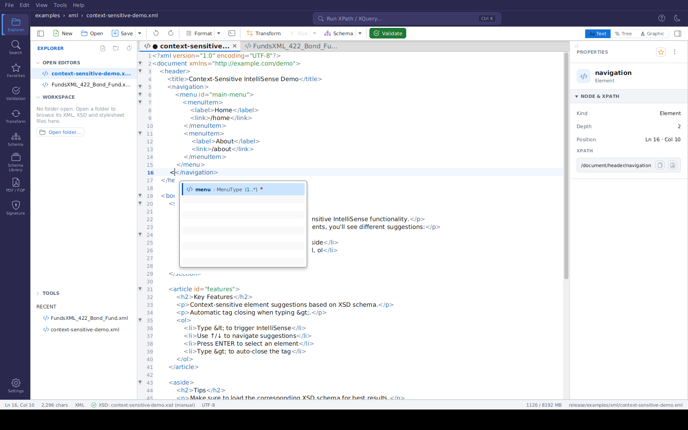

# Auto-Completion (IntelliSense)

> **Version:** 2.1.0

The XML Editor includes smart auto-completion that helps you write XML faster and with fewer errors.

---

## Overview


*The XML Editor with a schema-backed document - typing `<` shows context-valid element suggestions*

When you type `<` in the XML Editor, a popup appears showing only the elements that are valid at your current position. This is based on your XSD schema.

Inside a start tag, typing a space (or pressing **Ctrl+Space**) suggests the **attributes** of
that element - from your XSD schema, or, in XSLT stylesheets, from a built-in XSLT 3.0
catalog that needs no schema at all.

---

## Key Features

### 1. Smart Element Suggestions

- **Context-Aware**: Shows only valid child elements for your current location
- **Position-Aware**: Inside an `xs:sequence` only the elements that may follow the
  siblings already present are offered - an element that has reached its `maxOccurs` (or an
  `xs:choice` whose alternative is already there) disappears from the list. Elements that
  already exist *after* the cursor are respected too, so you cannot insert a child in the
  wrong order. Completion is strict about position: only what the schema allows at exactly
  that spot is listed.
- **Repeatable elements**: When the element you are inside may itself repeat (for example a
  FundsXML `<Fund>` with `maxOccurs="unbounded"`), only its *remaining* children are
  offered - the list does not start over with the first child just because the element can
  occur again. Only a repeatable group (`xs:sequence` / `xs:choice` with `maxOccurs` above
  1) starts over once all of its members are present.
- **Namespace-Aware**: Suggestions are inserted with the prefix your document declares for the
  element's namespace. A child of a type imported from another namespace (e.g. `c:street`
  when the document declares `xmlns:c="…"`) is inserted as `<c:street></c:street>`; elements
  in the default namespace stay unprefixed. Typing the local name (`<st`) still matches
  `c:street`.
- **Based on Schema**: Suggestions come from your loaded XSD schema
- **Reduces Errors**: You can't accidentally add invalid elements

### 2. Path-Specific Values

Elements with the same name at different locations show their correct values:

| Location | Suggested Values |
|----------|-----------------|
| `/Document/ControlData/Version` | 4.0.0, 4.0.1, 4.1.0 |
| `/Document/Report/Version` | V3, V3S1, V3S2 |

### 3. Automatic Tag Closing

When you type an opening tag like `<element>`, the editor automatically adds the closing tag `</element>`.

### 4. Attribute Suggestions (Schema-Bound XML)

*New in 2.6.0*

When your document is bound to an XSD schema, the editor also helps with attributes:

- **Where**: Place the cursor inside a start tag (for example after `<Fund `) and type a space,
  or press **Ctrl+Space**
- **What**: All attributes the schema declares for that element, including those from
  attribute groups
- **Order**: Required attributes come first, followed by the optional ones
- **Details**: The tooltip shows each attribute's type and its documentation from the schema
- **No duplicates**: Attributes that are already in the tag are not suggested again
- **Insertion**: Accepting a suggestion inserts `name=""` and places the cursor between the
  quotes, ready for the value
- **Values**: If the attribute's type is an enumeration or `xs:boolean`, its values
  (`true` / `false`) open right after the attribute is inserted; **Ctrl+Space** inside the
  quotes shows them again

### 5. XSLT Stylesheets (Works Without a Schema)

*New in 2.6.0*

XSLT stylesheets get auto-completion even when no schema is bound. The editor knows every
XSLT 3.0 instruction and declaration (including newer ones such as `xsl:iterate`,
`xsl:mode`, `xsl:accumulator`, `xsl:merge` and `xsl:evaluate`).

**Element suggestions** follow the context you are in:

| Cursor position | Suggested elements |
|-----------------|--------------------|
| Directly inside `xsl:stylesheet` | Declarations (`xsl:template`, `xsl:variable`, `xsl:output`, …) |
| Inside `xsl:choose` | `xsl:when`, `xsl:otherwise` |
| Inside a template or other instruction | Instructions (`xsl:value-of`, `xsl:if`, `xsl:for-each`, …) |

**Attribute suggestions** appear when you type a space inside an XSLT start tag such as
`<xsl:variable `, `<xsl:template ` or `<xsl:param ` (or press **Ctrl+Space** there):

1. **Required attributes first** - for example `name` for `xsl:variable`
2. **Then the element's own optional attributes** - for example `select` or `as`
3. **Then the standard attributes** every XSLT element accepts - `use-when`, `expand-text`,
   `xpath-default-namespace`, `exclude-result-prefixes`, `version`, and others

Attributes already present in the tag are left out, and accepting one inserts `name=""` with
the cursor between the quotes.

**Attribute value suggestions**: when you insert an attribute that only allows a fixed set of
values, the values open automatically (press **Ctrl+Space** inside the quotes to show them
again), for example:

| Attribute | Suggested values |
|-----------|------------------|
| `method` on `xsl:output` | xml, html, xhtml, text, json, adaptive |
| `indent` and other yes/no attributes | yes, no |
| `order` / `data-type` / `case-order` on `xsl:sort` | ascending, descending / text, number / upper-first, lower-first |
| `validation` | strict, lax, preserve, strip |
| `on-no-match` on `xsl:mode` | text-only-copy, shallow-copy, deep-copy, shallow-skip, deep-skip, fail |
| `visibility` | public, private, final, abstract (depending on the element) |
| `version` | 3.0, 2.0, 1.0 |

Good to know:

- Any prefix bound to the XSLT namespace works - not only `xsl:`
- Literal result elements (for example `<html>` or `<div>` inside a template) get no XSLT
  attribute suggestions
- Start tags that span several lines are supported: press **Ctrl+Space** after a line break
  inside the tag

---

## How to Use

### Step 1: Load an XSD Schema

If your XML already references its schema (via `xsi:schemaLocation`), it is picked up
automatically - and if you add or change that reference while editing, the new schema is
picked up on the next validation run and IntelliSense follows automatically. Otherwise,
bind one yourself:

1. Open your XML file in the editor
2. Click the **"No XSD"** indicator in the **status bar** (or the toolbar's **Schema**
   button - **Set XSD Schema…**)
3. Select your XSD file

The indicator changes to **"XSD: name"**, and the binding drives both auto-completion **and**
schema validation.

### Step 2: Use Auto-Completion

1. Position your cursor where you want to add an element
2. Type `<`
3. A popup shows valid elements for this location
4. Use **↑/↓** arrow keys to navigate
5. Press **Enter** to insert the selected element
6. Press **Escape** to close without selecting

### Step 3: Add Attributes

1. Place the cursor inside a start tag, after the element name (e.g. `<xsl:variable|`)
2. Type a space, or press **Ctrl+Space**
3. Pick an attribute - the editor inserts `name=""` with the cursor between the quotes
4. If the attribute has a fixed set of values, they appear right away - pick one with **Enter**
   (or press **Escape** and type your own value)

### Example

```
1. Inside <document>, type <
   → Shows: header, body, footer

2. Inside <body>, type <
   → Shows: section, article, aside

3. Inside <section>, type <
   → Shows: title, paragraph, list
```

---

## Keyboard Shortcuts

| Key | Action |
|-----|--------|
| `<` | Open auto-completion |
| `Space` (inside a start tag) | Suggest attributes |
| `Ctrl+Space` | Open auto-completion on demand (elements, attributes or attribute values, depending on the cursor position) |
| `↑` `↓` | Navigate suggestions |
| `Enter` | Insert selected element or attribute |
| `Escape` | Close popup |
| `>` | Close the current tag |

---

## Benefits

| Benefit | Description |
|---------|-------------|
| **Faster Writing** | No need to remember element names |
| **Fewer Errors** | Only valid elements are suggested |
| **Schema Compliance** | Your XML always matches the schema |
| **Easy Learning** | Discover available elements as you type |

---

## Troubleshooting

### No Suggestions Appearing?

- Make sure an XSD schema is loaded
- Check that your cursor is inside an element
- Verify the schema file is valid

### Wrong Suggestions?

- Check that the correct schema is loaded
- Verify the XML structure is valid up to your cursor position

### Nothing Offered Although the Element Is Empty?

The list also honours the elements that already exist *after* the cursor. If you type `<`
directly in front of the first existing child of a sequence, nothing may legally go there -
move the cursor after the last child that belongs before your new element.

### The First Child Is Offered Again Inside a Repeatable Element?

It no longer is. Earlier versions treated a repeatable element like a repeatable group and
restarted its content model. If you want to add another occurrence of the element itself,
close the current one and type `<` after it.

### No Attribute Suggestions?

- Make sure the cursor is inside the start tag, after the element name and before `>`
- For ordinary XML files, an XSD schema must be bound - attributes come from the schema
- In XSLT, only XSLT elements get attribute suggestions; literal result elements such as
  `<div>` do not
- Attributes that are already in the tag are intentionally not offered again
- In a start tag that spans several lines, press **Ctrl+Space** to open the list

### Prefix Missing or Unexpected?

Prefixes are taken from the `xmlns` declarations of your document. If the namespace of the
suggested element is not declared at all, the prefix used inside the schema is inserted -
add the matching `xmlns:` declaration to the root element.

---

## Navigation

| Previous                                    | Home             | Next                                        |
|---------------------------------------------|------------------|---------------------------------------------|
| [Digital Signatures](digital-signatures.md) | [Home](index.md) | [Schematron Support](schematron-support.md) |

**All Pages:** [Unified Shell](unified-shell.md) | [XML Editor](xml-editor.md) | [XML Features](xml-editor-features.md) | [JSON Editor](json-editor.md) | [XSD Tools](xsd-tools.md) | [Profiled XML Generation](profiled-xml-generation.md) | [XSD Validation](xsd-validation.md) | [XSLT Viewer](xslt-viewer.md) | [XSLT Developer](xslt-developer.md) | [FOP/PDF](pdf-generator.md) | [Signatures](digital-signatures.md) | [IntelliSense](context-sensitive-intellisense.md) | [Schematron](schematron-support.md) | [FundsXML Extensions](fundsxml-extensions.md) | [Favorites](favorites-system.md) | [Templates](template-management.md) | [Tech Stack](technology-stack.md) | [Security](SECURITY.md) | [Licenses](licenses.md)
