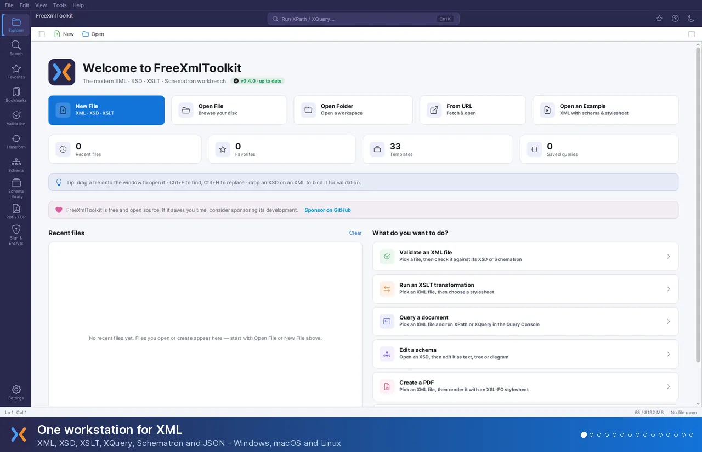
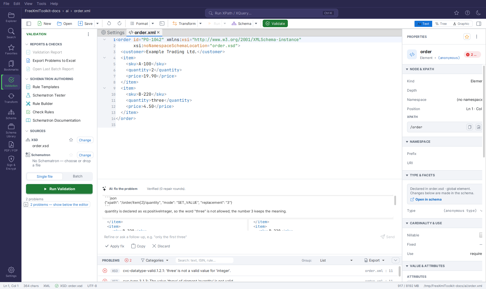

# What FreeXmlToolkit can do

An overview of the application by area, with a link to the guide for each.

## At a glance

FreeXmlToolkit is a free desktop application for working with XML files. It helps you edit, validate, transform, and secure your XML documents - all in one place.

***A tour of the main features - click to open it full screen***

### What Can You Do With FreeXmlToolkit?

- **Edit XML files** with smart auto-completion and syntax highlighting
- **Validate XML** against XSD schemas, DTDs and RELAX NG schemas to check for errors
- **Validate JSON** against JSON Schemas, auto-detected from the document's `$schema` member
- **Transform XML** into other formats (HTML, PDF, Text)
- **Sign XML documents** with digital certificates
- **Create business rules** with Schematron validation
- **Generate documentation** from your XSD schemas
- **Compare and merge** XML files by structure, compare folders, convert XML ↔ JSON ↔ YAML
- **Open huge files** (gigabytes) in the [Large File Viewer](../guides/edit-xml/large-files.md)
- **Automate** with the [command line](../automate/command-line.md) (`fxt-cli`) and [projects](../guides/projects.md)
- **Work with AI** - an optional [AI assistant](../guides/ai-assistant.md) that checks every answer, and an [MCP server](../automate/mcp-server.md) for AI agents
- **Extend** it with [plugins](../industry/manage-extensions.md) — industry plugins for ISO 20022, ebInterface, FinDatEx and XBRL included
- **Work in English or German**, [accessible](../reference/accessibility.md), centrally [administrable](../administer/policies.md)

### Supported Standards

These are the XML-related standards and versions FreeXmlToolkit reads, validates, runs or writes:

| Area | Standard and version | Engine |
|---|---|---|
| XML | XML 1.0 (Fifth Edition), XML 1.1, Namespaces in XML, OASIS XML Catalogs 1.1 | Xerces 2.12 |
| Schemas | **XSD 1.0 and 1.1** (assertions, type alternatives, open content, `xs:override`), DTD, RELAX NG (XML and compact syntax) | Xerces (XSD 1.1 build), Jing, Trang |
| Business rules | ISO Schematron (query bindings `xslt2` and `xslt3`), Schematron Quick Fixes (SQF) | ph-schematron / SchXslt on Saxon |
| Transformation | **XSLT 1.0, 2.0 and 3.0** | Saxon HE 12 (not schema-aware, no streaming) |
| Query | **XPath 1.0 – 3.1**, **XQuery 1.0 – 3.1**, JSONPath | Saxon HE 12, Jayway JsonPath |
| Pipelines and tests | **XProc 3.0**, XSpec 4 (XSLT, XQuery, Schematron) | XML Calabash 3, XSpec |
| PDF | **XSL-FO 1.1** (as implemented by Apache FOP), PDF/A-1b; external XSL-FO processors | Apache FOP 2.12 |
| Security | **XML Signature 1.1**, **XML Encryption 1.1**, Canonical XML 1.0 / 1.1, Exclusive XML Canonicalization 1.0 | Apache Santuario 4 |
| JSON and YAML | JSON (RFC 8259), **JSON Schema Draft-07, 2019-09 and 2020-12**, YAML 1.2 | networknt json-schema-validator, SnakeYAML Engine |
| AI agents | Model Context Protocol (MCP, revisions up to 2025-11-25, stdio) | MCP Java SDK |

### Works On All Platforms

FreeXmlToolkit runs on **Windows** (x64), **macOS** (Apple Silicon and Intel) and **Linux** (x64) - as an installer, a native package or a portable ZIP, and via **Scoop** and **Homebrew**. The [Installation](install.md) page explains every format and the package managers.

---

## Features by area

### XML Editor

Edit your XML files with professional tools:

| Feature | What It Does |
|---------|--------------|
| **Auto-Completion** | Suggests valid elements and attributes as you type |
| **Syntax Highlighting** | Colors your XML for easier reading |
| **Instant Validation** | Shows errors immediately as you edit |
| **Find & Replace** | Search and replace text in your documents |
| **Find in Files** | Search and replace across all files of a folder - by plain text or by XPath (the Search activity, Ctrl+Shift+F) |
| **Code Folding** | Collapse sections to focus on what matters |
| **Grid View** | Edit XML like a spreadsheet in the Graphic view: repeating elements as tables, opened cells, entry helpers, copy/paste with Excel |
| **Properties Inspector** | View and edit the selected node - and its schema declaration - in every view |
| **Query Console** | Run XPath 3.1, XQuery 3.1 and JSONPath against the open document (Ctrl+K); **Ask AI** writes the query from a question |

Learn more: [XML Editor Guide](../guides/edit-xml/index.md) | [Grid View](../guides/edit-xml/grid.md)

### JSON Editor

Edit and validate JSON files with multiple format support:

| Feature | What It Does |
|---------|--------------|
| **Multi-Format Support** | Edit `.json`, `.jsonc` and `.json5` files, including JSONC-style comments and JSON5 syntax |
| **Tree View** | Navigate JSON structure visually |
| **Grid View** | Edit JSON in the same grid as XML - arrays of objects as tables, type-aware inline editing, undo/redo |
| **JSONPath Queries** | Extract data using JSONPath expressions |
| **Schema Validation** | Validate against JSON Schema (Draft-07, 2019-09, 2020-12) - the schema is auto-detected from the document's `$schema` member, or bound manually; problems appear with line numbers |
| **Hover Information** | See JSONPath and type info on hover |

Learn more: [JSON Editor Guide](../guides/json-yaml.md)

### XSD Schema Tools

Work with XML Schema files:

| Feature | What It Does |
|---------|--------------|
| **Visual Schema Viewer** | See your schema as an interactive diagram |
| **Documentation Generator** | Create HTML documentation from schemas |
| **Sample XML Generator** | Generate valid sample XML files with customizable rules |
| **Profiled Generation** | Control values per element, save profiles, batch generate |
| **Schema Flattening** | Combine multiple schema files into one standalone schema, optionally reduced for validation servers |
| **Schema Analysis** | Statistics, a type library with one-click removal of unused components, quality checks, identity-constraint and XPath validation - exportable as CSV, JSON, HTML, PDF or Excel |
| **Schema Library & XML Catalogs** | Map namespaces to schema files, register OASIS `catalog.xml` files, and manage the cache of downloaded schemas - documents without a schema reference bind automatically |

Learn more: [XSD Tools Guide](../guides/design-schemas/index.md) | [Profiled XML Generation](../guides/design-schemas/sample-xml-profiles.md) | [XSD Validation](../guides/validate/xsd.md) | [Schema Library](../guides/design-schemas/schema-library.md)

### XSLT Transformation

Convert XML into other formats:

| Feature | What It Does |
|---------|--------------|
| **Multi-Format Output** | Generate XML, HTML, Text, or JSON |
| **Live Preview** | See results as you work |
| **Rendered HTML Results** | Open an HTML result as an editor tab showing the rendered page (Preview view) |
| **Modern XSLT Support** | Uses the latest XSLT 3.0 standard |
| **Interactive Debugger** | Debug XSLT, XQuery and Schematron: conditional breakpoints, logpoints, stepping, variables, watches, call stack and coverage |
| **Multi-File Batch Processing** | Process multiple XML files with one XQuery using `collection()` |
| **XProc 3.0 Pipelines** | Run multi-step processing pipelines (`.xpl`) with the built-in XML Calabash engine |
| **Generate a Stylesheet with AI** | Describe the output with a target sample; the AI assistant writes the XSLT, which is run and compared before you see it |

Learn more: [Transform Panel](../reference/transform-panel.md) | [XSLT Developer](../guides/transform-query/run-xslt.md) | [Debugger](../guides/transform-query/debug.md) | [XProc Pipelines](../guides/transform-query/xproc.md)

### PDF Generation

Create professional PDF documents:

| Feature | What It Does |
|---------|--------------|
| **XSL-FO Support** | Use XSL-FO stylesheets for formatting |
| **High-Quality Output** | Professional PDF generation |
| **External Processors** | Render with Antenna House, RenderX XEP or another XSL-FO processor installed on your computer |

Learn more: [PDF Generation Guide](../guides/publish-pdf.md)

### Digital Signatures

Sign and verify XML documents:

| Feature | What It Does |
|---------|--------------|
| **Create Certificates** | Generate your own signing certificates |
| **Sign Documents** | Add digital signatures to XML files |
| **Verify Signatures** | Check if signed documents are valid |

Learn more: [Digital Signatures Guide](../guides/sign-encrypt/signatures.md)

### Appearance

| Feature | What It Does |
|---------|--------------|
| **Light, Dark or System** | Pick a theme, or follow the light or dark setting of your operating system |
| **Accent Colour** | Eight presets or your own colour for buttons, selection, focus and links |
| **Text Size, Font and Density** | Larger or smaller interface text, your own interface font, compact or roomy spacing |
| **Editor Font and Syntax Colours** | Font, size and line spacing of every code editor; colour schemes such as Monokai, plus your own colours |
| **High Contrast** | Stronger texts and borders on top of the light or the dark theme |
| **Export Views** | Save the XSD diagram, the grid or a flame graph as PNG, SVG or PDF, or copy it as an image |

Learn more: [Settings](../reference/settings.md) | [Exporting a Graphical View](workspace-tour.md#export-view)

### Schematron Validation

Define custom business rules:

| Feature | What It Does |
|---------|--------------|
| **Business Rules** | Validate beyond basic XML structure |
| **Visual Rule Builder** | Create rules without writing code |
| **Detailed Reports** | Get clear validation results |
| **Quick Fixes (SQF)** | Correct rule violations automatically with one click |
| **Explain / Fix with AI** | Let the AI assistant explain a validation problem or propose a fix that is checked against the schema and the rules |

Learn more: [Schematron Guide](../guides/validate/schematron.md) | [Quick Fixes](../guides/validate/schematron-quick-fixes.md)

### FundsXML Extension (Optional)

Opt-in integration with the [FundsXML](https://fundsxml.org/) industry standard for fund data exchange:

| Feature | What It Does |
|---------|--------------|
| **Automatic Downloads** | Schemas, samples, rules and snippets are fetched from GitHub and kept up to date automatically |
| **Sample Library** | One-click access to FundsXML example documents via Favorites and the Welcome page |
| **Quick-Validate** | Check any open XML against the active FundsXML schema with one click in the FundsXML panel |
| **Schematron Rules** | Ready-made business-rule checks for FundsXML documents |
| **Query Snippets** | Pre-built XPath/XQuery expressions, ready to load in the Query Console |
| **Data-Quality Checks** | 54 checks with severity — error, warning, hint (ISIN/LEI, weights, positions vs. NAV, prices × units, dates, FX rates, master data …) with a report, also in every validation |
| **Grid Formulas & Filters** | Counts, sums per currency, weights and filters added to a document for the Grid view |

This feature is **off by default**. Enable it from Settings only if you work with FundsXML files - when you open a FundsXML document, the app offers to enable it once.

Learn more: [FundsXML Extension Guide](../industry/fundsxml.md)

### AI Assistant and MCP Server (Optional)

Use a language model for the routine parts of XML work - with every answer checked by the application:

| Feature | What It Does |
|---------|--------------|
| **Fix or Explain a Problem** | Right-click a validation problem → Fix with AI / Explain with AI; the fix is applied only by you, as one undo step |
| **Ask AI for a Query** | Turn a question into XPath or XQuery in the Query Console; the query is run before you see it |
| **Generate a Stylesheet** | Write XSLT from a target sample in the Transform panel; the stylesheet is run and its output compared |
| **Model of Your Choice** | A model on your computer (Ollama, LM Studio) or a provider you have an account with (OpenAI-compatible, Anthropic) - no subscription |
| **Your Data, Your Choice** | Data levels (schema only, structure, excerpts), a preview of every request, nothing in telemetry or logs |
| **MCP Server** | `fxt-cli mcp` gives AI agents such as Claude Code the validation, XSLT/XQuery, XSpec and schema tools - read-only, sandboxed, limited to the folders you name |

The assistant is **off by default**; turn it on under Settings → AI. Administrators can remove both features
(`ai.allowed`, `ai.mcp.allowed`).

Learn more: [AI Assistant](../guides/ai-assistant.md) | [MCP Server](../automate/mcp-server.md)

---
