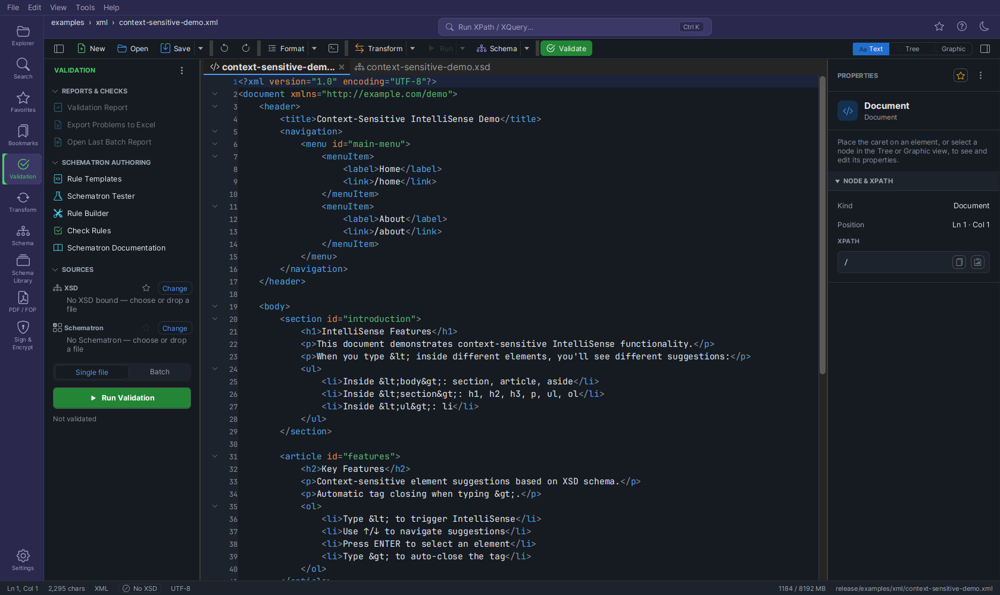
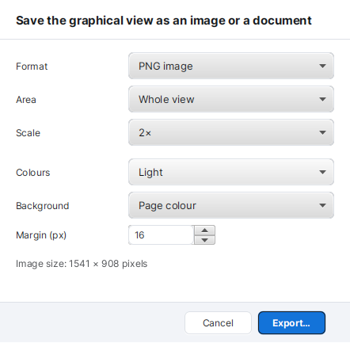
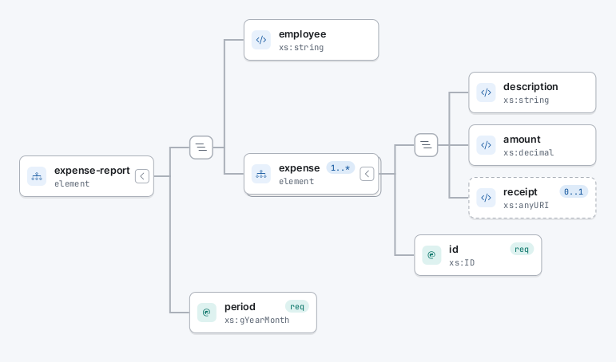
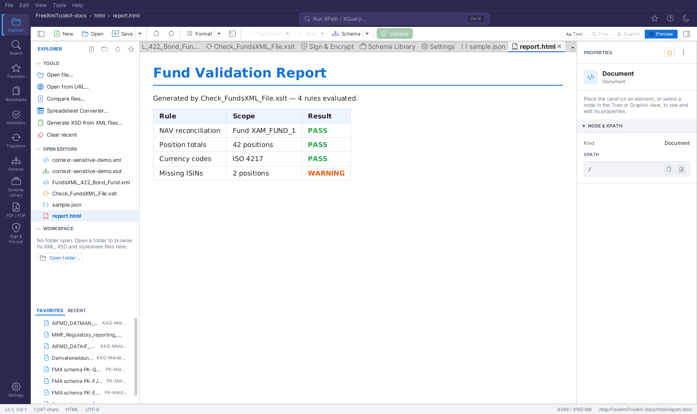
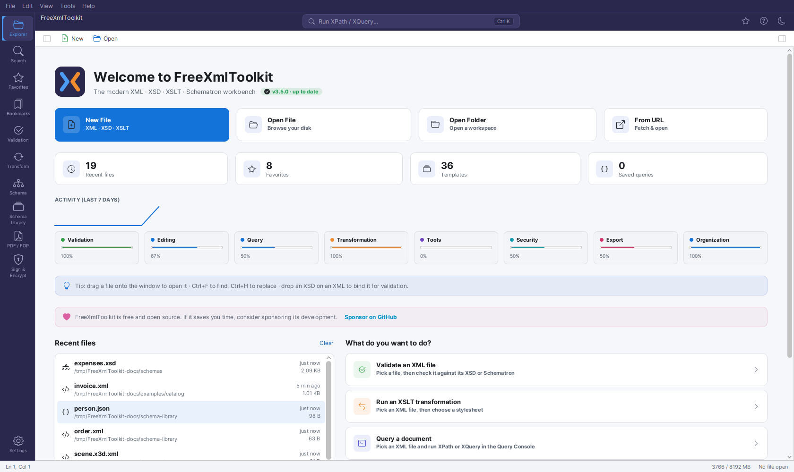
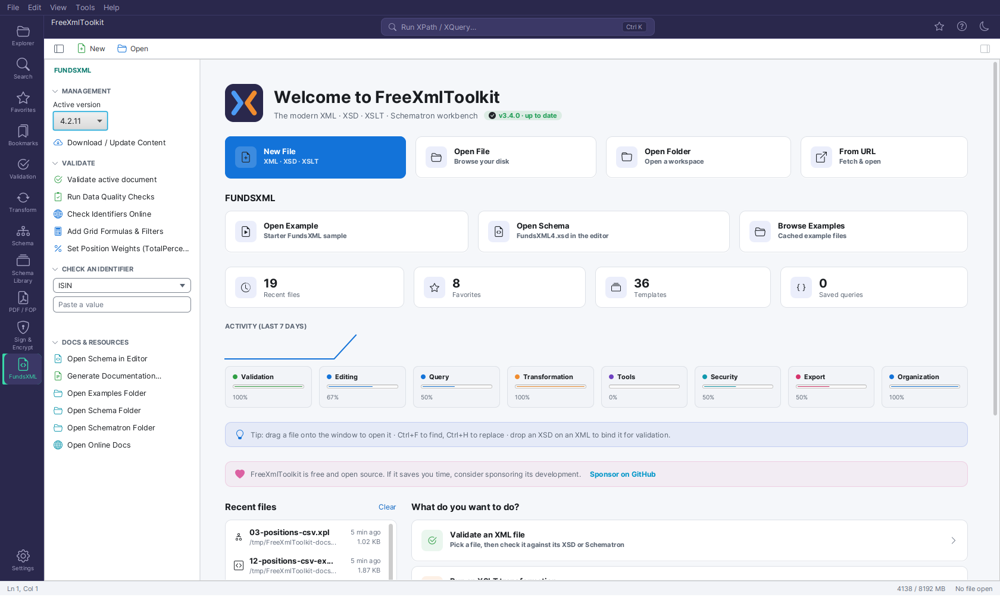

# Tour of the workspace

FreeXmlToolkit is one window: you open files as tabs in the middle, pick a tool from the
activity bar on the left, and inspect or edit the selected node on the right. This page walks
through that layout, the view modes and the editor tabs.

## Overview

The Unified Shell is the single workspace for everything FreeXmlToolkit does. Instead of
switching between separate editor pages, you open files as tabs in the central **editor
host** and reach every tool through the **activity bar** on the left. You can work with an
XML file next to its XSD schema, XSLT stylesheets and Schematron rules at the same time.

*The Unified Shell: activity bar (left), Explorer side panel, editor host with an XML file
(Text/Tree/Graphic view toggle), the Properties inspector (right) and the status bar.*

### Layout

| Area | Purpose |
|------|---------|
| **Activity bar** (far left) | Switch tools / side panels: Explorer, Search, Favorites, Validation, Transform, Schema, Schema Library (its label wraps onto two lines), PDF/FOP, Sign & Encrypt, Settings - plus a **FundsXML** activity when the optional [FundsXML extension](../industry/fundsxml.md) is enabled (see [FundsXML Panel](../industry/fundsxml.md)). **Always visible** - it cannot be collapsed. (**Settings**, **Schema Library** and **Sign & Encrypt** open as a full page in the editor area - see [Settings Page](../reference/settings.md#settings-page), [Schema Library Page](../guides/design-schemas/schema-library.md#schema-library-page) and [Sign & Encrypt Page](../guides/sign-encrypt/index.md). Help is not an activity - it is the **Help** menu, see [Help Menu & About](../reference/workspace.md#help-menu-about).) |
| **Menu bar** (very top) | **File / Edit / View / Tools / Help** - every action of the toolbar, the Activity Bar and the keyboard shortcuts in one place (see [Menu Bar](../reference/workspace.md#menu-bar)). On macOS it is the system menu bar at the top of the screen. |
| **Header bar** (top) | The breadcrumb (application / active file), a centered **search pill** (*"Run XPath / XQuery…"*, shortcut **Ctrl+K**) that opens the bottom [Query Console](../guides/transform-query/query-console.md#query-console) when clicked, the **star** button ([Favorites quick access](../reference/workspace.md#favorites-quick-access) - every favorite, from any activity or page), the **?** button (opens the [Help menu](../reference/workspace.md#help-menu-about) as a popup - same as **F1**) and the Theme button. |
| **Side panel** | The panel for the selected activity (e.g. the Transform panel, the Validation panel). **Resizable and collapsible** (see [Resizing and collapsing the side panels](#collapsing-the-side-panels)). |
| **Editor host** (center) | Tabs of open documents, each with the Text, Tree and Graphic view modes - plus a rendered **Preview** for HTML documents (see [View Modes](#view-modes)). |
| **Inspector** (right) | View **and edit** the selected node's properties from any view. **Resizable and collapsible** (see [Resizing and collapsing the side panels](#collapsing-the-side-panels)). Hidden automatically while a page without a document (Settings, Schema Library, Signature, reports, tool tabs) is selected. |
| **Status bar** (bottom) | Caret position (Ln/Col), character count, file type, the XSD / IntelliSense indicator, the encoding label (the charset the file was read in and is saved in, e.g. UTF-8 or ISO-8859-1), the last recorded run (Developer feature), a memory indicator and the active file's path (see [Status Bar](../reference/workspace.md#status-bar)). |

#### Resizing and collapsing the side panels {#collapsing-the-side-panels}

Both the **left side panel** and the **right Properties inspector** can be resized and
collapsed to give the editor more room - the activity bar always stays visible.

**Resizing** - the panels are not fixed-width:

- **Drag the thin divider line** between a panel and the editor to make the panel wider or
  narrower (the mouse pointer turns into a horizontal resize arrow over the divider). Widen
  the panel when file names, validation messages, or property values get truncated.
- Each panel keeps a **minimum width of 200 px**, and the editor in the middle always keeps
  at least **320 px** - you cannot drag a panel so far that the editor disappears.
- The chosen widths are **remembered across restarts** (per user).
- When you **resize the window**, the panels keep their pixel width - only the editor column
  grows or shrinks (the same behavior as VS Code).

**Collapsing** - each panel can also be hidden completely:

- **Collapse / re-open**: click the matching toggle button in the editor toolbar (left-most
  toggle, a sidebar icon, for the side panel; right-most toggle, a mirrored sidebar icon, for
  the inspector) - the same mechanism on both sides. Selecting any
  activity from the activity bar also re-opens the left side panel. A re-opened panel comes
  back at its **last dragged width**. The toolbar toggles (or **Ctrl+L** / **Ctrl+Shift+P**)
  are the only way to collapse a panel - there is no collapse button on the panels themselves.
- **Collapsing one panel leaves the other alone**: hiding the side panel does not resize the
  Properties inspector (and the other way round) - only the editor gets the freed space.
- The collapsed/expanded state is **remembered across restarts** and can also be changed under
  **Settings → Appearance → LAYOUT** ("Show left side panel" / "Show Properties (inspector) panel").
- **The inspector only appears next to documents.** When you switch to a tab that is not a
  document - **Settings**, **Schema Library**, **Sign & Encrypt**, a report or another tool tab - the
  inspector hides automatically, so the page gets the full width. Its toggle button is greyed out
  on such tabs. As soon as you select a document tab again, the inspector comes back. Your own
  show/hide choice is not changed by this - if you had hidden the inspector, it stays hidden.

### Key Features

- **Multi-tab editing** - Open multiple files of different types in one view
- **Automatic file type detection** - Files are recognized by extension (.xml/.wsdl, .xsd, .xsl/.xslt, .xpl/.xproc, .xq/.xquery/.xqm/.xqy, .xpath, .sch/.schematron, .json/.jsonc/.json5, .html/.htm/.xhtml). A file with any other extension (or none) is recognized by its **content**: one that starts with an XML declaration, a start tag, a comment or a DOCTYPE opens as **XML** (for example `web.config`, `.xaml`, `.gpx`, `.svg`), an HTML page as **HTML** and a JSON object as **JSON** (`.geojson`, `.har`, …) - with grid, validation and every other feature of that type. Anything else opens as plain text
- **View modes per document** - Text, Tree and Graphic, all over one shared model, plus a rendered **Preview** for HTML documents (see [View Modes](#view-modes))
- **Inspector editing everywhere** - edit node properties from the Text, Tree and Graphic views, not just one
- **Type picker with explanations** - the inspector's **Type** field and *Change Type…* in the
  diagram and tree context menus list the schema's own types and every XSD built-in datatype,
  and a side pane explains the highlighted one (see [Choosing a type](../reference/inspector.md#type-picker))
- **Integrated XPath/XQuery** - a bottom [Query Console](../guides/transform-query/query-console.md#query-console) queries the active
  XML/JSON file right from the editor (Ctrl+Shift+X)
- **Editor toolbar actions** - run [Validate, Transform, Run, Generate Documentation and the Type
  Editor](../reference/workspace.md#editor-toolbar-document-actions) for the active document without switching activities
- **Search & Replace** - Ctrl+F / Ctrl+H across the editor, in **every view mode**: the Text
  view searches the raw text, the Tree and Graphic views search the nodes themselves (names,
  documentation, attributes, enumeration and facet values, comments)
- **Find in Files & XPath search** - the **Search** activity
  (Ctrl+Shift+F) searches and replaces across **all files of a folder**, by plain text or
  by XPath expression (see [Search Panel](../guides/edit-xml/search-in-files.md))
- **Resizable side panels** - drag the divider lines to give the side
  panel or the Properties inspector more room; the widths are remembered across restarts
  (see [Resizing and collapsing the side panels](#collapsing-the-side-panels))
- **Favorites** - Quick access to frequently used files
- **Optional AI assistant** - explain or fix validation problems, ask for an XPath/XQuery query or generate a
  stylesheet, each answer checked by the application before you see it (off by default; see
  [AI Assistant](../guides/ai-assistant.md)); AI agents use the application's tools through the [MCP Server](../automate/mcp-server.md)

### Colours: workflows and actions

Colour tells you two things at a glance, and the two never mix on one surface:

- **Which workflow you are in.** Every activity has its own accent colour: Explorer brand
  blue, Search indigo, Favorites amber, Validation green, Transform orange, Schema purple,
  Schema Library grape, PDF / FOP rose, Signature cyan, FundsXML teal. The colour appears only on the
  chrome that names the workflow: the bar next to the selected Activity-Bar icon, the panel
  title (VALIDATION, TRANSFORM, …), the panel's one primary button (Run Validation, Run
  Transform, Generate PDF, Validate Signature), the tint of the matching toolbar group, the
  icons of the Welcome page's task list and the "last run" badge in the status bar. Settings stays
  neutral, so the default view of the app looks as before.
- **What an action does.** Menu items and the action rows of the side panels colour their icon
  by the kind of action, in every editor and every view: green adds or creates (Add, Paste,
  Duplicate, Validate, Generate), red removes (Delete, Remove, Clear, Cut), orange edits in
  place (Rename, Edit value), cyan navigates to something that already exists (Go to
  Definition, Reveal, Find, opening a favorite or a generated PDF), purple changes structure
  (Change Type, Cardinality, Move Up/Down), blue runs a tool (Format, Sort, Save, Export,
  Download, "Open file…" with a file chooser) and grey is neutral (Copy, Expand/Collapse,
  Undo/Redo).

Result colours always win: a failed run shows a red icon on an orange Transform badge, a
passed validation a green check. Both layers switch with the light/dark theme:

## Getting Started

1. The Unified Shell opens automatically on startup.
2. Use the **Explorer** activity (or **File → Open**) to open files; **File → New** (Ctrl+N) opens the guided [New File dialog](../guides/edit-xml/working-with-files.md#new-file-dialog) to create a new file from a template or schema. You can also **drag & drop** files from your file manager anywhere onto the window - every [supported file type](../guides/edit-xml/working-with-files.md#supported-file-types) (XML, XSD, XSLT, XProc, XQuery, XPath, Schematron, JSON, HTML) opens as a new tab; other files are ignored.
3. Files open as tabs in the editor host - switch tabs by clicking their headers (drag a header to reorder, right-click it for [tab actions](#editor-tabs)), and switch view modes (Text / Tree / Graphic - plus **Preview** for HTML files) with the segmented view switch.

After the first start, a small **Anonymous usage statistics** notice appears once in the
bottom-right corner of the window. It explains that FreeXmlToolkit sends anonymous usage
statistics and error reports (never file names, paths or content). Click **OK** to continue,
**Settings…** to switch it off, or **What is sent?** to see the exact data. Nothing is sent
before you have acknowledged this notice. See [Privacy & Anonymous Telemetry](../administer/privacy-telemetry.md).

## View Modes

> The segmented view switch offers the **Text**, **Tree**, and **Graphic** view
> modes - each with its own icon - plus, for **HTML documents only**, a rendered read-only
> **Preview** (eye icon) - the Preview segment only appears while an HTML document is
> active - and, for **XSD documents only**, the **Overview** (table icon). There is no separate **Grid** mode - the grid is part of
> **Graphic**.

Every document tab offers the same view modes:

| Mode | What it shows |
|------|---------------|
| **Text** | Source code editing with syntax highlighting |
| **Tree** | The document as a hierarchical tree; while you scroll, a bar at the top shows the parents of the topmost row - click one to go back to it. In XML documents an element's attributes are rows of their own (`name = "value"`) before its children. In XML, JSON and XSD documents **Delete** removes the selected node completely (element, property, array item or schema component - no empty element stays in its place; on an attribute row only that attribute) and selects the next one, so Delete can be pressed again; one **Undo** restores it |
| **Graphic** | A visual editor that depends on the document type: for **XML**, **XSLT**, **Schematron** and **JSON** files it shows the editable **grid**; for **XSD** files it shows the **schema diagram** |
| **Overview** | *(XSD documents only.)* All top-level components of the schema in one table - reorder, sort, add, rename, edit attributes, identity constraints, assertions and namespaces - see [XSD Tools](../guides/design-schemas/overview-view.md) |
| **Preview** | *(HTML documents only.)* The page rendered read-only in an embedded web view - see [HTML Preview](#html-preview) |

All views share one in-memory model per document, so edits and Undo/Redo history are preserved
when you switch views.

**Switching views keeps your place.** The new view continues at the node you were working on:

- From **Text** to **Tree**, **Graphic** or **Overview**, the node at the caret is selected. The tree, grid or
  schema diagram opens down to it and scrolls it into view (the grid briefly flashes its row or table cell).
- From **Tree**, **Graphic** or **Overview** back to **Text**, the caret goes to the node that was active there.
  All the node's lines are tinted, from its start tag to its end tag (for JSON, its whole member or item). The
  tint goes away when you edit the text or move the caret off the node.
- Between **Tree** and **Graphic**, the same node stays selected.

This works for XML, XSLT, Schematron, XSD and JSON documents.

### The Grid (Graphic view for XML)

The Graphic view of XML and JSON documents is an editable grid with tables for repeating elements, opened cells, entry helpers, filters and formulas - see **[Grid View](../guides/edit-xml/grid.md)**.

### Exporting a Graphical View {#export-view}

The XSD diagram, the XML and JSON grid and the profiler's flame graph can be saved as a file or
copied as an image:

- **File → Export View…** (also **Export View…** in the context menu of the diagram's empty
  canvas, of the grid and of the flame graph) asks for the format and options, then for the file.
- **Edit → Copy View as Image** (also in those context menus) puts the view on the clipboard as an
  image, ready to paste into Word, a wiki page, a ticket or a chat.

Both items are only available while a graphical view is shown (the **Graphic** view of a
document, or a Profile tab).

*The Export View dialog: format, area, scale, colours, background and margin, with the resulting image size*

*The result: the diagram as it is expanded on screen, without selection or hover marks*

| Format | Best for |
|--------|----------|
| **PNG image** | Wikis, tickets, e-mail, Office documents. Scale 1× to 4×; the file carries its resolution, so it prints at the size of the diagram on screen. |
| **SVG vector graphic** | Web pages, documentation, Inkscape and current Office versions. Scales without loss; the texts stay text. |
| **PDF document** | Printing and archiving. Vector graphics with selectable text and the fonts embedded; one page the size of the drawing, or A4 / A3 / US Letter (turned to landscape for wide drawings, shrunk to fit). |

Options:

- **Area:** the whole view (also the parts scrolled out of sight) or only the visible part.
- **Colours:** *Light* (the default, best for paper), *Dark* or *As shown*.
- **Background:** the page colour of the view, white or transparent.
- **Margin** around the drawing in pixels.
- **Embed fonts** (SVG only): adds the fonts to the file, so the texts look the same on machines
  without them. The file gets larger.

The dialog shows the size of the result. The diagram is exported as it is expanded on screen, but
without selection, hover and drag marks. A PNG larger than about 150 megapixels is refused; choose
a smaller scale, the visible area, or SVG / PDF instead. The last options and folder are
remembered.

### HTML Preview (Preview view for HTML) {#html-preview}

HTML documents (`.html`, `.htm`, `.xhtml`) get their own **Preview** view mode - the eye
icon in the segmented view switch - that renders the page read-only, the way a browser
would show it:

- **HTML files open in Preview by default.** Whether you open them from the Explorer, by
  drag & drop, or via the Open dialog, you see the rendered page first.
- **Editing happens in the Text view.** Switch to **Text** to change the markup, then
  switch back to **Preview** - it re-renders your current editor text, including unsaved
  changes.
- **Tree and Graphic are disabled for HTML documents**, because HTML output is often not
  well-formed XML.
- **Transform results render here too.** The OUTPUT panel's **Open result as editor tab**
  opens an HTML/XHTML transform result as an HTML document showing its Preview, and
  re-running the transform updates the open result tab live - see
  [The OUTPUT Panel](../guides/transform-query/index.md#the-output-panel-results).

!!! note "Preview limitations"
    - The page is rendered **without a base URL**, so **relative references** - external
      CSS files, images - do not resolve. **Inline styles render fine.** To view a
      transform result together with its external assets, use the OUTPUT panel's
      **Open in browser** action instead.
    - **Ctrl+F** in the Preview searches the document's underlying **markup text**, not
      the rendered page.
    - The Preview is **read-only** - all editing happens in the Text view.

## Working with Editor Tabs {#editor-tabs}

- **Reorder tabs** by dragging a tab header left or right. The Explorer's
  [OPEN EDITORS](../reference/workspace.md#explorer-panel) list follows the new order.
- **Right-click a tab** for a menu that acts on *that* tab, even if it is not the active one:

| Menu item | What it does |
|-----------|--------------|
| **Reload from Disk** | Reads the file again. If the document has unsaved changes, you are asked first. Not available for untitled documents. |
| **Close** | Closes the tab (asks to save unsaved changes). |
| **Close Others** | Closes every other tab. Each tab with unsaved changes still asks to save; **Cancel** stops closing the rest. |
| **Save** / **Save As…** | Saves the document. For an untitled document, **Save** works like **Save As…**. |
| **Copy Path** | Copies the file's full path to the clipboard. |
| **Reveal in File Manager** | Shows the file in Windows Explorer, the macOS Finder or your Linux file manager, with the file selected (if the file manager cannot select it, its folder opens). |
| **Reveal in Explorer Panel** | Opens the [Explorer](../reference/workspace.md#explorer-panel) and selects the file in the workspace tree. If the file lies outside the current workspace, its folder becomes the workspace. |

Copy Path and the two Reveal items need a saved file, so they are disabled for untitled
documents. Tabs that show no document - tool tabs such as the Type Editor, a diff or a PDF
preview - only offer **Close** and **Close Others**.

## Panel Toggles

- **Side panel** (Ctrl+L) - Show/hide the left side panel (the active activity's Explorer,
  Validation, Transform, Schema, … panel). The editor toolbar's toggle buttons are the only
  way to collapse the side panel and the Properties panel - the panels have no collapse button
  of their own
- **Query Console** (Ctrl+Shift+X) - Show/hide the bottom XPath/XQuery query console (terminal
  icon in the editor toolbar). See [Query Console](../guides/transform-query/query-console.md#query-console) below.
- **Properties** (Ctrl+Shift+P) - Show/hide properties and validation sidebar. For XML files,
  the properties inspector lets you view **and edit** a node's properties (element name,
  namespace, attributes, and text content) from **all three** views - Text, Tree, and Graphic
  (the grid). For XSD files, the same inspector lets you edit a schema node's
  properties from **all three** XSD views - Text, Tree, and Graphic. See
  [Properties Inspector](../reference/inspector.md#properties-inspector) below.
- **Favorites** (Ctrl+Shift+D) - Show/hide the favorites panel (Ctrl+D adds the active document to favorites)

## Drag and Drop

Drag files from your file manager directly into the editor to open them. Multiple files can be dropped at once.

The file **pickers and source rows** across the shell are **drop
targets too**:

- Drop an `.xsl` / `.xslt` file onto the Transform panel's **[STYLESHEET](../guides/transform-query/index.md#stylesheet)** row
  to make it the current stylesheet.
- Drop an `.xml` file onto the Transform panel's **[INPUT](../guides/transform-query/index.md#input)** row to make it the
  transform's input file. On both Transform panel rows a drop behaves like picking a
  favorite: the file is loaded into the editor and the transform **runs automatically** once
  both a stylesheet and an input are ready (while **Run automatically** is checked).
- Drop a `.sch` / `.schematron` file onto the Validation panel's
  **[SCHEMATRON source row](../guides/validate/index.md#sources)** to make it the current
  Schematron (and bind it to the active document). Like every schema, stylesheet or input
  dropped on a panel row, it is also loaded into the editor - schemas behind the document
  they are bound to, inputs as the active tab.
- Drop an `.xsd` file onto the Validation panel's **[XSD source row](../guides/validate/index.md#sources)** or onto
  the **[schema indicator in the status bar](../reference/workspace.md#status-bar)** (shown for XML-family documents)
  to bind that schema to the active document.
- Drop a `.json` schema onto the Validation panel's **[JSON Schema source row](../guides/validate/index.md#sources)**
  or onto the **[schema indicator in the status bar](../reference/workspace.md#status-bar)** (while a JSON document
  is active) to bind it for JSON validation.
- Drop an `.xml` file onto the **[PDF / FOP panel](../guides/publish-pdf.md#the-pdf-fop-panel)**'s XML input row, or
  an `.xsl` / `.xslt` file onto its XSL-FO stylesheet row, to set the PDF rendering
  sources.
- Drop a keystore file (`.jks`, `.keystore`, `.p12`, `.pfx`) onto the
  **[Signature page](../guides/sign-encrypt/index.md)**'s KEYSTORE row or Expert Mode's trust store row.
- Drop an `.xsd` file anywhere on the **[Schema panel](../guides/design-schemas/schema-panel.md#the-schema-panel)** (Type
  Library) to **open it as a document** - unlike the targets above, this drop *opens* the
  file instead of binding or selecting it; the panel shows a **dashed** green/red border
  while you drag.

While you drag, the target shows **green** feedback when the file can be loaded there and
**red** feedback when the extension does not match - a red drop is rejected and does
**not** open the file in the editor. On the picker and source-row targets, a valid drop
behaves exactly like choosing the file via **Change** or a favorite: it is recorded in
the recent list (where the target has one) and shared between the Explorer bars and the
panels. The feedback colors follow the light and dark theme.

## Welcome / Dashboard

> The welcome screen starts from **tasks**, not tools: a short list titled
> *"What do you want to do?"* takes you straight to the right panel. On a first start it stays
> uncluttered and offers a ready-made example to try.

When no document is open, the editor shows a welcome dashboard with:

- **Quick cards** - **New File**, **Open File**, **Open Folder** and **From URL**. While you
  have no recent files yet, a fifth card **Open an Example** is shown (see
  [Trying the bundled example](#trying-the-bundled-example) below).
- **Stat cards** - At-a-glance counts of your **Recent files**, **Favorites**, **Templates**,
  and **Saved queries**. They appear only once at least one of them is above zero, so a
  fresh installation does not show a row of zeros.
- **Activity trend** - The **ACTIVITY (LAST 7 DAYS)** chart appears only once you have used
  the application in the last seven days.
- **Tips banner** - A short hint banner with handy shortcuts (for example, drag a file onto the
  window to open it, or use Ctrl+F / Ctrl+H to find and replace).
- **Recent files** list - Each entry shows the file name, its folder, when it was last changed
  and its size (e.g. `177.00 MB`). Click an entry to reopen it. While the list is still empty it
  shows a hint: files you open or create appear here - start with **Open File** or
  **New File** above.
- **What do you want to do?** - A task list with six rows:

    | Task | What happens |
    |------|--------------|
    | **Validate an XML file** | Asks for a file, opens it, shows the [Validation panel](../guides/validate/index.md#validation-panel) and validates it as soon as it is loaded |
    | **Run an XSLT transformation** | Asks for an XML file, opens it and shows the [Transform panel](../guides/transform-query/index.md#transform-panel), where you choose the stylesheet |
    | **Query a document** | Asks for an XML file, opens it and opens the [Query Console](../guides/transform-query/query-console.md#query-console) for XPath / XQuery |
    | **Edit a schema** | Asks for an XSD file, opens it and shows the Schema panel |
    | **Create a PDF** | Asks for an XML file, opens it and shows the **PDF / FOP** panel, where you pick the XSL-FO stylesheet |
    | **Sign or verify a document** | Opens the **Signature** page directly (no file needed first) |

    If you cancel the file chooser, nothing happens. The other activities (Explorer, Search,
    Favorites, Settings, …) are always one click away in the Activity Bar.

- **FUNDSXML quick access** - When the optional
  [FundsXML extension](../industry/fundsxml.md) is enabled and its content is cached, an
  extra row with three cards appears: **Open Example** (opens a compact starter sample),
  **Open Schema** (opens `FundsXML4.xsd` in the editor) and **Browse Examples** (opens the
  cached examples folder). The row shows up live as soon as the automatic background
  download finishes.

### Trying the bundled example {#trying-the-bundled-example}

**Open an Example** gives you something to experiment with right away. It copies a small
example set into `~/.freeXmlToolkit/examples/getting-started/` in your home folder and opens
`order.xml`:

- `order.xml` - an order document that already points to its schema, so it is
  **validated against `order.xsd` immediately** - no need to bind a schema yourself.
- `order.xsd` - the schema for the order.
- `order-summary.xslt` - a stylesheet that turns the order into an HTML summary.

If the files already exist there (for example because you edited them), they are kept and
not overwritten. A comment at the top of `order.xml` suggests what to try next:

1. Press **F8** to validate the document.
2. Switch between the **Tree** and **Graphic** views.
3. Choose **Tools → Transform with XSLT…** and pick `order-summary.xslt`.
4. Open the **Query Console** (Ctrl+Shift+X) and run `sum(//item/(@quantity * @price))` to
   get the order total.

## Next steps

- [Working with files](../guides/edit-xml/working-with-files.md) - new files, supported types, files changed on disk
- [Workspace reference](../reference/workspace.md) - every menu, toolbar button, panel and status bar field
- [Keyboard shortcuts](../reference/keyboard-shortcuts.md)
- [Guides](../guides/index.md) - editing, validating, transforming, comparing
