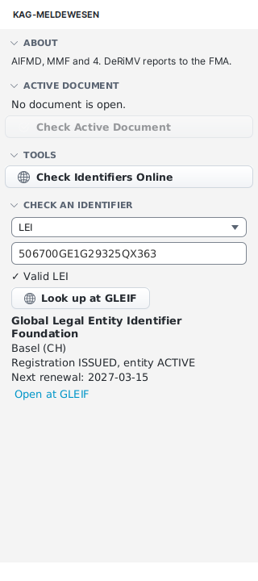
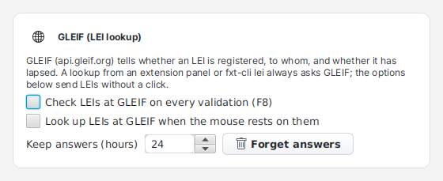

# LEI Lookup at GLEIF

The check digits of an LEI only say that it is well-formed. Whether it is registered, to whom it belongs and
whether its registration is still valid is known to the [Global Legal Entity Identifier Foundation](https://www.gleif.org)
(GLEIF). FreeXmlToolkit asks GLEIF's public API (`api.gleif.org`, no account or key needed) in four places:
the identifier checker of the industry extensions, a check of every LEI of a document, a hover in the editor and the
command line.

!!! note "LEIs leave your computer"
    A lookup sends the LEIs to GLEIF (and nothing else from the document). It happens when you click, or - only if
    you turn it on - with every validation and when the mouse rests on an LEI. Administrators can switch all of it off
    with `gleif.allowed=false` ([Administration](administration.md)).

## Look up one LEI



In the side panel of an extension that checks LEIs (KAG-Meldewesen, ESMA Reporting, FinDatEx, ISO 20022), choose
**LEI** under **CHECK AN IDENTIFIER** and paste the LEI. When its check digits are right, **Look up at GLEIF** shows:

- the legal name and the city and country of the legal address;
- the registration status (`ISSUED`, `LAPSED`, `RETIRED`, `ANNULLED`, `PENDING_TRANSFER` …) and the entity status
  (`ACTIVE` / `INACTIVE`);
- the next renewal date;
- **Open at GLEIF** - the LEI's page in GLEIF's search.

## Check every LEI of a document

**Check LEIs at GLEIF** - in the TOOLS section of those panels, in the VALIDATE section of the FundsXML panel and the
CHECK section of the PK-Meldewesen panel, and in **Tools → Check LEIs at GLEIF** for any document - finds every LEI in the text (XML, CSV, JSON …: 20 characters with valid check digits), asks GLEIF about all
of them at once (200 per request) and puts a finding for each occurrence into the **Problems** panel, at its line:

| GLEIF says | Finding |
|---|---|
| Not registered | Error |
| `RETIRED`, `ANNULLED`, `DUPLICATE`, `MERGED`, `TRANSFERRED` | Error - the LEI must not be used any more |
| `LAPSED` (registration not renewed) | Warning |
| Entity `INACTIVE` | Warning |
| `PENDING_…` | Warning (*info* on the command line) |

The findings have the source **GLEIF** and replace the GLEIF findings of an earlier check; schema and rule findings
stay. Answers are kept for 24 hours (see below), so a second check asks GLEIF only about new LEIs.

## With every validation

**Settings → Network & Security → GLEIF (LEI lookup) → Check LEIs at GLEIF on every validation (F8)** adds the same
check to every validation of an XML document (F8, Validation panel, the extensions' **Check Active Document**). Off by
default. When GLEIF cannot be reached, the validation shows one warning and goes on.

## Hover

When the mouse rests on an LEI in the text editor, a tooltip shows what GLEIF said about it - from the answers already
known. **Look up LEIs at GLEIF when the mouse rests on them** (off by default) also asks GLEIF about LEIs it does not
know yet.

## Settings



| Setting | Key | Default |
|---|---|---|
| Check LEIs at GLEIF on every validation (F8) | `gleif.onValidation` | off |
| Look up LEIs at GLEIF when the mouse rests on them | `gleif.hover` | off |
| Keep answers (hours) | `gleif.cacheHours` | 24 |

**Forget answers** empties the cache (`~/.freeXmlToolkit/gleif/cache.json`). Requests go through the proxy of
*Settings → HTTP Proxy*. GLEIF allows 60 requests a minute; the application sends at most one a second.

## Command line

```bash
fxt-cli lei 506700GE1G29325QX363              # one or more LEIs
fxt-cli lei --file report.xml -f json          # every LEI of a file, as JSON
fxt-cli validate reports/ --gleif              # validation plus the GLEIF check
```

`fxt-cli lei` exits with `1` when an LEI is invalid, unknown, lapsed, retired or annulled or its entity inactive, and
with `3` when GLEIF cannot be reached. `validate --gleif` adds the findings to the report (source `GLEIF`, rule
`GLEIF-LEI`); an unreachable GLEIF is an *info* there. The command line ignores the GUI setting "on every
validation" - only `--gleif` turns the check on. See [Command Line](command-line.md#lei).
