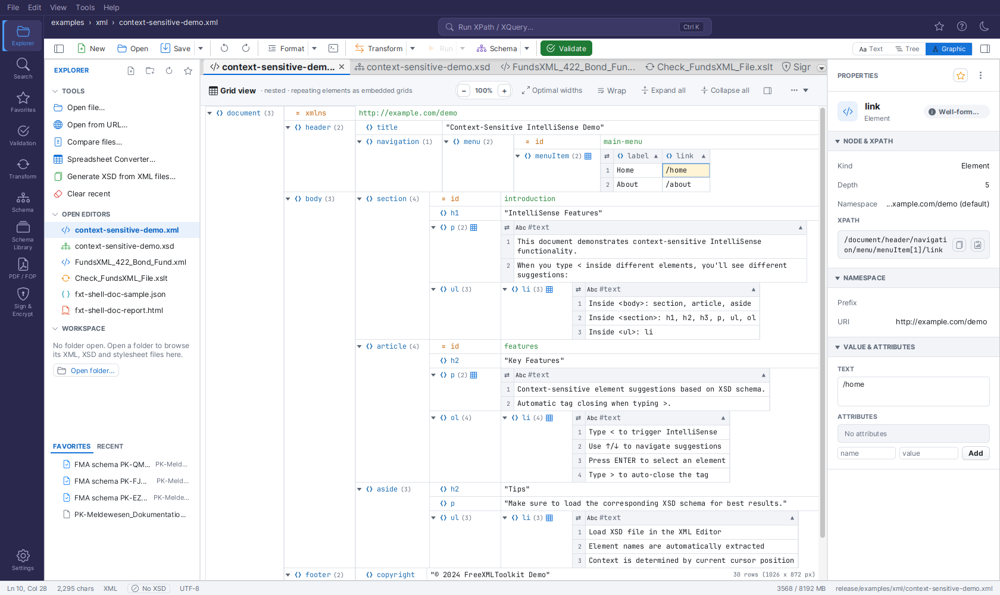
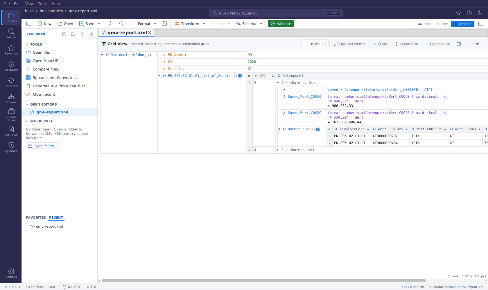
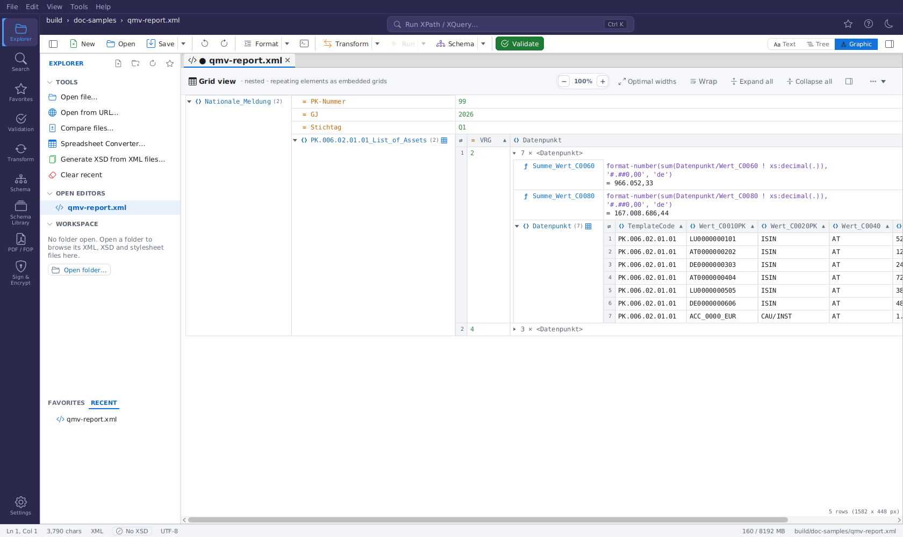
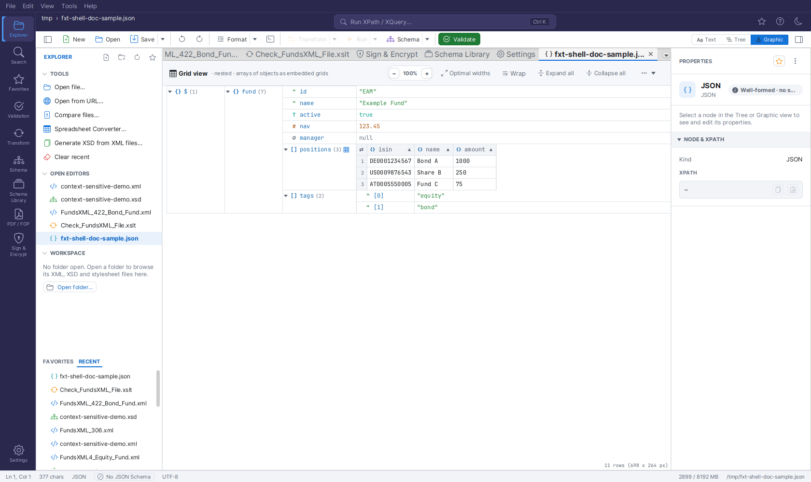

# Grid View

The **Graphic** view of an XML or JSON document is an editable grid: nested blocks for containers, repeating elements as tables, inline editing, drag & drop and search. Switch to it with the **Graphic** button of the view switch in the editor toolbar.

## The Grid (Graphic view for XML)

When an XML-instance document (XML, XSLT, or Schematron) is in the **Graphic** view, the editor
shows the editable grid, laid out as follows:

- A **header strip** at the top reads *"Grid view · nested · repeating elements as embedded
  grids"* and offers the **zoom pill** (`− 100% +`), **Optimal widths**, the **Wrap** toggle,
  **Expand all** / **Collapse all**, and a **⋯** menu with the cell-height limit. In a narrow
  editor column the strip first drops its subtitle and shows the tool buttons as icons only
  (hover for their names); narrower still, only the title icon, the zoom pill and **⋯** remain,
  and **Optimal widths**, **Wrap**, **Expand all** / **Collapse all** and the entry helpers toggle
  become entries of the **⋯** menu, so every action stays reachable.
- **Nested containers.** Every element is a row with a **name cell** (expand arrow, type icon,
  bold name) and, to its right, either its **value cell** or the **block** of its children. A
  child block is docked at the parent's value column, so the structure reads as nested boxes;
  an expanded container's name cell spans its whole child block. Each block has its own
  name-column width (the widest name in it).
- **Type icons**: `<>` element, `=` attribute, `Abc` text, `[ ]` CDATA, `<!`
  comment, `<?` processing instruction. Colours come from the application theme (light/dark).
- **Attributes always show** as `=` rows directly beneath their element - also while the
  element itself is collapsed.
- **Collapsed containers show a grey one-line preview** of their content (the markup without
  whitespace, cut off with "…"); hovering the preview shows a longer excerpt as a tooltip.
- **Counts.** A container's name is followed by its child count `(n)`; a repeating group shows
  the number of its members and a small table glyph.
- **Nothing is cut off.** Values take the width their content needs; long values **wrap** onto
  further lines (the row grows). Very wide content is reached with the horizontal scrollbar
  (Shift+wheel).
- **Zoom** the whole grid - text, rows, icons and embedded tables - with **Ctrl+mouse wheel**,
  **Ctrl +** / **Ctrl −** (10 % steps, 50-300 %) or the `−`/`+` buttons; **Ctrl 0** or a
  click on the percentage resets to 100 %. The zoom factor is remembered across files, XML
  and JSON grids and restarts.
- **Repeating elements** (two or more siblings with the same name) are rendered as an
  **embedded table beside the group's name cell**: one row per element (numbered in the
  first column), one column per attribute (`=`) and child element (`<>`). Click the small
  **arrow at the right of a column header** to **sort** the group (also: **Sort Column** in the
  context menu); numbers, dates and text are recognised, and one **Undo** restores the order. A
  table of 20,000 rows or more is sorted in the background: the grid stays usable (wait cursor),
  and an edit made meanwhile makes the sort start again from the new state. Cells with nested
  structure expand inline. **Right-click a cell** that is an
  element of its own (e.g. `Identifiers` of an `Asset` row): the node actions of the context menu
  (Add Child Element / Attribute, Rename, Copy, Delete, Move, …) act on that element; whole-row
  actions are in the **Table** submenu (**Insert Row Before/After**, **Append Row**, **Delete Row**).
- **Every node looks like a root node, at any depth.** An opened table cell shows its content as
  a grid of its own: expandable rows, blocks and - for repeating children - a **table again**
  (or numbered rows `<1>`, `<2>`, … after a click on the table glyph), whose cells open the same
  way, however deep tables and rows are nested. A column with several children of one name
  (e.g. four `Position`s of a `Waehrung`) is one cell (`4 × <Position>`) holding them all.
  Rows inside cells are selected, edited (double-click), expanded and navigated with the arrow
  keys like any other row (**Left** at the top of a cell's grid returns to the cell); tables
  inside cells sort, flip and edit like the outer ones. Hover, the name-column separators of
  blocks, column handles and column drags of tables, **Optimal widths** and **drag & drop of rows**
  (with auto-scroll at the top and bottom edge) work at every depth too. Open cells, expanded
  rows, dragged widths and table/flip choices at every depth survive edits.
- **Open whole rows and columns.** Click a **row number** to select the whole row, click a
  **column header** (its name, not the arrow) to select the whole column; **Shift+click**
  extends to more rows or columns. Then press **+** to open the nested cells of the selection
  one level, and again for the next level inside them; **−** closes the deepest open level
  first, then the cells. The same entries are in the **Table** submenu (**Expand / Collapse
  Selected Cells**). Without a table selection, **+** / **−** open and close the selected
  grid rows one level. Open cells stay open after edits.
- **Table or rows.** The small table glyph after the group's name (or the context menu's
  **Display as Table**) switches the group between the table and the standard display,
  where every member is its own row numbered `<1>`, `<2>`, … The choice is kept per group
  while the document is open.
- **Flip Rows/Columns.** The corner cell of a table (or the context menu entry) transposes
  it: the columns become rows and the numbered members become columns - handy for wide
  tables with few rows. Sorting, editing and the inline sub-trees keep working.
- **Whole rows and columns.** Right-click inside a table for the **Table** submenu: **Insert
  Row Before / After** and **Append Row** add a member with every column present but empty;
  **Insert Column Before / After…** adds an attribute (type `@name`) or a child element
  (`name`) to every member; **Rename Column…** (also: double-click a column header) renames
  it in every member. Each of these is one undo step. Typing into an empty cell whose
  member lacks that child element creates the element. **Drag a column header** onto another
  header to move that column - a blue line shows where it lands; the child element (or
  attribute) moves in every member, one undo step. Attributes move only among attributes.
- **Cell colours.** **Settings → Editor → GRID TABLE COLOURS** sets your own colours for table
  headers, missing cells, the selection and the focus frame - separately for the light and the
  dark theme (switch the theme to set the other one). Open grids repaint at once; switching the
  option off returns to the theme colours.
- **Spreadsheet exchange.** Click a table cell to select it, **Shift+click** another cell
  (or a row number) to select a range, **Ctrl+A** selects the whole table. **Ctrl+C** copies
  the selection as tab-separated text (the whole table with a header line); the context menu
  offers **Copy Table as Tab-separated Text**. Values arrive in the spreadsheet unchanged and
  each in its own cell, even when they contain tabs, line breaks or quotes (the clipboard holds
  quoted text plus an HTML table; values such as `00123` stay text). Copy a range in Excel or LibreOffice, select a
  table cell and press **Ctrl+V**: the values fill the table from that cell to the right and
  down, overwriting existing cells; extra rows become new elements. One undo step.
- **Column widths.** Name columns and table columns size themselves to their content. Drag
  the hairline between a name column and its values (or a column separator in a table's
  header row) to resize it - text re-wraps to the new width - and **double-click the line**
  to return to automatic sizing. Each nested block has its own name-column width. **Optimal
  widths** in the header resets every column at once. Dragged widths survive edits and undo.
- **Wrap** (header toggle, remembered across restarts) switches word wrap off: every value
  stays on one line and the grid grows to the right instead. The **⋯** menu limits the
  **cell height** to 3, 6 or 12 lines (longer values end with "…"), also remembered.
- **Keyboard navigation** works as soon as the view opens (no click needed):
  **↑/↓** walk the rows, **→** expands a collapsed element, **←** collapses it (or jumps to
  the parent), **Space** or **Enter** toggles a container (on a leaf row Enter starts renaming it),
  **Home/End** jump to the first/last row, **F2** renames, and the usual **Ctrl+C/X/V**,
  **Ctrl+D** (duplicate) and **Delete** act on the selected node.
- **Several rows at once.** **Ctrl+click** adds or removes a row from the selection,
  **Shift+click** selects every sibling between the selected row and the clicked one.
  **Shift+click on the arrow** of a selected row expands or collapses all selected rows.
- **Expand Fully** (**Ctrl+Shift++**) opens the selected container with everything below it;
  **Collapse Unselected** (**Ctrl+Shift+−**) folds every container except the path to the
  selection. Both, plus **Expand All / Collapse All**, are in the context menu. The expanded
  state and the selection survive edits, undo and sorting (rows are tracked by their XPath).
- **Editing every node kind.** Double-click a value to edit it - with a bound schema the editor
  follows the declared type: a **dropdown** for enumerations (elements and attributes, in tree rows,
  table columns and opened cells), date pickers, number spinners, length/pattern checks - also comments, CDATA sections
  and processing instructions; double-click the name of an attribute or a processing
  instruction to rename it. **Enter** or a click anywhere else keeps the new value, **Esc**
  discards it. A context menu closes as soon as you click somewhere else. **Click the type icon** of a row (or press **Ctrl+Alt+T**) to
  change the node's type - element, attribute, text, CDATA, comment or processing instruction;
  name and value are kept, attributes move into their element's attribute list. Containers
  with child elements keep their type. **Wrap in Element…** (**Ctrl+Alt+W**, context menu)
  puts a new parent element around the selected node. **Edit as Raw Text…** (**Ctrl+Alt+R**)
  opens the selected element's content as markup (entities unresolved) and parses it back;
  not well-formed markup is reported and the editor reopens. All of these are undoable.
- **Sibling groups** for very large files (**⋯** menu → *Sibling groups: 100 / 1,000 / 10,000
  nodes*, remembered): an element with more children than that shows them in collapsed groups
  such as `record <1001..2000>`; opening a group closes the other groups of the same element.
- **Large files** (from 8 MB of text). Grid edits are not written into the text after every
  change: the text follows when you switch to the Text view, save, validate or transform. While
  it is written back, a loading indicator shows and the text is read-only for a moment.
- **Validation markers.** After a validation (Validation panel), rows whose element has a
  problem show a red **!** at the end of the name cell and a red value; hover the row for the
  message. Problems inside a repeating group mark the member's row number. The markers clear
  on the next grid edit and come back with the next validation. Selecting a problem in the
  PROBLEMS panel keeps the grid open and reveals it: the row or table cell is selected, opened on
  the way and briefly highlighted.
- **Split view.** The header's **⋯** menu splits the grid *top / bottom* or *side by side* into
  two views of the same document; each scrolls, expands and selects on its own, and an edit in
  one appears in the other at once. *Single view* closes the second one.
- **Entry helpers.** The header's panel button (right of *Collapse all*) opens the entry
  helpers beside the grid. They need an XSD bound to the document and follow the
  selected row. **Siblings** lists the attributes and elements the schema allows next to the
  selected node, **Children** lists those allowed inside the selected element, and **Values**
  lists the enumeration values of the selected element or attribute. Entries that are already
  there and cannot occur again are greyed out. Required ones (`use="required"`, `minOccurs` ≥ 1
  outside an optional or choice group) carry a red **!**. A double-click inserts:
  - Siblings: after the selected node; the buttons insert before it or append at the end.
  - Children: as the last child of the selected element. An attribute starts with its schema
    default.
  - Values: sets the value.

  Every insertion is one undo step. The panel stays open or closed across sessions.
- **Scroll header.** While you scroll through a long element, a bar at the top shows the
  path of containers you are inside (`root › section › body`); click one to select it and
  scroll back to its start.
- **Drag & drop.** Drag a node by its name cell: drop it on the upper or lower third of another
  name cell to place it before / after that node, on the middle (or anywhere in an expanded
  element's cell) to append it as a child. A blue line or frame shows the target; hold **Ctrl**
  to copy instead of move. Text dragged in from other applications replaces a value when dropped
  on a value cell; dropped on a name cell, an XML fragment becomes new nodes and plain text a
  text node. A node is never dropped into its own subtree; every drop is one undo step.
- **Filters.** Right-click an element → **Filter…** and enter an XQuery 3.1 expression evaluated
  with that element as context, e.g. `Month[number(Min) > 10]`: below the element only the
  matching nodes (with their ancestors and subtrees) stay visible, repeating groups shrink to
  their matching members. A blue funnel line under the element shows the expression - click
  the funnel to switch the filter off and on, double-click the line to edit it. To remove a
  filter, right-click its funnel line (or the element / the table cell it was set on) →
  **Remove Filter**; **Remove All Filters** clears every filter of the view. **Filter to Focus** filters the root down to the selected node - on a row
  of an embedded table, the table keeps only that row. Right-clicked inside a table, **Filter…**
  filters the element that holds the table (on a group row too). On a cell with nested content
  (e.g. `22 × <Datenpunkt>`) it filters that cell's content only: the cell opens and the filter
  goes to its record, every other node stays complete. Inside an opened cell the target is
  the cell's record: in the `Datenpunkt` table of a `PK.006…` row, **Filter…** with
  `Datenpunkt[starts-with(Wert_C0010PK, 'AT')]` leaves only those Datenpunkte in that cell; the
  funnel line is the cell's first row and the record's formulas still sum all of its data. A
  filter higher up reduces the opened cells below it as well, e.g. on the root
  `*/Datenpunkt[starts-with(Wert_C0010PK, 'AT')]` for every record at once. Filters
  only change the display; an invalid expression is reported and filters nothing. A filter
  lives while the document is open unless you save it: right-click it → **Save Filter in
  Document** stores it in the file as `<?fxt-filter expression="…"?>` in the filtered element
  (one undoable edit; its funnel line then starts with `saved ·`). A saved filter always comes back
  **switched off** when the file is opened, so nobody sees a filtered grid without knowing it:
  the grey funnel line shows it, and a click on the funnel or right-click → **Filter Active**
  switches it on. Editing a saved filter updates the file; **Remove Filter** / **Remove All
  Filters** also remove it from the file, unticking **Save Filter in Document** only from the
  file. A filter on an element with more than 20,000 nodes below it is evaluated in the
  background: its funnel line ends with *(evaluating…)* and the grid stays usable. Until the
  result is in, the grid keeps the filter's previous result (after an edit) or shows all rows
  (when it is new), then filters once the result arrives.

- **Formulas.** Right-click an element → **Add Formula…**: a name and an XQuery 3.1 expression
  evaluated with that element as context (e.g. `avg(Month/Min)`). The formula row (icon `ƒ`)
  shows the expression and, below it, the live result - or the error in red; double-click the
  expression or the name to edit it. Formula rows are listed first under their element, above
  its tables and other children (in the file they stay where they are). A new formula is
  selected and its element expanded.
  Right-clicked inside a table, the formula goes to the element that holds the table (e.g.
  `avg(Month/Min)` on the parent of the `Month` rows), since a table cell cannot show it. When
  that element is itself a row of an outer table, its formulas are listed first in its opened
  cell — in the cell of the group the expression names (`sum(Datenpunkt/Wert)` → the
  `Datenpunkt` cell), otherwise in its first cell. An element can hold several named formulas,
  e.g. one sum per numeric column; `format-number(sum(Datenpunkt/Wert ! xs:decimal(.)), '#,##0.00')`
  gives an exact sum with two decimals and thousands separators (`12,005,649.85`). The German
  number format is predeclared as `de`: `format-number(…, '#.##0,00', 'de')` gives
  `12.005.649,85`. Formulas are saved in the file as
  `<?fxt-formula name="…" expression="…"?>` instructions. Formulas and filters see only their own
  element and what is inside it — not the rest of the document: `//Position` in a formula on
  `AssetMasterData` finds nothing. Put the formula on a common ancestor instead (e.g. the root). A formula over more than 20,000 nodes
  is computed in the background: it shows `…` until its result arrives, and is computed again
  only after the data changed. **Store Formula Result in Document**
  also writes the result into an element named after the formula, right after it;
  **Recalculate Stored Formula Results** refreshes all of them in one undo step.

- **Search** (Ctrl+F) finds names and values in the rows and in the cells of embedded tables,
  including the content of cells that are still closed (nested elements, attributes such as
  `ccy="EUR"`) at any depth; a hit opens the cells and expands what hides it, then selects it.
  Enter / Shift+Enter walk through all hits.
- **Copy XPath / Copy Node**: the grid's context menu offers **Copy XPath** (**Ctrl+Alt+X**),
  **Copy Cell Content** (**Ctrl+Shift+C**) and **Copy Node (XML)** (**Ctrl+Alt+C**); all three
  shortcuts also work directly on the selected node. **Ctrl+Shift+X** toggles the Query
  Console everywhere, including while the grid has focus.
- **Go to Definition**: right-click an element → **Go to Definition** opens the bound XSD in the
  Graphic view, expanded along the element's path, with the card of its declaration selected - see
  [Go to Definition](xml-editor.md#go-to-definition). The entry is disabled while no schema is bound.

## The Grid (Graphic view for JSON) {#json-grid}

JSON documents (`.json`, `.jsonc`, `.json5`) get the **same grid** in the **Graphic** view -
same header strip, same rows, same keyboard shortcuts and context menu - so a JSON file
looks and feels exactly like an XML file in the grid:

- The **root** value is the `$` row; **object properties** and **array items** (`[0]`, `[1]`, …)
  are the rows beneath it. Objects and arrays are collapsible containers showing their child
  count; scalar properties show as `key = value` rows.
- Every row carries a **type glyph** in its own colour: `{}` object, `[]` array, `"` string,
  `#` number, `T`/`F` boolean and `∅` null. **Strings are shown quoted** (`= "Alice"`) - like
  XML leaf values - so `"42"` and `42` are never confused.
- **Arrays of objects** are rendered as **embedded grids** (a table with one column per key,
  merged across all items), exactly like repeating elements in XML. The arrow in a column
  header **sorts** the array (numbers, dates and strings are recognised), nested objects expand
  inline; a click on the header's name selects the column, **+** / **−** open and close its
  nested objects level by level, as in XML.
- **Inline editing** keeps the value's type: double-click a number and type a number
  (anything else is rejected with a hint and the editor stays open), booleans toggle between
  `true`/`false`, `null` stays `null` unless you type text. Double-click a key to rename it
  (duplicate keys are refused).
- The context menu mirrors the XML one: **Add** (Property / Array Item / Sibling Before /
  After), **Rename Key** (F2), **Duplicate** (Ctrl+D), **Copy / Cut / Paste as Sibling /
  Paste as Child**, **Copy Cell Content**, **Copy JSONPath** (Ctrl+Alt+X - e.g.
  `$.items[1].name`), **Copy Node (JSON)** (Ctrl+Alt+C), **Change Type** (String / Number /
  Boolean / Null / Object / Array), **Move Up / Down** (Alt+↑/↓), **Expand Fully / Collapse
  Unselected**, **Display as Table**, **Flip Rows/Columns**, **Copy Table as Tab-separated
  Text**, **Expand All / Collapse All**, **Sort Column** and **Delete**. Copy Cell Content is
  Ctrl+Shift+C, as in the XML grid.
- All edits go through the document's **undo history** (Ctrl+Z / Ctrl+Y) and are written back
  into the text - the Text, Tree and Graphic views share one model, and the **Properties**
  inspector edits keys and values from any of them.
- **Same layout and controls as the XML grid.** Objects and arrays are nested blocks with
  one-line previews when collapsed; the header strip offers the **zoom pill**, **Optimal
  widths**, **Wrap**, **Expand all** / **Collapse all** and the **⋯** menu (cell-height limit,
  sibling groups); name and table columns can be dragged to a new width (double-click to
  auto-fit). **Expand Fully** (Ctrl+Shift++) and **Collapse Unselected** (Ctrl+Shift+−),
  **Display as Table** / **Flip Rows/Columns** for arrays of objects, the scroll header and
  the search in table cells all work as described above. Table cells can be selected and
  copied as tab-separated text (Ctrl+C or **Copy Table as Tab-separated Text**); Ctrl+V
  overwrites existing cells only. The zoom factor is shared with the XML grid.
- **Change a value's type** by clicking its type glyph (or Ctrl+Alt+T on the selected row):
  a popup lists the other types. Number ↔ String ↔ Boolean ↔ Null convert the value
  (`"42"` → `42`); Object and Array start empty. One undo step.
- **Drag & drop:** drag a row by its name cell onto another row - the upper part of the name
  cell inserts **before** it, the lower part **after** it, the middle of an object or array
  **into** it; hold **Ctrl** to copy instead of move. A property moved into another object
  keeps its key (made unique with `_copy` if it is taken); an item moved into an object gets
  the key `item`. JSON text dragged in from another application becomes a new value (an
  object dropped into an object adds its properties), plain text a string; dropped on a value
  cell it replaces the value. A node can never be dropped into itself.
- **Table** submenu (right-click a cell of an array-of-objects table): **Insert Row Before /
  After**, **Append Row** (a new object with every column as an empty string), **Insert
  Column Before / After…** (the key in every object, next to the clicked column) and
  **Rename Column…** (also a double-click on the column header; refused as a whole when an
  object already uses the new key). Each is one undo step.
- **XML only:** **Wrap in Element**, **Edit as Raw Text**, filters, formulas and validation
  markers.

!!! warning "Comments and JSON5 syntax are not preserved"
    The grid edits the parsed *model*. Comments (JSONC) and JSON5 syntax (unquoted keys,
    single quotes, trailing commas) are not part of it, so the **first grid edit rewrites the
    file as standard JSON**. The grid shows a warning the first time it opens such a file;
    if you need to keep the comments, edit in the Text view instead.
