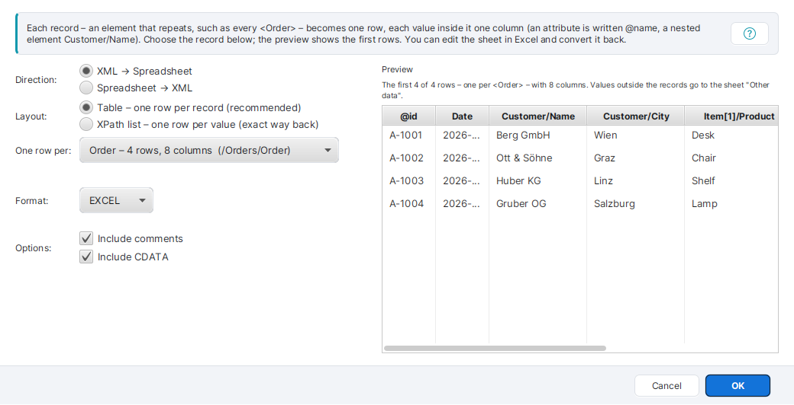
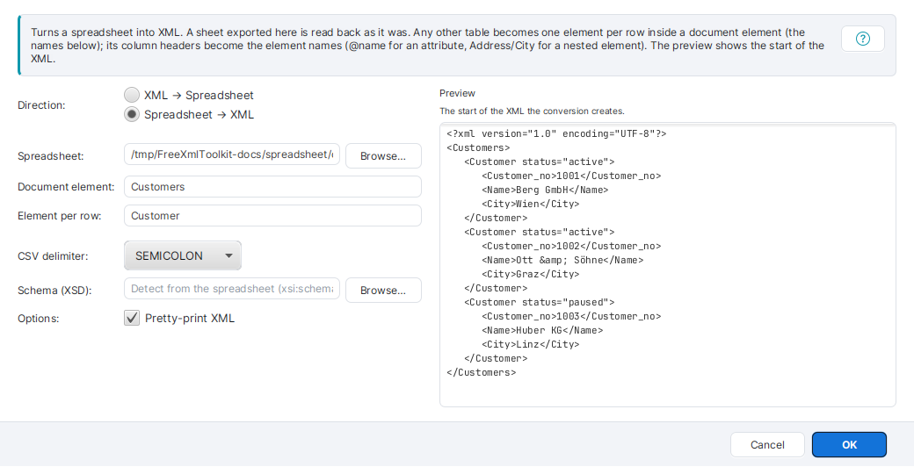

# Convert formats

Turn a document into another format: XML, JSON and YAML into one another, and XML into Excel or CSV and back.

## Before you start

- An XML, JSON or YAML document open in the editor.

## Converting between XML, JSON and YAML

The **Tools** menu converts the active document:

| Command | From |
|---|---|
| **Convert to JSON…** | XML, YAML |
| **Convert to XML…** | JSON, YAML |
| **Convert to YAML…** | XML, JSON |

When XML is involved, a dialog asks for the mapping (below) and remembers your choice; between JSON
and YAML there is nothing to choose. The result opens in a new, unsaved tab named after the
document (`order.xml` → `order.json`). The converter reads the text of the editor, including
changes that are not saved yet. The indentation follows Settings (XML for XML output, JSON for
JSON and YAML output).

YAML is read as YAML 1.2 (core schema: `yes` and `on` stay strings); a file with several
documents (`---`) becomes an array. Application tags such as `!Ref` or `!vault` are read as the
value they are written as. YAML is written in block style. Strings that would otherwise read back
as a number, boolean or null are quoted (`'007'`, `'true'`), so a conversion to YAML and back
returns the same data. XML goes to YAML through its JSON form, with the same mapping. Comments
and anchors of a YAML file are not kept.

### Structured mapping

The default. It works for any XML and gives JSON that reads naturally:

| XML | JSON |
|---|---|
| `<order>…</order>` (the root) | `{"order": …}` |
| `<name>Ada</name>` | `"name": "Ada"` |
| `<item sku="A">Apple</item>` | `"item": {"@sku": "A", "#text": "Apple"}` |
| two or more `<item>` siblings | `"item": [ … ]` |
| `<empty/>` | `"empty": ""` |
| `xmlns:p="urn:p"` | `"@xmlns:p": "urn:p"` |
| comments, processing instructions | dropped |

Element text is kept as it is, as a string. With **Numbers and true/false as JSON numbers and
booleans**, text that is a JSON number (`42`, `1.5`, `-3e2`, but not `007`) or `true`/`false`
becomes a number or boolean.

From JSON to XML the same rules apply in reverse. A top-level object with exactly one property
names the root element; anything else (several properties, an array, a single value) is wrapped
in the root element set in the dialog (default `json`). An array repeats its element; an array
inside an array becomes `<item>` elements. `null` becomes an empty element. A property name that is
not an XML name is adapted: invalid characters become `_`, and a name that starts with a digit
gets a leading `_` (`"first name"` → `first_name`, `"1st"` → `_1st`). A prefix like `p:` stays
when the object declares it with `"@xmlns:p"`.

What the structured mapping cannot keep: the order of differently named siblings
(`<a/><b/><a/>` becomes `"a": [ … ], "b": …`), text between child elements in mixed content (it
is joined into one `#text`), the difference between one element and an array of one, and empty
arrays. Characters that XML 1.0 cannot hold (control characters such as `\u0001`) stop the
conversion to XML; the W3C mapping replaces them.

### W3C mapping (XPath 3.1)

The XML representation of JSON defined for XPath 3.1, as written by `fn:json-to-xml` and read by
`fn:xml-to-json` (Saxon). It converts any JSON to XML and back without loss:

```xml
<map xmlns="http://www.w3.org/2005/xpath-functions">
   <array key="items">
      <number>1</number>
      <string>two</string>
   </array>
   <boolean key="active">true</boolean>
</map>
```

Use it when the XML is processed further with XSLT or XQuery, or when the JSON must come back
unchanged. Converting XML to JSON with this mapping needs a document in that vocabulary;
other XML is refused with a message.

On the command line: [`fxt-cli convert`](../automate/cli-compare.md#convert).

## XML/Excel/CSV Converter

Choose **Tools → Spreadsheet Converter…** (Ctrl+E) to turn an XML document into an Excel workbook or a CSV
file, or a spreadsheet into XML. The text at the top of the dialog says what the chosen direction does, every
option explains itself in a tooltip, **?** opens this page, and the **preview** on the right shows the result
before anything is written.

### XML to a spreadsheet



Two layouts:

- **Table – one row per record** (the default). A *record* is an element that repeats, such as every
  `<Order>`. Each record becomes one row, each value inside it one column:

    | @id | Date | Customer/Name | Customer/City | Item[1]/Product | Item[1]/Qty | Item[2]/Product | Item[2]/Qty |
    |-----|------|---------------|---------------|-----------------|-------------|-----------------|-------------|
    | A-1001 | 2026-11-02 | Berg GmbH | Wien | Desk | 2 | Lamp | 4 |
    | A-1002 | 2026-11-03 | Ott & Söhne | Graz | Chair | 6 | | |

    How to read the column names: `Date` is a child element, `Customer/Name` an element inside another one,
    `@id` an attribute, `Item[2]/Qty` the `Qty` of the second `Item`, `#text` a record's own text. **One row per**
    lists the repeating elements with the rows and columns each would give; the default is the one that shows
    most of the document while staying readable. When the records sit in several places (orders under several
    customers), a **Parent** column says where each one belongs.

    The Excel workbook has three sheets: **Records**; **Other data** – the values outside the records (a header,
    the document element's attributes) as XPath, value and type; and **Info**, which explains the workbook. You
    can change values, add or delete rows, sort and filter, then convert it back; keep the header row, the sheet
    names and the Other data sheet. A CSV file has the records only.

    The table does not keep empty elements inside a record (an empty cell means "no element"), and the columns
    give one order for all records.

- **XPath list – one row per value**: each node becomes a row with its XPath (its place in the document, such as
  `/Orders/Order[2]/Date`), its value and its kind (**Include type column**). Harder to read, but converting back
  gives exactly the same document. The workbook gets an Info sheet as well.

The last layout you chose is remembered. **Include comments** and **Include CDATA** also write XML comments and
CDATA sections as values.

### A spreadsheet to XML



Choose the file under **Spreadsheet**; a saved CSV or TSV document that is open in the editor is filled in, with
the delimiter taken from its first line. The layout is read from the file:

- a workbook exported as a table or an XPath list is read back as it was;
- **any other table** – a CSV file or a sheet from elsewhere – becomes one element per row (**Element per row**,
  e.g. `Customer`) inside the **Document element** (e.g. `Customers`). The column headers become the element
  names: `Customer no` becomes `Customer_no`, `@status` an attribute, `Address/City` a nested element. Empty
  cells create nothing.

The XML opens in a new tab. When the active document is no XML (a CSV file, for example), the dialog starts with
**Spreadsheet → XML**. Exporting a document that contains no XML element at all says so and offers
**Convert Spreadsheet → XML…** instead of reporting it as malformed XML. A malformed XML document is reported with
line, column and the parser's message; **Go to Error** shows that place in the editor.

### Excel look and types

The Excel workbook looks like the Data Dictionary export: a dark header row that stays in
view while you scroll, striped rows, XPaths in a monospace font, and container elements in
bold. It also has an AutoFilter and prints one page wide.

When an **XSD is bound** to the document, each value goes into a cell of its schema type.
The type is followed through derived simple types, `xs:simpleContent` and imported schemas:

| Schema type | Excel cell |
|-------------|------------|
| `xs:integer`, `xs:int`, `xs:long`, … | Number, format `0` |
| `xs:decimal` | Number, showing as many decimals as the XML value (`10.50` → `10.50`) |
| `xs:double`, `xs:float` | Number, General format |
| `xs:boolean` (`true` / `false`) | TRUE / FALSE |
| `xs:date`, `xs:dateTime`, `xs:time` | Date / time, `yyyy-mm-dd` / `yyyy-mm-dd hh:mm:ss` / `hh:mm:ss` |

Some values stay text, so that importing the workbook gives back exactly the same XML:

- values with more than 15 digits;
- leading zeros or `+`;
- `0` / `1` booleans;
- dates with a timezone or before 1900;
- times more precise than milliseconds;
- lists, unions and values that do not match their type.

Without a schema, every value is text.

**Excel to XML** turns typed cells back into their XML form. It also uses an XSD, so that cells
you entered or changed by hand still give valid values:

- the date cell `31.01.2024` under `xs:dateTime` becomes `2024-01-31T00:00:00`;
- a plain number such as `45322` under `xs:date` becomes `2024-01-31`;
- a date-formatted cell under `xs:decimal` stays a number;
- `1` / `0` or the text `TRUE` under `xs:boolean` become `true` / `false`;
- `42.0` under `xs:int` becomes `42`;
- blanks around a number or date are removed;
- a formula gives its result instead of the formula text (this also applies without a schema).

**CSV to XML** uses the XSD too. A CSV holds only text, so the import repairs values that do not
fit their type yet. This is typical after the file went through a spreadsheet application:

| In the CSV | XSD type | Imported |
|------------|----------|----------|
| `1.234,50` · `1,234.50` · `1 234,50` | `xs:decimal` | `1234.50` |
| `31.01.2024` · `2024/01/31` | `xs:date` | `2024-01-31` |
| `31.01.2024 10:15` | `xs:dateTime` | `2024-01-31T10:15:00` |
| `9:05` | `xs:time` | `09:05:00` |
| `TRUE` · `WAHR` · `yes` | `xs:boolean` | `true` |

A value that is already valid for its type is never changed. For example, `007` under `xs:int`
and `1.234` under `xs:decimal` stay as written. Text values are not touched.

The delimiter decides ambiguous values. In a semicolon file (as European Excel writes it) a
single comma is the decimal separator and `01/02/2024` is 1 February. In a comma file it is
the other way round. Values that stay ambiguous (`1,234` in a tab file) are imported as
written, and validation shows the error. Text cells in an Excel import are repaired the same
way, as far as that is unambiguous.

The import (Excel or CSV) takes the XSD from the **Schema (XSD)** field of the converter dialog. If you leave
the field empty, it uses the schema the file declares: the root element's
`xsi:noNamespaceSchemaLocation` / `xsi:schemaLocation`, resolved relative to the workbook's
folder, or the Schema Library entry for its namespace. The imported document is bound to that
XSD. Without a schema, the cells' own types and formats decide, as before. A value that does
not fit its type is imported as written, and validation shows the error.

The **CSV** export uses the bound XSD as well. CSV has no cell types, so the file gets an extra
**Data Type** column with each value's XSD built-in type (`decimal`, `date`, `dateTime`, …).
Values that are valid for their type are written without quotes; all text fields are quoted:

```
"XPath";"Value";"Type";"Data Type"
"/FundsXML4/ControlData/ContentDate";2021-11-30;"element";"date"
"/FundsXML4/ControlData/DataSupplier/Name";"Example Asset Management";"element";"string"
```

Values are written exactly as in the XML. A timezone or a leading zero stays as it is.
A value that contains the delimiter, a quote or a line break is always quoted, with inner
quotes doubled. **CSV to XML** reads such values back correctly, including line breaks
inside a value, and ignores the Data Type column. Without a schema, the CSV keeps the plain
format: no Data Type column, and quotes only where needed.

## Next steps

- [JSON & YAML](json-yaml.md)
- [Grid view](edit-xml/grid.md) - copy and paste table cells to and from a spreadsheet
- [fxt-cli: compare, merge, convert](../automate/cli-compare.md) - `convert` on the command line
