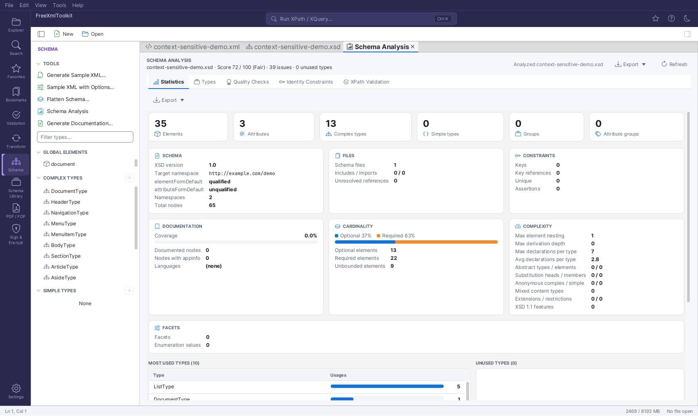

# Schema analysis

The **Schema Analysis** row in the **Schema** panel's **TOOLS** section (at the top of the panel; expand it if collapsed) analyzes the active XSD
and opens the report as a tool tab in the editor area. The analysis runs in the background on
the current editor text (unsaved changes included); imports and includes are resolved relative
to the file. The header shows the document, the quality score, the number of issues, the
number of unused types and - when unused components drag further components along - the size
of the unreachable set; **Refresh** re-runs the analysis, and opening the tool again while the
tab is already open re-analyzes the active document instead of adding a second tab.

*The Schema Analysis tool tab with its five sub-tabs, opened from the Schema activity*

Every finding is a link into the schema: selecting a row, an unused type, a usage location or
an affected element switches the document to the **Tree** view and reveals the node.

**Export** in the header writes the **complete report** - every section of every sub-tab - as
CSV, JSON, HTML, PDF, or Excel. Each sub-tab additionally has its own **Export** menu that
writes just that section in the same formats. All formats carry the same content: CSV as one
block per section (facts as `Key,Value`, then each table), JSON as sections keyed by id with
tables as arrays of objects, HTML with a table of contents, PDF with one chapter per section,
and Excel with one sheet per section (in the same look as every other Excel export: dark header
row, striped rows, highlighted findings in their status colour).

## Statistics

The **Statistics** tab opens with a row of tiles for the declaration counts (elements,
attributes, complex and simple types, groups, attribute groups), followed by detail cards:

| Card                 | Metrics                                                                  |
|----------------------|--------------------------------------------------------------------------|
| **Schema**           | XSD version (1.0/1.1), target namespace, form defaults, namespaces, total nodes |
| **Files**            | Schema files, includes / imports, unresolved references, and node counts per file for multi-file schemas |
| **Constraints**      | Counts of `xs:key`, `xs:keyref`, `xs:unique`, and assertions             |
| **Documentation**    | Coverage bar (green ≥ 75 %, yellow ≥ 40 %, red below), documented nodes, appinfo nodes, documentation languages, the most frequent appinfo tags (`@deprecated`, `@since`, …) |
| **Cardinality**      | Optional vs. required elements as a two-segment bar, plus the unbounded element count |
| **Complexity**       | Deepest element nesting (hover for the XPath), longest type-derivation chain, widest complex type, average declarations per type, abstract types / elements, substitution-group heads / members, anonymous types, mixed content, extensions / restrictions, XSD 1.1 features |
| **Facets**           | Total facets and enumeration values, plus a count per facet kind (`pattern`, `maxLength`, …) |

Below the cards:

| Section                         | Content                                                                          |
|---------------------------------|----------------------------------------------------------------------------------|
| **Schema references**           | One row per `xs:include` / `xs:import` with its location, resolution status (error in the tooltip), namespace and the number of elements, types and groups it contributes; shown only for multi-file schemas |
| **Most used types**             | The named types with the most references; the usage bar is relative to the most used type |
| **Unused types**                | Every named type that is never referenced, listed by name - click one to reveal it |
| **Unused groups / attribute groups** | Global `xs:group`s and `xs:attributeGroup`s nothing references                |
| **Circular references**         | Type-derivation cycles (a type deriving from itself - an error) and recursive content models (`Folder → FolderType → Folder`, legal); click one to reveal its first member |

## Types

The **Types** tab is the type library of the schema: one row per global complex type, simple
type, group and attribute group with its kind, name, base (`extends X`, `restricts X`,
`list of X`, `union of A, B`), first documentation line, usage count and - for multi-file
schemas - the include file it comes from. The usage chip is red for **0** usages, orange for
one to three, green otherwise. The chips above the table filter by kind, **Unused** (never
referenced), **Unreachable** (not reachable from any global element or attribute, directly or
through other components - the cascading unused set) and **Single use** (named types used
exactly once, candidates for an inline anonymous type); the text field searches name, base and
documentation.

Selecting a row reveals the component in the Tree view and fills the **Used in** list with
every reference to it (element and attribute types, base types, list item and union member
types, `ref`s, `substitutionGroup`s - references from included files are marked with the file
name, references from imported schemas with `[import]`); selecting a usage reveals the
referring node. The **Documentation** box shows the full documentation text.

**Remove unused (N)…** deletes every unreachable component of the analyzed document in one
step: a confirmation lists what will be removed; components declared in included files are
skipped (they belong to another file). The deletion goes through the editor's command stack,
so **Ctrl+Z** in the document restores all of them at once, and the analysis re-runs afterwards.

## Quality Checks

The **Quality Checks** tab shows a score (0-100) with its rating, the number of checks passed,
the dominant naming convention and its distribution (chips per convention, the dominant one in
green), and the issues found. The count chips next to the score (by severity and by category)
are clickable filters - click one to show only those issues, click it again to clear. The filter
bar offers the same severity and category selection plus a free-text search and reports how many
issues are currently shown. Every row carries a severity icon; the **File** column names the
include file of a finding (full path in the tooltip) and the location column shows the XPath.
Select an issue to read its suggestion and location and to jump to the affected elements.

| Check                              | Severity        | Description                                                        |
|------------------------------------|-----------------|--------------------------------------------------------------------|
| **Naming Convention**              | Warning         | Element, attribute, type and group names that deviate from the schema's dominant convention (UpperCamelCase, lowerCamelCase, snake_case, kebab-case) |
| **Best Practice**                  | Info / Warning / Suggestion | `xs:any` / `xs:anyAttribute` wildcards and unbounded content without limits (info), elements nested deeper than the **Max nesting** limit (warning), anonymous complex types (suggestion) |
| **Deprecated**                     | Warning         | Components marked as deprecated in `xs:appinfo`                     |
| **Constraint Conflict**            | Error           | Enumeration values that conflict with length facets                |
| **Inconsistent Definition**        | Warning         | The same name defined with different content in several places    |
| **Duplicate Definition**           | Info            | Different names with identical structure                            |
| **Duplicate Element in Container** | Error           | The same element declared twice in one sequence, choice, or all (ambiguity error) |
| **Unresolved Reference**           | Error           | A `type`, `ref`, `base`, `itemType`, `memberTypes`, `substitutionGroup` or XSD 1.1 `alternative` type naming a component that is declared nowhere (XSD built-ins, prefixes bound to other namespaces and unknown prefixes are ignored) |
| **Circular Reference**             | Error / Info    | A type deriving from itself, directly or indirectly (error); a recursive content model (info) |
| **Unused Component**               | Info            | A named type, group or attribute group that nothing references, or that is only referenced from other unused components |
| **Missing Documentation**          | Suggestion      | A global component without `xs:documentation`                       |
| **Inline Candidate**               | Suggestion      | A named type used exactly once as an element or attribute type - could be declared inline (abstract types and types from included files are not suggested) |

**Max nesting** (top right of the tab, default 5) is the limit of the deep-nesting check: it
counts *element* levels declared inside one another through anonymous types - compositors and
the types themselves do not count, and an element with a named type starts a new declaration.
Changing the value re-runs the analysis; the setting is remembered.

The score is the share of checked declarations (every named element, attribute, type and
group) that no **Error** or **Warning** counts against: a naming deviation or a too deeply
nested element costs one declaration, a duplicate element every occurrence, and an
inconsistent definition the declarations that deviate from the most frequent variant of that
name. The informational checks (unused components, recursion,
missing documentation, inline candidates) never lower it; documentation coverage has its own
percentage on the Statistics tab.

## Identity Constraints

The **Identity Constraints** tab lists every `xs:key`, `xs:keyref`, `xs:unique`, and
`xs:assert` with its parent element, selector, fields, referenced key or test expression, and a
validation status - for example a `keyref` whose `refer` points to a key that does not exist.
The count chips above the table filter by kind (key, keyref, unique, assert) and by status
(errors, warnings); click a chip again to clear the filter. Selecting a row reveals the
constraint in the Tree view and fills the details pane with the validation message, the parent
element (a link), selector and fields, and - for a keyref - a link that selects the referenced
key.

## XPath Validation

The **XPath Validation** tab lists every XPath expression used by identity constraints and
assertions - each selector, each field and each assert test is one row - with its status:
**Valid**, or the most severe finding for it (syntax errors, element names that do not occur
in the schema, empty assert tests). The status chips
above the table are clickable filters, and the details pane shows the full expression, the
findings and a link to the parent element. The expressions are checked statically against the
schema; they are not evaluated against a sample XML document.

!!! note
    Identity constraints (`xs:key`, `xs:keyref`, `xs:unique`, `xs:assert`) can also be
    inspected and deleted per node in the Properties inspector's **CONSTRAINTS** section -
    see [What You Can Edit in the Properties Pane](text-view.md#what-you-can-edit-in-the-properties-pane).

---
