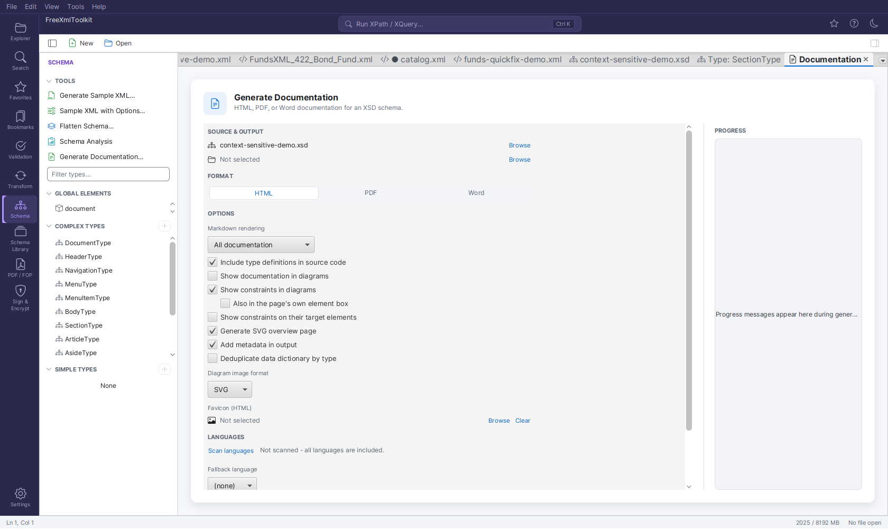

# Generate schema documentation

Create professional documentation from your XSD file automatically.


*The Documentation generator open as a tab in the editor area, with source, format, and options*

## Before you start

- An XSD open in the editor.

## Output Formats

| Format   | Description                                   |
|----------|-----------------------------------------------|
| **HTML** | Interactive web documentation with navigation |
| **Word** | Microsoft Word (.docx) document               |
| **PDF**  | PDF document using Apache FOP                 |
| **Excel** | The data dictionary as a workbook (`dataDictionary.xlsx`) - written together with the HTML output, not a format of its own |

The **HTML** output also contains an Excel workbook, `dataDictionary.xlsx`, in the output folder:
the data dictionary as a table with one row per element and attribute path (XPath, name, type,
cardinality, documentation, restrictions, sample data). It has a **Schema Info** sheet and one
sheet per documentation language; the **Download Excel** button on the HTML Data Dictionary page
opens it. There is no separate Excel format to choose, and PDF and Word do not write the workbook.

## How to Generate Documentation

1. Open your XSD file in the editor host
2. Click **Generate Documentation…** in the **Schema** panel's **TOOLS** section (or pick it from
   the editor toolbar's **Schema ▾** menu) - the generator opens as a tab in the editor area.
   The generator reads the saved schema file: if it has unsaved changes, you are asked to
   **Save and Continue**, **Use Saved Version** or **Cancel**
3. Check **SOURCE & OUTPUT**: the active schema is pre-filled; choose the output folder
   (HTML) or file (PDF/Word)
4. Select your output format (HTML, PDF, or Word) and the diagram format (SVG, PNG, or JPG)
5. Configure options (PDF and Word add page-layout and content options)
6. Click **Generate** - the PROGRESS log streams the pipeline's messages live, and the run
   can be cancelled
7. Open the result automatically or from the output location

!!! tip
    Generation works from the schema's **last-saved** version on disk so that relative
    `xs:include` / `xs:import` references resolve correctly - save the XSD first to document
    your latest edits. Remote imports are resolved through the Schema Library, XML catalogs
    and the schema cache (see
    [Automatic Resolution of Imported Schemas](graphic-view.md#automatic-resolution-of-imported-schemas));
    the generator never modifies your schema file or writes into its folder.

## Generation Options

| Option                                          | Description                                                        |
|-------------------------------------------------|--------------------------------------------------------------------|
| **Markdown rendering**                          | *All documentation* (default), *Per node (`@markdown`)*, or *Off* - see below      |
| **Include type definitions in source code**     | Show the type's XSD source on the detail pages (on by default)     |
| **Show documentation in diagrams**              | Print the documentation text inside the SVG element boxes (off by default) |
| **Show constraints in diagrams**                | List keys, unique and keyref constraints and assertions inside the element boxes, as in the Graphic view: a coloured label (KEY / UNIQ / REF / ASSERT) and the text, at most four lines plus "+N more", full details as tooltip; assertions include those of derived and base types (on by default, also for PDF and Word) |
| **Also in the page's own element box**         | Off: only the child boxes list constraints; the page's own ones are in the sections below the diagram (off by default) |
| **Show constraints on their target elements**   | Also list a key, unique or keyref on the element its field points to (e.g. `BenchmarkID` for a key on `Fund`). It shows as a row in that element's diagram box (with **Show constraints in diagrams** on) and in a **Referenced by Identity Constraints** section of its page, linked to the element that declares it. An attribute field shows on the attribute's element (off by default) |
| **Generate SVG overview page**                  | Interactive full-schema SVG (on by default)                        |
| **Add metadata in output**                      | Generator name, date and schema information in the output (on by default) |
| **Deduplicate data dictionary by type**         | List each type once in the Data Dictionary instead of per usage    |
| **Image format**                                | SVG (default), PNG or JPG for the diagrams                         |
| **Favicon (HTML)**                              | A custom icon file for the HTML output                             |
| **Open the generated documentation after creation** | Opens `index.html` (HTML) or the generated file in your system viewer |

When you pick **PDF** or **Word**, a **PDF OPTIONS** / **WORD OPTIONS** section appears below the
general options:

| Option                              | Formats    | Description |
|-------------------------------------|------------|-------------|
| **Page size**                       | PDF, Word  | A4 (default), Letter or Legal; the PDF also offers A3 |
| **Orientation**                     | PDF, Word  | **Portrait** (default) or **Landscape** |
| **Cover page**                      | PDF, Word  | A title page in front of the document (off by default) |
| **Table of contents**               | PDF, Word  | A table of contents listing the chapters (on by default) |
| **Data dictionary**                 | PDF, Word  | The table of every element and attribute path with its type, cardinality and description (on by default) |
| **Schema diagram**                  | PDF, Word  | A chapter with the diagram of the root element; the PDF adds an overview of the whole schema for schemas up to 400 elements (on by default) |
| **Element diagrams**                | PDF, Word  | A diagram in every element and type section (on by default) |
| **Element reference**               | PDF, Word  | *One section per declaration* (default), *Every occurrence* or *Off* - see [Element reference](#element-reference-pdf-and-word) below |
| **XSD source in each section**      | PDF, Word  | Shows the XSD source of every element and type in its section (off by default; makes the document considerably longer) |
| **Color scheme**                    | PDF        | The accent colour of the document: Blue (default), Green, Purple, Grayscale or Professional |
| **Watermark**                       | PDF        | None (default), Draft, Confidential or Internal Use Only, printed across every page |
| **Page numbers**                    | PDF        | Page numbers in the footer (on by default) |
| **PDF bookmarks**                   | PDF        | A bookmark tree for the chapters and every element and type section (on by default) |

### Element reference (PDF and Word)

The PDF and the Word document are built from the same chapters, each one switched by the options
above: cover page, table of contents, **Schema Overview**, **Namespace Overview**,
**Schema Diagram**, **Complex Types**, **Simple Types**, **Data Dictionary**,
**Element Reference** and **Index**. The schema diagram starts at the schema's root element. The
index lists every element and attribute with its path (without sequence/choice containers) and
says which of the two it is. Restrictions are written as plain text (for example
*Base: xs:string; MaxLength: 256*), and long paths, restrictions and descriptions wrap in their
column instead of being cut off. Type usage counts include derived types.

The PDF and the Word document have an **Element Reference**: one section per element and attribute with what the HTML
detail page shows:

- the diagram (all levels), with **Element diagrams** on;
- the properties: type, cardinality or use, namespace, default / fixed / nillable;
- the documentation in every selected language;
- the restrictions with their values, including the full enumeration list;
- the children and attributes;
- identity constraints (selector, fields, refers to), assertions, type alternatives, wildcards
  and open content;
- appinfo.

**One section per declaration** describes an element once, however many paths its type is used at.
The section lists the other paths, and they link to it. **Every occurrence** gives each path its own
section, as the HTML documentation does; for large schemas this makes the PDF much longer.

Paths in the data dictionary, names in the index and in the children tables link to their section,
and the PDF bookmarks list every section under *Element Reference*.

The **Complex Types** and **Simple Types** chapters list every global type in a table, then give
each type its own section:

- documentation;
- base and derivation;
- the content model of a complex type: diagram plus children and attributes;
- the facets of a simple type with their values, and each enumeration value with its documentation;
- assertions;
- **Used In**: the elements and attributes of this type, with links;
- the types derived from it.

Type names link to these sections wherever they appear: overview tables, data dictionary, element
properties, children tables and index.

**Deduplicate data dictionary by type** also applies to PDF and Word: each named type is listed once
in the data dictionary.

The **Word** document has the same element and type sections as the PDF:

- each section is a bookmark;
- paths and types in the data dictionary, names in the index, the type tables, children tables
  and **Used In** lists are links to it;
- chapters use real Word headings (Heading 1 to 3), so the table of contents, the navigation pane
  and the outline view work. Section headings appear in the navigation pane, while the table of
  contents lists the chapters (Word fills it when the document is opened);
- the **Namespace Overview** says what each namespace is and lists the imports and includes;
- diagrams are embedded as sharp PNG images in their own proportions, fitted to the text width.

More in the PDF:

- **Diagrams** follow **Diagram image format**. With *SVG* (the default) they are vector graphics:
  sharp at any zoom and searchable. *PNG* and *JPG* embed images.
- The **Namespace Overview** lists the prefixes the schema declares (target namespace, XML Schema,
  imported, declared), plus a table of its imports, includes, redefines and overrides with their
  locations.
- The **Schema Diagram** chapter adds an **overview of the whole schema**, as on the HTML overview
  page. Schemas with more than 400 elements get a note instead, because the overview would not be
  legible on one page.
- **XSD source in each section** (PDF and Word, off by default) shows the XSD source of every element
  and type. Leaf elements and attributes show a **Sample** value.

### Markdown rendering

`xs:documentation` text can be rendered as Markdown, so `**bold**`, lists and links show up
formatted on the generated pages. The choice has three settings:

| Setting | Effect |
|---------|--------|
| **All documentation** *(default)* | Every node's documentation is rendered as Markdown, unless that node itself says `@markdown` is `false` |
| **Per node (`@markdown`)** | Only nodes whose annotation says `@markdown` is `true` are rendered - everything else, including nodes that say nothing, stays plain text |
| **Off** | Nothing is rendered, whatever the nodes say |

A node's own `@markdown` always beats the chosen setting - only **Off** is absolute. Where an
element and its type disagree, the element wins; the type's `@markdown` applies to every element
using it that does not state its own. The same rule drives the complexType, simpleType, attribute
and enumeration documentation on the generated type pages.

Documentation that is *not* rendered as Markdown appears literally: `**bold**` stays visible as
typed instead of being formatted. If you want text formatted, write Markdown and leave the
rendering on.

Unrendered text is HTML-escaped everywhere it appears in the generated HTML, so markup written
straight into `xs:documentation` shows as the tags themselves instead of being applied. The PDF,
Word and Excel outputs are unaffected: they flatten the documentation to plain text and drop the
markup as before.

Formatting is a feature of the **HTML** output. The PDF, Word and Excel outputs are plain text:
the documentation is flattened for them, but paragraphs, list items and headings each keep their
own line instead of running together.

The per-node switch lives in the schema itself and is edited in the Inspector's **Markdown**
choice (*Not set* / *Markdown* / *Plain text*):

```xml
<xs:element name="Transaction">
    <xs:annotation>
        <xs:documentation>A **single** financial transaction.</xs:documentation>
        <xs:appinfo source="@markdown">true</xs:appinfo>
    </xs:annotation>
</xs:element>
```

## Language Settings

For multi-language schemas, you can:

1. Click **Scan languages** to detect the `xml:lang` values used in the schema
2. Untick the languages you do not want in the output
3. Choose a fallback language for missing translations

De-selected languages are dropped everywhere: element detail pages, type pages, attribute and
enumeration documentation, the Data Dictionary (HTML and Excel), the search index, the SVG
diagrams and the *Source Code* snippets on the detail pages. Documentation without an `xml:lang`
attribute ("default") is always kept as a fallback. The schema files copied next to the
documentation are left untouched. Leaving every language ticked (or not scanning at all) includes
all of them.

## Adding Technical Notes to Your Schema

You can add structured technical information directly in your XSD files:

!!! info "Full tag reference"
    All supported tags, their semantics and examples are listed in the
    [XsdDoc Tags reference](../../reference/xsddoc-tags.md).

The tag goes into the `source` attribute of an `xs:appinfo`, its value into the element's text
content.

**Supported tags:**

- `@since` - When a feature was introduced
- `@version` - Version detail of the component
- `@see` - References to other elements (may occur several times)
- `@deprecated` - Mark elements as deprecated
- `@markdown` - `true`/`false`, whether this node's documentation is rendered as Markdown
  (see [Markdown rendering](#markdown-rendering))
- `{@link /path/to/element}` - Create clickable links inside `@see` and `@deprecated`

Example values are a separate block rather than a tag. They appear as **Sample Data** on the
detail pages and also feed the sample-XML generator and IntelliSense.

**Example in your XSD:**

```xml

<xs:element name="Transaction">
    <xs:annotation>
        <!-- User-friendly documentation -->
        <xs:documentation xml:lang="en">A single financial transaction.</xs:documentation>
        <xs:documentation xml:lang="de">Eine einzelne Transaktion.</xs:documentation>

        <!-- Technical notes for developers -->
        <xs:appinfo source="@since">4.0.0</xs:appinfo>
        <xs:appinfo source="@version">1.2</xs:appinfo>
        <xs:appinfo source="@see">{@link /FundsXML4/ControlData}</xs:appinfo>
        <xs:appinfo source="@deprecated">Use {@link /FundsXML4/NewTransaction} instead.</xs:appinfo>
        <xs:appinfo source="@markdown">true</xs:appinfo>

        <!-- Example values -->
        <xs:appinfo>
            <fxt:exampleValues xmlns:fxt="http://freexmltoolkit.org/xml-schema-extensions">
                <fxt:example value="TRX-0815"/>
                <fxt:example value="TRX-0816"/>
            </fxt:exampleValues>
        </xs:appinfo>
    </xs:annotation>
</xs:element>
```

!!! note "Older schemas keep working"
    The form that packs tag and value into the attribute alone -
    `<xs:appinfo source="@since 4.0.0"/>`, used throughout FundsXML - is still read, and so is
    `altova:exampleValues`. Both are rewritten into the form above the next time you save the
    schema from the toolkit; the generated documentation is the same either way. An
    `altova:exampleValues` block is only converted once you actually change the example values.

## Next steps

- [XsdDoc tags](../../reference/xsddoc-tags.md) - tags for technical notes
- [fxt-cli: transform and publish](../../automate/cli-transform.md) - `xsd-doc` on the command line
- [Schema analysis](analysis.md)
