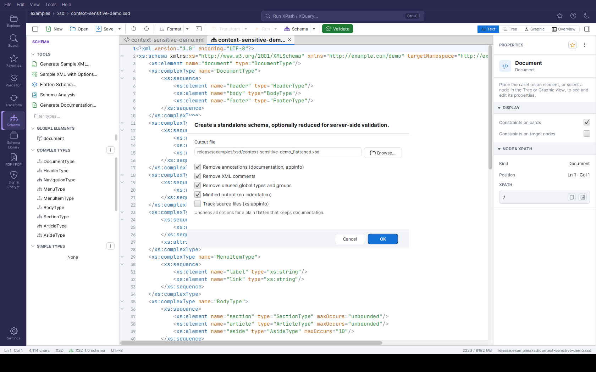

# Flatten a schema

Combine multiple XSD files into a single, standalone file. Useful when your schema is split across several files via `<xs:include>`, or when you want a minimal schema for a validation server.


*The Flatten Schema options dialog over an open schema — all reductions enabled by default*

## How to Use

1. Open your main XSD file in the editor
2. In the **Schema** activity's side panel, click the **Flatten Schema…** tool button
3. The **Flatten Schema** dialog opens. **Output file** is preset to the folder of your schema with
   `_flattened.xsd` appended to its name (`FundsXML.xsd` → `FundsXML_flattened.xsd`). Change it,
   or pick another file with **Browse…**
4. Pick which reductions you want (see below) and click **OK**
5. The flattened schema is written to the output file and opened in a new editor tab. If the
   file already exists you are asked before it is overwritten; the original schema itself can
   never be chosen as the output

Leave **Output file** empty to open the result as an unsaved tab (`Flattened.xsd`) instead —
this is also the default for a schema that has not been saved yet.

## Flatten Options

Before flattening, a dialog lets you reduce the output. The four reduction options are **checked by default**, which produces the smallest possible schema — ideal for deploying to a validation server:

| Option | What it does |
|--------|--------------|
| **Remove annotations (documentation, appinfo)** | Strips all `xs:documentation` and `xs:appinfo` content — the human-readable descriptions a validator does not need |
| **Remove XML comments** | Strips all XML comments, including comments at the top of the file |
| **Remove unused global types and groups** | Removes global types, groups and attribute groups that are not reachable from any global element or attribute — dead weight in large schema libraries. (Skipped automatically if the schema uses `xs:redefine` or `xs:override`.) |
| **Minified output (no indentation)** | Collapses the whitespace between tags for the smallest file size |
| **Track source files (`xs:appinfo`)** | *Off by default.* Adds an `fxt:sourceFile` annotation to every global component that came from an included file, naming that file — see below |

**Uncheck all four reduction options** for a plain flatten that keeps documentation, comments and formatting — the previous behavior.

## Keeping Track of Where Components Came From

Flattening merges every included file into one document, which normally loses the information
about which file a type or element originally came from. Tick **Track source files** to keep it:
each global element, type, group, attribute group and attribute that was pulled in from an
`xs:include` gets an annotation naming its origin.

```xml
<xs:complexType name="PersonType">
    <xs:annotation>
        <xs:appinfo>
            <fxt:sourceFile xmlns:fxt="http://freexmltoolkit.org/schema/flattening">types.xsd</fxt:sourceFile>
        </xs:appinfo>
    </xs:annotation>
    ...
</xs:complexType>
```

The markers are added **after** the reductions, so they survive **Remove annotations** — you can
combine a fully reduced schema with full origin tracking. Components defined in the main file are
not marked, and a stale marker from an earlier flatten is replaced rather than duplicated.
The option needs a saved file: for unsaved content there is no directory to resolve includes
against, so nothing is merged and nothing is marked.

The reduced schema is verified to still compile as a valid schema before it is shown, so you can deploy it with confidence.

## What Happens to Includes and Imports

- **`xs:include`** — Included schemas (same namespace) are merged into the output, and the resolved include directives are removed: the flattened schema is standalone. If an include cannot be resolved, its directive is kept in the output so you can see what is missing.
- **`xs:import`** — Imported schemas (different namespaces) are **not** merged; the import declarations stay untouched.

When saving schemas from the graphical editor, `xs:include` and `xs:import` declarations are preserved. The flattener only merges included content when you explicitly flatten — it does not alter your original schema structure.

## When to Use

- Deploying a minimal, resource-efficient schema to a validation server
- Distributing schemas to partners
- Tools that don't support includes
- Simplifying complex schema sets
- Creating self-contained schemas

---
