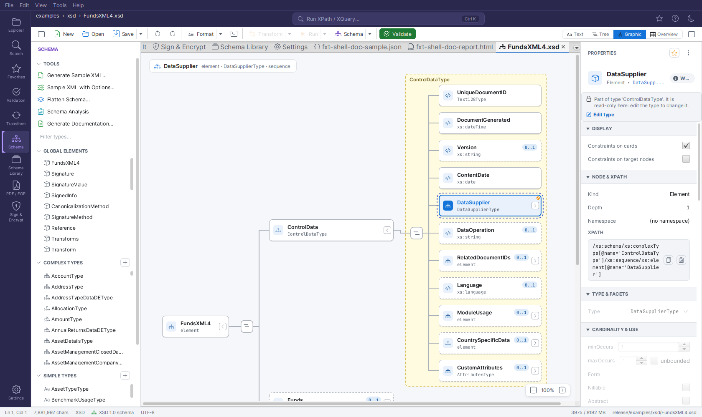
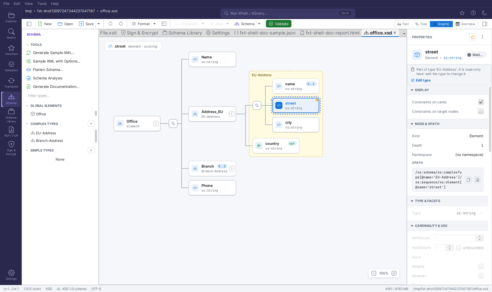
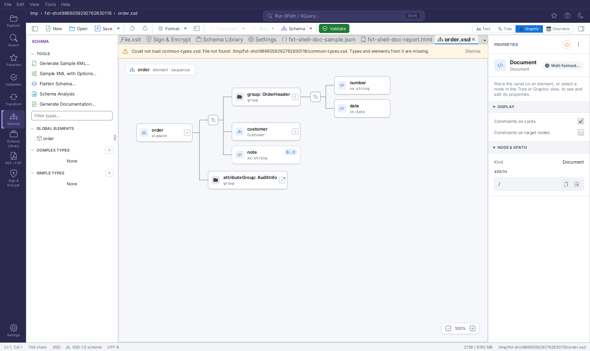

# Graphic view

The Graphic View lets you explore and edit your schemas visually.


*An XSD open in the Unified Shell's Graphic view, with the Schema activity panel on the left*

## Features

- **Visual Tree**: See your XSD as an interactive, hierarchical tree
- **Easy Navigation**: Click on elements to explore their structure
- **Edit Documentation**: Add or edit documentation for schema elements using the inline tab-based editor (no modal dialogs)
- **Constraints on the Cards**: Element and attribute cards list their `key`, `keyref` and `unique` constraints and the assertions of their type, including inherited ones - see [Constraints on the Cards](#constraints-on-the-cards)
- **Named Types in Frames**: The content of a named complex type is drawn in a light-yellow, dashed frame titled with the type's name; it is read-only there and edited in the type's editor - see [Named Types in Frames](#named-types-in-frames)
- **Type Picker**: Choose an element's or attribute's type from a list of the schema's own types and all XSD built-in datatypes, each explained in a side pane
- **Add Examples**: Include example values for elements
- **Drag and Drop**: Move or copy elements, compositors, group references and attributes by dragging their cards - see [Moving and Copying by Drag and Drop](#drag-and-drop-in-the-diagram)
- **Reorder and Duplicate**: Move nodes up and down, copy, cut, paste and duplicate them from the context menu
- **Full Undo/Redo**: Go back and forward through your changes
- **Export**: Save the diagram as PNG, SVG or PDF, or copy it as an image (**File → Export View…**, **Edit → Copy View as Image**, or right-click the empty canvas) - see [Exporting a Graphical View](../../get-started/workspace-tour.md#export-view)

## How to Use

1. Open your XSD file in the editor host and switch to the **Graphic** view
2. The schema appears as an interactive tree
3. **Select** an element by clicking on it
4. **Edit properties** in the panel on the right (name, type, cardinality/occurrence, use, form, constraints, documentation, and facets)
5. **Add children** using the context menu (right-click)
6. **Reorder** nodes by dragging them to a new place, or with **Move Up** / **Move Down** from the context menu; **Delete** removes the selected node

!!! tip "Editing properties from any view"
    The same Properties pane is
    available in the **Text** view as well as the Graphic and Tree views. See
    [Editing Schema Properties from Any View](text-view.md#editing-schema-properties-from-any-view) below.

## Reading a Card {#reading-a-card}

Every node is a card with two lines: the **name** and, below it in a monospace font, the
**type** (`xs:string`, `DataSupplierType`) - or the kind of node when it has no type
(`element`, `group`). The cards of one sequence, choice or all share the width of the widest one.

| What you see | Meaning |
|--------------|---------|
| Symbol `</>` | Simple content (a simple type, no children) |
| Symbol of a small tree | Content of its own: a complex type, or an element with children |
| Symbol `@` | Attribute |
| Folder symbol | Group or attribute group reference |
| Symbol colour | Kind of node: blue element, teal attribute, green simple type, grey complex type or group |
| Pill `0..1`, `1..*`, `2..5` | Cardinality; none is shown for the default `1..1` |
| Pill `req` / `opt` | Attribute use: required or optional |
| **Dashed** outline | Optional (`minOccurs="0"`, or an attribute that is not required) |
| A second outline behind the card | Repeats (`maxOccurs` above 1 or `unbounded`) |
| Button with `›` / `‹` | Opens / closes the card; a blue dot means its children load when you open it |
| Small box with lines, signpost or stack | `xs:sequence`, `xs:choice`, `xs:all`; a cardinality other than `1..1` is written below it |
| Small blue `I` in the corner | The node comes from an included file |

The **title chip** at the top-left names the selected card (or the diagram's root when nothing is
selected) with its kind, type and content model, e.g. `DataSupplier  element · DataSupplierType · sequence`.
The **zoom control** at the bottom-right zooms out and in; click the percentage to return to 100 %
(also **Ctrl −**, **Ctrl +**, **Ctrl 0**).

## Constraints on the Cards

A card lists what limits its node below the type lines, one row per constraint:

| Label    | Meaning                          | Row shows                  |
|----------|----------------------------------|----------------------------|
| `KEY`    | `xs:key`                         | Name and fields            |
| `UNIQ`   | `xs:unique`                      | Name and fields            |
| `REF`    | `xs:keyref`                      | Name and the key it refers to |
| `ASSERT` | `xs:assert` or `xs:assertion`    | The test, shortened        |

An element reference shows the constraints of the global element. Assertions come from the
card's type and its base types. A card shows up to four rows, followed by **+N more**.

Hover over the rows to see every constraint in full: selector, fields, the complete test, and
the type it was declared in. To add or delete a constraint, use the **CONSTRAINTS** section of
the Properties pane; it lists what is declared directly on the selected node, so an assertion
inherited from a type is changed in that type.

To hide the rows, turn off **View → Show Constraints in Diagram**. The setting applies to all
open diagrams and is remembered.

**Constraints on target nodes.** A key, unique or keyref is declared on one element but checks
the values of another: its *field* target. For example, in FundsXML4 the element `Fund` declares
the key `benchmarkID` with the selector `FundStaticData/Benchmarks/Benchmark` and the field
`BenchmarkID`. Turn on **Constraints on target nodes**, and the `BenchmarkID` card also lists
`← benchmarkID @ Fund`. The row has an outlined label and muted text, so you can tell it apart
from the card's own constraints. An attribute field (`@code`) shows on the attribute card. A
type used in several places matches only where its path fits the selector. Only fields count,
not the elements the selector picks. The option is off by default.

Both switches are in the **DISPLAY** section at the top of the Properties pane, which appears for
XSD documents, and in the **View** menu (**Show Constraints on Target Nodes**). They change open
diagrams at once and are remembered.

## Named Types in Frames {#named-types-in-frames}

When an element uses a named complex type (`<xs:element name="Address_EU" type="EU-Address"/>`),
the content it gets from that type is drawn inside a **light-yellow frame with a dashed border**.
The type's name is the frame's title, top left. Everything inside the
frame belongs to the type, not to the element: the same content appears wherever the type is used.

- **The frame is read-only.** Renaming, deleting, moving, cutting or pasting a node inside it, and
  adding new content to the element that holds the frame, are refused with a short explanation.
  The context menu of such a node starts with **Edit Type '…'** and greys out the changing
  actions; **Copy Node** and **Copy XPath** stay available. The Properties pane shows
  *"Part of type '…'. It is read-only here"* with an **Edit type** button and disables its editors.
- **To change the content, edit the type**: **double-click the frame title**, choose
  **Edit Type '…'** in the context menu, or use **Edit type** in the Properties pane. The type
  opens in its own [Type Editor](types.md#type-editor) tab, where its content can be edited.
  This works inside a Type Editor tab too: a type used there opens in a further Type Editor
  tab (of the same schema), so nested types can be followed level by level. A type that is
  already open just has its tab brought to the front.
- **The element itself stays editable**: its name, cardinality, type and documentation belong to
  the element's declaration, so they can still be changed on its card.
- **Extensions show the base type as a nested frame.** For a type defined by
  `xs:complexContent/xs:extension`, the frame of the derived type contains a second frame titled
  with the base type, holding the inherited content; the extension's own content follows below it.
  In the type editor of the derived type only the base type's frame is shown (and read-only), its
  own content is editable.
- Anonymous types defined inline in an element are not framed: their content belongs to the
  element and is edited in place.


*`Address_EU` uses the type `EU-Address`: its content is drawn in the type's frame. The selected `street` belongs to the type, so the Properties pane shows it read-only with **Edit type**. Expanding `Branch` (which extends `EU-Address`) shows the base type's frame nested inside the `Branch-Address` frame.*

## Tips

- **Right-click** for a context menu with common actions (**Add Element…** / **Add Attribute…** with all properties - see [Adding an Element or Attribute](#adding-an-element-or-attribute), **Rename…**, **Change Type…**, **Change Cardinality…**, add/move/delete). **Change Type…** opens a small dialog with the [type picker](../../reference/inspector.md#type-picker), pre-filled with the current type - the same dialog as in the Tree view
- Edit the name and every other property in the Properties pane on the right
- Only edits that keep the schema valid are possible; see [Only Valid Changes](#only-valid-changes)
- **Ctrl+Z** to undo, **Ctrl+Y** to redo
- **Ctrl+S** to save (a backup is created automatically - **Settings → Schemas & Validation → XSD** lets you turn this off or change the number of kept versions, 3 by default)
- The toolbar's **Save ▾** split button saves the schema; its arrow menu offers **Save As…** (Ctrl+Shift+S, save under a new name) and **Save All** (saves every open tab)

## What the Diagram Shows {#what-the-diagram-shows}

- **Expanding cards.** Click a card's expand button to open it. In a large schema the diagram
  builds the first few thousand cards up front; the rest loads when you open the card that holds it.
  Simple types and built-in types have no content to open, so they have no expand button.
- **Inherited content.** A type built with `xs:extension` also shows the content of its base
  type. A type built with `xs:restriction` shows its own elements, because a restriction restates
  the content model, plus the attributes of its base type, except those it redeclares or prohibits.
- **Wildcards.** `xs:any` and `xs:anyAttribute` appear as cards named `any` and `anyAttribute`, with
  the allowed namespace and the validation mode. Their right-click menu offers **Delete** and
  **Copy XPath**.
- **Redefined files.** The file named by `xs:redefine` or `xs:override` is loaded, and its global
  elements appear like those of an include. Its definitions are shown in their changed form: a
  redefined type builds on the original, an overridden one replaces it. They are read-only, and saving
  leaves the file and your `xs:redefine` as they are.
- **Group references.** `xs:group` and `xs:attributeGroup` references appear as their own cards,
  labelled `group: Name` and `attributeGroup: Name`. Attribute group cards stay closed until you
  open them. The right-click menu of these cards offers only **Delete** and **Copy XPath**:
  **Delete** removes the reference, not the shared definition.
- **Placeholder cards.** When the diagram cannot show something, a card names it, and it has no
  right-click actions:
    - `Unresolved type: X`, `Unresolved group: X`, `Unresolved attribute group: X`: the definition
      was not found, often because it is in a file that could not be loaded.
    - `External: ...`: a referenced element was not found. It usually belongs to another
      namespace whose schema is not loaded.
- **Files changed on disk.** The schema's own file and every local file it pulls in are watched:
  includes at any depth, imports and the targets of `xs:redefine`/`xs:override`. When such a file
  changes, is deleted or appears, one question names the files for each schema tab. A file with a
  new date but the same content asks nothing. **Reload**
  rebuilds the schema from the current editor text, so unsaved text stays, but the undo history of
  diagram edits is cleared. **Ignore** keeps the current view until the file changes again. Open
  and closed cards, zoom and scroll position survive any rebuild.
  An XML document watches the schema bound to it the same way, also without a tab for that schema.
  Its schema facts and IntelliSense then refresh without asking, because the document stays as it is.
- **Warning bar for missing schemas.** A bar above the diagram names the includes and imports that
  could not be loaded, also those inside imported schemas and nested includes. Circular includes
  are not failures. **Dismiss** hides the bar until the set of failures changes. A schema you have
  not saved yet has no file location, so it cannot resolve its includes: save it first.

    

For what the diagram leaves out, see [Supported XSD Features](../../reference/schema-support.md#supported-xsd-features).

## Moving and Copying by Drag and Drop {#drag-and-drop-in-the-diagram}

In the Graphic view you can rearrange the schema by dragging its cards: elements, compositors
(sequence, choice, all), group references and attributes.

1. **Press the left mouse button** on a card and move the mouse a few pixels - the drag starts.
   While you drag a card, the diagram does not pan (dragging on empty space still pans it).
2. **Point at the target** and watch the feedback:
    - A **blue line** above or below a card: the node is dropped **before** or **after** that card
      (point at the upper or lower quarter of the card).
    - A **green frame** around a card: the node is dropped **into** it (point at the middle).
      Elements go into the card's sequence, choice or all; attributes go into its complex type.
      Sequence, choice and all symbols only accept drops into them.
    - A **red frame**: the drop would not produce a valid schema. If you release there, a message
      explains why and nothing changes.
3. **Release the mouse button** to move the node. Hold **Ctrl** (**Cmd** on macOS) while releasing
   to **copy** it instead. The copy keeps its name, or gets the suffix `_copy` if a sibling already
   has that name.

More details:

- Near the edge of the visible area the diagram **scrolls automatically**.
- Press **Esc** to cancel the drag.
- **Named types are read-only in their frames.** Dropping into an element whose content comes from
  a named complex type, next to a node inside such a [frame](#named-types-in-frames), or moving a
  node out of it is refused - edit the type in its type editor instead. Copying a node out of a
  frame (**Ctrl**) is allowed.
- **Shared definitions ask first.** Dropping into or out of a named global group, or into a named
  type in its type editor, that is used by more than one declaration changes every place that uses
  it. A confirmation dialog tells you how often the definition is used ("This changes a shared
  definition … used N times").
- **Not possible** (shown with a red frame):
    - moving a global declaration into a content model - use a reference (`ref`) instead
    - moving a local declaration to the top level of the schema
    - dropping attributes among elements, or elements among attributes
    - dropping into an element with a simple type (such as `xs:string`)
    - changing nodes that come from an imported schema
    - changing the content of a named type inside its frame (see above)
- **Every drop is one undo step** - **Ctrl+Z** reverts it. The **Text** view shows the change
  right away.
- As an alternative without the mouse, use **Move Up** / **Move Down** from the context menu.

## Adding an Element or Attribute {#adding-an-element-or-attribute}

**Add Element…**, **Add Root Element** and **Add Attribute…** (right-click in the Graphic or Tree
view) open one dialog in which you set the new node's properties right away. You do not have to
fill them in afterwards in the Properties pane.

- **Name**: pre-filled and selected, so you can type over it.
- **Type**: the [type picker](../../reference/inspector.md#type-picker) with built-in types and the
  schema's own types. Leave it empty for no type. Attributes are offered simple types only.
- **Occurs** (elements): **min**, **max** and **unbounded**. A top-level element has no
  cardinality, so the row is hidden for **Add Root Element**.
- **Use** (attributes): optional, required or prohibited.
- **Documentation**: written as `xs:annotation/xs:documentation`.
- **More** (collapsed): **Default** or **Fixed** value, **Form** (qualified / unqualified / schema
  default), **nillable**, and for top-level elements **abstract** and **Substitution group**.

The input is checked while you type. A red note names the problem and **OK** does nothing until
it is fixed. For example, the name must be a valid XML name, min may not be greater than max, a
node cannot have both a default and a fixed value, and an attribute with a default must be
optional. The new node is added with all its properties as **one undo step**.

## Only Valid Changes {#only-valid-changes}

The graphical editor only lets you make changes that keep the schema valid XML Schema. This
applies to the Properties pane, the right-click menus of the Graphic and Tree views, Paste and
drag & drop alike.

- **Menu entries that cannot apply are disabled.** An element with a simple type such as
  `xs:int` cannot contain child elements or attributes, so **Add Element…**, **Add Container
  Element…** and **Add Attribute…** are greyed out for it. An element reference (`ref="…"`) takes
  its type and content from the referenced element, so its **Type** field and **Change Type…** are
  locked. Child elements need a **Sequence**, **Choice** or **All** first.
- **A change that would replace existing content asks first.** Setting a type on an element that
  defines its own content (an inline complex type, for example a sequence with child elements)
  would leave both in the schema. Instead a dialog explains what would be lost and offers
  **Replace with xs:int**. Confirming removes the inline content and sets the type. **Cancel**
  keeps the schema unchanged. Adding a Sequence, Choice or All to an element that has a type works
  the same way: the dialog offers **Remove type and add sequence**.
- **Everything is one undo step.** **Ctrl+Z** brings back the inline content or the type you
  replaced.
- **Switching a compositor keeps its children.** Changing a Sequence into a Choice or All moves the
  child elements over. An **All** is refused when it would hold a nested Sequence or Choice, or, in
  an XSD 1.0 schema, an element with `maxOccurs` greater than 1.
- **Attributes land in the right place.** For an element whose type is a named complex type, a new
  attribute is added to that type. For a complex type with simple content it goes into the
  `xs:extension`.

When an edit is not possible, a short message says why.

## Automatic Resolution of Imported Schemas

Some schemas import other schemas that are not shipped alongside them.
For example, many financial schemas contain:

```xml
<xs:import namespace="http://www.w3.org/2000/09/xmldsig#"
           schemaLocation="xmldsig-core-schema.xsd"/>
```

If `xmldsig-core-schema.xsd` is not next to your schema, FreeXmlToolkit resolves the
import automatically, trying these sources in order:

1. **Next to the declaring file** - a relative `schemaLocation` is resolved against the
   folder of the schema that declares the import (also for imports declared inside an
   imported or included file).
2. **The [Schema Library](schema-library.md)** - your own mappings, registered XML
   catalogs and the bundled standards, matched by the declared location (system ID) first
   and then by the import's namespace. A hit here loads **without any network access**.
3. **The schema cache** - a previously downloaded copy under
   `~/.freeXmlToolkit/cache/schemas/`, again without network access.
4. **The declared URL** - an `http(s)` `schemaLocation` is downloaded (following redirects,
   using your proxy settings).
5. **The namespace URL** - as a last resort the schema is fetched from the import's
   namespace URL, which is how the W3C hosts the XML signature schema, for instance.

Downloaded content is verified to be a real XML Schema, then stored in the cache **and saved
next to the schema that references it, under its original name** - for the example above as
`xmldsig-core-schema.xsd` in your schema's folder. From then on that file is used: it is what
Schema Analysis shows as *Resolved path*, what **Open Referenced File** opens, and it works
offline. A relative location keeps its folder layout (`../common/types.xsd` lands one folder
up, in `common`); an absolute `http(s)` location is saved under its file name next to the
referencing schema (`http://www.w3.org/2001/xml.xsd` → `xml.xsd`), and the `schemaLocation`
in your schema stays as it is. Imports are resolved **transitively**: an imported schema's own
`xs:import` and `xs:include` declarations (and imports declared inside an included file)
are followed too, with circular imports detected and a nesting depth cap of 10.

A few things to know:

- **Your files are never overwritten.** A downloaded schema is only saved next to your
  schema when no file of that name exists there yet; the referencing schema itself is never
  rewritten. If the folder is not writable (or the schema has not been saved yet), the
  cached copy is used as before. This applies everywhere imports and includes are resolved:
  the schema views, validation, the Type Library, Schema Analysis, flattening, sample
  validation and documentation generation.
- Only imports whose namespace is an `http://` or `https://` URL are looked up by
  namespace (step 5).
- `xs:include` references are resolved relative to the including file, or through an XML
  catalog / Schema Library entry for their location - they are not looked up by namespace.
- If an include or import still cannot be loaded, the Graphic view
  [names it in a bar above the diagram](#what-the-diagram-shows).
- Internal and private network addresses are never contacted - see
  [Security Features](../../administer/security-features.md#ssrf-server-side-request-forgery-protection).
- Clearing the cache (**Settings → Files & Cache → TEMP & CACHE**, or the Schema Library's Cache tab) is safe:
  the copies next to your schemas stay, and anything else is re-downloaded the next time it is needed.
- *Advanced:* `-Dfxt.schema.localCopies=false` keeps downloaded schemas in the cache only.
- *Advanced:* to turn remote downloads off entirely (for example in fully offline
  environments), start the application with the system property
  `-Dfxt.schema.namespaceFallback=false` - local files, catalog hits and already-cached
  copies still resolve.

---
