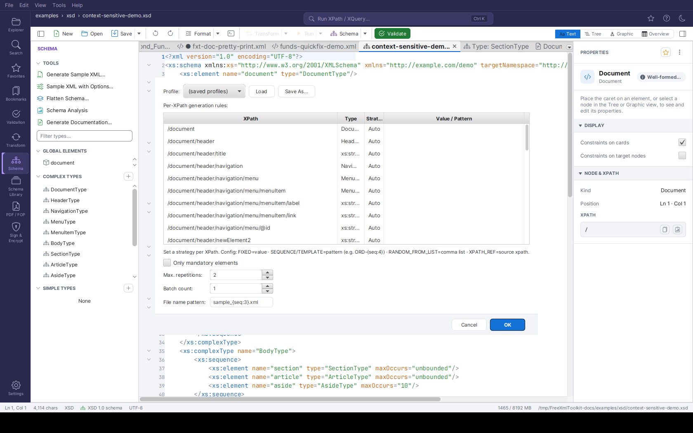

# Generate sample XML

Create sample XML files based on your XSD schema. This is useful for testing, data migration, or as a starting template.

*The advanced sample generator dialog with its per-XPath rules table*

> **Unified Shell:** In the [Unified Shell](../../get-started/workspace-tour.md), sample-data
> generation lives in the **Schema** panel. It offers two actions: **Generate Sample XML** for
> the basic generation described below, and **Sample XML with Options…** for the
> rule-based, batch-capable generation shown above.

## Quick Start (Basic Generation)

For simple use cases, you can generate sample XML in seconds:

1. Load your XSD file
2. Choose **Generate Sample XML…** in the toolbar's **Schema ▾** menu or under **Tools**
   (or in the **Schema** panel's **TOOLS** section at the top of the panel). If the schema has
   unsaved changes, choose **Save and Continue** or **Use Saved Version** when asked
3. Choose your options:
    - **Only mandatory elements**: Include only required elements
    - **Max. repetitions**: Limit repeating elements
    - **Realistic values**: Honor enumerations, patterns and value ranges when inventing values
4. Click **Generate**
5. **Validate** the generated XML against the schema
6. Save or copy the generated XML

## Profiled Generation (Advanced)

For more control, you can define rules that specify exactly how each element or attribute gets
its value. Open it from **Sample XML with Options…** in the Schema panel. It includes:

| Feature | Description |
|---------|-------------|
| **XPath-Based Rules** | Set a generation strategy for each element or attribute by its XPath |
| **11 Strategies** | Auto, Fixed Value, Omit, Empty, XSD Example, Enum Cycle, Sequence, XPath Reference, Random from List, Template, and Null |
| **Auto-Fill XPaths** | Automatically extract all XPaths from your schema to populate the rules table |
| **Saveable Profiles** | Save your generation configuration and reload it later |
| **Profile Sharing** | Export and import profiles to share with colleagues |
| **Batch Generation** | Generate multiple files at once with configurable file naming (for example, `order_001.xml`, `order_002.xml`) |

For a complete guide with step-by-step instructions and examples, see **[Profiled XML Generation](sample-xml-profiles.md)**.

## Validation

The generated sample is pretty-printed like **Format Document** (Shift+Alt+F) and opens as a
normal editor tab (`Sample.xml`) that is already bound to the schema it was generated from, so
you can validate it right away:

1. Click **Validate** (F8) - the result is *Valid* or a list of problems, not merely
   *Well-formed*
2. Problems appear in the PROBLEMS list - click one to jump to its line

The sample's root element references the schema by file name
(`xsi:noNamespaceSchemaLocation="FundsXML4.xsd"`, or the `xsi:schemaLocation` pair for a
namespaced schema) rather than by an absolute `file:` path, so it can be moved and shared.
Saving it for the first time into another folder rewrites the reference to a relative path
(for example `../xsd/FundsXML4.xsd`), so it keeps resolving there - also in other tools.

---
