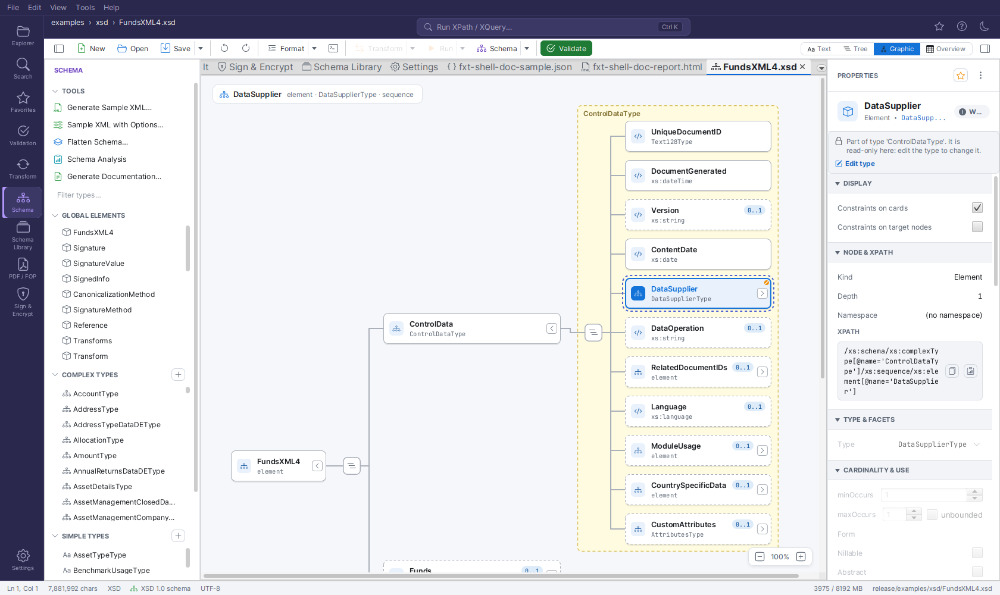
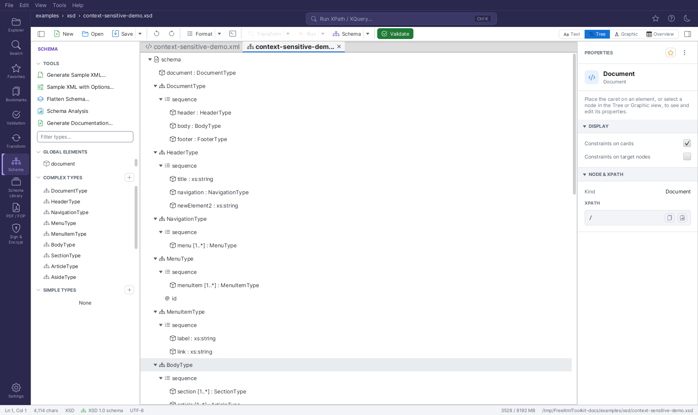

# The Schema panel

What the **Schema** activity and the editor offer while an XSD is open: the views of a schema,
the tools of the side panel and the sample-data generators. Each tool is described in detail under
[Design schemas](index.md).

## Before you start

- An XSD open in the editor; open the **Schema** activity.

## XSD Views & Tools

When editing an XSD file, the editor host and the **Schema** activity provide:

*An XSD open in the Graphic view, with the Schema activity panel (Type Library, Flatten,
Schema Analysis, Generate Sample XML / Documentation) on the left.*

*The same schema in the Tree view - select a node to edit its properties in the inspector.*

- **Text** - Source code editing with syntax highlighting; moving the caret into a schema construct also lets you edit its properties in the Properties pane (see [Properties Inspector](../../reference/inspector.md#properties-inspector))
- **Graphic** - Visual schema diagram of cards (name, type, cardinality - see [Reading a Card](graphic-view.md#reading-a-card)); drag cards to move nodes, hold Ctrl (Cmd on macOS) to copy (see [Moving and Copying by Drag and Drop](graphic-view.md#drag-and-drop-in-the-diagram))
- **Type Editor** - Edit ComplexTypes graphically, SimpleTypes with form editor
- **Analysis** - The **Schema Analysis** tool tab: statistics incl. complexity metrics, unused types / groups and circular references, a Types tab with usage locations and "Remove unused", quality checks with score, identity constraints, XPath validation - every finding reveals its node in the Tree view, and the whole report exports as CSV / JSON / HTML / PDF / Excel (see [Schema Analysis](analysis.md))
- **Documentation** - Generate HTML/Word/PDF documentation (see below)
- **Sample Data** - Generate sample XML from the schema
- **Flatten** - Merge included schemas into a single standalone file. The **Flatten Schema…** button opens an options dialog first: strip annotations, strip XML comments, remove unused global types and groups, and minify the output — all checked by default for a minimal schema suited to server-side validation; uncheck everything for a plain flatten that keeps documentation. Imports (`xs:import`, different namespaces) are never merged. See [XSD Flattener](flatten.md) for details.

!!! note "Missing imported schemas resolve automatically"
    If a schema's `xs:import` points to a file that is not found next to the schema, the
    toolkit looks it up in the Schema Library and your XML catalogs, then in the schema
    cache, and finally downloads it from the declared or namespace URL into the cache -
    so the imported types still appear in the Tree and Graphic views, even offline on
    later loads. Nested imports inside imported schemas are followed too, and your own
    schema files are never modified. See
    [Automatic Resolution of Imported Schemas](graphic-view.md#automatic-resolution-of-imported-schemas).

### The Schema Panel

The **Schema** activity's side panel lists the active schema's top-level declarations,
grouped into **GLOBAL ELEMENTS**, **COMPLEX TYPES**, and **SIMPLE TYPES** (collapsible
sections), with a **filter field** above them. Click a declaration to reveal it in the Tree
view; double-click a type to open it in its dedicated **Type Editor** tab; right-click for
**Reveal in Tree / Open Type Editor / Find Usage**. The **+** button in the COMPLEX TYPES and
SIMPLE TYPES headers declares a new type and opens it in its Type Editor
(see [Creating a New Type](types.md#creating-a-new-type)). The schema tools (Generate Sample XML…, Sample XML with Options…, Flatten Schema…,
Schema Analysis, Generate Documentation…) are **labelled rows in the TOOLS section at the top
of the panel** - each row shows an icon and the tool's name, so nothing hides behind a
tooltip. TOOLS starts open; click its header to collapse it.

**Generate XSD from XML** (infer a schema from the active XML document) and **Generate XSD
from XML Files…** (infer one schema from several XML files) are not in the Schema panel -
they are in the editor toolbar's **Schema ▾** split menu.

The **whole panel is a drop zone**: drop an `.xsd` file from your
file manager anywhere on it to **open that schema as a document** - the panel then shows
its declarations. Unlike the picker drop targets elsewhere in the shell, this drop
*opens* the file rather than binding or selecting anything. While dragging, the panel
shows a **dashed green border** with a soft tint for an `.xsd` file and a **dashed red
border** for any other extension - a red drop is rejected and does not open the file.

### Documentation Generator (editor area)

**Generate Documentation…** (Schema panel **TOOLS** section or the editor toolbar's **Schema ▾** menu) opens the generator as
a tab in the main editor area with the full option set:

- **SOURCE & OUTPUT** - the XSD (the active schema is pre-filled) and the output folder
  (HTML) or file (PDF/Word).
- **FORMAT** - HTML, PDF, or Word.
- **OPTIONS** - **Markdown rendering** (*All documentation*, *Per node (`@markdown`)*, or
  *Off*), type definitions in source code, documentation in diagrams, SVG overview page,
  metadata, the diagram image format (SVG/PNG/JPG), and a **favicon** (.ico/.png/.svg)
  embedded into the generated HTML site. See
  [Generation Options](documentation.md#generation-options) for what the Markdown settings do.
- **PDF/WORD OPTIONS** *(shown for those formats)* - page size (A4/Letter/Legal, PDF also
  A3), orientation, and the content building blocks (cover page, table of contents, data
  dictionary, schema/element diagrams). PDF additionally offers the **color scheme**
  (Blue/Green/Purple/Grayscale/Professional), a **watermark** (Draft/Confidential/Internal
  Use Only), page numbers, and PDF bookmarks.
- **LANGUAGES** - **Scan languages** discovers the `xml:lang` documentation languages in
  the schema; pick which to include and the fallback language.
- **PROGRESS** - the right-hand log streams the pipeline's task messages live while
  generating; the run can be **cancelled**, and the result can open automatically.

## Schema Panel: Sample-Data Generation

Open the **Schema** panel from the activity bar while an XSD file is active. Alongside type
browsing, the panel offers actions to generate sample XML from the schema:

- **Generate Sample XML** - The simple generator. It builds one sample document using
  mandatory-only / maximum-occurrence options and realistic example values.
- **Sample XML with Options…** - Opens a dialog for full control over how the sample
  data is built (see below).

### Advanced Sample-Data Generation

A rule-based generator with per-XPath strategies, batch output, and
reusable profiles.

The advanced dialog turns the schema's XPaths into an editable table. For each XPath you
choose a generation **Strategy** plus a value or pattern:

| Strategy | What It Produces |
|----------|------------------|
| **Auto** | Type-based automatic value (the default) |
| **Fixed Value** | A fixed literal you type |
| **Sequence** | An auto-incrementing value from a pattern (for example `ORD-{seq:4}`) |
| **Enum Cycle** | Cycles through the allowed enumeration values |
| **Template** | A string built from a template with placeholders |
| **Random from List** | A random pick from a comma-separated list |
| **XPath Reference** | Copies the value from another XPath |
| **XSD Example** | An example value taken from the schema's annotations |
| **Omit / Empty / Null** | Skip the node, leave it empty, or set `xsi:nil` |

You can also set **batch options** - a **count** and a **file-name pattern** (for example
`order_001.xml`, `order_002.xml`) - and **Save** / **Load** named **profiles** so you can reuse
a configuration later.

The dialog can either generate a **single document** (which opens in a new tab) or a **batch**
of files written to a folder you choose. For a full walkthrough, see
[Profiled XML Generation](sample-xml-profiles.md) and the
[Sample XML Generator](sample-xml.md) section of the XSD Tools guide.

## Next steps

- [Graphic view](graphic-view.md)
- [Schema analysis](analysis.md)
- [Generate schema documentation](documentation.md)
