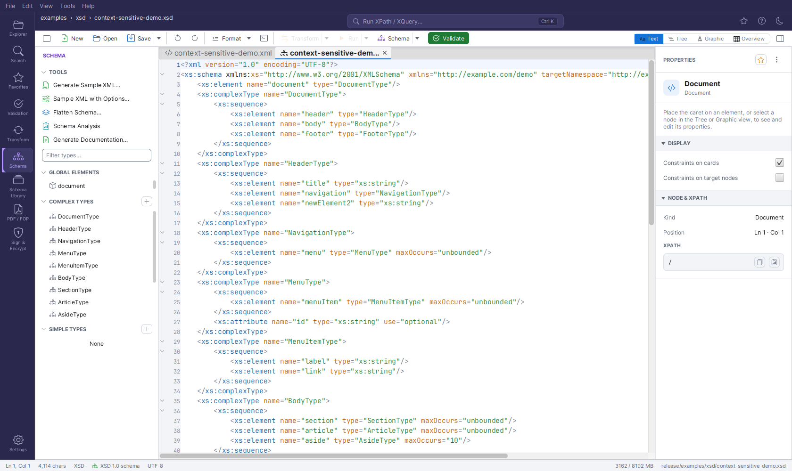

# Text view

The Text View provides raw XSD source code editing.

*The XSD in the Unified Shell's Text view (Schema activity panel on the left, inspector on the right)*

## Features

- **Full Code Editor**: View and edit the raw XSD source code
- **Syntax Highlighting**: Color-coded code for easy reading
- **Search and Replace**: Find and change text quickly
- **Query Console**: Query the schema with XPath/XQuery (Ctrl+Shift+X)
- **Save as Favorite**: Quick access to frequently used schemas
- **Editable Properties pane**: Move the text caret into a schema construct to select it and edit its properties without leaving the text editor (see below)

## Editing Schema Properties from Any View

You can edit a schema node's properties directly from the
**Text** view, the same way as in the **Tree** and **Graphic** views.

The XSD editor has three views - **Text**, **Tree**, and **Graphic** - and all three share one
in-memory schema model. The Properties pane works in every view:

- **Tree** and **Graphic** views: Select a node to edit its name, type, cardinality/occurrence,
  use, form, constraints, documentation, and facets.
- **Text** view: Move the text caret into an XSD construct - such as an `xs:element`,
  `xs:complexType`, `xs:simpleType`, `xs:attribute`, a compositor (`xs:sequence`, `xs:choice`,
  `xs:all`), or a facet - and the Properties pane selects the matching schema node and shows it
  **editable**. You get the same property editing as in the Tree and Graphic views, without
  leaving the source editor. Your edits round-trip back into the schema text as a minimal change
  that preserves your caret and scroll position.

If the caret is not inside a recognizable construct - for example inside an `xs:annotation`, a
comment, or blank space - the pane falls back to a read-only caret/XPath view.

Because all three views share one model, your edits and your **Undo/Redo** history are preserved
when you switch between Text, Tree, and Graphic.

## What You Can Edit in the Properties Pane

For the selected schema node you can edit:

- **Name, type, cardinality/occurrence, use, form** - The core properties of the node. The
  **Type** field is a picker: it lists the schema's own simple and complex types (including
  included and imported ones, with their namespace prefix) and every XSD built-in datatype,
  filters as you type and explains the highlighted type in a side pane; free text is still
  accepted for references it does not know. See [Choosing a type with the type
  picker](../../reference/inspector.md#type-picker) for the keyboard shortcuts and what the side pane shows.
  Compositors (`xs:sequence`, `xs:choice`, `xs:all`), group references and `xs:any` also show
  editable minOccurs/maxOccurs and their Order in **CARDINALITY & USE**.
- **Facets** - Add, edit, and remove facets such as patterns, enumerations, and length limits.
  In the facet list, click a value to edit it (**Enter** saves, **Esc** cancels), point at a row
  and click the trash icon to delete it, and use the row below the list to add one, which offers
  only the facets the base type allows, also through named, list and union types. Facets
  inherited from a base type appear in *italics* and are read-only. When all facets come from a
  named type, the add row is replaced by *"Facets come from T – click to edit them there."*;
  click it to select that type.
- **App info (`xs:appinfo`)** - The machine-readable metadata attached to the node (for example
  the technical tags described in [Documentation Generator](documentation.md)).
- **Multi-language documentation (`xs:documentation`)** - One row per language. Use **Add
  language** to add a translation and the **✕** button to remove one.
- **Comments** - Select an XSD comment in the tree to edit its text. To add a comment, choose
  **Add Comment…** from a node's right-click context menu.
- **Constraints** - In the **CONSTRAINTS** section, select a `key`, `keyref`, `unique`, or
  `assert` constraint and click **Delete constraint** to remove it.

The pane also shows information you cannot edit directly: the **Base type** and **Derivation**
(restriction / extension / list / union), **final** for a simple type (in ADVANCED), the **Order**
of the node in its parent compositor
(e.g. *2 of 5 · sequence*), and **USED IN** - for a global type, element or group every place
that references it (click an entry to select the referring node), for a local declaration the
global component that contains it. Editable values look like plain text until you point at
them. See [Properties Inspector](../../reference/inspector.md) for the
full layout.

In the Tree/Graphic view, the **Copy XPath** and **Copy Node** buttons in NODE & XPATH copy the
schema XPath and the XSD source of the selected node.

!!! tip
    You can also edit a declaration from an XML document that uses this schema: select
    the element there and change type, cardinality, facets or documentation in its inspector - see
    [Properties Inspector - Editing the bound schema](../../reference/inspector.md#editing-the-bound-schema).

!!! note
    Structural editing (adding, deleting, and moving nodes) remains a **Tree** and
    **Graphic** capability via the right-click context menu. The **Text** view provides
    *property* editing through the Properties pane.

---
