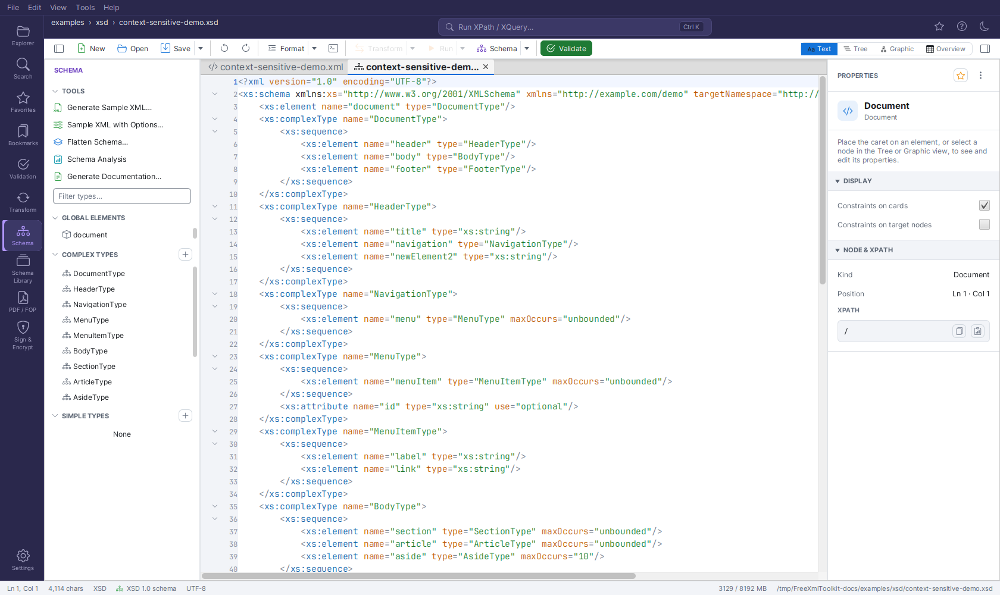
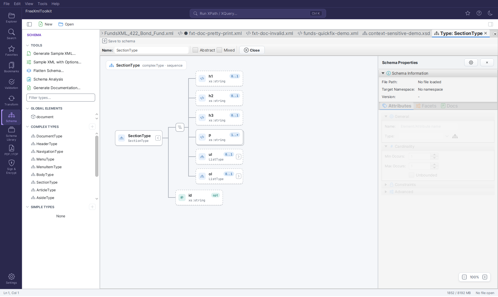

# Types

Named types are the building blocks of a schema. The **Type Library** lists them and shows where each is used; the **Type Editor** opens one type on its own to edit it.

## Before you start

- An XSD open in the editor; open the **Schema** activity.

## Type Library

The Schema activity's side panel is your type library: it lists the active schema's
top-level declarations so you can browse, find, and open every type in the schema.

*The Schema activity's Type Library, with the schema diagram in the editor host*

### Features

| Feature               | Description                                                          |
|-----------------------|----------------------------------------------------------------------|
| **Grouped lists**     | Declarations grouped into **GLOBAL ELEMENTS**, **COMPLEX TYPES**, and **SIMPLE TYPES** (collapsible sections) |
| **Filter**            | A filter field on top narrows all three lists by name as you type    |
| **Reveal in Tree**    | Click a declaration to reveal it in the schema's Tree view           |
| **Open Type Editor**  | Double-click a type to open it in its own [Type Editor](#type-editor) tab |
| **Find Usage**        | Right-click a type to find the places where it is used              |
| **New type**          | The **+** button in the COMPLEX TYPES / SIMPLE TYPES header (or right-click → **New Complex Type…** / **New Simple Type…**) declares a new top-level type - see [Creating a New Type](#creating-a-new-type) |
| **Schema tools**      | Labelled rows in the **TOOLS** section at the top of the panel, above the filter field (open by default): Generate Sample XML…, Sample XML with Options…, Flatten Schema…, Schema Analysis, and Generate Documentation… |
| **Generate XSD from XML** | Not in the Schema panel: **Generate XSD from XML** and **Generate XSD from XML Files…** are in the editor toolbar's **Schema ▾** split menu |

### How to Use

1. Open your XSD file
2. Open the **Schema** activity from the activity bar
3. Browse the grouped lists, or type in the filter field to narrow them
4. **Click** a declaration to reveal it in the Tree view
5. **Double-click** a type - or right-click and choose **Open Type Editor** - to edit it;
   right-click also offers **Reveal in Tree** and **Find Usage**

!!! tip
    The whole panel is a drop zone: drop an `.xsd` file from your file manager anywhere on
    it to open that schema as a document.

---

## Type Editor

The Type Editor provides dedicated editing for ComplexTypes and SimpleTypes.

*A named type opened in its own Type Editor tab in the editor area*

### Features

| Feature                | Description                                         |
|------------------------|-----------------------------------------------------|
| **Tab-Based Editing**  | Each type opens in its own tab in the editor area; a named type used inside a Type Editor opens in a further Type Editor tab (double-click its frame title or **Edit Type '…'**) - see [Named Types in Frames](graphic-view.md#named-types-in-frames) |
| **ComplexType Editor** | Graphical editing in the card diagram of the Graphic view |
| **SimpleType Editor**  | Form-based editing with facet panels                |

### ComplexType Editor

For ComplexTypes, the tab shows the same card diagram as the [Graphic view](graphic-view.md) -
see [Reading a Card](graphic-view.md#reading-a-card) for what each card shows:

- The type is the root card of the diagram, with its compositors, child elements and attributes
  below it
- A **title chip** at the top left names the selected card (or the type), and the **zoom
  control** at the bottom right zooms out, in, or back to 100%
- A bar above the diagram edits the type's **Name**, **Abstract** and **Mixed** settings. These
  apply to the schema right away and can be undone there (**Ctrl+Z** in the schema's tab)
- Add, delete and modify elements, attributes and Sequence / Choice / All compositors through the
  cards' context menus, as in the Graphic view; the properties pane beside the diagram edits the
  selected node
- Changes to the diagram are kept in the tab until you click **Save to schema** (or press
  Ctrl+S); they are then written into the schema. Close the tab with **Close**, **Esc** or its **×**

### SimpleType Editor

For SimpleTypes, you get a 5-panel form editor:

| Panel           | Description               |
|-----------------|---------------------------|
| **General**     | Name and Final attribute  |
| **Restriction** | Base type and facets      |
| **List**        | Item type (enabled for list types and types without derivation yet) |
| **Union**       | Member types (enabled for union types and types without derivation yet) |
| **Annotation**  | Documentation and AppInfo |

The **Base type**, **Item type** and **Add Member Type…** fields are the same
[type picker](../../reference/inspector.md#type-picker) as in the inspector, limited to what a simple type may
derive from: the schema's other simple types and the built-in datatypes (complex types,
`xs:anyType` and the type itself are left out).

### Creating a New Type {#creating-a-new-type}

New top-level types can be declared from three places:

- **Graphic view:** right-click the schema node or an empty area of the diagram →
  **Add Complex Type…** / **Add Simple Type…**
- **Tree view:** right-click the schema (root) node → **New Complex Type…** / **New Simple Type…**
- **Schema panel:** the **+** button in the **COMPLEX TYPES** or **SIMPLE TYPES** section header

A small dialog asks for the kind and the name. A free name is suggested (`NewComplexType`,
`NewComplexType2`, …); the name is checked while you type - it must be a valid XML name
(no spaces or `:`) and must not be used by another simple or complex type of the schema, so
**OK** stays disabled until it is.

| Kind             | Starts as                                   |
|------------------|---------------------------------------------|
| **Complex type** | An empty `xs:sequence` - add child elements and attributes right away |
| **Simple type**  | A restriction of `xs:string` - pick another base type and add facets   |

The new type is added next to the schema's other types of the same kind, appears in the
Type Library and opens in its own Type Editor tab. The diagram itself shows global elements
only; assign the new type to an element with the [type picker](../../reference/inspector.md#type-picker).
One **Undo** removes the type again.

### How to Use

1. In the Schema panel's Type Library, find the type (use the filter field for large schemas)
2. **Double-click** it - or right-click and choose **Open Type Editor**. Alternatively, pick
   **Type Editor…** from the editor toolbar's **Schema ▾** menu and choose a type by name.
3. The type opens in its own Type Editor tab in the editor area
4. Make your changes
5. Click Save or use Ctrl+S

## Next steps

- [Graphic view](graphic-view.md) - named types appear as frames
- [Schema analysis](analysis.md) - unused types
