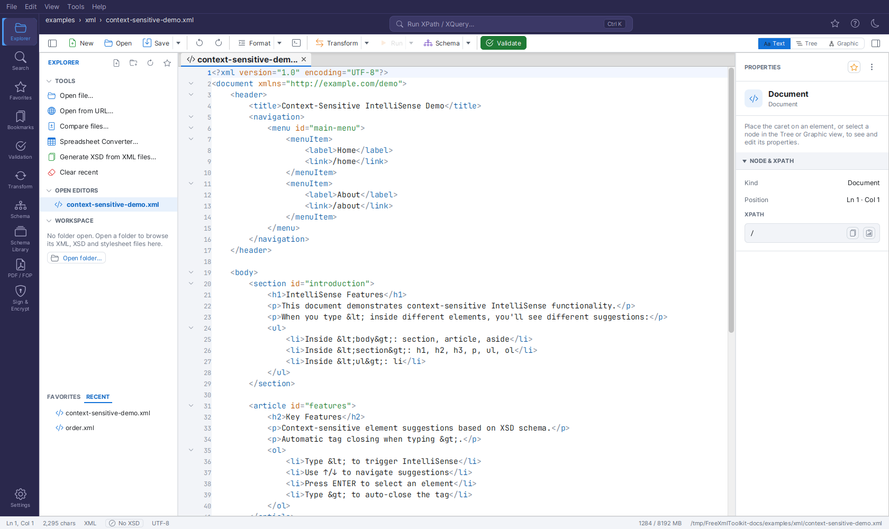
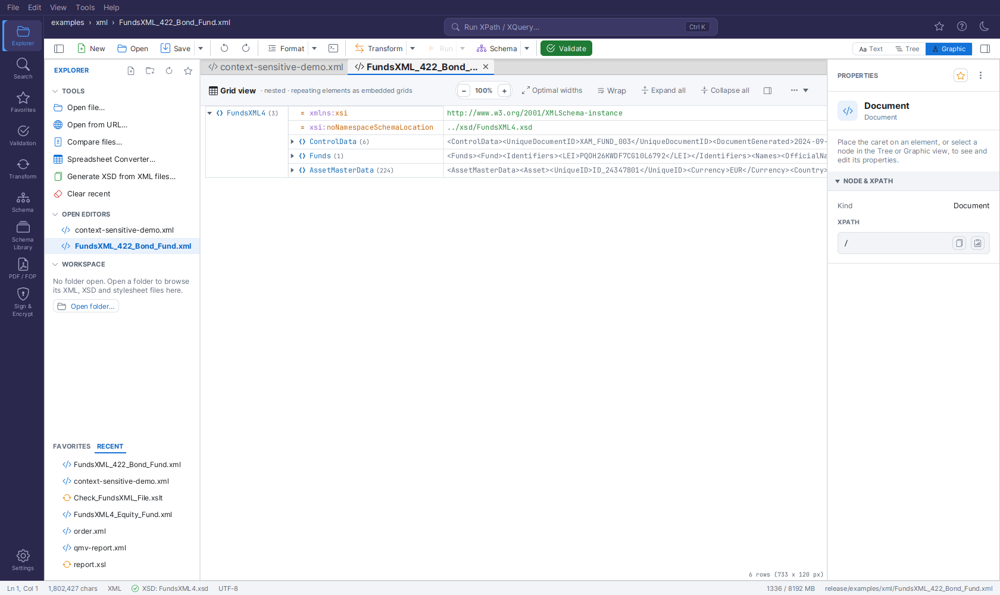
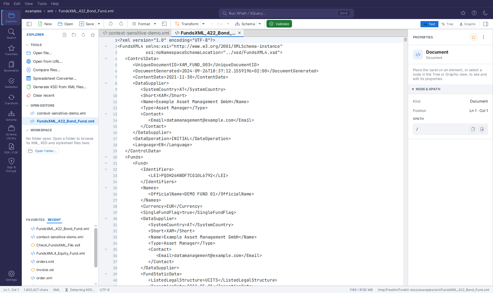
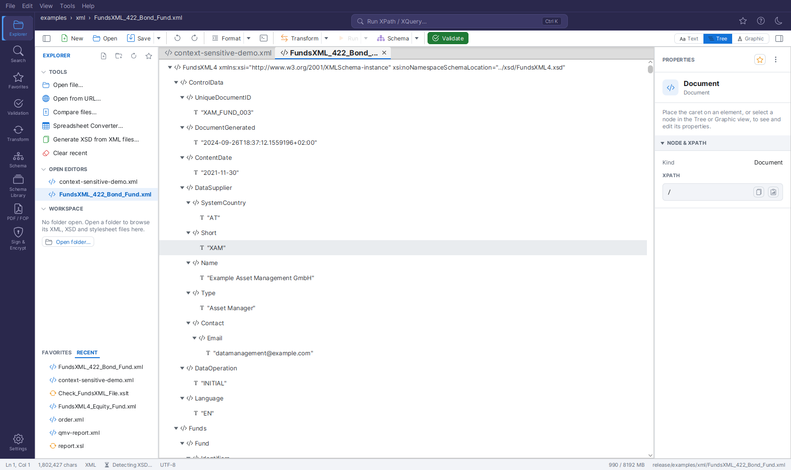
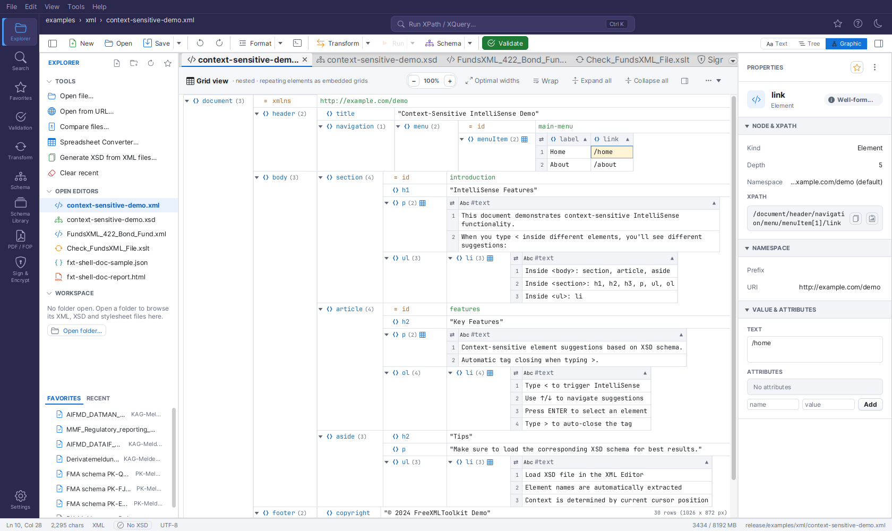
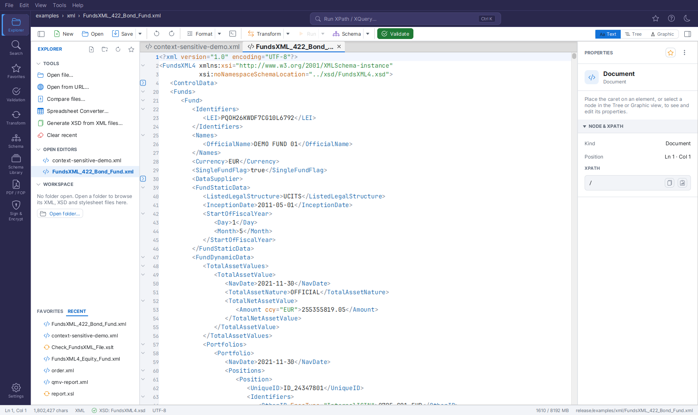
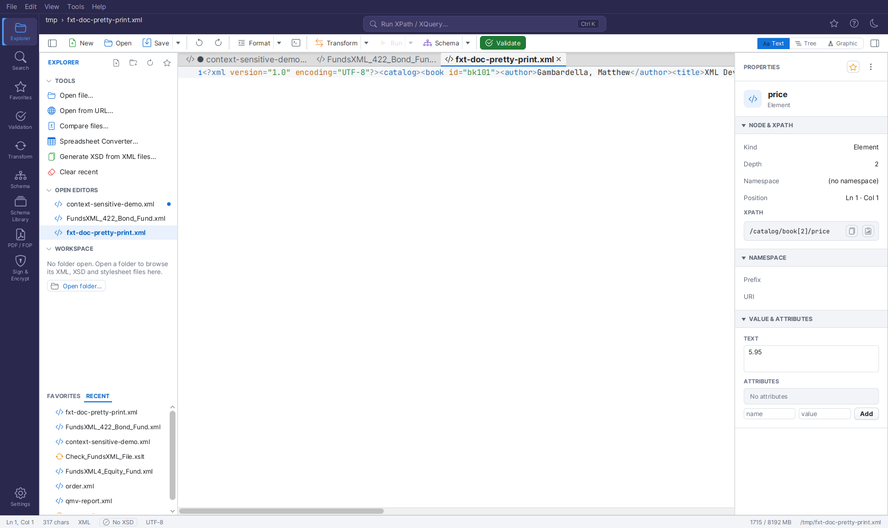
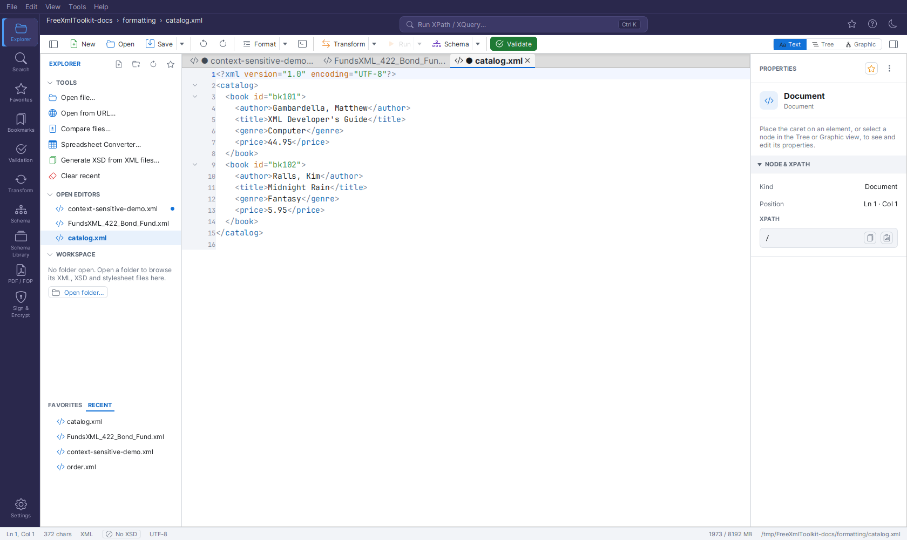

# Edit XML

Open an XML file and work on it as text, as a tree or as a grid. The three views show the same
document and share one undo history; a bound schema drives auto-completion, validation and the
facts shown in the Properties panel.

*The XML Editor in text mode with syntax highlighting*

*The XML Editor in the Graphic view (grid) for structured editing*

| Task | Page |
|------|------|
| Open, create and save files; files changed on disk | [Working with files](working-with-files.md) |
| Edit tables of repeating elements, filter, sort, use formulas | [Grid view](grid.md) |
| Let the schema suggest elements, attributes and values | [Auto-completion](auto-completion.md) |
| Change a node's name, value, attributes; see its schema facts | [Edit the properties of a node](properties.md) |
| Find and replace in the open document | [Find and replace in a document](find-replace.md) |
| Find and replace across folders, also by XPath | [Search and replace in files](search-in-files.md) |
| Insert snippets, star files, mark lines | [Templates](templates.md), [Favorites](favorites.md), [Bookmarks](bookmarks.md) |
| Open files of hundreds of megabytes | [Large files](large-files.md) |
| Validate the document | [Validate](../validate/index.md) |
| Query it with XPath or XQuery | [Query console](../transform-query/query-console.md) |
| Convert it to JSON, YAML, Excel or CSV | [Convert formats](../convert.md) |

## The three views

### Text Mode

*Text editor with syntax highlighting*

The text editor provides:

- **Syntax Highlighting**: XML elements, attributes, and values are color-coded
- **Line Numbers**: Every line is numbered for easy reference
- **Code Folding**: Click the chevrons in the gutter to collapse or expand elements - see [Code Folding](#code-folding)
- **Auto-Completion**: Type `<` to see suggestions for valid elements
- **Error Highlighting**: Invalid XML is highlighted in red
- **Edit Properties**: Move the text cursor into an element and edit its properties in the
  Properties inspector - see [Properties Inspector](properties.md)

### Tree View

*Tree view showing XML structure*

- See your XML document as a hierarchical tree
- Click any node (element, text, comment, CDATA, or processing instruction) to select it
- An element's attributes are rows of their own (`name = "value"`), listed before its children
- Press **Delete** to remove the selected node completely - no empty element is left in its place.
  On an attribute row only that attribute goes. The next node is selected, so you can press
  **Delete** again; one **Undo** restores it
- Edit the selected node's properties in the Properties inspector - see
  [Properties Inspector](properties.md)
- Right-click for context menu options
- While you scroll, a bar at the top shows the parents of the topmost row (`root › section › body`); click
  one to select it and scroll back to it. The same bar appears in the Tree view of JSON and XSD documents.

### Graphic View (Grid)

For XML documents (and XSLT / Schematron), the **Graphic** view shows the editable grid.

*An XML document in the Graphic view (grid editing)*

1. Open an XML file and switch to the **Graphic** view with the view switch
2. Click cells to edit values directly; move with the arrow keys
3. Add, delete, wrap or move nodes through the right-click context menu or drag & drop
4. Select a row to view and edit its properties in the [Properties inspector](properties.md)

Repeating elements appear as **embedded tables** (sortable, flippable, copy/paste with
spreadsheets), cells can be **opened** to show their nested content as a grid of their own, and
the **entry helpers** side panel offers the siblings, children and values the bound XSD allows.
All views share one model, so changes show up in the Text view immediately.

See the **[Grid View](grid.md)** page for every grid feature.

### Code Folding

*Code folding - collapse XML sections to focus on the parts that matter*

For large XML files, you can collapse sections to focus on what you're working on:

- **Fold**: Click the downward chevron in the gutter next to an element whose end tag is at
  least two lines below its start tag. Its content is hidden; the gutter shows the folded block as a highlighted chip
  with a right-pointing chevron.
- **Unfold**: Click the chip to show the content again.
- **Fold or unfold everything**: Right-click in the text and choose **Collapse All** or
  **Expand All**.
- **Nested Folding**: Collapse parent elements to hide all children; unfolding the parent
  shows its whole content again.
- **Start tags over several lines**: An element whose start tag is spread over several
  lines (for example a root element with many namespace declarations) folds from the line
  of its `<`.
- **Comments and CDATA**: Tags inside comments, CDATA sections and processing
  instructions are ignored and do not create fold regions.

Folding only hides lines - the document text is unchanged, so saving, validation and
XPath always see the complete XML. The text cursor never lands inside a folded block:
moving down jumps to the line after it, moving up to its first line. Even very large
regions (for example a `<Funds>` element with 24,000 lines) fold and unfold in well
under a second.

## Binding an XSD Schema

Bind an XSD to the active document directly from the editor.

If your XML does not reference its schema (or you want to use a different one), you can bind an
XSD by hand:

1. Click the **"No XSD"** indicator in the **status bar** (it shows **"XSD: name"** once a
   schema is bound), or click the toolbar's **Schema** button (**Set XSD Schema…**).
2. Choose an `.xsd` file.

The binding applies to the active document and drives **both** features at once:

- **IntelliSense** - auto-completion suggests the elements and attributes the schema allows.
- **Schema validation** - Validate (F8) and continuous validation check against the bound XSD.

### Go to Definition {#go-to-definition}

Jump from an element in your XML document to the place in the bound XSD that declares it:

- **Graphic view (grid)** and **Tree view:** right-click an element → **Go to Definition**
- **Text view:** right-click inside an element → **Go to Definition (Ctrl+Click)**, or hold
  **Ctrl** and click the element

The XSD opens in front (in its own tab, if it was not open yet) in the **Graphic** view. The
diagram is expanded along the element's path from the document root, and the card of the
declaration is selected. Because the path is followed, elements with the same name in different
places - for example a `Name` inside `Customer` and a `Name` inside `Product` - each lead to their
own declaration. If the path cannot be found in the schema (for example an element allowed by a
wildcard), the first declaration with that name is selected instead.

The entry is available for elements only, and only when a schema is bound to the document.

## Formatting Tools

### Pretty Print

*Before pretty print*

Click **Format** or use `Shift+Alt+F` to format your XML with proper indentation. (The
**Format ▾** arrow menu also offers **Minify** to strip all insignificant whitespace.)

*After pretty print*

## Schema Generator

**Tools → Generate XSD from XML** writes a first draft of an XSD from the active XML document;
**Generate XSD from XML Files…** starts from several files - see
[Generate a schema from XML](../design-schemas/generate-from-xml.md).

## XML/Excel/CSV converter {#xmlexcelcsv-converter}

**Tools → Spreadsheet Converter…** (Ctrl+E) turns an XML document into an Excel workbook or a CSV
file and back - see
[Convert formats](../convert.md#xmlexcelcsv-converter).

## Tips

- **Multiple Files**: Open multiple XML files in different tabs
- **Remember Location**: The editor remembers the last folder you used
- **Font Size / Zoom**: Hold `Ctrl` and scroll the mouse wheel to adjust the font size in the Text view (`Ctrl+0` resets; font, default size and whether the zoom is kept: [Settings → Editor font](../../reference/settings.md#editor-font)); in the Graphic view the same gesture zooms the whole grid
- **Quick Validation**: Errors are highlighted as you type
- **Drag & Drop**: Drag files directly into the editor window
- **Recent Files**: Reopen recent files from the Explorer panel's **RECENT** section or the Welcome page
