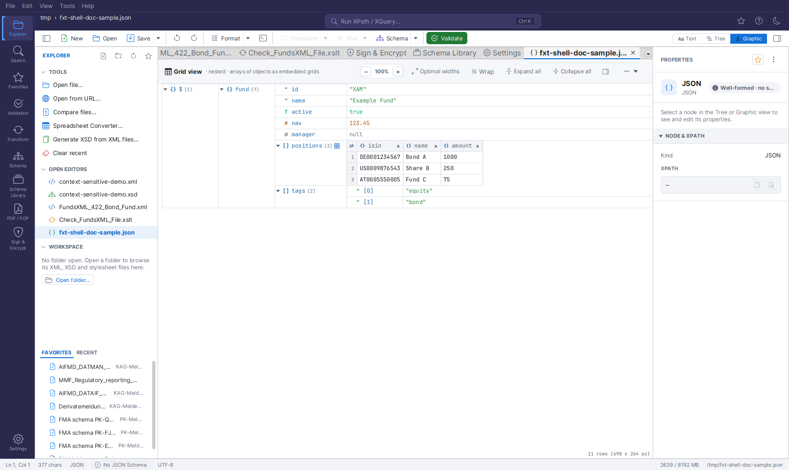

# JSON grid

JSON documents (`.json`, `.jsonc`, `.json5`) get the **same grid** in the **Graphic** view -
same header strip, same rows, same keyboard shortcuts and context menu - so a JSON file
looks and feels exactly like an XML file in the grid:

- The **root** value is the `$` row; **object properties** and **array items** (`[0]`, `[1]`, …)
  are the rows beneath it. Objects and arrays are collapsible containers showing their child
  count; scalar properties show as `key = value` rows.
- Every row carries a **type glyph** in its own colour: `{}` object, `[]` array, `"` string,
  `#` number, `T`/`F` boolean and `∅` null. **Strings are shown quoted** (`= "Alice"`) - like
  XML leaf values - so `"42"` and `42` are never confused.
- **Arrays of objects** are rendered as **embedded grids** (a table with one column per key,
  merged across all items), exactly like repeating elements in XML. The arrow in a column
  header **sorts** the array (numbers, dates and strings are recognised), nested objects expand
  inline; a click on the header's name selects the column, **+** / **−** open and close its
  nested objects level by level, as in XML.
- **Inline editing** keeps the value's type: double-click a number and type a number
  (anything else is rejected with a hint and the editor stays open), booleans toggle between
  `true`/`false`, `null` stays `null` unless you type text. Double-click a key to rename it
  (duplicate keys are refused).
- The context menu mirrors the XML one: **Add** (Property / Array Item / Sibling Before /
  After), **Rename Key** (F2), **Duplicate** (Ctrl+D), **Copy / Cut / Paste as Sibling /
  Paste as Child**, **Copy Cell Content**, **Copy JSONPath** (Ctrl+Alt+X - e.g.
  `$.items[1].name`), **Copy Node (JSON)** (Ctrl+Alt+C), **Change Type** (String / Number /
  Boolean / Null / Object / Array), **Move Up / Down** (Alt+↑/↓), **Expand Fully / Collapse
  Unselected**, **Display as Table**, **Flip Rows/Columns**, **Copy Table as Tab-separated
  Text**, **Expand All / Collapse All**, **Sort Column** and **Delete**. Copy Cell Content is
  Ctrl+Shift+C, as in the XML grid.
- **Delete in a table** works as in the XML grid: on selected **cells** only their properties
  are removed (key and value - no empty value is left), the objects stay; rows selected on
  their **row numbers** are deleted as whole objects. One **Undo** restores everything.
- All edits go through the document's **undo history** (Ctrl+Z / Ctrl+Y) and are written back
  into the text - the Text, Tree and Graphic views share one model, and the **Properties**
  inspector edits keys and values from any of them.
- **Same layout and controls as the XML grid.** Objects and arrays are nested blocks with
  one-line previews when collapsed; the header strip offers the **zoom pill**, **Optimal
  widths**, **Wrap**, **Expand all** / **Collapse all** and the **⋯** menu (cell-height limit,
  sibling groups); name and table columns can be dragged to a new width (double-click to
  auto-fit). **Expand Fully** (Ctrl+Shift++) and **Collapse Unselected** (Ctrl+Shift+−),
  **Display as Table** / **Flip Rows/Columns** for arrays of objects, the scroll header,
  sticky table headers and the search in table cells all work as described above. Table cells can be selected and
  copied as tab-separated text (Ctrl+C or **Copy Table as Tab-separated Text**). **Ctrl+V**
  pastes tab-separated cells (e.g. from a spreadsheet) from the selected cell on: a number or
  boolean cell keeps its type (a value that does not fit is skipped), a missing property is
  added as a string, and rows beyond the table become new objects - all in **one undo step**.
  The zoom factor is shared with the XML grid.
- **Change a value's type** by clicking its type glyph (or Ctrl+Alt+T on the selected row):
  a popup lists the other types. Number ↔ String ↔ Boolean ↔ Null convert the value
  (`"42"` → `42`); Object and Array start empty. One undo step.
- **Drag & drop:** drag a row by its name cell onto another row - the upper part of the name
  cell inserts **before** it, the lower part **after** it, the middle of an object or array
  **into** it; hold **Ctrl** to copy instead of move. A property moved into another object
  keeps its key (made unique with `_copy` if it is taken); an item moved into an object gets
  the key `item`. JSON text dragged in from another application becomes a new value (an
  object dropped into an object adds its properties), plain text a string; dropped on a value
  cell it replaces the value. A node can never be dropped into itself.
- **Table** submenu (right-click a cell of an array-of-objects table): **Insert Row Before /
  After**, **Append Row** (a new object with every column as an empty string), **Insert
  Column Before / After…** (the key in every object, next to the clicked column) and
  **Rename Column…** (also a double-click on the column header; refused as a whole when an
  object already uses the new key). Each is one undo step.
- **Sort Keys** / **Sort Keys Recursively** on an object (or a member of it) sorts its
  properties by key - recursively also every object below it, inside arrays too. One undo step.
- **Filters (JSONPath):** right-click an object or array → **Filter…** and enter a JSONPath
  expression relative to it (`$` is that value), e.g. `$.orders[?(@.total > 100)]` or
  `$..email`. Only the matches stay visible, with their parents and everything below them; a
  table keeps only its matching rows. Started on a value row (`city = "Graz"`) the dialog
  suggests `$[?(@['city'] == 'Graz')]` on the array holding the objects. **Filter to Focus**,
  **Filter Active** and **Remove (All) Filters** work as in the XML grid; filters are not saved
  in the document.
- **Validation markers:** after **Validate** (or while typing with live validation), the rows
  of values with a problem get a red marker with the messages as tooltip, as in the XML grid.
- **Entry helpers:** the header's entry-helpers toggle opens the side panel. With a JSON Schema
  bound, **Siblings** lists the properties the selected value's object may have, **Children**
  those of the selected object (required ones marked `!`, present ones greyed) and **Values**
  the allowed values of the selected scalar. Insert / Append / Add and a double-click add the
  property with a starting value from the schema (its `const`, `default`, or an empty value of
  its type) or set the value - each one undo step.
- **XML only:** **Wrap in Element**, **Edit as Raw Text**, formulas and saving filters in the
  document.

!!! warning "Comments and JSON5 syntax are not preserved"
    The grid edits the parsed *model*. Comments (JSONC) and JSON5 syntax (unquoted keys,
    single quotes, trailing commas) are not part of it, so the **first grid edit rewrites the
    file as standard JSON**. The grid shows a warning the first time it opens such a file;
    if you need to keep the comments, edit in the Text view instead.
