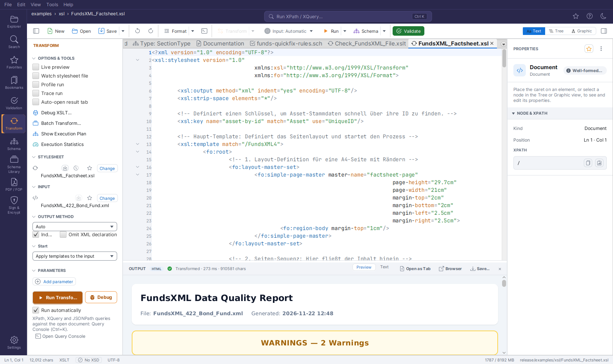
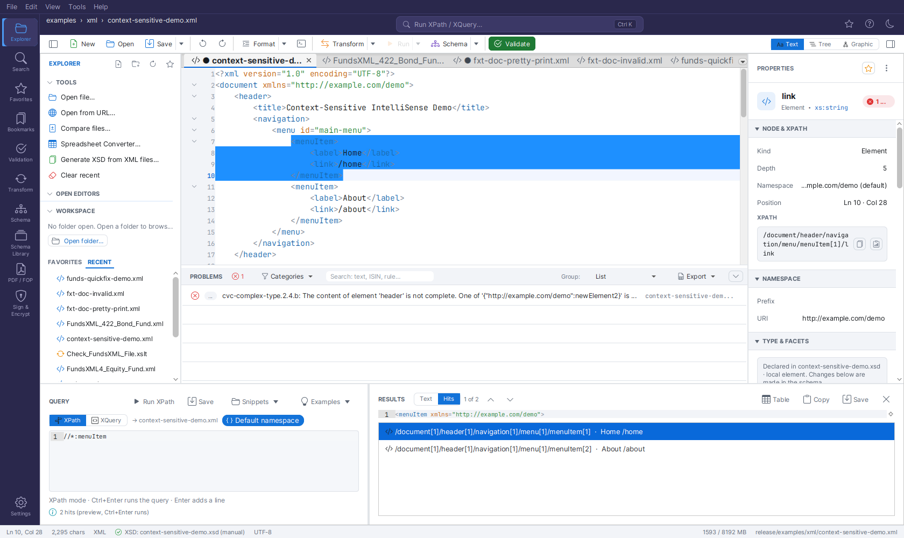

# XSLT and XQuery examples

Short, complete examples to copy from: XSLT 1.0 to 3.0 patterns and XQuery expressions.

## What is XSLT?

XSLT (Extensible Stylesheet Language Transformations) is a language for transforming XML documents. Think of it like a
recipe that tells the computer how to convert your XML data into a different format such as HTML, text, or another XML
structure.


*XML input + XSLT rules = Output: the `examples/xslt/FundsXML_Factsheet.xslt` stylesheet
rendered as HTML in the OUTPUT panel below the editor*

**Common uses:**

- Convert XML data to HTML for web display
- Transform XML between different schemas
- Generate reports from XML data
- Extract and restructure data

## XSLT Examples

FreeXmlToolkit includes example XSLT stylesheets in the `examples/` folder. Here are some common XSLT patterns:

### Example 1: Basic XML to HTML

Transform a simple XML list to an HTML table:

```xml
<!-- Input XML -->
<books>
    <book>
        <title>XML for Beginners</title>
        <author>Jane Smith</author>
        <price>29.99</price>
    </book>
    <book>
        <title>Advanced XSLT</title>
        <author>John Doe</author>
        <price>49.99</price>
    </book>
</books>
```

```xslt
<!-- XSLT Stylesheet -->
<?xml version="1.0" encoding="UTF-8"?>
<xsl:stylesheet version="1.0"
                xmlns:xsl="http://www.w3.org/1999/XSL/Transform">

  <xsl:output method="html" indent="yes"/>

  <xsl:template match="/">
    <html>
      <head><title>Book List</title></head>
      <body>
        <h1>Available Books</h1>
        <table border="1">
          <tr>
            <th>Title</th>
            <th>Author</th>
            <th>Price</th>
          </tr>
          <xsl:for-each select="books/book">
            <tr>
              <td><xsl:value-of select="title"/></td>
              <td><xsl:value-of select="author"/></td>
              <td><xsl:value-of select="price"/></td>
            </tr>
          </xsl:for-each>
        </table>
      </body>
    </html>
  </xsl:template>

</xsl:stylesheet>
```

**Output:** An HTML page with a table listing all books.

---

### Example 2: Filter and Sort Data

Filter items based on a condition and sort the results:

```xslt
<?xml version="1.0" encoding="UTF-8"?>
<xsl:stylesheet version="1.0"
                xmlns:xsl="http://www.w3.org/1999/XSL/Transform">

  <xsl:output method="xml" indent="yes"/>

  <xsl:template match="/">
    <expensive-books>
      <!-- Select books over $30, sorted by price descending -->
      <xsl:for-each select="books/book[price > 30]">
        <xsl:sort select="price" data-type="number" order="descending"/>
        <book>
          <xsl:copy-of select="title"/>
          <xsl:copy-of select="price"/>
        </book>
      </xsl:for-each>
    </expensive-books>
  </xsl:template>

</xsl:stylesheet>
```

---

### Example 3: Using Templates for Modular Code

Use templates to organize complex transformations:

```xslt
<?xml version="1.0" encoding="UTF-8"?>
<xsl:stylesheet version="1.0"
                xmlns:xsl="http://www.w3.org/1999/XSL/Transform">

  <xsl:output method="html" indent="yes"/>

  <!-- Main template -->
  <xsl:template match="/">
    <html>
      <body>
        <xsl:apply-templates select="books/book"/>
      </body>
    </html>
  </xsl:template>

  <!-- Template for each book -->
  <xsl:template match="book">
    <div class="book">
      <h2><xsl:value-of select="title"/></h2>
      <p>By: <xsl:value-of select="author"/></p>
      <xsl:call-template name="format-price">
        <xsl:with-param name="amount" select="price"/>
      </xsl:call-template>
    </div>
  </xsl:template>

  <!-- Named template for price formatting -->
  <xsl:template name="format-price">
    <xsl:param name="amount"/>
    <p class="price">
      <xsl:text>Price: $</xsl:text>
      <xsl:value-of select="format-number($amount, '#,##0.00')"/>
    </p>
  </xsl:template>

</xsl:stylesheet>
```

---

### Example 4: XML to JSON-like Structure

Convert XML to a JSON-friendly text format:

```xslt
<?xml version="1.0" encoding="UTF-8"?>
<xsl:stylesheet version="1.0"
                xmlns:xsl="http://www.w3.org/1999/XSL/Transform">

  <xsl:output method="text"/>

  <xsl:template match="/">
    <xsl:text>[</xsl:text>
    <xsl:for-each select="books/book">
      <xsl:if test="position() > 1">,</xsl:if>
      <xsl:text>{"title":"</xsl:text>
      <xsl:value-of select="title"/>
      <xsl:text>","author":"</xsl:text>
      <xsl:value-of select="author"/>
      <xsl:text>","price":</xsl:text>
      <xsl:value-of select="price"/>
      <xsl:text>}</xsl:text>
    </xsl:for-each>
    <xsl:text>]</xsl:text>
  </xsl:template>

</xsl:stylesheet>
```

---

### Example 5: Conditional Formatting

Apply different styles based on data values:

```xslt
<?xml version="1.0" encoding="UTF-8"?>
<xsl:stylesheet version="1.0"
                xmlns:xsl="http://www.w3.org/1999/XSL/Transform">

  <xsl:output method="html" indent="yes"/>

  <xsl:template match="/">
    <html>
      <head>
        <style>
          .low-price { color: green; }
          .high-price { color: red; font-weight: bold; }
        </style>
      </head>
      <body>
        <xsl:for-each select="books/book">
          <p>
            <xsl:value-of select="title"/>:
            <span>
              <xsl:attribute name="class">
                <xsl:choose>
                  <xsl:when test="price &lt; 30">low-price</xsl:when>
                  <xsl:otherwise>high-price</xsl:otherwise>
                </xsl:choose>
              </xsl:attribute>
              $<xsl:value-of select="price"/>
            </span>
          </p>
        </xsl:for-each>
      </body>
    </html>
  </xsl:template>

</xsl:stylesheet>
```

---

### Example 6: Grouping with Keys (XSLT 1.0 Muenchian Grouping)

Group items by a common value:

```xslt
<?xml version="1.0" encoding="UTF-8"?>
<xsl:stylesheet version="1.0"
                xmlns:xsl="http://www.w3.org/1999/XSL/Transform">

  <xsl:output method="html" indent="yes"/>

  <!-- Key for grouping books by author -->
  <xsl:key name="books-by-author" match="book" use="author"/>

  <xsl:template match="/">
    <html>
      <body>
        <h1>Books by Author</h1>
        <!-- Select first book of each author group -->
        <xsl:for-each select="books/book[count(. | key('books-by-author', author)[1]) = 1]">
          <xsl:sort select="author"/>
          <h2><xsl:value-of select="author"/></h2>
          <ul>
            <!-- List all books by this author -->
            <xsl:for-each select="key('books-by-author', author)">
              <li><xsl:value-of select="title"/></li>
            </xsl:for-each>
          </ul>
        </xsl:for-each>
      </body>
    </html>
  </xsl:template>

</xsl:stylesheet>
```

## XSLT 3.0 Examples

FreeXmlToolkit supports XSLT 3.0 via Saxon HE. Here are some advanced patterns:

### For-Each-Group (XSLT 2.0/3.0)

Group items without the Muenchian method:

```xslt
<?xml version="1.0" encoding="UTF-8"?>
<xsl:stylesheet version="3.0"
                xmlns:xsl="http://www.w3.org/1999/XSL/Transform">

  <xsl:output method="html" indent="yes"/>

  <xsl:template match="/">
    <html>
      <body>
        <h1>Books by Author</h1>
        <xsl:for-each-group select="books/book" group-by="author">
          <xsl:sort select="current-grouping-key()"/>
          <h2><xsl:value-of select="current-grouping-key()"/></h2>
          <ul>
            <xsl:for-each select="current-group()">
              <li><xsl:value-of select="title"/></li>
            </xsl:for-each>
          </ul>
        </xsl:for-each-group>
      </body>
    </html>
  </xsl:template>

</xsl:stylesheet>
```

### Using Maps and Arrays (XSLT 3.0)

```xslt
<?xml version="1.0" encoding="UTF-8"?>
<xsl:stylesheet version="3.0"
                xmlns:xsl="http://www.w3.org/1999/XSL/Transform"
                xmlns:map="http://www.w3.org/2005/xpath-functions/map">

  <xsl:output method="text"/>

  <xsl:variable name="config" select="map {
    'title': 'Report',
    'format': 'detailed',
    'max-items': 100
  }"/>

  <xsl:template match="/">
    <xsl:text>Title: </xsl:text>
    <xsl:value-of select="map:get($config, 'title')"/>
  </xsl:template>

</xsl:stylesheet>
```

### JSON Output (XSLT 3.0)

```xslt
<?xml version="1.0" encoding="UTF-8"?>
<xsl:stylesheet version="3.0"
                xmlns:xsl="http://www.w3.org/1999/XSL/Transform">

  <xsl:output method="json" indent="yes"/>

  <xsl:template match="/">
    <xsl:map>
      <xsl:map-entry key="'books'">
        <xsl:array>
          <xsl:for-each select="books/book">
            <xsl:map>
              <xsl:map-entry key="'title'" select="string(title)"/>
              <xsl:map-entry key="'author'" select="string(author)"/>
              <xsl:map-entry key="'price'" select="number(price)"/>
            </xsl:map>
          </xsl:for-each>
        </xsl:array>
      </xsl:map-entry>
    </xsl:map>
  </xsl:template>

</xsl:stylesheet>
```

### Text Value Templates (XSLT 3.0)

```xslt
<?xml version="1.0" encoding="UTF-8"?>
<xsl:stylesheet version="3.0"
                xmlns:xsl="http://www.w3.org/1999/XSL/Transform"
                expand-text="yes">

  <xsl:output method="html" indent="yes"/>

  <xsl:template match="/">
    <html>
      <body>
        <xsl:for-each select="books/book">
          <p>{title} by {author} - ${price}</p>
        </xsl:for-each>
      </body>
    </html>
  </xsl:template>

</xsl:stylesheet>
```

## XQuery

XQuery is powerful for querying and transforming XML data. There are two ways to work with
it:

- **XQuery documents** — open (or create) a `.xq` / `.xquery` file; it gets its own editor
  with highlighting and autocomplete. Press the toolbar's **Run** button (`Ctrl+Enter`) to
  run it against the selected [Input](query-console.md#query-documents-the-target-selector);
  the result appears in the OUTPUT panel.
- **The [Query Console](query-console.md#query-console)** — switch it to **XQuery** mode and
  run a query against the active document.

### Basic XQuery Example

```xquery
for $book in /books/book
where $book/price > 30
order by $book/title
return <result>{$book/title}</result>
```

### Built-in XQuery Examples

The Query Console's **Examples** menu inserts sample queries:

| Example                | Description                |
|------------------------|----------------------------|
| **Simple**             | Basic element selection    |
| **FLWOR**              | For-Let-Where-Order-Return |
| **HTML report**        | Generate HTML output       |
| **Data-quality check** | Validate data completeness |

!!! tip
    The installation ships **17 ready-to-run XQuery scripts** in `examples/xquery/` and
    **32 XPath expressions** in `examples/xpath/` — open any of them and press
    `Ctrl+Enter`. See [Bundled Example Collections](#bundled-example-collections).

## XQuery Examples

### Data Extraction

```xquery
(: Extract all customer emails :)
for $customer in /customers/customer
return <email>{$customer/email/text()}</email>
```

### Transformation

```xquery
(: Transform to HTML table :)
<table>
  <tr><th>Name</th><th>Email</th></tr>
  {
    for $c in /customers/customer
    return <tr>
      <td>{$c/name/text()}</td>
      <td>{$c/email/text()}</td>
    </tr>
  }
</table>
```

### Aggregation

```xquery
(: Calculate statistics :)
let $orders := /orders/order
return <stats>
  <count>{count($orders)}</count>
  <total>{sum($orders/amount)}</total>
  <average>{avg($orders/amount)}</average>
  <min>{min($orders/amount)}</min>
  <max>{max($orders/amount)}</max>
</stats>
```

### Conditional Logic

```xquery
(: Categorize items :)
for $item in /items/item
return <categorized>
  <name>{$item/name/text()}</name>
  <category>{
    if ($item/price > 100) then "Premium"
    else if ($item/price > 50) then "Standard"
    else "Budget"
  }</category>
</categorized>
```

## Queries on the open document


*The Query Console docked below the editor - XPath query on the left, the result on the right*

Use XPath and XQuery to find and extract data from your XML documents. The fastest way is
the **Query Console**, a panel that docks along the bottom of the editor and always runs
against the **active** document.

### Using the Query Console

1. Toggle the console with **Ctrl+Shift+X** or the toolbar's terminal icon
2. Choose **XPath** or **XQuery** with the mode toggle
3. Enter your expression - it is syntax-highlighted, and IntelliSense suggests element
   names, functions, and axes as you type (or on **Ctrl+Space**)
4. Click **Run** or press **Ctrl+Enter** (Enter inserts a new line; the hint below the query says so)
5. The result appears in the read-only results pane on the right, with syntax highlighting;
   **Copy** puts it on the clipboard

**Save** stores the current expression as a named snippet, and the **Snippets** menu loads
any saved XPath or XQuery snippet back into the console. See
[Query Console](query-console.md#query-console) for the full reference.

### XPath Examples

| Expression | Description |
|------------|-------------|
| `//element` | Find all elements named "element" |
| `//element/@attr` | Find all "attr" attributes on "element" |
| `/root/child[1]` | Find the first child of root |
| `count(//item)` | Count all item elements |
| `//text()` | Find all text nodes |

### XQuery Examples

| Expression | Description |
|------------|-------------|
| `for $x in //item return $x` | Return all items |
| `for $x in //item where $x/@id='1' return $x/name` | Filter and return |

Use the **Examples** menu for quick insertion of common expressions.

### Bundled Example Collections

Your FreeXmlToolkit installation ships ready-to-run query
collections in the `examples` folder next to the application:

- **`examples/xpath/`** - 32 XPath 3.1 expressions (one per file, each with a comment
  header). Files 01-20 cover the basics; files 21-32 are a **reporting series** that
  joins positions, asset master data and transactions and outputs CSV, ASCII
  tables/charts, Markdown tables or JSON.
- **`examples/xquery/`** - 17 XQuery 3.1 scripts. Files 01-11 are data-quality checks
  with HTML reports; files 12-17 are **reporting/export examples** (CSV export, ASCII
  dashboard, Markdown fund report, JSON export, pivot table, two-fund comparison).
- **`examples/xproc/`** - 8 XProc 3.0 pipelines, from a minimal identity pipeline to
  multi-step chains: slimming with `p:delete`, CSV/JSON export by orchestrating the
  bundled stylesheets, metadata stamping, `p:for-each` iteration, `p:choose`
  branching and a Schematron SVRL report. See the folder's `README.md`.
- **`examples/xspec/`** - 5 [XSpec](xspec.md) test files for an
  XSLT stylesheet, an XQuery module and a Schematron (with the code under test next to them);
  `05-failing-demo.xspec` fails on purpose to show what a failure looks like. Open one and
  choose **Tools → Run XSpec Tests**.

All examples target the FundsXML4 sample documents in `examples/xml/`. The simplest way
to run one: **open the file directly** and press the toolbar's **Run** button
(`Ctrl+Enter`) - query, XSLT and XProc files are first-class editor documents that run
against the [Input dropdown](query-console.md#query-documents-the-target-selector)'s
selection (by default the most recently active XML document). Alternatively paste a query
into the query panel or the [Query Console](query-console.md#query-console) - the
`map:`, `array:` and `math:` function namespaces are pre-declared, so expressions using
`map:merge()`, `array:size()` etc. run without any prolog. Each folder contains a
`README.md` describing every example.

---
