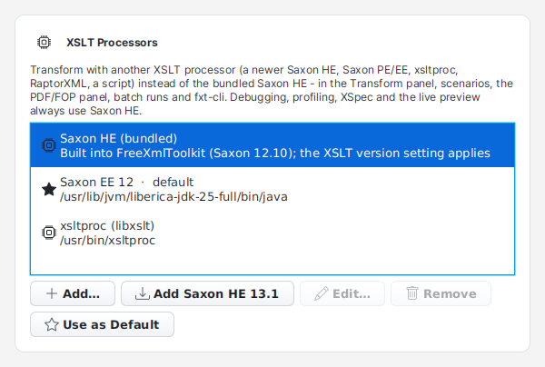
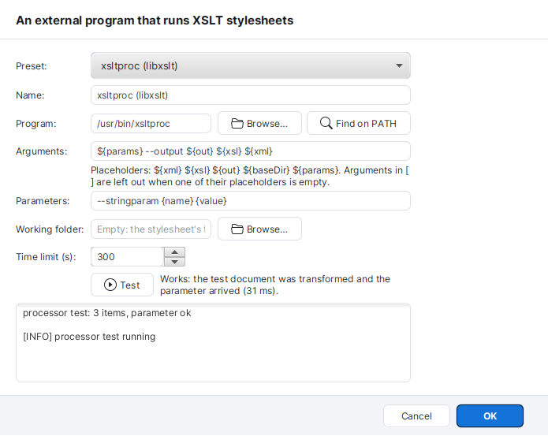

# External XSLT processors

Instead of the bundled Saxon HE a transformation can run on any XSLT processor with a command line:
a **newer Saxon HE** (13.1, see below), **Saxon PE/EE** (the licensed editions - schema-aware processing, extension functions, higher-order functions in
older versions), **xsltproc** (libxslt, XSLT 1.0), **Altova RaptorXML**, or a script of your own - for example to
check that a stylesheet gives the same result on the processor your production system uses.

**Set one up:** *Settings → Extensions → XSLT Processors* (or the gear button next to **Processor**) → **Add…**

## Before you start

- The external program installed on this computer; Saxon HE 13 can be downloaded from the settings (see below).
- Administrators can switch external processors off.

## Saxon HE 13 {#saxon-he-13}

The bundled Saxon HE is version 12.10: XML Calabash, the XProc engine, is built against it, and two Saxon versions
cannot run inside one application. **Add Saxon HE 13.1** on the same settings card gives you the newest Saxon HE
(XSLT 4.0 / XPath 4.0 preview features, current fixes) next to it:

1. After a confirmation about 6.4 MB are downloaded from Maven Central (`repo1.maven.org`; the proxy settings
   apply), checked against fixed SHA-256 checksums and stored in `~/.freeXmlToolkit/saxon/13.1/`.
2. A processor **Saxon HE 13.1** is added. It runs in a process of its own with FreeXmlToolkit's Java runtime -
   nothing else needs to be installed.
3. Choose it in the Transform panel's **Processor** box, in a scenario, or make it the default.

The rest of the application - debugger, profiler, live preview, XSpec, XProc, Schematron and the AI tools - keeps
using the bundled Saxon HE 12.10. The list shows which version is bundled. Nothing is downloaded until you click
the button; when the administrator turns external processors off, the button is disabled too.

| Field | Meaning |
|---|---|
| **Preset** | Fills arguments and parameter syntax for Saxon PE/EE, xsltproc, RaptorXML or *Custom* |
| **Name** | Shown in the panels; also used by scenarios and `fxt-cli transform --processor` |
| **Program** | The executable or script. Empty: the preset's program is looked up on the `PATH` (**Find on PATH**); the Saxon presets use FreeXmlToolkit's own `java` first |
| **Arguments** | The argument template (below) |
| **Parameters** | How one stylesheet parameter is passed (below) |
| **Working folder** | Where the program runs. Empty: the stylesheet's folder |
| **Time limit** | The program is stopped after this many seconds (default 300) |

**Test** transforms a small document with one parameter and says whether the transformation worked and the
parameter arrived. **Use as Default** makes a processor the default for scenarios, the PDF/FOP panel and the
command line.

**Argument template** - arguments are separated by spaces, an argument with spaces goes in double quotes, the
program is started directly (never through a shell), `[ … ]` is an optional group as for the
[XSL-FO processors](../publish-pdf.md#argument-template):

| Placeholder | Value |
|---|---|
| `${xsl}` | The stylesheet (required) |
| `${out}` | The result file to write (required) |
| `${xml}` | The input document |
| `${baseDir}` | The stylesheet's folder |
| `${params}` | The stylesheet parameters, each written with the parameter template - several arguments |

**Parameter template** - repeated for every parameter: `{name}` and `{value}` are replaced, e.g.
`--stringparam {name} {value}` gives three arguments per parameter.

| Preset | Program | Arguments | Parameters |
|---|---|---|---|
| Saxon HE 13.1 (Java) | `java` | `-cp "<the downloaded jars>" net.sf.saxon.Transform -s:${xml} -xsl:${xsl} -o:${out} ${params}` | `{name}={value}` |
| Saxon PE/EE (Java) | `java` | `-cp "saxon-pe-12.jar" net.sf.saxon.Transform -s:${xml} -xsl:${xsl} -o:${out} ${params}` | `{name}={value}` |
| xsltproc (libxslt) | `xsltproc` | `${params} --output ${out} ${xsl} ${xml}` | `--stringparam {name} {value}` |
| Altova RaptorXML | `raptorxml` | `xslt --input=${xml} --output=${out} ${params} ${xsl}` | `--param={name}:'{value}'` |

For Saxon replace `saxon-pe-12.jar` with the path of your jar (the licence file goes next to it).

**How a run works:** the stylesheet and input text you have in the editor - saved or not - are written to hidden
temporary files **next to the originals** (`.fxt-xslt-…`, deleted afterwards), so relative `xsl:include`,
`xsl:import` and `document()` references resolve as they do for the files. The program runs in the working
folder; it succeeded when it exits with code 0 and wrote the result. Its console output becomes the run's
messages (`xsl:message`); for an error the first line, error code and phase are read from the output of Saxon,
xsltproc and RaptorXML, so the error shows its line as with Saxon HE.

**What stays on Saxon HE:** the live preview, **Profile**, **Trace**, the debugger, XSpec, XProc and the AI tools
need Saxon's internals; with an external processor chosen, Profile and Trace are off and the XSLT version setting
does not apply (the program has its own).

**Where it applies:** the Transform panel and the editor's Run Transform, [scenarios](../projects.md) (field
`xsltProcessor`), the batch transform, the XSLT stage of the [PDF/FOP panel](../publish-pdf.md) and the command
line (`fxt-cli transform --processor`, `fxt-cli fop --xslt-processor`). An administrator can turn external
processors off with `xslt.external.allowed=false` - see [Administration](../../administer/policies.md).

## Next steps

- [Run a transformation](run-xslt.md)
- [Standards and language versions](../../reference/standards-versions.md)
- [Policies](../../administer/policies.md)
