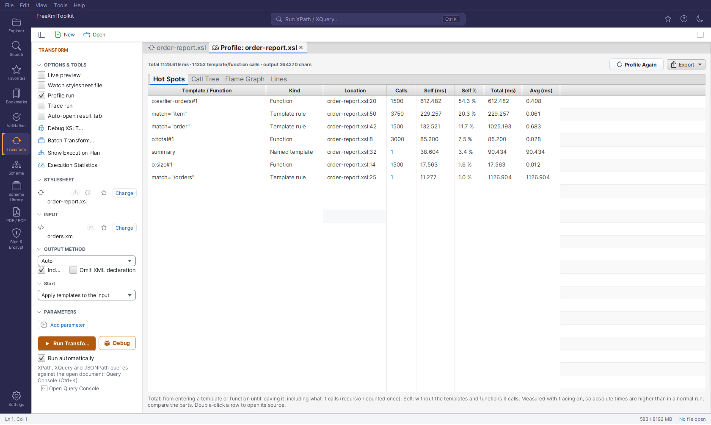
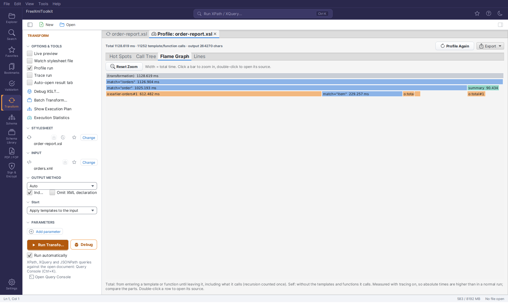

# Profile a transformation

Every run shows compact statistics in the OUTPUT panel's status line:
`Transformed · N ms · M chars` — the **execution time** and the **output size**.

***Hot Spots**: calls, own time and total time of every template rule and function*

***Flame Graph**: the width of a bar is its total time*

For a deeper look, enable **Profile run** in the Transform panel's **OPTIONS & TOOLS** section: the next
transformation runs under the XSLT profiler and opens a **Profile: <stylesheet>** tab that shows
where the time goes.

| Tab | Shows |
|---|---|
| **Hot Spots** | Every template rule (with its mode), named template and function: calls, **Self** time and its share of the run, **Total** time, average per call. Sorted by self time: the top rows are what to optimize. |
| **Call Tree** | Who called whom: the whole run at the top, below it the templates and functions each one called, with calls, total time and its share, and self time. The slowest path is expanded. |
| **Flame Graph** | The call tree as bars; the width is the total time. Click a bar to zoom in (it fills the width), click it again or **Reset Zoom** to go back; hover for the numbers. Right-click to export it as PNG, SVG or PDF or to copy it as an image ([Exporting a Graphical View](../../get-started/workspace-tour.md#export-view)). |
| **Lines** | Self time per stylesheet line, with the line's text: the expressions and instructions that cost the most. |

**Total** is the time from entering a template or function until leaving it, including everything it
calls; a recursive function counts only its outermost calls, so no time is counted twice (in the call
tree its recursive calls are folded into one node). **Self** is the total without the templates and
functions it calls. Double-click a row or bar to open the stylesheet (also an included or imported
module) at that line.

The run is measured with Saxon's tracing on, so the absolute times are higher than in a normal
transformation; compare the parts with each other. The first run of a stylesheet also includes the
warm-up of Java's JIT compiler: **Profile Again** measures once more after a warm-up run, which gives
steadier numbers. **Export** writes the profile as JSON (with the call tree) or as a text report.

## Before you start

- A stylesheet and an input set in the **Transform** panel, or a query document.

## Profiling an XQuery

An XQuery is profiled the same way: open the `.xq` file and choose **Run ▾ → Profile Query**. The
query runs against the selected **Input** (or without a context item when none is chosen), its
result goes to the OUTPUT panel, and a **Profile: <query>** tab opens with the same four views. The
components are the query's user functions (`declare function`); the time outside them belongs to the
root of the call tree, **(query body)**. Saxon may move an expression that does not depend on a loop
out of it, so a function called in a loop can show fewer calls than iterations.

On the command line, `fxt-cli transform --profile report.json …` profiles a stylesheet or a query run
(see [Command Line](../../automate/cli-transform.md#transform)).

---

## Performance Statistics

After each transformation, the OUTPUT panel's status line shows compact statistics in the
form `Transformed · N ms · M chars`:

- **Execution time** - How long the transformation took (milliseconds)
- **Output size** - Size of the generated output (characters)

For detailed per-template timings, enable **Profile run** in the Transform panel's **OPTIONS & TOOLS** section -
the next run also opens a read-only Profile tool tab.

## Next steps

- [Debugger](debug.md)
- [Execution statistics](../../reference/execution-statistics.md)
