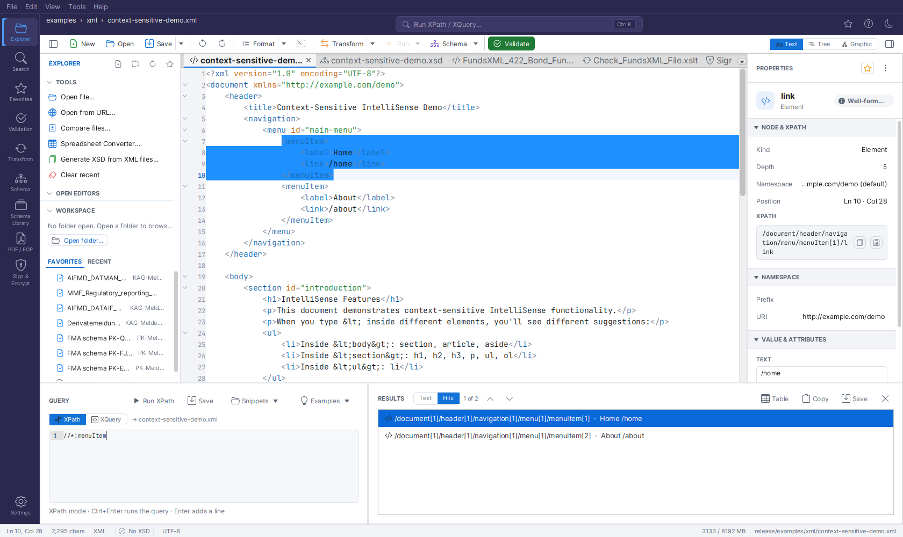
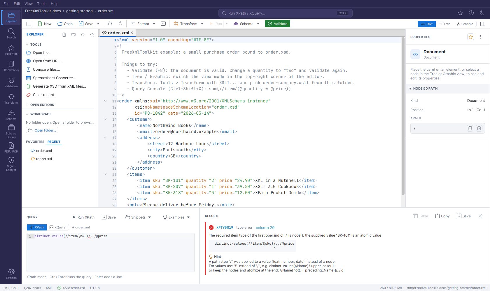
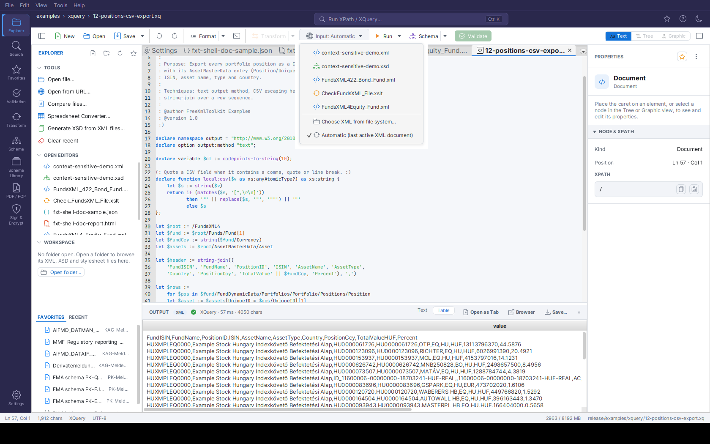

# Query Console & Query Documents

XPath, XQuery and JSONPath queries run either in the **Query Console** at the bottom of the editor (Ctrl+K) or as query documents (`.xq`, `.xpath`) with an input selector.

## Query Console

> Run XPath, XQuery and JSONPath against the open document right from the editor. This is
> the one place for queries - the Transform panel links here with its **Open Query Console**
> button.

The **Query Console** is a panel that opens along the **bottom of the editor**. Toggle it with the
**terminal icon** in the editor toolbar or with **Ctrl+Shift+X**; **Ctrl+K** (or a click on the
header search pill) opens it and focuses the query input. Close it with the **✕** button at its
top right. It runs against whichever
document is currently active, so it is the fastest way to probe an XML or JSON file while you work.

The same queries run on the command line with [`fxt-cli query`](../../automate/cli-validate.md#query), e.g.
`fxt-cli query -e 'count(//Position)' data/` for every XML file of a folder.

*The Query Console with IntelliSense: typing `/` in the XPath input opens the completion popup
(document elements and axes). The mode toggle and Run are on the left; on the right, the results
pane shows the previous run's XML result with syntax highlighting.*

### Layout

- **Left - the query:**
  - An **XPath | XQuery** mode switch; the active mode is filled in the accent colour. The
    mode is also named on the **Run** button (*Run XPath* / *Run XQuery*), in the hint below the
    input (*XPath mode · …*) and in the empty input's example. While a JSON document is active,
    the XPath segment reads **JSONPath**. Next to the switch: the document the query runs against.
  - The query input **with IntelliSense** (autocomplete): suggestions pop up as you type after
    `/`, `//`, `@`, `[`, `(`, `$` and `::`, or on demand with **Ctrl+Space**. It suggests element
    and attribute names from the active document, XPath/XQuery functions, axes, operators and
    (in XQuery mode) FLWOR keywords. Use ↑/↓ to navigate and **Enter**/**Tab** to accept.
  - The query is **syntax-highlighted** as you type: keywords, functions, axes, variables,
    strings, numbers and comments each get their own color.
  - To run: press **Ctrl+Enter** in either mode (Enter inserts a new line, so queries can
    span several lines; a hint below the query says so). The **Run** button works in both modes.
  - **Run** - Execute the query against the active document.
  - **Save** - Save the current expression as a reusable snippet (see below).
  - **Snippets** - A menu of your saved XPath and XQuery snippets; pick one to load it (the console
    switches to the matching mode automatically).
  - **Examples** - Inserts a built-in XQuery example: **Simple**, **FLWOR**, **HTML report** or
    **Data-quality check**.
  - **Ask AI…** - Shown while the [AI assistant](../ai-assistant.md) is on: describe what you want in your own
    words; the model writes the XPath or XQuery (for the current mode), the application runs it against the active
    document and shows the item count and first results, and **Insert into the console** puts it into the input.
    Running it stays your action. XML documents only. See
    [A question → XPath or XQuery](../ai-assistant.md#a-question-xpath-or-xquery).
- **Right - the results:**
  - A read-only, selectable results editor with **line numbers** showing the query
    result. **XML results are
    syntax-highlighted** (tags, attributes, values, comments), and **JSON results** (e.g. from
    JSONPath queries) get JSON highlighting; scalar results and messages stay plain.
  - **Copy** - Copy the full result to the clipboard.
  - **Table** - Shows the last XPath or XQuery result as a table in the
    [OUTPUT panel](../../reference/transform-panel.md#the-output-panel-results): each result item is a row, its child elements
    (or, without any, its attributes) are the columns; plain values fill a single **value** column. Enabled after
    a run on an XML document whose result has at least one item (not for JSONPath). An XPath result is projected
    at the console's [XPath version](../../reference/standards-versions.md).

Like the text editor, every console area zooms with the mouse: hold **Ctrl** and scroll the
**mouse wheel** over the query input or the results to change that area's font size
(**Ctrl+0** resets it to the size of the [editor font](../../reference/settings.md#editor-font)).

### Running a Query

1. Open the console (**Ctrl+K**, the header search pill, the terminal icon, or **Ctrl+Shift+X**) - it opens focused on the query input.
2. Choose **XPath** or **XQuery** with the mode toggle.
3. Type your expression, then click **Run** (in XPath mode, **Enter** also runs).
4. The result appears on the right. Use **Copy** to put it on the clipboard.

See [When a query fails](#when-a-query-fails) for how errors are shown.

The console always runs against the **active** document. For an **XML** document it evaluates the
expression directly; for a **JSON** document the toggle reads **JSONPath** and the input is
evaluated as a **JSONPath** expression. When no document is open, **Run** is disabled and the results pane shows
*"No document open."*

The `map:`, `array:` and `math:` function namespaces are
**pre-declared** in the console, so XPath 3.1 expressions using `map:merge()`,
`array:size()`, `math:pow()` etc. run directly - no namespace prolog needed.

**Namespaces of the document.** The prefixes the document declares are declared for the query too: on a document with
`xmlns:fx="…"`, `//fx:Fund` runs without `declare namespace` (a declaration in the query wins). When the root element
is in a **default namespace** (`<FundsXML xmlns="…">`), a **Default namespace** chip appears next to the target:

- **On** (default): names without a prefix match the document's default namespace, so `//Fund` finds the funds.
- **Off**: names without a prefix match only elements in no namespace, as the XPath standard says; write `*:Fund` or a
  prefix. Completion then proposes `*:Fund`.

The chip, the setting under **Settings → Schemas & Validation → Queries** and query files share one choice. XPath 1.0
cannot bind a default namespace, so the chip is hidden there.

**Hits while typing.** When the expression checks without errors, the console runs it in the background and the line
under the input says what it would find: *"3 hits (preview, Ctrl+Enter runs)"*, *"Result: 42"* or *"No hit"*. The
preview runs on documents up to 5 MB, stops after 1.5 seconds and skips expressions that read files (`doc()`,
`collection()`, `unparsed-text()`). It marks nothing in the document - that stays **Run**'s job. Turn it off under
**Settings → Schemas & Validation → Queries**.

**Cancel and time limit.** While a query runs, **Run** turns into **Cancel** with the seconds so far. An XQuery stops at
once (at its next `for`/`let` clause, function call or constructor); an XPath expression cannot be interrupted, so the
console stops waiting and the expression finishes in the background without showing its result. A run stops on its own
after the **time limit** (60 seconds by default, 0 = none; Settings → Queries). One run computes the text, the table and
the hits together.

!!! note
    The Query Console is an additional, faster access point - it does not replace the **Transform**
    activity. For XSLT transformations, parameters, recent-stylesheet history, watch-and-rerun, and
    the OUTPUT panel's result table and HTML preview, use the [Transform Panel](../../reference/transform-panel.md#transform-panel).

### Variables, trace and the execution plan

- **External variables.** An XQuery that declares `declare variable $n as xs:integer external;` gets a field for
  each such variable under the input (required ones in bold, the type as placeholder). The values are text,
  converted to the declared type. A query file (`.xq`) asks for a required value on its first run and remembers it
  for that file.
- **Trace.** `trace()` output of the last XQuery run is listed in the **Trace (n)** menu next to the results; a
  click copies a line.
- **Show Execution Plan** (the diagram button in XQuery mode, and Run ▾ → Show Execution Plan for a `.xq` tab)
  opens Saxon's plan of the query after optimization in a tab.

### When a query fails

The console checks the expression **while you type** (it is compiled, not run, shortly after you stop typing):

- A **syntax or static error** (missing bracket, unknown function, variable or prefix) gets a red wavy underline,
  and the line under the input names it, for example *XPST0003 · column 7: expected "]", found "<eof>"*.
- A **compiler warning** gets an amber underline. The most useful one says that a `/` step will fail because its
  left side is a value, not a node (`distinct-values(//Ccy)/../Name`) - before you run it.
- Resting the mouse on an underline shows the message.

When a run fails, the RESULTS area shows the error instead of the result:

- **Code** (e.g. `XPTY0019`) as a link to its explanation in the W3C specification, the **kind** (syntax, static,
  type or run-time error) and the **position** - a click puts the cursor at the error in the input.
- The **message** without Saxon's internal notation, and the query line with a **`^` under the error**. The error is
  also underlined in the input until you change it.
- A **Hint** with the usual cause and how to write it instead, for the errors made most often:

| Error | Typical cause | Hint |
|---|---|---|
| `XPTY0019` | A `/` step on a value, e.g. `distinct-values(//Ccy)/../Name` | Use `!` for values, or keep the nodes and atomize at the end |
| `XPTY0020` | An axis step in a predicate on values, e.g. `distinct-values(//Ccy)[../Name]` | Filter the nodes before they become values: `//Fund[Ccy = "EUR"]/Name` |
| `XPTY0004` | Several values where one is needed (`//Fund/Name + 1`), or text where a number is needed (`"5" + 1`) | Pick one with `[1]`, aggregate, or use `!`; convert with `number(.)`, `xs:date(@Date)` |
| `FORG0001` | A value in the wrong format for a cast, e.g. `xs:decimal("1.234,5")` | `xs:date` needs `2026-11-17`, `xs:decimal` a dot; `number(.)` gives `NaN` instead of failing |
| `SXXP0003` | The **document** is not well-formed XML - the query may be fine | Shown as *error in the document* with *document line 3, column 14*; a click on it opens the document there. **Validate** (F8) lists all problems |
| `FODC0002`, `FODC0005`, `XTDE1162`, `FOUT1170` | `doc()` / `unparsed-text()` cannot find or read a file | Relative paths resolve next to the saved document (an unsaved one has no location); absolute paths are `file:` URIs: `doc("file:///C:/data/funds.xml")`, not `C:\data\funds.xml` |

- **Did you mean** buttons for an unknown function (`distinct-value` → `distinct-values`; also *"substring() exists,
  but takes 2 or 3 arguments"*), an unknown variable (`$nme` → `$name`) or an undeclared prefix (`*:Fund`, or in
  XQuery a `declare namespace` with the document's namespace). A click corrects the input.
- **Ask AI to fix** (when the [AI assistant](../ai-assistant.md) is on) sends the query and the error to the assistant;
  its corrected query is checked against the document before it is offered.

**Copy** and **Save** in the RESULTS header take the error as text, with position and hint.

When a query **finds nothing** although the document is in a namespace and the query uses names without a prefix
(`//Fund` on `<funds xmlns="urn:…">`), the line under the input explains it and suggests `*:Fund`.

With **XPath 1.0** chosen as the version (expert mode), errors carry the same codes as the newer versions
(`XPST0003`, `XPST0017` unknown function, `XPST0008` unknown variable) with a position where the XPath 1.0 engine names
a token; a function that exists only in a later version says so: *"distinct-values() exists from XPath 2.0 on; the
query runs as XPath 1.0."* The check while typing uses the XPath 1.0 engine too. For **XQuery 1.0 / 3.0** the check while
typing reports constructs and functions the version does not have (`FXT-COMPAT`, at their position) before you run.
An error inside an **imported module** names the module and its line (*"in module lib.xq, line 2"*) instead of marking
a place in the query.

In an XPath or XQuery **file** (`.xpath`, `.xq`), the same check runs while you type, and a failed **Run Query** is
underlined in the editor and listed in the **Problems** panel with line and column. The next successful run removes
it. `fxt-cli query` prints the same text (see [Command Line](../../automate/cli-validate.md#query)). A query file imports its modules
(`import module … at "lib.xq"`) and resolves its own relative paths next to the query file; the run target is the
document's base URI, so `doc(resolve-uri('rates.xml', base-uri(.)))` reads a file next to the target.

### Showing Results in the Document

When a result contains nodes of the document - elements, attributes or text, as in
`//Position[TotalPercentage > 30]` - the RESULTS header shows a **Text | Hits** switch and a
counter such as **1 of 2**. *Hits* lists every result item; a click on a node (or **Enter**, or
the arrows next to the counter, **F3** / **Shift+F3** while the console has the focus) shows it
**in the view you are in**, without switching it:

- **Text** - every hit is highlighted, the current one is selected.
- **Tree** - the node is selected and scrolled into view.
- **Graphic** - every hit is highlighted in the grid: a whole table row when the hit is a member of
  repeating elements, only the cell when it is a node inside one, the row otherwise. The current hit
  is opened, selected and briefly flashed.

Values that are not nodes of the document - `sum(...)`, strings, numbers, elements an XQuery
builds - appear in the list without a link and are not highlighted; a result with no nodes shows
no switch at all. After the document changes the hits are stale ("Document changed - run the query
again"); running the query again finds the new places. Hits are shown for XPath and XQuery against
XML documents (not JSONPath).

### Saving and Loading Snippets

Reusable XPath **and** XQuery expressions are saved as **snippets**:

- **Save** - Prompts for a name and stores the current expression. XPath snippets are saved as
  `.xpath` files and XQuery snippets as `.xquery` files.
- **Snippets** - Lists every saved snippet, prefixed with its kind (*XPath* / *XQuery*). Selecting
  one loads it into the console and switches to the matching mode.

Snippets are kept in the shared query folder.

Saved snippets can be **managed** directly from the menu. Each snippet's
submenu offers, next to *Load into console* and *Open in editor*:

- **Overwrite with current query** - Replaces the saved expression with the console's current
  input of the snippet's kind (an `.xpath` snippet always takes the XPath input, an `.xquery`
  snippet the XQuery input), after a confirmation.
- **Rename…** - Prompts for a new name (pre-filled with the current one). Names already in use
  are refused.
- **Delete…** - Deletes the snippet file, after a confirmation.

The entries in the **FUNDSXML** section (see below) are read-only - they are re-registered from
the FundsXML content cache on every start and therefore offer no management actions.

Looking for ready-made queries? The installation's `examples/xpath/` folder contains
**32 XPath 3.1 examples** and `examples/xquery/` contains **17 XQuery 3.1 scripts**
(data-quality checks plus a reporting series producing CSV, ASCII tables/charts,
Markdown and JSON), all written for the FundsXML4 sample files in `examples/xml/`.
Paste them into the console, or copy the `.xpath` files into your query folder to have
them appear in the **Snippets** menu. See the `README.md` in each folder for details.

When the optional [FundsXML extension](../../industry/fundsxml.md) is
enabled, the **Snippets** menu also shows a **FUNDSXML** section with the XPath/XQuery
example queries shipped with the FundsXML examples (for example *fund-summary*,
*top-holdings*, *look-through*, *aggregate-by-assettype*). Selecting one loads it into the
console and switches the XPath/XQuery mode to match. These entries come from the FundsXML
content cache and are re-registered automatically on every start.

## XPath / XQuery Autocomplete

The XPath/XQuery inputs of the Query Console offer context-aware
autocomplete in both the XPath and
XQuery input fields. Suggestions appear automatically after trigger characters (`/`, `[`, `@`, `(`,
`$`, `::`) or on demand with **Ctrl+Space**. Depending on context it suggests element names, attribute
names, XPath axes, functions, and (in XQuery) variables. The functions are Saxon's own library (over 200, with
`map:`, `array:` and `math:`), each with its signature (`substring($value as xs:string?, $start as xs:numeric[,
$length as xs:numeric?])`) - and only those of the chosen language version: XPath 2.0 does not offer
`parse-json`. Navigate with the arrow keys and press
**Enter** or **Tab** to insert; **Escape** dismisses the popup. Functions and axes are inserted with
their parentheses / `::` automatically.

### Saving, Loading and Examples

Saved queries are the Query Console's **Snippets** menu, and its **Examples** menu inserts the
built-in XQuery examples - see [Saving and Loading Snippets](#saving-and-loading-snippets).

## Query Documents & the Input Selector {#query-documents-the-target-selector}

> XPath and XQuery files are first-class editor documents: open a
> `.xq` or `.xpath` file (or any file from `examples/xpath/` and `examples/xquery/`),
> press **Run Query**, and read the result in the OUTPUT panel - no console or panel
> switching required.

*An XQuery document from `examples/xquery/` with the **Input** dropdown open: pick an
open XML-family document, a file from disk, or Automatic (the most recently active XML
document, here checked). Below, the OUTPUT panel shows the query's CSV result.*

### Query documents

`.xq`, `.xquery`, `.xqm`, `.xqy` (XQuery) and `.xpath` (XPath) files open in a dedicated
query editor with XPath/XQuery syntax highlighting and the same context-aware
[autocomplete](#xpath-xquery-autocomplete) as the Query Console. They appear in the
Explorer workspace tree, the file choosers and drag & drop like every other supported
type.

### Running

- **Run Query** (the toolbar's **Run** button, or `Ctrl+Enter`) runs the active
  XPath/XQuery document. The **Run ▾** arrow menu lists all three run actions explicitly.
- **Run Transform** does the same for an active **XSLT** stylesheet - output format
  auto-detected from its `xsl:output` declaration.
- **Run Pipeline** covers **XProc** documents (see [XProc Pipelines](xproc.md#xproc-pipelines)).

Results appear in the **[OUTPUT panel](../../reference/transform-panel.md#the-output-panel-results)** docked below the
editor, with execution time and result size in the status line. A tabular XQuery result
(a sequence of similar elements) additionally offers a **Table** view; HTML results get
a preview, and everything can be opened as an editor tab, opened in the browser, or
saved from the panel's header buttons.

### The Input dropdown {#the-target-dropdown}

The query, stylesheet or pipeline runs against an **XML input document**. The
**Input** dropdown in the editor toolbar (its label reads *"Input: …"* followed by the chosen document) (shown only for query/XSLT/XProc documents)
controls which one:

- **Automatic (last active XML document)** - the default: the most recently active
  XML-family document (XML, XSD, XSLT, Schematron, XProc). The active document itself is
  never chosen - an XSLT stylesheet does not transform itself.
- **An open document** - pick any other open XML-family tab. The run uses the tab's
  **live editor text**, including unsaved changes.
- **Choose XML from file system…** - pick a file without opening it; it is read fresh
  on every run.

The choice is remembered **per document** for the session. If a chosen target tab is
closed, the run falls back to Automatic. With no XML-family document available at all,
Run Query/Run Transform show a short guard message instead of failing.

!!! tip
    Ready-made queries ship in `examples/xpath/` (32 expressions) and `examples/xquery/`
    (17 scripts) - open any of them and press `Ctrl+Enter` against a FundsXML sample from
    `examples/xml/`. See [Bundled Example Collections](examples.md#bundled-example-collections).
