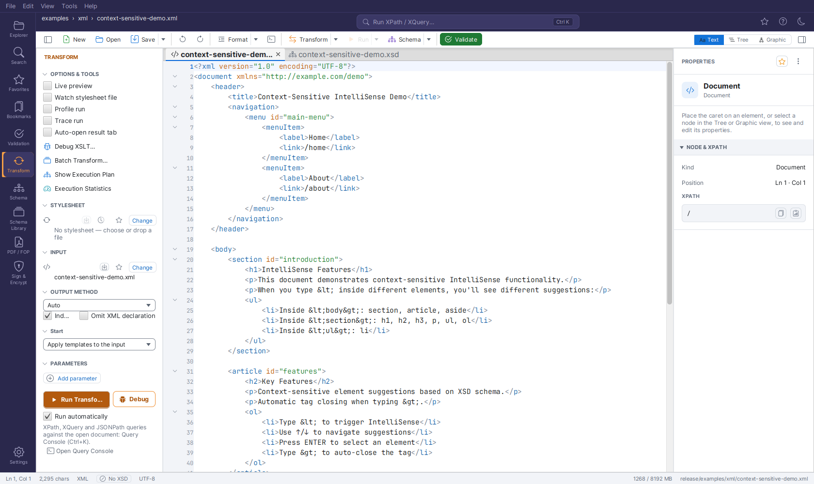

# Run a transformation

Pick a stylesheet and an input in the **Transform** panel, run it, and read the result in the
**OUTPUT** panel below the editor. This page covers the everyday run, parameters, live preview and
batch runs; every field of the panel is described in the
[Transform panel reference](../../reference/transform-panel.md).



## Before you start

- An XML input document and an XSLT stylesheet.

## Run a stylesheet

### 1. Select your files

1. Open your XML source file in the editor host so it is the active document - the panel's
   **INPUT** section follows the active tab by default (use **Change → Select XML file…** to
   transform a fixed file from disk instead, or **drop** an `.xml` file from your file
   manager onto the INPUT row)
2. In the **STYLESHEET** section, click **Change** to choose an XSLT stylesheet (the clock
   icon offers your recently used stylesheets) - or simply **drop** an `.xsl` / `.xslt`
   file from your file manager onto the STYLESHEET row

### 2. Run and view the result

Click **Run Transform**. The result appears in the **OUTPUT panel** that docks **below the
editor** - the source stays on top, the result shows underneath. The panel header shows a
format badge, a success/error status with timing (`Transformed · N ms · M chars`), and view
toggles:

| View        | Description                                                              |
|-------------|--------------------------------------------------------------------------|
| **Text**    | The result in a read-only code editor with line numbers and syntax highlighting (the default) |
| **Preview** | For HTML/XHTML output: the result rendered as a web page. A result over 1 MB is not rendered on its own (rendering it can block the application for seconds): the Text view opens, and the Preview offers **Show anyway** and **Open in browser** |
| **Table**   | For XQuery (and Query Console XPath) results that return a sequence: the items shown as a table |

The **OUTPUT METHOD** defaults to **Auto**: the format (XML, HTML, XHTML, Text, JSON) is
detected from the stylesheet's `xsl:output` declaration. Pick a concrete format in the
dropdown to override the detection.

### Running automatically

The **Run automatically** checkbox next to **Run Transform** (on by default) controls the
automatic run that starts when you drop a stylesheet or input, pick one from your favorites,
or browse with ◀ / ▶. Uncheck it to only set the file and run with **Run Transform** yourself.

## Controls at a glance

| Control                       | Description                                                                  |
|-------------------------------|------------------------------------------------------------------------------|
| **Run Transform**             | Runs the transformation with the current stylesheet and input                |
| **Run automatically**         | (Checkbox next to Run Transform, on by default) Runs as soon as a stylesheet or input is dropped, picked from favorites or browsed with ◀ / ▶ |
| **Debug**                     | (Next to Run Transform, also `Shift+F5`) Runs the stylesheet in the interactive debugger - breakpoints (toggle them in the saved stylesheet's gutter at any time, before or during a session; they are remembered per file), stepping, variables - in a DEBUG dock below the editor; see [XSLT Developer](debug.md#interactive-live-debugger) |
| **Transform with XSLT…**      | (Editor toolbar / Tools menu, XML documents) Opens this panel on the active document, asks for a stylesheet if none is set, and runs it |
| **Open result as editor tab** | (OUTPUT panel) Opens the result as an editable, savable document. HTML/XHTML results open as an HTML document rendered in the editor's read-only [Preview view](../../get-started/workspace-tour.md#html-preview) (over 1 MB: as text); re-running the transform updates the open tab |
| **Open in browser**           | (OUTPUT panel) Opens the result in your default web browser                  |
| **Save result…**              | (OUTPUT panel) Writes the result straight to a file                          |
| **Watch stylesheet file**     | (OPTIONS & TOOLS checkbox) Re-runs automatically when the stylesheet changes on disk |
| **Live preview**              | (OPTIONS & TOOLS checkbox) Re-runs automatically (debounced) while you edit the input document |
| **Auto-open result tab**      | (OPTIONS & TOOLS checkbox) Also opens every successful result as an editor tab (off by default) |

The **OPTIONS & TOOLS** section sits at the top of the panel and is open by default -
click its header to collapse it.

## Live Preview and Watch Mode

Two checkboxes in the Transform panel's **OPTIONS & TOOLS** section re-run the transformation automatically:

- **Live preview** — re-runs (debounced) whenever you edit the **input document**.
- **Watch stylesheet file** — re-runs whenever the chosen **stylesheet** changes on disk,
  which is handy while editing the stylesheet in another tab or tool.

This is ideal for developing and debugging stylesheets: make a change, and the OUTPUT panel
updates by itself.

## Using XSLT Parameters

XSLT stylesheets can accept parameters to make them more flexible. The **PARAMETERS**
section of the Transform panel lets you define these values.

### Defining Parameters in XSLT

```xslt
<?xml version="1.0" encoding="UTF-8"?>
<xsl:stylesheet version="1.0"
                xmlns:xsl="http://www.w3.org/1999/XSL/Transform">

  <!-- Define a parameter with a default value -->
  <xsl:param name="title" select="'Default Title'"/>
  <xsl:param name="show-prices" select="true()"/>
  <xsl:param name="currency" select="'EUR'"/>

  <xsl:template match="/">
    <html>
      <head><title><xsl:value-of select="$title"/></title></head>
      <body>
        <h1><xsl:value-of select="$title"/></h1>
        <xsl:if test="$show-prices">
          <!-- Show prices in the specified currency -->
        </xsl:if>
      </body>
    </html>
  </xsl:template>

</xsl:stylesheet>
```

### Setting Parameter Values

1. Expand the **PARAMETERS** section in the Transform panel
2. Click **Add parameter** to create a new row
3. Enter the parameter name (e.g., `title`)
4. Enter the value (e.g., `My Custom Report`)

Each row has its own remove button, and the values are passed to the stylesheet on every run.

## Output Format

The Transform panel's **OUTPUT METHOD** section is a single dropdown with
**Auto, XML, HTML, XHTML, Text, JSON**. **Auto** (the default) detects the format from
the stylesheet's `xsl:output` declaration; pick a concrete format to override the detection.

!!! note
    XSLT version selection (1.0/2.0/3.0) is intentionally not offered: Saxon HE auto-detects
    the version from the stylesheet's `version` attribute.

## Multi-File Batch Processing

**Batch Transform…** (Transform panel, **OPTIONS & TOOLS** section) runs the chosen stylesheet
over many XML files at once - or, when no stylesheet is set, the active XQuery document.

1. Open the stylesheet (or XQuery file) you want to apply, then pick
   **OPTIONS & TOOLS → Batch Transform…** — a **Batch** tool tab opens.
2. Add the XML files to process (each file is transformed/queried **independently**).
3. Run the batch: the table shows one row per file with its status, and selecting a row
   shows that file's **RESULT**.
4. **Save All…** writes every result to a folder you choose.

The Explorer offers an even faster route: select **several XML files** in the workspace tree
(Ctrl/Shift+click), right-click and choose
[Transform with *&lt;stylesheet&gt;*](../../reference/workspace.md#explorer-context-menu) — the Batch tool
tab opens pre-loaded with those files and starts automatically.

## Tracing and Messages

Enable **Trace run** in **OPTIONS & TOOLS** to open a **Trace** tool tab with the next run. It
shows the sequence of **template matches** and all `xsl:message` output:

```xslt
<xsl:message>Processing book: <xsl:value-of select="title"/></xsl:message>
```

### Tips

- **Validate first** - Make sure your XML and XSLT files are valid before transformation
- **Check the OUTPUT panel status** - If a transformation fails, the red error status in the OUTPUT panel header shows the error message
- **Use the Preview view** - For HTML output, the OUTPUT panel's **Preview** toggle shows you exactly how it will look
- **Start with Live preview off** for large files to avoid slow updates
- **Star your stylesheets** as favorites, then page through them with the STYLESHEET row's
  **◀ / ▶** buttons
- **Use Batch Transform** for processing multiple files efficiently
- **Enable Profile run** if transformations are slow - the per-template timings show where
  (see [Profile a transformation](profile.md))
- **Enable Trace run** when troubleshooting complex stylesheets
- **Use the Examples menu** to insert working XQuery templates, and try the files in the
  `examples/` folder
- **Only process trusted stylesheets** - see [Security Features](../../administer/security-features.md) for details on XSLT extension security

## Troubleshooting

| Problem                           | Solution                                                                                                               |
|-----------------------------------|------------------------------------------------------------------------------------------------------------------------|
| No output                         | Check the STYLESHEET row shows a stylesheet and the INPUT row shows the XML you expect                                 |
| Syntax error                      | Read the red error status in the OUTPUT panel header                                                                   |
| Slow transformation               | Enable **Profile run** (OPTIONS & TOOLS) and check the per-template timings                                                          |
| Batch results empty               | Ensure files were added to the Batch tab and the run has finished                                                      |
| Parameters not working            | Verify parameter names match exactly                                                                                   |
| Java extension function not found | Java extensions are disabled by default for security. See [Security Features](../../administer/security-features.md#xsltxquery-extension-security) |

## Next steps

- [Debugger](debug.md) - breakpoints, stepping, variables and watches
- [Profile a transformation](profile.md) - where the time goes
- [Test with XSpec](xspec.md)
- [External XSLT processors](external-processors.md) - Saxon HE 13, xsltproc and others
- [XSLT and XQuery examples](examples.md)
