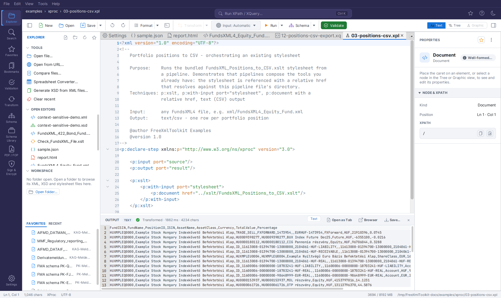

# XProc Pipelines

[XProc 3.0](https://xproc.org/) is a language for XML processing pipelines: instead of running one
stylesheet at a time, a pipeline declares a chain of steps — delete, transform, validate, split,
merge — that documents flow through. Pipelines (`.xpl`, `.xproc`) are editor documents like
stylesheets and queries, and run on the embedded **XML Calabash 3** engine.


*The bundled `03-positions-csv.xpl` example after **Run Pipeline**: the pipeline runs
the CSV export stylesheet (referenced with a relative href) against the Automatic
input and shows the result in the OUTPUT panel.*

## Before you start

- A pipeline file. **File → New…**, type **XProc**, gives you a skeleton: a `p:declare-step` with a
  `source` and a `result` port and one `p:identity` step.
- An XML document for the pipeline's input, unless the pipeline loads its documents itself.

## A first pipeline

Save these two files into one folder.

`orders.xml` — the input:

```xml
<orders>
  <order id="1" status="open"><total>120.00</total></order>
  <order id="2" status="shipped"><total>80.50</total></order>
  <order id="3" status="open"><total>15.00</total></order>
</orders>
```

`open-orders.xpl` — the pipeline, three steps in a row:

```xml
<p:declare-step xmlns:p="http://www.w3.org/ns/xproc" version="3.0">

  <p:input port="source"/>
  <p:output port="result"/>

  <!-- 1. Drop every order that is not open -->
  <p:delete match="order[@status != 'open']"/>

  <!-- 2. Summarise what is left with an inline stylesheet -->
  <p:xslt>
    <p:with-input port="stylesheet">
      <p:inline expand-text="false">
        <xsl:stylesheet xmlns:xsl="http://www.w3.org/1999/XSL/Transform" version="3.0">
          <xsl:template match="/orders">
            <open-orders count="{count(order)}" total="{sum(order/total)}">
              <xsl:copy-of select="order"/>
            </open-orders>
          </xsl:template>
        </xsl:stylesheet>
      </p:inline>
    </p:with-input>
  </p:xslt>

  <!-- 3. Stamp the root element -->
  <p:add-attribute match="/*" attribute-name="source" attribute-value="orders.xml"/>

</p:declare-step>
```

Each step reads the result of the step before it; the first step reads the `source` port and the
last step's result goes to the `result` port.

!!! note "Curly braces in inline content"
    XProc evaluates `{…}` inside `p:inline` itself, before the stylesheet ever sees it.
    `expand-text="false"` leaves the braces to XSLT. Without it, `count(order)` above would be
    computed by the pipeline and the result would say `count="0"`.

## Run the pipeline

1. Open `orders.xml` and `open-orders.xpl`, and make the pipeline the active tab.
2. Click **Run** in the editor toolbar, choose **Run Pipeline** in its ▾ menu, or press
   `Ctrl+Enter`.

The pipeline runs with the text in the editor, including unsaved changes.

**Which document is the input.** The document on the pipeline's primary input port — the port
marked `primary="true"`, or the only input port — is the one named in the toolbar's **Input**
dropdown. **Automatic** is the most recently active XML document; you can also pick another open
document or a file from disk, exactly as for
[Run Query and Run Transform](query-console.md#query-documents-the-target-selector).

- A pipeline without input ports, or whose input port has a default binding (for example a
  `p:document` inside `p:input`), runs without an input document.
- A pipeline that needs an input while none is available does not run; the message asks you to
  open an XML document or pick one in the dropdown.

**Relative addresses.** `href`s in the pipeline (`p:document`, `p:import`, stylesheets of `p:xslt`,
Schematron schemas) resolve against the pipeline file's folder. In a pipeline that was never
saved they resolve against the application's working directory — save the pipeline first.

## Read the result

The result appears in the **OUTPUT** panel below the editor. For the example (indented here for
reading; write `<p:output port="result" serialization="map{'indent': true()}"/>` in the pipeline
to get it indented):

```xml
<open-orders count="2" total="135" source="orders.xml">
  <order id="1" status="open"><total>120.00</total></order>
  <order id="3" status="open"><total>15.00</total></order>
</open-orders>
```

- The panel shows what arrived on the **primary output port**. If the pipeline declares no primary
  output, the first port that received documents is shown. Several documents on the port are
  shown one after the other.
- The view follows the result's media type: XML, HTML, JSON and text (CSV, YAML and other text
  formats) each open in the matching view of the panel.
- A pipeline that produces nothing shows *(the pipeline produced no output documents)*.
- An error is shown in the same panel as `ERROR:` followed by the message, with the XProc error
  code in brackets where the engine reports one, for example `[err:XC0050]`.

Files that the pipeline writes itself (`p:store`) are written where the pipeline says.

## Bundled examples

Ready-to-run pipelines are in the `examples/xproc/` folder of the installation. They run against
the FundsXML files in `examples/xml/`, for example `FundsXML4_Equity_Fund.xml`.

| File | Demonstrates | Output |
|---|---|---|
| `01-identity.xpl` | The anatomy of a pipeline: `p:declare-step`, ports, `p:identity` | XML (the input, unchanged) |
| `02-extract-fund-core.xpl` | `p:delete` with match patterns | XML without positions and FX rates |
| `03-positions-csv.xpl` | `p:xslt` with a stylesheet from a relative `href` | CSV, one row per position |
| `04-stamp-metadata.xpl` | Several steps in a row: `p:add-attribute`, `p:insert`, computed options | XML with audit metadata |
| `05-for-each-shareclass.xpl` | `p:for-each`, inline XSLT, `p:wrap-sequence` | XML share-class report |
| `06-choose-by-fund-type.xpl` | `p:variable`, `p:choose` / `p:when` | XML with category attributes |
| `07-schematron-report.xpl` | `p:validate-with-schematron`, reading a secondary port | SVRL validation report |
| `08-fund-kpis-json.xpl` | XML to JSON | JSON fund summary |

Keep the folder structure when you copy them: several reference stylesheets and schemas in the
neighbouring folders. See also
[Bundled Example Collections](examples.md#bundled-example-collections).

## Steps that are not available

!!! note "Saxon-HE limitations"
    `p:validate-with-xml-schema` and `p:xsl-formatter` require Saxon-EE and are not
    available; use the [Validation](../validate/index.md) activity (Xerces, full XSD 1.1) and the
    [PDF / FOP](../publish-pdf.md) activity instead. `p:validate-with-json-schema` is not supported
    in this bundle.

## Restrictions

Pipelines are programs, so by default they run with restrictions:

- Pipelines that use **`p:os-exec`** (run a program), **`p:run`** (run a pipeline computed at run
  time) or **`p:http-request`** are not run, also when the step is in a local library the pipeline
  imports with `p:import`. The message names the step.
- Documents, imports and `doc()` may only be **local files**; loading from `http:`, `https:` or
  `ftp:` fails with a message that says so.
- Reading and writing local files (`p:store`, `p:file-copy`, `p:file-delete`, …) works as before,
  with your rights: run only pipelines you trust.

**Settings → Network & Security → Run XProc pipelines without restrictions** lifts all of it (an
administrator can lock it, see [Administration & Policies](../../administer/policies.md)). It is
off by default. See also the [Threat Model](../../administer/threat-model.md).

## On the command line

`fxt-cli transform` runs a pipeline; the `.xpl` extension selects XProc (for other extensions add
`-l xproc`):

```bash
fxt-cli transform -s open-orders.xpl orders.xml                 # result on standard output
fxt-cli transform -s open-orders.xpl orders.xml -o open.xml     # result into a file
fxt-cli transform -s report.xpl                                 # a pipeline that needs no input
```

The same restrictions apply as in the application, unless `security.xproc.unrestricted=true` is
set in the settings. See [fxt-cli transform](../../automate/cli-transform.md#transform) for all
options.

## Next steps

- [Run a transformation](run-xslt.md)
- [Projects & scenarios](../projects.md) - save a pipeline with its input and output as a scenario
- [CI recipes](../../automate/ci-recipes.md)
