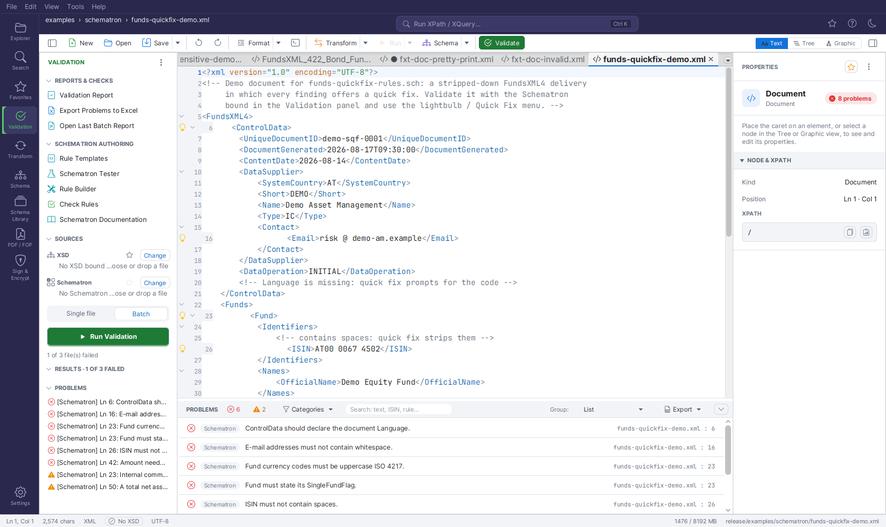

# Validate folders and export results

Validate every file of a folder in one run and export the findings.

## Validate a folder

Validate multiple XML files at once. Useful for testing entire folders of XML documents.


*Batch validation with multiple files*


### Which Schema Is Used

There is no per-run schema picker. A batch run validates **every selected file against the
XSD (and Schematron) currently bound to the active document** - the ones shown in the
Validation panel's **SOURCES** section and in the status bar's XSD indicator:

| Bound in SOURCES | What the batch run does |
|------------------|-------------------------|
| **XSD** | Every file is validated against that one schema |
| **Schematron** | Every file is additionally checked against that Schematron |
| *(nothing bound)* | Every file gets a well-formedness check only |

The files' own `xsi:schemaLocation` references are **not** consulted during a batch run.
To validate a folder against a particular schema, open any XML document, bind the XSD
(**Change** in the SOURCES row, the ★ favorites menu, drag & drop, or the toolbar's
**Schema** button), then start the batch.

### Running Batch Validation

In the Validation panel's **Batch** mode, **Run Validation**
opens a small menu so you can pick files or a whole folder in one step.

1. Open the **Validation** panel and switch the mode toggle to **Batch**.
2. Click **Run Validation** and choose how to pick the files:
   - **Select XML files…** - a file chooser where you select one or more XML files.
   - **Select folder…** - a folder chooser; every `*.xml` file in the folder **and all of its
     subfolders** is validated.
3. Watch progress while the files are validated.

### Results

The **RESULTS** list shows one row per file:

| Indicator | Description |
|-----------|-------------|
| **Status icon** | Red ✕ = errors, orange ⚠ = warnings only, green ✓ = valid |
| **File name** | Name of the XML file |
| **Badge** | Number of problems found in that file |

The **RESULTS** list and the panel's **PROBLEMS** list are only shown in **Batch** mode
(starting a batch run switches to it). Select a row to see that file's problems in the
**PROBLEMS** section; **double-click** a row to open the file in the editor. A plain-text
report of the run (schema names plus one line per file) opens as a document via **Open
Last Batch Report** in the panel's **REPORTS & CHECKS** section. A running batch can be cancelled from the progress bar; the
results collected so far are kept.

### Summary

The RESULTS header shows a summary of the run, for example:

```
RESULTS · 2 OF 25 FAILED
```

and the panel's status line repeats it ("2 of 25 file(s) failed").

---

## Exporting Results

There is one export: the **Export Problems to Excel** row (Excel icon) in the panel's
**REPORTS & CHECKS** section. It is enabled whenever the list contains problems and writes
**exactly the problems currently shown**:

- after a single-file run, the active document's problems;
- after a batch run, the problems of the file selected in **RESULTS** - pick a row first,
  then export. There is no all-files export; use **Open Last Batch Report** for a
  per-file overview of the whole run.

The suggested file name is `<document>-problems.xlsx`. The workbook contains:

| Sheet | Content |
|-------|---------|
| **Summary** | Source file, export timestamp, application version, and counts (total, errors, warnings) |
| **Problems** | One row per problem: `#`, `Source`, `Severity` (errors in red, warnings in amber), `Line`, `Message` - with a frozen header row and an auto-filter |

All Excel files FreeXmlToolkit writes share one look - the Data Dictionary, the Schema Analysis
report, the XML → Excel conversion and this export: a dark header row, striped rows with a thin
rule, no gridlines, coloured sheet tabs, and an info sheet with a title and sections. Every sheet
prints one page wide.

---
