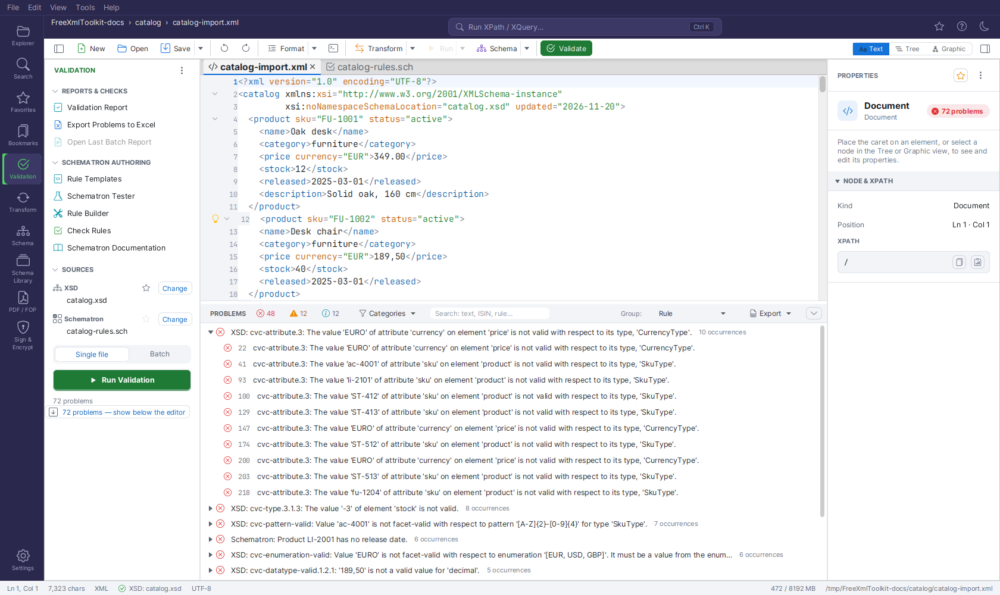

# Working with problems

Validation findings are listed in the **PROBLEMS** panel below the editor. This page describes
where they appear, how to read one, how to jump to its place in the document, how to fix it, and
how to handle long lists.

## Where problems appear {#the-problems-list}

- The **PROBLEMS panel below the editor** appears automatically when validation finds problems.
  Its header shows the counts of errors, warnings and hints, and it can be collapsed to just the
  header. Drag its top edge to change its height; the height is remembered. Each row shows the
  message and the file and line in a monospaced label.
- The **PROBLEMS** list in the Validation side panel (**Batch mode only**) shows the problems of
  the file selected in RESULTS. **Export Problems to Excel** in the **REPORTS & CHECKS** section
  saves the current list as an `.xlsx` workbook.

Validating (**F8**, the toolbar, a panel's *Validate*) does not switch to the Validation page.
The result stays with its document: switch to another tab (or to the Validation result that
**Validate** / F8 opens) and back, and the status and problems are shown again, as long as you
have not changed the text since.

## Read a problem

Every row in the PROBLEMS panel carries a **source badge** - **XSD**, **Schematron**,
**Well-formed** or **JSON Schema** - so when a run combines several checks you can tell where
each problem comes from. Hovering a **Schematron** row shows a **tooltip** with the full message,
the failed rule/test expression and the XPath of the failing node.

The counters in the header (red ✕ errors, orange ⚠ warnings, blue ⓘ hints) are filters: click one
to list only that severity, click it again to list all problems. The counters keep counting all
problems; when new results contain none of the filtered severity, the filter goes away.
**Hints** are findings that need no change as a rule - an ISIN not in ESMA FIRDS or not traded in
the EU, an LEI whose registration is pending; they count neither as errors nor as warnings.
Findings of [Check Identifiers Online](../../industry/identifier-lookup.md) carry a link to the
identifier's entry at GLEIF, ESMA FIRDS or OpenFIGI.

Long messages are cut off in the row. **Right-click** a row to copy it: **Copy Message** (just the
message text), **Copy Problem** (severity, source, message, file and line/column, plus rule and
context for Schematron) or **Copy All Problems** (one problem per line). **Ctrl+C** (**Cmd+C** on
macOS) copies the selected row like Copy Problem.

## Jump to a problem

Select a problem in either list. It is shown **in the view you are in**; the view does not change:

- **Text** - the caret jumps to its line and, for XML and XSD errors, to the reported column.
- **Tree** - the element of that line is selected and scrolled into view.
- **Graphic** - the grid selects the element's row; inside a repeating group it opens the table,
  selects the cell (the attribute's cell when the message names an attribute) and opens table
  cells on the way to errors nested deeper. The row or cell flashes briefly, the red problem
  marker stays. For an XSD the diagram selects the schema node.

This works for **Schematron problems too**: the failing rule's context node is resolved back to
its line in the XML, so a click navigates straight to the offending element.

## Fix a problem

- **Quick Fixes.** Schematron problems whose rules define quick fixes (SQF) can be corrected in
  place: right-click the problem row in either list and pick a fix from the **Quick Fix** submenu,
  or use the **yellow lightbulb** in the editor gutter on lines with fixable problems (click it,
  or press **Alt+Enter** / **Ctrl+.** on the line). See
  [Schematron Quick Fixes](schematron-quick-fixes.md).
- **AI assistant.** While the [AI assistant](../ai-assistant.md) is on, the same menu - in the
  PROBLEMS panel and in the side panel's list - also offers **Fix with AI** and **Explain with AI**
  (below any quick fixes). A fix is applied to a copy and validated against the same schema and
  Schematron first; the **AI** panel below the editor shows it side by side with the result of the
  checks, and **Apply** makes it one edit (Ctrl+Z undoes it). See
  [Fix or explain a validation problem](../ai-assistant.md#fix-or-explain-a-validation-problem).

## Large lists: categories, search, grouping, export

*72 problems of one document, grouped by rule: each group shows how often the rule was broken*

A check of a large report can give hundreds of thousands of findings - one per occurrence. The header has the tools to
work them off:

- **Categories** - every finding belongs to a category, grouped: *Document* (not well-formed, schema, Schematron),
  *LEI* (check digits, not registered, lapsed, pending), *ISIN* (unknown, CFI code differs, issuer LEI differs, not
  traded in the EU), *FMA rules* (master data, Form 800, reconciliation and totals, assets, look-through, allocation,
  Form 900, whole report, additional checks), *Extension rules* and *Other*. The menu shows each with its count; tick
  them on and off, or show all / none.
- **Search** - text, an ISIN or LEI, a rule code, a security's name.
- **Group** - *List* (one row per finding, as before), *Security / object* (one group per ISIN, LEI, asset or VRG: a
  security that occurs a hundred times is one row, with its kinds of problems and their occurrences below), *Rule* and
  *Category*. Findings without a security (wrong totals, schema errors) come after the securities, grouped by rule.
  Errors come first, then the groups with the most occurrences. Click an occurrence to jump to it.
- A group's right-click menu: **Show in List** (only the group's findings, with a label to leave), **Copy These
  Problems**, **Export These Problems to Excel…** and, where ESMA FIRDS knows better, **Fix ISIN … in Every Place**:
  the reported CFI code and issuer LEI of the security are replaced with the FIRDS values in every position of the
  document - after one confirmation that lists old → new and how often, as one undo step. A rule or category group
  fixes all its securities at once.
- **Export** - the shown (filtered) or all problems to an Excel workbook: *Summary* (filter, counts per severity and
  category), *Problems* (severity, category, rule, security / object and its name, line, message, link), *By Object*
  (one row per security with its occurrences and kinds of problems) and *By Rule*. The row menu offers the export
  too. The workbook's document properties (title, subject, description, keywords) name the checked document and
  sum up the counts and the filter, so the file can be found and told apart later.

The chosen grouping is remembered.

See [Validation Panel](index.md) for details.

## Next steps

- [Schematron Quick Fixes](schematron-quick-fixes.md)
- [Online identifier lookup](../../industry/identifier-lookup.md)
