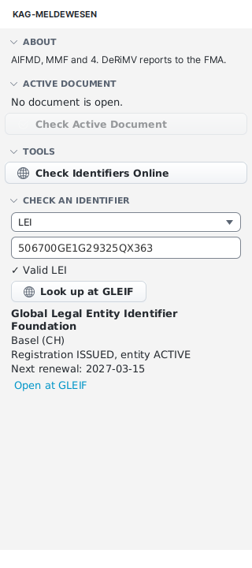
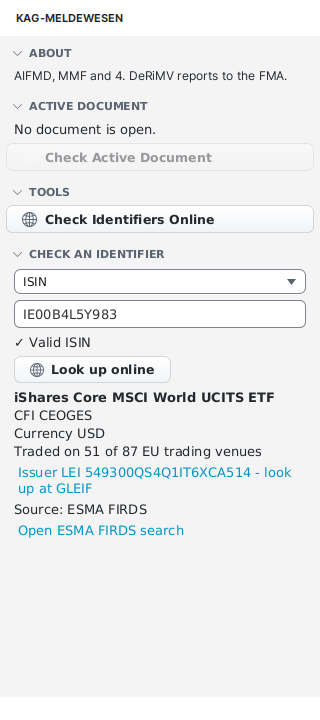
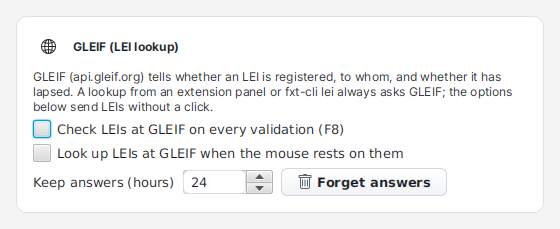
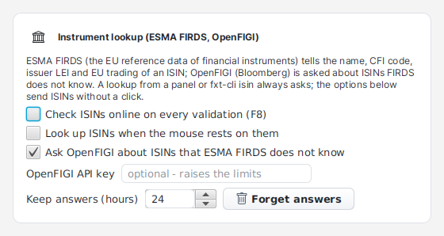

# Online Identifier Lookup (GLEIF, ESMA FIRDS, OpenFIGI)

Check digits only say that an identifier is well-formed. Whether it exists and what it stands for is known online:

- **LEIs** at the [Global Legal Entity Identifier Foundation](https://www.gleif.org) (GLEIF, `api.gleif.org`): legal
  name, address, registration and entity status;
- **ISINs** at **ESMA FIRDS** (`registers.esma.europa.eu`, the EU reference data of financial instruments the
  supervisors check against): name, CFI code, issuer LEI, currency, EU trading venues - and, for ISINs FIRDS does
  not know (fund units not traded on an EU venue, instruments outside the EU), at **OpenFIGI** (`api.openfigi.com`,
  Bloomberg): name, security type, ticker, FIGI.

None of the services needs an account. FreeXmlToolkit asks them from the identifier checker of the extensions, for
every identifier of a document, in a hover in the editor and on the command line.

!!! note "Identifiers leave your computer"
    A lookup sends the LEIs or ISINs to these services (and nothing else from the document). It happens when you click,
    or - only if you turn it on - with every validation and when the mouse rests on an identifier. Administrators can
    switch it off: `gleif.allowed=false`, `isin.allowed=false`, `isin.openfigi.allowed=false`
    ([Administration](administration.md)).

## Look up one identifier




In the side panel of an extension that checks identifiers (KAG-Meldewesen, ESMA Reporting, FinDatEx, ISO 20022,
FundsXML, PK-Meldewesen), choose the kind under **CHECK AN IDENTIFIER** and paste the value. When its check digits are
right:

- **LEI → Look up at GLEIF** shows the legal name, the city and country of the legal address, the registration status
  (`ISSUED`, `LAPSED`, `RETIRED`, `ANNULLED`, `PENDING_TRANSFER` …), the entity status (`ACTIVE` / `INACTIVE`), the next
  renewal date and **Open at GLEIF**.
- **ISIN → Look up online** shows the name, CFI code, currency and on how many EU trading venues it is traded now (or
  that it is no longer traded in the EU), with the issuer's LEI as a link that looks it up at GLEIF. An ISIN FIRDS does
  not know shows OpenFIGI's name, security type, ticker and FIGI.

## Check every identifier of a document

**Check Identifiers Online** - in the TOOLS section of the extension panels, in the VALIDATE section of the FundsXML
panel, the CHECK section of the PK-Meldewesen panel, and in **Tools → Check Identifiers Online (LEI, ISIN)** for any
document - finds every LEI (20 characters with valid check digits) and every ISIN (country prefix and valid check
digit) in the text (XML, CSV, JSON …), asks the services about all of them at once and puts a finding for each
occurrence into the **Problems** panel, at its line:

| Answer | Finding |
|---|---|
| XML: a 20-character value with wrong check digits in an LEI element or attribute (`LEI`, `IssuerLEI`, `LEICode`, `LegalEntityIdentifier` …) - checked locally, not sent to GLEIF | Error |
| LEI not registered at GLEIF | Error |
| LEI `RETIRED`, `ANNULLED`, `DUPLICATE`, `MERGED`, `TRANSFERRED` | Error - must not be used any more |
| LEI `LAPSED` (registration not renewed), entity `INACTIVE` | Warning |
| LEI `PENDING_…` | Warning (*info* on the command line) |
| ISIN known neither to ESMA FIRDS nor to OpenFIGI | Warning |
| ISIN no longer traded on any EU trading venue | Warning (*info* on the command line) |
| Reported CFI code differs from the one in ESMA FIRDS | Warning |
| Reported issuer LEI differs from the one in ESMA FIRDS | Warning |
| ISIN not in FIRDS while OpenFIGI is switched off | Warning (*info* on the command line) |

**CFI codes.** In an XML document, a CFI field next to an ISIN - an element named `ClssfctnTp`, `PdctClssfctn`,
`CFI` or `CFICode` with a six-letter value, and exactly one ISIN in its nearest enclosing elements (up to three levels,
e.g. MMF `AsstId`, SFTR `Scty`) - is compared with the CFI code FIRDS has for that ISIN, position by position; an `X`
on either side (a construct such as `DBXXXX`, or "not applicable") matches anything. A difference is a warning at the
CFI field (rule `ISIN-CFI`). CFI fields next to several ISINs are not compared.

**Issuer LEIs.** Likewise, an LEI inside an issuer element (a name containing `Issr`, `Issuer` or `Emittent` up to three
levels above it: MMF `IssrData/PtyId/LEI`, SFTR `Scty/Issr/Id`) is compared with the issuer LEI FIRDS has for the one ISIN
in its nearest enclosing elements (up to five levels). Other LEIs next to an ISIN - counterparties, sponsors, the
reporting fund - are not compared. A difference is a warning at the LEI (rule `ISIN-ISSUER`); the LEI itself is still
checked at GLEIF.

An ISIN only OpenFIGI knows is no finding. The findings have the source **GLEIF** or **ISIN** and replace the online
findings of an earlier check; schema and rule findings stay, also when the document is validated again while its text
is unchanged. When one service cannot be reached, the panel says so and the other part still counts.

**Example identifiers are skipped.** Synthetic identifiers marked `XMPL` - an LEI starting with `XMPL`
(`XMPL00FNDGLOBEQ00172`), an ISIN whose national part starts with it (`ATXMPLF01010`) - are what the FundsXML sample
files use. They have valid check digits but belong to nobody, so no service knows them. They are not sent and get no
finding; the result names how many were skipped ("5 example identifiers (XMPL) not looked up"). Their check digits
are still checked locally. The hover shows "Synthetic example identifier" for them.

**Open the entry.** A finding row carries a link to the identifier's entry at the service that answered - **GLEIF**
(the LEI's record at `search.gleif.org`), **ESMA FIRDS** (the instrument's record in the ESMA register, as shown in the
register's details page) or **OpenFIGI** (a search for the ISIN, also for an ISIN neither service knows). Click it, or
right-click the row → **Open at …**, to see the entry in the browser; **Copy Problem** includes the address. The
Validation panel's problem list offers the same menu item. FIRDS answers cached by version 3.3.0 do not know the
record's page and are looked up again on the next check.

## With every validation

**Settings → Network & Security** has a card for each kind: **Check LEIs at GLEIF on every validation (F8)** and
**Check ISINs online on every validation (F8)** add the same checks to every validation of an XML document (F8,
Validation panel, the extensions' **Check Active Document**). Both are off by default. When a service cannot be
reached, the validation shows one warning and goes on.

## Hover

When the mouse rests on an LEI or ISIN in the text editor, a tooltip shows what the services said about it - from
the answers already known. **Look up LEIs at GLEIF when the mouse rests on them** / **Look up ISINs when the mouse
rests on them** (off by default) also ask about identifiers not known yet.

## Settings




| Setting | Key | Default |
|---|---|---|
| Check LEIs at GLEIF on every validation (F8) | `gleif.onValidation` | off |
| Look up LEIs at GLEIF when the mouse rests on them | `gleif.hover` | off |
| Keep answers (hours), GLEIF | `gleif.cacheHours` | 24 |
| Check ISINs online on every validation (F8) | `isin.onValidation` | off |
| Look up ISINs when the mouse rests on them | `isin.hover` | off |
| Ask OpenFIGI about ISINs that ESMA FIRDS does not know | `isin.openfigi` | on |
| OpenFIGI API key (stored encrypted) | `isin.openfigi.apiKey` | - |
| Keep answers (hours), ISINs | `isin.cacheHours` | 24 |

**Forget answers** empties the caches (`~/.freeXmlToolkit/gleif/cache.json`, `~/.freeXmlToolkit/isin/cache.json`).
Requests go through the proxy of *Settings → HTTP Proxy*. Limits: GLEIF 60 requests a minute (the application sends
at most one a second, 200 LEIs each); FIRDS one request a second with 100 ISINs; OpenFIGI without an API key 25
requests a minute with 10 ISINs each, with a key (free at [openfigi.com](https://www.openfigi.com/api)) 100 ISINs per
request and shorter pauses.

## Command line

```bash
fxt-cli lei 506700GE1G29325QX363                  # one or more LEIs
fxt-cli lei --file report.xml -f json              # every LEI of a file, as JSON
fxt-cli isin IE00B4L5Y983                          # one or more ISINs
fxt-cli isin --file holdings.xml --no-openfigi     # every ISIN of a file, FIRDS only
fxt-cli validate reports/ --gleif --isin           # validation plus the online checks
```

`fxt-cli lei` exits with `1` when an LEI is invalid, unknown, lapsed, retired or annulled or its entity inactive;
`fxt-cli isin` with `1` when an ISIN is invalid or known to neither service; both with `3` when a service cannot be
reached. `validate --gleif` / `--isin` add the findings to the report (sources `GLEIF` / `ISIN`, rules `GLEIF-LEI` /
`ISIN-LOOKUP`); an unreachable service is an *info* there. The OpenFIGI API key comes from `FXT_OPENFIGI_APIKEY` or
the setting. Example identifiers (`XMPL`) found in a file are not looked up: `lei --file` / `isin --file` list them as
"synthetic example identifier" (`examples` in JSON), `validate` adds one *info* with their number; an `XMPL` value
given on the command line itself is looked up. The command line ignores the GUI settings "on every validation" - only `--gleif` / `--isin` turn the
checks on. See [Command Line](command-line.md#lei).
