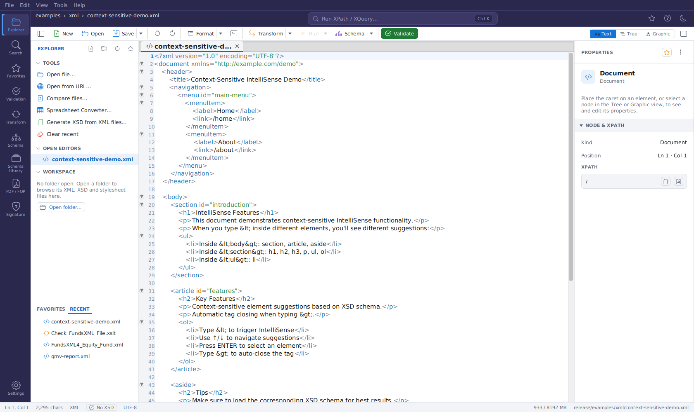

# FreeXmlToolkit Documentation

  
Free, open-source desktop app for XML, XSD, XSLT, Schematron and JSON – Windows, macOS and Linux. No registration, no admin rights needed.

  

    

      
🪟 Windows x64 · Windows 10/11

      <a class="md-button md-button--primary" data-fxt-asset="win-exe" href="https://github.com/karlkauc/FreeXmlToolkit/releases/latest">Download .exe installer</a>
      <ul class="fxt-download-card__alts">
        <li><a data-fxt-asset="win-msi" href="https://github.com/karlkauc/FreeXmlToolkit/releases/latest">MSI package</a> – for silent / Group Policy deployment</li>
        <li><a data-fxt-asset="win-zip" href="https://github.com/karlkauc/FreeXmlToolkit/releases/latest">Portable ZIP</a> – no installation, extract and run</li>
        <li><a href="installation/#install-with-a-package-manager">Scoop</a> – <code>scoop install karlkauc/freexmltoolkit</code></li>
      </ul>
    

    

      
🍎 macOS Apple Silicon &amp; Intel

      <a class="md-button md-button--primary" data-fxt-asset="mac-arm64-dmg" href="https://github.com/karlkauc/FreeXmlToolkit/releases/latest">Download .dmg (Apple Silicon)</a>
      <ul class="fxt-download-card__alts">
        <li><a data-fxt-asset="mac-x64-dmg" href="https://github.com/karlkauc/FreeXmlToolkit/releases/latest">Intel .dmg</a> – for Intel-based Macs</li>
        <li><a data-fxt-asset="mac-arm64-pkg" href="https://github.com/karlkauc/FreeXmlToolkit/releases/latest">.pkg installer</a> (Apple Silicon) · <a data-fxt-asset="mac-x64-pkg" href="https://github.com/karlkauc/FreeXmlToolkit/releases/latest">.pkg</a> (Intel)</li>
        <li><a data-fxt-asset="mac-arm64-zip" href="https://github.com/karlkauc/FreeXmlToolkit/releases/latest">Portable ZIP</a> (Apple Silicon) · <a data-fxt-asset="mac-x64-zip" href="https://github.com/karlkauc/FreeXmlToolkit/releases/latest">Portable ZIP</a> (Intel)</li>
        <li><a href="installation/#install-with-a-package-manager">Homebrew</a> – <code>brew install --cask karlkauc/tap/freexmltoolkit</code></li>
      </ul>
    

    

      
🐧 Linux x64

      <a class="md-button md-button--primary" data-fxt-asset="linux-deb" href="https://github.com/karlkauc/FreeXmlToolkit/releases/latest">Download .deb package</a>
      <ul class="fxt-download-card__alts">
        <li><a data-fxt-asset="linux-rpm" href="https://github.com/karlkauc/FreeXmlToolkit/releases/latest">.rpm package</a> – Fedora, RHEL, openSUSE</li>
        <li>.deb is for Ubuntu, Debian and Linux Mint</li>
        <li><a data-fxt-asset="linux-zip" href="https://github.com/karlkauc/FreeXmlToolkit/releases/latest">Portable ZIP</a> – any distribution, extract and run</li>
      </ul>
    

  

  
Latest release: <strong class="fxt-release-version">see GitHub</strong> · <a href="https://github.com/karlkauc/FreeXmlToolkit/releases/latest">All downloads and release notes on GitHub</a> · Licensed under Apache 2.0 · <a href="https://github.com/karlkauc/FreeXmlToolkit">Source code</a> · <a href="https://github.com/sponsors/karlkauc">&#9829; Sponsor</a>

## Welcome

FreeXmlToolkit is a free desktop application for working with XML files. It helps you edit, validate, transform, and secure your XML documents - all in one place.

***Screenshot: Main application window***

### What Can You Do With FreeXmlToolkit?

- **Edit XML files** with smart auto-completion and syntax highlighting
- **Validate XML** against XSD schemas, DTDs and RELAX NG schemas to check for errors
- **Validate JSON** against JSON Schemas, auto-detected from the document's `$schema` member
- **Transform XML** into other formats (HTML, PDF, Text)
- **Sign XML documents** with digital certificates
- **Create business rules** with Schematron validation
- **Generate documentation** from your XSD schemas
- **Compare and merge** XML files by structure, compare folders, convert XML ↔ JSON ↔ YAML
- **Open huge files** (gigabytes) in the [Large File Viewer](large-files.md)
- **Automate** with the [command line](command-line.md) (`fxt-cli`) and [projects](projects.md)
- **Extend** it with [plugins](plugins.md) — industry plugins for ISO 20022, ebInterface, FinDatEx and XBRL included
- **Work in English or German**, [accessible](accessibility.md), centrally [administrable](administration.md)

### Works On All Platforms

FreeXmlToolkit runs on **Windows** (x64), **macOS** (Apple Silicon and Intel) and **Linux** (x64) - as an installer, a native package or a portable ZIP, and via **Scoop** and **Homebrew**. The [Installation](installation.md) page explains every format and the package managers.

---

## Feature Overview

### XML Editor

Edit your XML files with professional tools:

| Feature | What It Does |
|---------|--------------|
| **Auto-Completion** | Suggests valid elements and attributes as you type |
| **Syntax Highlighting** | Colors your XML for easier reading |
| **Instant Validation** | Shows errors immediately as you edit |
| **Find & Replace** | Search and replace text in your documents |
| **Find in Files** | Search and replace across all files of a folder - by plain text or by XPath (the Search activity, Ctrl+Shift+F) |
| **Code Folding** | Collapse sections to focus on what matters |
| **Grid View** | Edit XML like a spreadsheet in the Graphic view: repeating elements as tables, opened cells, entry helpers, copy/paste with Excel |
| **Properties Inspector** | View and edit the selected node - and its schema declaration - in every view |
| **Query Console** | Run XPath 3.1, XQuery 3.1 and JSONPath against the open document (Ctrl+K) |

Learn more: [XML Editor Guide](xml-editor.md) | [Grid View](grid.md)

### JSON Editor

Edit and validate JSON files with multiple format support:

| Feature | What It Does |
|---------|--------------|
| **Multi-Format Support** | Edit `.json`, `.jsonc` and `.json5` files, including JSONC-style comments and JSON5 syntax |
| **Tree View** | Navigate JSON structure visually |
| **Grid View** | Edit JSON in the same XMLSpy-style grid as XML - arrays of objects as tables, type-aware inline editing, undo/redo |
| **JSONPath Queries** | Extract data using JSONPath expressions |
| **Schema Validation** | Validate against JSON Schema (Draft-07, 2019-09, 2020-12) - the schema is auto-detected from the document's `$schema` member, or bound manually; problems appear with line numbers |
| **Hover Information** | See JSONPath and type info on hover |

Learn more: [JSON Editor Guide](json-editor.md)

### XSD Schema Tools

Work with XML Schema files:

| Feature | What It Does |
|---------|--------------|
| **Visual Schema Viewer** | See your schema as an interactive diagram |
| **Documentation Generator** | Create HTML documentation from schemas |
| **Sample XML Generator** | Generate valid sample XML files with customizable rules |
| **Profiled Generation** | Control values per element, save profiles, batch generate |
| **Schema Flattening** | Combine multiple schema files into one standalone schema, optionally reduced for validation servers |
| **Schema Analysis** | Statistics, a type library with one-click removal of unused components, quality checks, identity-constraint and XPath validation - exportable as CSV, JSON, HTML, PDF or Excel |
| **Schema Library & XML Catalogs** | Map namespaces to schema files, register OASIS `catalog.xml` files, and manage the cache of downloaded schemas - documents without a schema reference bind automatically |

Learn more: [XSD Tools Guide](xsd-tools.md) | [Profiled XML Generation](profiled-xml-generation.md) | [XSD Validation](xsd-validation.md) | [Schema Library](schema-library.md)

### XSLT Transformation

Convert XML into other formats:

| Feature | What It Does |
|---------|--------------|
| **Multi-Format Output** | Generate XML, HTML, Text, or JSON |
| **Live Preview** | See results as you work |
| **Rendered HTML Results** | Open an HTML result as an editor tab showing the rendered page (Preview view) |
| **Modern XSLT Support** | Uses the latest XSLT 3.0 standard |
| **Interactive Debugger** | Debug XSLT, XQuery and Schematron: conditional breakpoints, logpoints, stepping, variables, watches, call stack and coverage |
| **Multi-File Batch Processing** | Process multiple XML files with one XQuery using `collection()` |
| **XProc 3.0 Pipelines** | Run multi-step processing pipelines (`.xpl`) with the built-in XML Calabash engine |

Learn more: [Transform Panel](transform-panel.md) | [XSLT Developer](xslt-developer.md) | [Debugger](debugger.md) | [XProc Pipelines](xproc.md)

### PDF Generation

Create professional PDF documents:

| Feature | What It Does |
|---------|--------------|
| **XSL-FO Support** | Use XSL-FO stylesheets for formatting |
| **High-Quality Output** | Professional PDF generation |

Learn more: [PDF Generation Guide](pdf-generator.md)

### Digital Signatures

Sign and verify XML documents:

| Feature | What It Does |
|---------|--------------|
| **Create Certificates** | Generate your own signing certificates |
| **Sign Documents** | Add digital signatures to XML files |
| **Verify Signatures** | Check if signed documents are valid |

Learn more: [Digital Signatures Guide](digital-signatures.md)

### Appearance

| Feature | What It Does |
|---------|--------------|
| **Dark Mode** | Switch between light and dark themes to suit your preference |
| **Modern UI** | Clean, modern interface with light and dark themes |

### Schematron Validation

Define custom business rules:

| Feature | What It Does |
|---------|--------------|
| **Business Rules** | Validate beyond basic XML structure |
| **Visual Rule Builder** | Create rules without writing code |
| **Detailed Reports** | Get clear validation results |
| **Quick Fixes (SQF)** | Correct rule violations automatically with one click |

Learn more: [Schematron Guide](schematron-support.md) | [Quick Fixes](schematron-quick-fixes.md)

### FundsXML Extensions (Optional)

Opt-in integration with the [FundsXML](https://fundsxml.org/) industry standard for fund data exchange:

| Feature | What It Does |
|---------|--------------|
| **Automatic Downloads** | Schemas, samples, rules and snippets are fetched from GitHub and kept up to date automatically |
| **Sample Library** | One-click access to FundsXML example documents via Favorites and the Welcome page |
| **Quick-Validate** | Check any open XML against the active FundsXML schema with one click in the FundsXML panel |
| **Schematron Rules** | Ready-made business-rule checks for FundsXML documents |
| **Query Snippets** | Pre-built XPath/XQuery expressions, ready to load in the Query Console |
| **Data-Quality Checks** | 17 checks (ISIN/LEI, weights, positions vs. NAV, master data …) with a report, also in every validation |
| **Grid Formulas & Filters** | Counts, sums per currency, weights and filters added to a document for the Grid view |

This feature is **off by default**. Enable it from Settings only if you work with FundsXML files - when you open a FundsXML document, the app offers to enable it once.

Learn more: [FundsXML Extensions Guide](fundsxml-extensions.md)

---

## Getting Started

Download FreeXmlToolkit with the [buttons above](#download); the [Installation](installation.md) guide covers every package format, Scoop and Homebrew.

### Your First Steps

1. **Open a file**: The app opens on the Welcome page - use **Open File** (Ctrl+O), the Explorer activity, or drag files into the window. No file at hand? Click **Open an Example** on the Welcome page to open a small order document that already has a schema and a stylesheet, or pick a task under **What do you want to do?** (for example *Validate an XML file*)
2. **Edit multiple files**: The shell handles XML, XSD, XSLT, Schematron and JSON files in tabs, each with Text / Tree / Graphic views - HTML files get a rendered read-only Preview view instead
3. **Start editing**: Type `<` to see auto-completion suggestions
4. **Validate**: Use the Validation activity (or the toolbar's **Validate** button, F8) to check your document for errors
5. **Reach every tool**: Pick a tool from the activity bar on the left (Explorer, Search, Favorites, Validation, Transform, Schema, Schema Library, PDF/FOP, Signature, FundsXML, Settings). Help, the documentation and **About** are in the **Help** menu (also **F1** or the **?** button in the header)

Learn more: [Unified Shell Guide](unified-shell.md)

### Sample Files

The application includes example files in the `examples/` folder to help you get started:

- **xml/** - Sample XML documents (FundsXML4 instances, valid and deliberately invalid)
- **xsd/** - Sample XSD schemas (including FundsXML 4.2.11)
- **xslt/** - XSLT stylesheets (HTML reports, JSON and CSV export)
- **xsl/** - XSL-FO stylesheets for PDF reports
- **xquery/** - XQuery 3.1 data-quality checks
- **xpath/** - XPath 3.1 snippets for the Query Console
- **xproc/** - XProc 3.0 pipelines (identity, slimming, CSV/JSON export, reports)
- **schematron/** - Schematron business rules
- **catalog/** - OASIS XML catalog example for the Schema Library
- **json/** - JSON Schema validation demos (`$schema` auto-binding, valid/invalid instances, Draft-07 / 2019-09 / 2020-12 dialects)
- **signature/** - Signed XML document with demo keystore
- **templates/** - XML snippet templates
- **profiles/** - XML generation profiles

---

## Troubleshooting

Problems starting the application, blurry rendering, proxies, memory or schemas that do not resolve: see the **[FAQ & Troubleshooting](faq.md)** page.

---

## Keyboard Shortcuts

The most important ones (on macOS use **Cmd** instead of Ctrl):

| Shortcut | Action |
|----------|--------|
| `Ctrl+N` / `Ctrl+O` / `Ctrl+S` | New / Open / Save |
| `Ctrl+F` / `Ctrl+Shift+F` | Find / Find in Files |
| `Shift+Alt+F` | Format the document |
| `F8` | Validate the current document |
| `F5` / `Ctrl+Enter` | Run the active XQuery / XPath / XSLT / XProc document |
| `Shift+F5` | Start the debugger |
| `Ctrl+K` | Open the Query Console |
| `F1` | Show the Help menu |

The complete list is on the **[Keyboard Shortcuts](keyboard-shortcuts.md)** page (and in the app under **Help → Keyboard Shortcuts**).

---

## Support the Project

FreeXmlToolkit is free and open source. If it saves you time, please consider sponsoring its development — sponsorships directly fund maintenance, bug fixes and new features.

[&#9829; Sponsor on GitHub](https://github.com/sponsors/karlkauc){ .md-button .md-button--primary }

Inside the application the sponsor link is available in the **Help** menu (**Sponsor this Project**), in the **About** dialog, on the **Welcome** page and under **Settings → Extensions → SUPPORT THE PROJECT**. Starring the repository and reporting bugs helps too.

---

## Need Help?

- Browse the documentation in the navigation, starting with the [Unified Shell](unified-shell.md) guide
- Read the [FAQ & Troubleshooting](faq.md) page
- Check the example files included with the application
- Report issues on the project's GitHub page, or send an anonymous report from inside the app with **Help → Report a Problem…**
- Want to contribute? Read the [Contributing Guide](contributing.md) and our [Code of Conduct](code-of-conduct.md); report security issues privately as described in the [Security Policy](security-policy.md)
