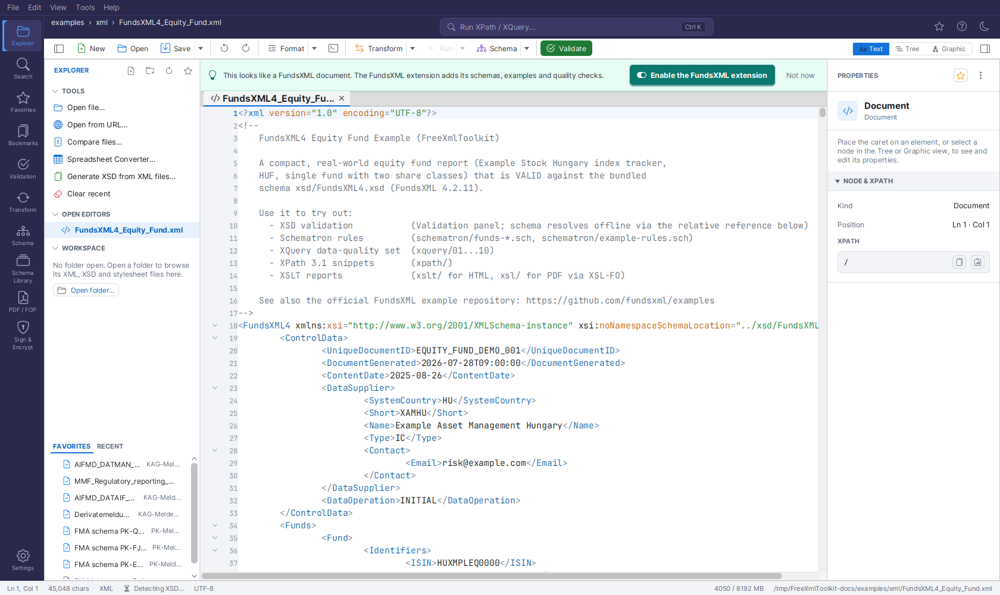
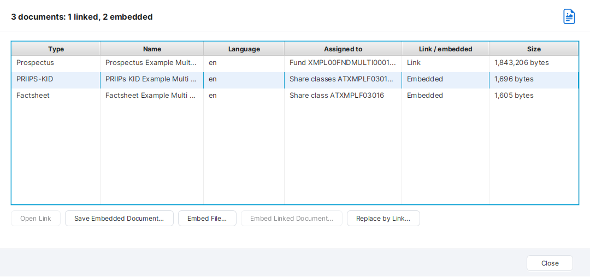
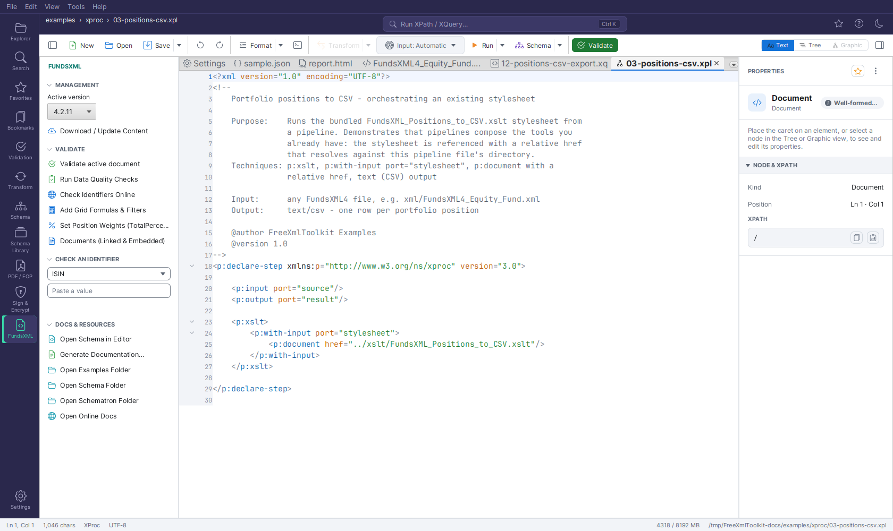
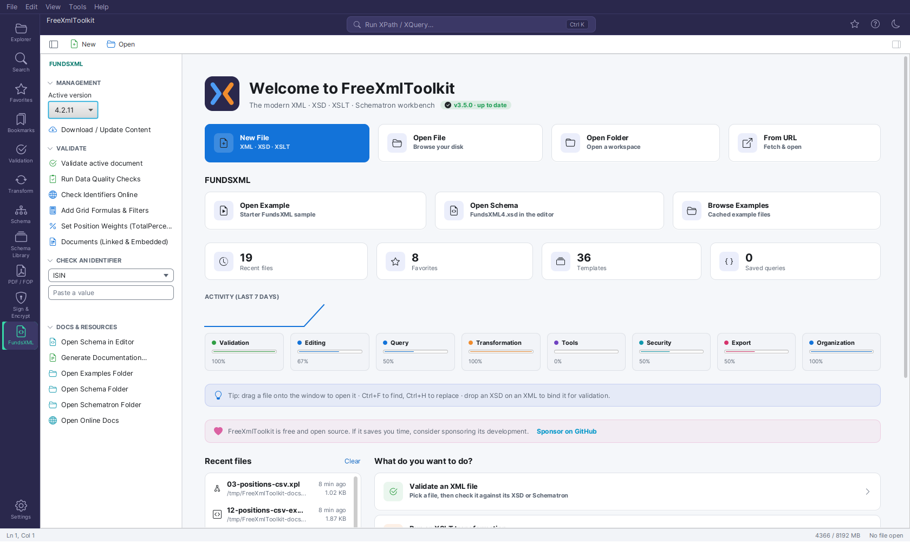

# FundsXML Extension

Optional integration with the [FundsXML](https://fundsxml.org/) standard for the fund management industry. When enabled, FreeXmlToolkit automatically downloads and keeps up to date the official FundsXML schemas, sample documents, Schematron rules, and XPath/XQuery snippets - and uses them for quick validation of your own files.

This feature is **off by default**. Enable it only if you work with FundsXML documents.

The FundsXML integration is a built-in [extension](manage-extensions.md). Its switch is the **FundsXML**
row in **Settings → Extensions → INSTALLED EXTENSIONS**; administrators can remove it completely with
`plugin.fundsxml.enabled=false` (no FundsXML activity, Help links, update check or hint).

---

## Overview

FundsXML is an open XML standard used to exchange fund data between asset managers, fund administrators, depositaries, and regulators. The FundsXML community publishes:

- **Schemas** (XSD) - the official `FundsXML4.xsd` and its include files
- **Examples** - real-world sample XML documents
- **Schematron rules** - additional business-rule checks beyond what XSD covers
- **Query snippets** - useful XPath and XQuery expressions for common tasks

The FundsXML Extensions feature downloads all of this from the official GitHub repositories and integrates the content into FreeXmlToolkit so you can use it directly from the FundsXML side panel, the Welcome page, the Query Console, and Favorites.

!!! note
    No FundsXML content is bundled with FreeXmlToolkit. Everything is fetched at runtime from the official GitHub repositories ([fundsxml/schema](https://github.com/fundsxml/schema), MIT License, and [fundsxml/examples](https://github.com/fundsxml/examples), Apache-2.0 License).

---

## Enabling the Feature

The feature is opt-in. Until you enable it, nothing in the application changes - apart from a
one-time hint when you open a FundsXML document (see [The FundsXML hint bar](#the-fundsxml-hint-bar)).

1. Open **Settings** (the gear icon at the bottom of the activity bar).
2. Select the **Extensions** group in the side panel (or type *FundsXML* into the settings search field) to reach the **INSTALLED EXTENSIONS** card.
3. Tick **FundsXML**.
4. Click **Save Settings** in the save bar at the bottom of the page.

Enabling the feature is all you need to do: the FundsXML content
starts downloading automatically in the background, and a small toast notification tells
you when it is ready. There is no separate download step.

Once enabled, the FundsXML integration appears in several places:

| Where | What appears |
|-------|--------------|
| **Activity bar** | A new **FundsXML** activity with its own side panel |
| **Welcome page** | A **FUNDSXML** quick-access row with **Open Example**, **Open Schema**, and **Browse Examples** cards (shown as soon as content is cached) |
| **Query Console** | A **FUNDSXML** section in the **Snippets** menu with the community's example queries |
| **Help menu** | The **FundsXML Website** and **FundsXML Schema Docs** links |

You can turn the feature off again at any time from the same Settings card. Disabling it hides these entries, but leaves the downloaded content on disk intact.

### Recognised documents: the FundsXML mark

While the extension is **on**, a FundsXML document (root element `FundsXML4`, `FundsXML` …) shows a
small green **FundsXML** mark in the status bar, next to the encoding. It tells you that the
document was recognised and that the FundsXML data-quality checks run with every validation of it.
A click opens the **FundsXML** panel. Other documents, or a FundsXML document while the extension
is off, show no mark.

### The FundsXML hint bar

You do not have to know about the extension in advance. When you open a document whose root
element is a FundsXML root (for example `FundsXML4`) while the extension is **off**, a hint bar
appears above the editor:

> *This looks like a FundsXML document. The FundsXML extension adds its schemas, examples and
> quality checks.*

- **Enable the FundsXML extension** - does the same as ticking **FundsXML** under **INSTALLED EXTENSIONS** in Settings
  and saving: the **FundsXML** activity appears in the activity bar and the content is
  downloaded in the background (or, if it was downloaded before, the cached content is used
  right away).
- **Not now** - closes the bar.

The hint is shown **only once**. If you dismiss it and change your mind later, enable the
feature in Settings as described above.



---

## Downloading FundsXML Content

Downloads are **fully automatic**. Content is fetched in the
background right after you enable the feature, and on every application start any missing
content is downloaded again. When a background download finishes, a non-blocking toast
notification appears - no dialogs interrupt your work.

You normally never need to trigger a download yourself. To force a manual refresh, open the
**FundsXML** side panel and click **Download / Update Content**. The panel shows a progress
bar with a stage description while a download is running - for manual and automatic
background downloads alike.

Whenever content is downloaded (automatically or manually), the application will:

- Download the latest **schema release** from `fundsxml/schema` (the official `FundsXML4.xsd` and its included files).
- Download **example documents**, **XSLT stylesheets**, **Schematron rule files**, and **XPath/XQuery snippets** from `fundsxml/examples`. Only these are kept: an `.xml` file counts as an example when its root element is `FundsXML4`. Program code and build files of the repository's Java, .NET, Python and JavaScript samples (such as Maven `pom.xml` files) and hidden folders are skipped. Each download replaces the cached examples, and files from earlier versions that are no examples are removed at startup.
- Register the active **XSD schema** as a Favorite under the category **FundsXML Schema** (XSD type), so it shows up alongside your other schema favorites.
- Register the **examples folder** as a Favorite under **FundsXML Examples**, plus the most compact sample XMLs (up to 10) as individual file favorites for one-click access.
- Register each **XSLT stylesheet** found in the examples as an XSLT Favorite under **FundsXML XSLT**.
- Register the Schematron files as Favorites under the category **FundsXML Schematron**.
- Register the most compact sample XMLs as **new-document templates** under the **FundsXML** category, so you can start a fresh document from a real sample via the toolbar's **New** button (Ctrl+N) → **Template** list.
- Seed the XPath/XQuery snippets into your **Saved Queries**, tagged `fundsxml` - they show up in the [Query Console](../guides/transform-query/query-console.md#query-console)'s **Snippets** menu under a **FUNDSXML** section (for example *fund-summary*, *top-holdings*, *look-through*, *aggregate-by-assettype*).
- Select the newly downloaded schema version as the **active** version.
- Make a compact starter sample available from the Welcome page's **Open Example** card, so you can immediately try **Validate active document** in the FundsXML panel.

!!! tip
    Independently of this downloaded content, your FreeXmlToolkit installation itself ships
    FundsXML4-based query collections in its `examples` folder: **32 XPath 3.1 examples**
    (`examples/xpath/`) and **17 XQuery 3.1 scripts** (`examples/xquery/`), including a
    reporting series that produces CSV, ASCII tables/charts, Markdown and JSON output.
    Each folder has a `README.md` describing every example.

Existing versions are kept on disk - downloads are additive, not replacements. Downloads are **idempotent** — favorites, snippets, and templates that already exist are not duplicated. On every application start, favorites and query snippets are also **re-registered from the on-disk cache**, so they stay available even without a network connection.

---

## Choosing an Active Schema Version

If you have downloaded more than one version of the FundsXML schema, you can switch between them.

Open the **FundsXML** side panel and pick the version from the **Active version** drop-down
in the MANAGEMENT section.

The active version is the schema used by the **Quick-validate** action (see below) and by the
**Open Schema in Editor** button. Switching does not delete any files - you can change versions
back and forth freely.

---

## Quick-Validate Your XML

The fastest way to check an XML file against the FundsXML schema:

1. Open your XML document in the editor.
2. Click **Validate active document** in the **FundsXML** side panel (FundsXML validation lives only there).
3. If the document is valid, the panel confirms it.
4. If there are errors, the panel shows their number and the **Problems** panel below the editor opens with
   one row per error - click a row to jump to its line.

The validation uses whichever FundsXML schema version is currently marked as active - the document does not
need to be bound to a schema (no `xsi:schemaLocation`, no binding in the Validation panel).

A FundsXML document whose schema the editor cannot find otherwise - no `xsi:noNamespaceSchemaLocation`, or one
naming a `FundsXML4.xsd` that is not next to the file - is bound to the active FundsXML schema automatically. The
status bar then shows **"XSD: FundsXML4.xsd (FundsXML)"**, and F8, the live validation and the auto-completion use
that schema, so the schema errors stay in the **Problems** panel while you edit. A schema you bound yourself, a
project binding, a Schema Library mapping or a reference that resolves always comes first. Choosing another
version in the panel binds an unbound document at once; an already bound one follows at its next validation.

!!! tip
    Use the Schematron Favorites under **FundsXML Schematron** to run additional business-rule checks. Open a Schematron file from Favorites, then validate your XML against it as you would with any other Schematron file.

---

## Data-Quality Checks

**Run Data Quality Checks** in the FundsXML side panel checks the active FundsXML document with
54 XQuery checks and opens a report (severity, passed / findings / hints / not run, with every finding). While it
runs, the panel shows *Check 5 of 54: …* with a bar and **Cancel** (stops between two checks); downloads, validation,
grid setup, documentation and **Check Identifiers Online** show their progress the same way.

Every check has a **severity**: *error* — the data cannot be right (an asset listed twice, a bond that matures before
it is issued, a negative exchange rate); *warning* — most likely wrong, often with a tolerance; *info* — a **hint**
that usually needs no change but that receivers often ask for (a fund without LEI, an OTC derivative without
counterparty LEI). A document with hints only counts as passed. Checks the schema already enforces (code lists,
required elements and attributes) are not repeated.

**Control data and identifiers**

| Check | Severity | What it looks at |
|---|---|---|
| Control data complete | warning | ControlData has UniqueDocumentID, DocumentGenerated, ContentDate and the data supplier's name. |
| Content date not in the future | warning | The ContentDate is not later than today. |
| Document generated after its content date | warning | DocumentGenerated is neither before the ContentDate nor in the future. |
| ISIN check digits | warning | Every ISIN has 12 characters and a correct check digit (ISO 6166). |
| LEI check digits | warning | Every LEI has 20 characters and correct check digits (ISO 17442). |
| Currency codes | warning | Currencies and ccy attributes are three capital letters (ISO 4217). |
| Country codes | warning | Country elements hold two capital letters (ISO 3166-1 alpha-2); the schema only checks the length. |
| BIC format | warning | A SwiftBIC has 8 or 11 characters: bank, country, location and an optional branch (ISO 9362); the schema only checks the length. |

**Positions and valuation**

| Check | Severity | What it looks at |
|---|---|---|
| Position weights add up to 100 % | warning | The TotalPercentage of all positions of a fund, share class, segment or subfund on a date (over all its own portfolios) add up to 100 % (± 0.5). Share-class portfolios are weighted against the share class, not the fund. |
| Positions vs. net asset value | warning | The market values of all positions of a fund, share class, segment or subfund on a date (in its currency, over all its own portfolios) match its own total net asset value of that date (± 1 %). |
| Position weight matches its value | warning | A position's TotalPercentage matches its TotalValue against the net asset value of its owner on that date (± 0.1 percentage points). |
| Positions valued in their owner's currency | warning | Every portfolio position has a TotalValue amount in the currency of its fund, share class, segment or subfund (the sums against the net asset value need it). |
| Position values agree in sign | warning | The TotalValue amounts of a position in different currencies are all positive or all negative. |
| No duplicate positions | warning | A portfolio lists every position (UniqueID) once. |
| No negative values of securities | warning | Equities, bonds, fund shares, certificates and warrants have no negative market value. |
| Securities have an identifier | warning | Equities, bonds, fund shares, certificates and warrants carry an identifier (ISIN …). |
| Units × price = market value | warning | For equities and fund shares, units (shares) × price matches the market value in the same currency (± 1 %). |
| Nominal × price = bond market value | warning | For bonds, nominal × clean price / 100 × pool factor × index factor matches the market value (without interest) in the same currency (± 1 %). |
| Bond prices are plausible | warning | A bond position's clean price (in percent of nominal) is greater than 0 and at most 250. |
| Exchange rates are positive | error | An FXRate is greater than 0, and 1 when it converts a currency into itself. |
| One exchange rate per currency pair | warning | The positions of a portfolio use the same rate for the same currency pair. |

**Master data and references**

| Check | Severity | What it looks at |
|---|---|---|
| Positions have master data | warning | Every portfolio position's UniqueID has an Asset in AssetMasterData (when the document has AssetMasterData). |
| Unused master data | warning | Assets in AssetMasterData that no position (including look-through positions in PositionsDecomposed), transaction or earning refers to. |
| No duplicate assets | error | AssetMasterData lists every asset (UniqueID) once. |
| One asset per ISIN | warning | No two assets in AssetMasterData carry the same ISIN. |
| Position ISIN matches the master data | warning | A position's ISIN is the ISIN of the asset with the same UniqueID in AssetMasterData. |
| Position currency matches the master data | warning | A position's Currency is the Currency of its asset in AssetMasterData. |
| Transactions and earnings have master data | warning | Every AssetUniqueID of a transaction or earning has an Asset in AssetMasterData (when the document has AssetMasterData). |
| Securities in the master data have an ISIN | warning | Assets of type EQ (equity), BO (bond) and SC (fund share) carry an ISIN. |
| Options and futures have an underlying | warning | Assets of type OP (option) and FU (future) name at least one underlying. |
| FX forwards are consistent | warning | An FX forward buys and sells different currencies, both amounts are positive, and the agreed rate matches AmountBuy / AmountSell or its inverse (± 1 %). |
| No matured instruments held | warning | Positions in bonds, futures, options, swaps, warrants … whose maturity date is before the date (NavDate) of the portfolio that holds them. |
| Bonds mature after issue | error | A bond's MaturityDate is not before its IssueDate. |

**Net asset values, share classes and prices**

| Check | Severity | What it looks at |
|---|---|---|
| Portfolio dates have a net asset value | warning | Every portfolio's NavDate has a TotalAssetValue of the node it belongs to (fund, share class, segment, subfund) for that date. |
| Net asset value in the owner's currency | warning | Every TotalAssetValue has a TotalNetAssetValue amount in the currency of its fund, share class, segment or subfund. |
| Share classes add up to the fund | warning | The net asset values of the share classes (in fund currency) add up to the fund's (± 0.5 %) for each date and nature (an ESTIMATED and an OFFICIAL value of the same day are compared separately). |
| Share class ratios add up to 100 % | warning | When every share class gives its Ratio for a date, the ratios add up to 100 % (± 0.5). |
| Share class dates match the fund | warning | Every net asset value date of a share class is also a net asset value date of its fund. |
| Price × shares = share class value | warning | NAV price × shares outstanding of a share class matches its net asset value (± 1 %). |
| Prices and net asset values are positive | warning | NAV prices are greater than 0; shares outstanding and net asset values are not negative. |
| One price per date | warning | A share class has one price per NavDate, price nature and currency. |
| A price in the share class currency | warning | For every price date a share class has a price in its own currency. |

**Dates, transactions and earnings**

| Check | Severity | What it looks at |
|---|---|---|
| No NAV date after the content date | warning | No NavDate (portfolio, net asset value, price) is later than the ContentDate. |
| No NAV date before inception | warning | No NavDate of a fund, share class, segment or subfund is earlier than its InceptionDate. |
| Transactions settle after entry | warning | A transaction's ValutaDate is not before its EntryDate. |
| Earnings settle after entry | warning | An earning's ValutaDate is not before its EntryDate. |
| No transactions after the content date | warning | No transaction is entered after the ContentDate. |
| No duplicate transactions | error | A portfolio lists every transaction (TransactionID) once; cancellations (CancellationFlag) are not counted. |

**Hints**

| Check | Severity | What it looks at |
|---|---|---|
| Funds have a LEI, share classes an ISIN | info | Funds carry a LEI and share classes an ISIN, as most receivers expect. |
| OTC derivatives name their counterparty's LEI | info | FX forwards (FX) and swaps (SW) name the counterparty's LEI (EMIR reporting). |
| Accounts name their bank | info | Accounts (AC) name the bank with a LEI or BIC. |
| Derivative positions have exposures | info | Positions in futures, options, swaps and FX forwards give their exposure (Exposures). |
| Positions with a value | info | Positions whose every TotalValue amount is 0 (closed positions that are still reported). |
| Recent portfolios | info | The latest portfolio of a fund, share class, segment or subfund is more than 31 days older than the ContentDate. |

??? note "The XPath of every check"

    Each XPath selects the nodes its check reports; it needs no prolog, so it runs as it is in the Query Console
    (XPath mode). An empty result means the check passes.

    **Control data complete** (`control-data`, warning)

    ```xpath
    /FundsXML4[not(ControlData)] | /FundsXML4/ControlData[not(UniqueDocumentID and DocumentGenerated and ContentDate and DataSupplier/Name)]
    ```

    **Content date not in the future** (`content-date`, warning)

    ```xpath
    /FundsXML4/ControlData/ContentDate[. castable as xs:date][xs:date(.) gt current-date()]
    ```

    **Document generated after its content date** (`generated-date`, warning)

    ```xpath
    /FundsXML4/ControlData/DocumentGenerated[. castable as xs:dateTime][let $g := xs:date(substring(., 1, 10)) return $g gt current-date() or (../ContentDate castable as xs:date and $g lt xs:date(../ContentDate))]
    ```

    **ISIN check digits** (`isin`, warning)

    ```xpath
    //ISIN[let $s := normalize-space(.) return not(if (matches($s, '^[A-Z]{2}[A-Z0-9]{9}[0-9]$')) then (let $d := string-join(string-to-codepoints(substring($s, 1, 11)) ! (if (. ge 65) then string(. - 55) else codepoints-to-string(.))), $r := reverse(string-to-codepoints($d) ! (. - 48)), $sum := sum(for $i in 1 to count($r) return if ($i mod 2 = 1) then (let $x := $r[$i] * 2 return if ($x gt 9) then $x - 9 else $x) else $r[$i]) return (10 - $sum mod 10) mod 10 = xs:integer(substring($s, 12, 1))) else false())]
    ```

    **LEI check digits** (`lei`, warning)

    ```xpath
    //LEI[let $s := normalize-space(.) return not(if (matches($s, '^[A-Z0-9]{18}[0-9]{2}$')) then xs:integer(string-join(string-to-codepoints($s) ! (if (. ge 65) then string(. - 55) else codepoints-to-string(.)))) mod 97 = 1 else false())]
    ```

    **Currency codes** (`currency`, warning)

    ```xpath
    //*[local-name() = ('Currency', 'CurrencyBuy', 'CurrencySell', 'PriceCurrency', 'SettlementCurrency')][not(*)][not(matches(normalize-space(.), '^[A-Z]{3}$'))] | //@ccy[not(matches(., '^[A-Z]{3}$'))]
    ```

    **Country codes** (`country-codes`, warning)

    ```xpath
    //*[local-name() = ('Country', 'SystemCountry', 'BusinessCountry', 'CountryCode', 'CountryOfDomicile', 'DomicileCountry', 'FundCustodianCountry', 'InvestorCountry', 'IssuerCountry', 'ListOfInvestedCountries')][not(*)][normalize-space(.) ne ''][not(matches(normalize-space(.), '^[A-Z]{2}$'))]
    ```

    **BIC format** (`bic`, warning)

    ```xpath
    //SwiftBIC[not(matches(normalize-space(.), '^[A-Z]{4}[A-Z]{2}[A-Z0-9]{2}([A-Z0-9]{3})?$'))]
    ```

    **Position weights add up to 100 %** (`weights`, warning)

    ```xpath
    //Portfolios[Portfolio/Positions/Position/TotalPercentage][some $d in distinct-values(Portfolio/NavDate) satisfies abs(sum(Portfolio[NavDate = $d]/Positions/Position/TotalPercentage[. castable as xs:decimal] ! xs:decimal(.)) - 100) gt 0.5]
    ```

    **Positions vs. net asset value** (`value-vs-nav`, warning)

    ```xpath
    //Portfolios[Portfolio/Positions/Position][let $ps := ., $ccy := string((ancestor::*[self::ShareClass or self::Segment or self::Subfund or self::Fund][1]/Currency, ancestor::Fund[1]/Currency)[1]) return some $d in distinct-values(Portfolio/NavDate) satisfies (let $tna := ($ps/../TotalAssetValues/TotalAssetValue[NavDate = $d]/TotalNetAssetValue/Amount[@ccy = $ccy][. castable as xs:decimal])[1] ! xs:decimal(.), $sum := sum($ps/Portfolio[NavDate = $d]/Positions/Position/TotalValue/Amount[@ccy = $ccy][. castable as xs:decimal] ! xs:decimal(.)) return exists($tna) and $tna ne 0 and abs($sum - $tna) div abs($tna) gt 0.01)]
    ```

    **Position weight matches its value** (`weight-vs-value`, warning)

    ```xpath
    //Portfolio/Positions/Position/TotalPercentage[. castable as xs:decimal][let $pf := ../../.., $ccy := string((ancestor::*[self::ShareClass or self::Segment or self::Subfund or self::Fund][1]/Currency, ancestor::Fund[1]/Currency)[1]), $tna := ($pf/../../TotalAssetValues/TotalAssetValue[NavDate = $pf/NavDate]/TotalNetAssetValue/Amount[@ccy = $ccy][. castable as xs:decimal])[1] ! xs:decimal(.), $v := (../TotalValue/Amount[@ccy = $ccy][. castable as xs:decimal])[1] ! xs:decimal(.) return exists($tna) and $tna ne 0 and exists($v) and abs($v div $tna * 100 - xs:decimal(.)) gt 0.1]
    ```

    **Positions valued in their owner's currency** (`fund-ccy-value`, warning)

    ```xpath
    //Portfolio/Positions/Position[let $ccy := string((ancestor::*[self::ShareClass or self::Segment or self::Subfund or self::Fund][1]/Currency, ancestor::Fund[1]/Currency)[1]) return $ccy ne '' and not(TotalValue/Amount/@ccy = $ccy)]
    ```

    **Position values agree in sign** (`value-direction`, warning)

    ```xpath
    //Portfolio/Positions/Position[TotalValue/Amount[. castable as xs:decimal][xs:decimal(.) gt 0] and TotalValue/Amount[. castable as xs:decimal][xs:decimal(.) lt 0]]
    ```

    **No duplicate positions** (`duplicate-positions`, warning)

    ```xpath
    //Positions/Position[UniqueID = preceding-sibling::Position/UniqueID]
    ```

    **No negative values of securities** (`negative-values`, warning)

    ```xpath
    //Positions/Position[Equity or Bond or ShareClass or Certificate or Warrant][xs:decimal((TotalValue/Amount)[1][. castable as xs:decimal]) lt 0]
    ```

    **Securities have an identifier** (`missing-identifier`, warning)

    ```xpath
    //Positions/Position[Equity or Bond or ShareClass or Certificate or Warrant][not(Identifiers/*)]
    ```

    **Units × price = market value** (`units-x-price`, warning)

    ```xpath
    //Portfolio/Positions/Position/(Equity | ShareClass)[let $s := ., $u := (($s/Units, $s/Shares)[. castable as xs:decimal])[1] ! xs:decimal(.), $p := ($s/Price/Amount[@ccy = $s/MarketValue/Amount/@ccy][. castable as xs:decimal])[1], $mv := ($s/MarketValue/Amount[@ccy = $p/@ccy][. castable as xs:decimal])[1] ! xs:decimal(.) return exists($u) and exists($p) and exists($mv) and $mv ne 0 and abs($u * xs:decimal($p) - $mv) div abs($mv) gt 0.01]
    ```

    **Nominal × price = bond market value** (`nominal-x-price`, warning)

    ```xpath
    //Portfolio/Positions/Position/Bond[let $b := ., $n := ($b/Nominal[. castable as xs:decimal])[1] ! xs:decimal(.), $f := (($b/Poolfactor[. castable as xs:decimal])[1] ! xs:decimal(.), 1)[1] * (($b/Indexfactor[. castable as xs:decimal])[1] ! xs:decimal(.), 1)[1], $p := ($b/Price/Amount[@ccy = $b/MarketValue/Amount/@ccy][. castable as xs:decimal])[1], $mv := ($b/MarketValue/Amount[@ccy = $p/@ccy][. castable as xs:decimal])[1] ! xs:decimal(.) return exists($n) and exists($p) and exists($mv) and $mv ne 0 and abs($n * xs:decimal($p) div 100 * $f - $mv) div abs($mv) gt 0.01]
    ```

    **Bond prices are plausible** (`bond-price-range`, warning)

    ```xpath
    //Portfolio/Positions/Position/Bond/Price/Amount[. castable as xs:decimal][xs:decimal(.) le 0 or xs:decimal(.) gt 250]
    ```

    **Exchange rates are positive** (`fx-rates`, error)

    ```xpath
    //FXRate[. castable as xs:decimal][xs:decimal(.) le 0 or (@fromCcy = @toCcy and xs:decimal(.) ne 1)]
    ```

    **One exchange rate per currency pair** (`fx-consistency`, warning)

    ```xpath
    //Portfolio/Positions/Position/FXRates/FXRate[. castable as xs:decimal][let $r := . return some $o in ancestor::Portfolio[1]/Positions/Position/FXRates/FXRate[@fromCcy = $r/@fromCcy and @toCcy = $r/@toCcy and @mulDiv = $r/@mulDiv][. castable as xs:decimal] satisfies xs:decimal($o) ne xs:decimal($r)]
    ```

    **Positions have master data** (`asset-master`, warning)

    ```xpath
    //Positions/Position[exists(/FundsXML4/AssetMasterData/Asset)][not(UniqueID = /FundsXML4/AssetMasterData/Asset/UniqueID)]
    ```

    **Unused master data** (`unused-assets`, warning)

    ```xpath
    /FundsXML4/AssetMasterData/Asset[not(UniqueID = (//Portfolios/Portfolio/Positions/Position/UniqueID, //PositionsDecomposed/Positions/Position/UniqueID, //Transaction/AssetUniqueID, //Earning/AssetUniqueID))]
    ```

    **No duplicate assets** (`duplicate-assets`, error)

    ```xpath
    /FundsXML4/AssetMasterData/Asset[UniqueID = preceding-sibling::Asset/UniqueID]
    ```

    **One asset per ISIN** (`duplicate-isin-assets`, warning)

    ```xpath
    /FundsXML4/AssetMasterData/Asset[Identifiers/ISIN ! normalize-space(.) = preceding-sibling::Asset/Identifiers/ISIN ! normalize-space(.)]
    ```

    **Position ISIN matches the master data** (`position-asset-isin`, warning)

    ```xpath
    //Portfolio/Positions/Position[Identifiers/ISIN][let $pos := ., $a := (/FundsXML4/AssetMasterData/Asset[UniqueID = $pos/UniqueID])[1] return exists($a/Identifiers/ISIN) and normalize-space($pos/Identifiers/ISIN[1]) ne normalize-space($a/Identifiers/ISIN[1])]
    ```

    **Position currency matches the master data** (`position-currency`, warning)

    ```xpath
    //Portfolio/Positions/Position[Currency][let $pos := ., $a := (/FundsXML4/AssetMasterData/Asset[UniqueID = $pos/UniqueID][Currency])[1] return exists($a) and string($pos/Currency) ne string($a/Currency)]
    ```

    **Transactions and earnings have master data** (`transaction-asset`, warning)

    ```xpath
    (//Transaction/AssetUniqueID | //Earning/AssetUniqueID)[exists(/FundsXML4/AssetMasterData/Asset)][not(. = /FundsXML4/AssetMasterData/Asset/UniqueID)]
    ```

    **Securities in the master data have an ISIN** (`security-isin`, warning)

    ```xpath
    /FundsXML4/AssetMasterData/Asset[AssetType = ('EQ', 'BO', 'SC')][not(Identifiers/ISIN)]
    ```

    **Options and futures have an underlying** (`derivative-underlying`, warning)

    ```xpath
    /FundsXML4/AssetMasterData/Asset[AssetType = ('OP', 'FU')][not(AssetDetails/*/Underlyings/Underlying)]
    ```

    **FX forwards are consistent** (`fx-forward`, warning)

    ```xpath
    /FundsXML4/AssetMasterData/Asset/AssetDetails/FXForward[let $b := (AmountBuy[. castable as xs:decimal])[1] ! xs:decimal(.), $s := (AmountSell[. castable as xs:decimal])[1] ! xs:decimal(.), $r := (AgreedFxRate[. castable as xs:decimal])[1] ! xs:decimal(.) return (exists(CurrencyBuy) and string(CurrencyBuy) eq string(CurrencySell)) or $b le 0 or $s le 0 or (exists($b) and exists($s) and exists($r) and $b gt 0 and $s gt 0 and $r gt 0 and abs($b div $s - $r) div $r gt 0.01 and abs($s div $b - $r) div $r gt 0.01)]
    ```

    **No matured instruments held** (`matured`, warning)

    ```xpath
    /FundsXML4/AssetMasterData/Asset[(AssetDetails/*/MaturityDate)[1] castable as xs:date][let $m := xs:date((AssetDetails/*/MaturityDate)[1]), $id := string(UniqueID) return some $p in //Portfolios/Portfolio[NavDate castable as xs:date][xs:date(NavDate) gt $m] satisfies $p/Positions/Position/UniqueID = $id]
    ```

    **Bonds mature after issue** (`bond-dates`, error)

    ```xpath
    /FundsXML4/AssetMasterData/Asset/AssetDetails/Bond[MaturityDate castable as xs:date and IssueDate castable as xs:date][xs:date(MaturityDate) lt xs:date(IssueDate)]
    ```

    **Portfolio dates have a net asset value** (`nav-dates`, warning)

    ```xpath
    //Portfolio[NavDate][exists(../../TotalAssetValues/TotalAssetValue)][not(NavDate = ../../TotalAssetValues/TotalAssetValue/NavDate)]
    ```

    **Net asset value in the owner's currency** (`fund-ccy-tna`, warning)

    ```xpath
    //TotalAssetValues/TotalAssetValue[TotalNetAssetValue/Amount][let $ccy := string((ancestor::*[self::ShareClass or self::Segment or self::Subfund or self::Fund][1]/Currency, ancestor::Fund[1]/Currency)[1]) return $ccy ne '' and not(TotalNetAssetValue/Amount/@ccy = $ccy)]
    ```

    **Share classes add up to the fund** (`share-classes-sum`, warning)

    ```xpath
    //Fund[SingleFund/ShareClasses/ShareClass/TotalAssetValues]/FundDynamicData/TotalAssetValues/TotalAssetValue[let $t := ., $f := ancestor::Fund[1], $ccy := string($f/Currency), $tna := ($t/TotalNetAssetValue/Amount[@ccy = $ccy][. castable as xs:decimal])[1] ! xs:decimal(.), $cl := $f/SingleFund/ShareClasses/ShareClass/TotalAssetValues/TotalAssetValue[NavDate = $t/NavDate][string(TotalAssetNature) = string($t/TotalAssetNature)]/TotalNetAssetValue/Amount[@ccy = $ccy][. castable as xs:decimal] return exists($tna) and exists($cl) and $tna ne 0 and abs(sum($cl ! xs:decimal(.)) - $tna) div abs($tna) gt 0.005]
    ```

    **Share class ratios add up to 100 %** (`share-class-ratio`, warning)

    ```xpath
    //Fund[SingleFund/ShareClasses/ShareClass/TotalAssetValues/TotalAssetValue/Ratio][let $tavs := SingleFund/ShareClasses/ShareClass/TotalAssetValues/TotalAssetValue return some $d in distinct-values($tavs/NavDate) satisfies (let $day := $tavs[NavDate = $d] return (every $t in $day satisfies $t/Ratio castable as xs:decimal) and abs(sum($day/Ratio ! xs:decimal(.)) - 100) gt 0.5)]
    ```

    **Share class dates match the fund** (`share-class-dates`, warning)

    ```xpath
    //Fund[FundDynamicData/TotalAssetValues/TotalAssetValue]/SingleFund/ShareClasses/ShareClass/TotalAssetValues/TotalAssetValue[not(NavDate = ancestor::Fund[1]/FundDynamicData/TotalAssetValues/TotalAssetValue/NavDate)]
    ```

    **Price × shares = share class value** (`price-x-shares`, warning)

    ```xpath
    //ShareClass/TotalAssetValues/TotalAssetValue[let $t := ., $price := ($t/../../Prices/Price[NavDate = $t/NavDate])[1], $p := ($price/NavPrice[. castable as xs:decimal])[1] ! xs:decimal(.), $sh := ($t/SharesOutstanding[. castable as xs:decimal])[1] ! xs:decimal(.), $tna := (($t/TotalNetAssetValue/Amount[@ccy = $price/PriceCurrency], $t/TotalNetAssetValue/Amount)[. castable as xs:decimal])[1] ! xs:decimal(.) return exists($p) and exists($sh) and exists($tna) and $tna ne 0 and abs($p * $sh - $tna) div abs($tna) gt 0.01]
    ```

    **Prices and net asset values are positive** (`positive-nav`, warning)

    ```xpath
    //Prices/Price/NavPrice[. castable as xs:decimal][xs:decimal(.) le 0] | //TotalAssetValue/SharesOutstanding[. castable as xs:decimal][xs:decimal(.) lt 0] | //TotalAssetValue/TotalNetAssetValue/Amount[. castable as xs:decimal][xs:decimal(.) lt 0]
    ```

    **One price per date** (`duplicate-prices`, warning)

    ```xpath
    //Prices/Price[let $p := . return exists(preceding-sibling::Price[NavDate = $p/NavDate and string(PriceNature) = string($p/PriceNature) and string(PriceCurrency) = string($p/PriceCurrency)])]
    ```

    **A price in the share class currency** (`price-currency`, warning)

    ```xpath
    //ShareClass[Currency and Prices/Price/PriceCurrency]/Prices/Price[let $p := ., $sc := ../.. return not($sc/Prices/Price[NavDate = $p/NavDate]/PriceCurrency = $sc/Currency)]
    ```

    **No NAV date after the content date** (`navdate-after-content`, warning)

    ```xpath
    //NavDate[. castable as xs:date][/FundsXML4/ControlData/ContentDate castable as xs:date][xs:date(.) gt xs:date(/FundsXML4/ControlData/ContentDate)]
    ```

    **No NAV date before inception** (`navdate-before-inception`, warning)

    ```xpath
    //NavDate[. castable as xs:date][let $o := ancestor::*[self::ShareClass or self::Segment or self::Subfund or self::Fund][1], $i := ($o/InceptionDate, $o/*[ends-with(local-name(), 'StaticData')]/InceptionDate)[. castable as xs:date][1] return exists($i) and xs:date(.) lt xs:date($i)]
    ```

    **Transactions settle after entry** (`transaction-dates`, warning)

    ```xpath
    //Transaction[ValutaDate castable as xs:date and EntryDate castable as xs:date][xs:date(ValutaDate) lt xs:date(EntryDate)]
    ```

    **Earnings settle after entry** (`earning-dates`, warning)

    ```xpath
    //Earning[ValutaDate castable as xs:date and EntryDate castable as xs:date][xs:date(ValutaDate) lt xs:date(EntryDate)]
    ```

    **No transactions after the content date** (`transaction-after-content`, warning)

    ```xpath
    //Transaction[EntryDate castable as xs:date][/FundsXML4/ControlData/ContentDate castable as xs:date][xs:date(EntryDate) gt xs:date(/FundsXML4/ControlData/ContentDate)]
    ```

    **No duplicate transactions** (`duplicate-transactions`, error)

    ```xpath
    //Transactions/Transaction[not(CancellationFlag = ('true', '1'))][TransactionID = preceding-sibling::Transaction[not(CancellationFlag = ('true', '1'))]/TransactionID]
    ```

    **Funds have a LEI, share classes an ISIN** (`fund-identifiers`, info)

    ```xpath
    //Fund[not(Identifiers/LEI)] | //ShareClasses/ShareClass[not(Identifiers/ISIN)]
    ```

    **OTC derivatives name their counterparty's LEI** (`otc-counterparty-lei`, info)

    ```xpath
    /FundsXML4/AssetMasterData/Asset[AssetType = ('FX', 'SW')][not(AssetDetails/*/Counterparty/Identifiers/LEI)]
    ```

    **Accounts name their bank** (`account-counterparty`, info)

    ```xpath
    /FundsXML4/AssetMasterData/Asset[AssetType = 'AC'][not(AssetDetails/Account/Counterparty/Identifiers/(LEI | SwiftBIC))]
    ```

    **Derivative positions have exposures** (`derivative-exposure`, info)

    ```xpath
    //Portfolio/Positions/Position[Future or Option or Swap or FXForward][not(Exposures/Exposure)]
    ```

    **Positions with a value** (`zero-positions`, info)

    ```xpath
    //Portfolio/Positions/Position[TotalValue/Amount][every $a in TotalValue/Amount satisfies ($a castable as xs:decimal and xs:decimal($a) = 0)]
    ```

    **Recent portfolios** (`stale-navdate`, info)

    ```xpath
    //Portfolios[/FundsXML4/ControlData/ContentDate castable as xs:date][Portfolio/NavDate[. castable as xs:date]][xs:date(/FundsXML4/ControlData/ContentDate) - max(Portfolio/NavDate[. castable as xs:date] ! xs:date(.)) gt xs:dayTimeDuration('P31D')]
    ```

The checks also run with every validation of a FundsXML document while the extension is on; their
findings appear as errors, warnings or hints — the severity of their check — with the source **FundsXML DQ**. Each finding carries the line of the element it is
about (the position, the ISIN, the transaction …): a click in the PROBLEMS pane shows it in the current
view — Text, Tree or the Graphic grid, where the row or table cell is highlighted. In the Query Console they are available as
snippets (**FUNDSXML** section) together with analysis queries — all funds, top 10 positions, exposure
by asset type and by currency, positions over 5 %, positions without ISIN, derivatives, share class
prices, the UCITS 5/10/40 issuer concentration — so each can be run, adapted and saved on its own. The checks were developed against the
documents of the official [fundsxml/examples](https://github.com/fundsxml/examples) repository.

## Grid Formulas and Filters

**Add Grid Formulas & Filters** in the side panel opens a copy of the active document in the
[Grid view](../guides/edit-xml/grid.md) with named formulas and saved filters added:

| Element | Formulas | Saved filter (off until clicked) |
|---|---|---|
| root | Funds, Positions, Assets | – |
| `Fund` | Net asset value, Positions value, Weights %, Share classes | – |
| `Positions` | Count, Value (per currency), Weight %, Largest, Without ISIN | positions over 5 % |
| `AssetMasterData` | Assets, By asset type, By country | assets without ISIN |
| `Transactions` | Count, Market value (per currency), By kind | transactions settling before their entry |
| `ShareClasses` | Share classes, Net asset value (per currency) | – |

Formulas show their live result as the first rows of their element; a saved filter appears as a grey
funnel line and filters the rows when you click it. Running the action again adds nothing twice. The
stylesheet behind it, `plugins/fundsxml/fundsxml-grid-setup.xsl`, can be used in the Transform panel on
any FundsXML file as well. For a signed document you are asked first: the copy no longer matches the
signature.

## Position Weights (TotalPercentage)

**Set Position Weights (TotalPercentage)** in the side panel fills in and checks the `TotalPercentage` of every
portfolio position (`Portfolio/Positions/Position`) of the active document:

- **Value:** the position's `TotalValue` amount in the currency of the node the portfolio belongs to - fund, share
  class, segment or subfund - divided by that node's `TotalNetAssetValue` (same currency) on the portfolio's
  `NavDate`, × 100, rounded half up to **two decimals**. A share-class portfolio is weighted against its share class,
  not the fund - the same rule as the data-quality check *Position weight matches its value*.
- **Missing:** the element is inserted after `TotalValue` (or `OtherTotalValues`), where the schema expects it,
  indented like its neighbours.
- **Present:** a value that rounds to the same two decimals stays as it is (`3.104922` when `3.10` is computed);
  any other value - wrong, empty or not a number - is replaced.
- **Skipped:** positions without a `TotalValue` in the node's currency, or whose node has no net asset value on that
  date; the confirmation lists them with the reason.

Before anything changes, a dialog shows how many values are inserted, corrected, already right and skipped, with
the first positions (`ID_004 (Fund X, 2025-10-01): 3.5 → 3.10`, `+ 2.47` for an inserted one). The changes go into
the open document as text edits - its formatting stays - and **Edit → Undo** takes all of them back at once. If the
document changes while the values are computed, nothing is set. For a signed document you are asked first: new
values no longer match the signature.

## Documents (Linked and Embedded)

*New in 3.6.0.* A FundsXML file can carry documents - a prospectus, a KID, an annual report - in its
`Documents` element: each `Document` either **links** to the file (`DocumentURL`) or **embeds** it as base64
text (`BinaryData`). **Documents (Linked & Embedded)** in the side panel lists them for the active document:
type, name, language, what the document is assigned to (the fund, subfunds or share classes), link or
embedded, and size.



Select an entry and choose what to do:

| Action | What it does |
|---|---|
| **Open Link** | Opens a linked document in your browser. Only web addresses (`http`, `https`) are opened - a link in a delivered file never starts a program or opens a network share. |
| **Save Embedded Document…** | Decodes an embedded document and saves it as a file. The proposed name is the document's own file name without any folders. If `SizeInBytes` does not match the embedded content, you are asked first - the file may be incomplete. |
| **Embed File…** | Adds a file as a new embedded document. You pick its type (from the schema's list), language, the fund or share class it belongs to (one with an ISIN or LEI) and its name. |
| **Embed Linked Document…** | Embeds a file you choose (for example the linked document you downloaded) in place of the link; file name and format are updated to the new file. |
| **Replace by Link…** | Replaces an embedded document by a link; the address must be absolute and contain no spaces. |

Every change is one step that **Edit → Undo** takes back, and the rest of the document keeps its formatting.
Files over 25 MB cannot be embedded (link them instead); above 5 MB you are asked first, because the base64
text makes the document about a third larger than the file and the editor slower. For a signed document you
are warned that the change breaks the signature.

The list stays open beside the editor. When you switch to another tab, its actions do nothing until you switch
back; when the document was edited meanwhile, the list is read again and you choose the entry again.

## The FundsXML Side Panel

Select the **FundsXML** activity in the activity bar to open its side panel.



It has four
sections:

| Section | What you can do |
|---------|-----------------|
| **MANAGEMENT** | Pick the **Active version** and force a manual **Download / Update Content**. A **progress bar with stage text** at the bottom of the panel tracks running downloads - including automatic background downloads. |
| **VALIDATE** | **Validate active document** - check the open XML against the active FundsXML schema. **Run Data Quality Checks**, **Check Identifiers Online** (are the LEIs registered and valid, do the ISINs exist and are they still traded? Findings in the Problems panel - see [Online Identifier Lookup](identifier-lookup.md)), **Add Grid Formulas & Filters**, **Set Position Weights (TotalPercentage)** (see [Position Weights](#position-weights-totalpercentage)) and **Documents (Linked & Embedded)** (see [Documents](#documents-linked-and-embedded)). |
| **CHECK AN IDENTIFIER** | Checks a pasted ISIN, LEI, BIC or IBAN; LEIs and ISINs can be looked up online ([Online Identifier Lookup](identifier-lookup.md)). |
| **DOCS & RESOURCES** | Open the schema and browse the downloaded content (see below). |

The DOCS & RESOURCES buttons:

| Button | What it does |
|--------|--------------|
| **Open Schema in Editor** | Opens the active version's `FundsXML4.xsd` directly as an editor tab - explore it in the Text view or as a diagram in the Graphic view |
| **Generate Documentation…** | Generates browsable HTML documentation for the active schema into `~/.freeXmlToolkit/fundsxml/docs/<version>/` |
| **Open Examples Folder** | The folder with downloaded sample XML documents |
| **Open Schema Folder** | The folder containing the active schema and its include files |
| **Open Schematron Folder** | The folder with downloaded `.sch` rule files |
| **Open Online Docs** | Opens [https://fundsxml.org/](https://fundsxml.org/) in your default browser |

You can also reach the downloaded files directly through [Favorites](../guides/edit-xml/favorites.md): example documents under **FundsXML Examples**, the active schema under **FundsXML Schema**, Schematron rules under **FundsXML Schematron**, and stylesheets under **FundsXML XSLT** (handy in the Transform panel's star menus).

### Welcome Page Quick Access

When the feature is enabled and content is cached, the Welcome/Dashboard page shows a
**FUNDSXML** quick-access row with three cards:



- **Open Example** - opens a compact starter sample document.
- **Open Schema** - opens `FundsXML4.xsd` in the editor.
- **Browse Examples** - opens the cached examples folder in your file manager.

The row appears automatically; if a background download is still running, it shows up live the moment the download finishes.

---

## Where the Files Are Stored

All FundsXML content is stored under your user home directory:

```
~/.freeXmlToolkit/fundsxml/
├── schema/
│   └── <version>/
│       ├── FundsXML4.xsd
│       └── include_files/
├── examples/        (downloaded XML sample documents)
├── schematron/      (downloaded .sch rule files)
├── queries/         (downloaded XPath/XQuery snippets)
└── metadata.json    (tracks installed versions and timestamps)
```

You can have multiple schema versions installed side by side; each lives in its own `schema/<version>/` subfolder.

On Windows the path is typically `C:\Users\<you>\.freeXmlToolkit\fundsxml\`. On macOS and Linux it is `/Users/<you>/.freeXmlToolkit/fundsxml/` or `/home/<you>/.freeXmlToolkit/fundsxml/`.

---

## Automatic Update Checks

Updates are installed automatically.

By default, FreeXmlToolkit checks once per day whether a newer FundsXML schema release is available on GitHub. If a new release is found, it is **downloaded and installed automatically in the background** - a toast notification confirms when the new content is in place, and the new version becomes the active one. There is no update dialog to answer.

The check is throttled to at most once every 24 hours and runs quietly in the background. Missing content (for example after clearing the cache folder) is also re-downloaded automatically on the next application start. To turn the daily check off, set `fundsxml.update.check.enabled=false` in your `~/.freeXmlToolkit/FreeXmlToolkit.properties` file.

---

## Contributing Snippets Upstream

The XPath/XQuery snippets in the `queries/` folder follow a simple convention so the community can grow them.

If a `queries/index.json` manifest is present, it tells FreeXmlToolkit how to label and tag each snippet:

```json
{
  "snippets": [
    {
      "file": "list-portfolios.xq",
      "name": "List all Portfolio IDs",
      "type": "xquery",
      "description": "Returns the unique identifier of every Portfolio in the document.",
      "tags": ["fundsxml", "portfolio"]
    },
    {
      "file": "total-nav.xpath",
      "name": "Total Net Asset Value",
      "type": "xpath",
      "description": "Sum of all NAV values across funds.",
      "tags": ["fundsxml", "nav"]
    }
  ]
}
```

Field reference:

| Field | Description |
|-------|-------------|
| `file` | Path of the snippet file relative to the `queries/` folder |
| `name` | Short title shown in the Saved Queries list |
| `type` | Either `xpath` or `xquery` |
| `description` | Human-readable explanation (optional but recommended) |
| `tags` | List of tags used for filtering; include `fundsxml` for FundsXML snippets |

If no `index.json` is present, snippets are still loaded - file names are used as titles and the snippet type is inferred from the file extension.

To propose a snippet for everyone, submit a pull request to the [fundsxml/examples](https://github.com/fundsxml/examples) repository.

---

## Settings Reference

The feature's options and where to find them:

| Setting | Where | Description | Default |
|---------|-------|-------------|---------|
| **FundsXML** | Settings page, INSTALLED EXTENSIONS card | Master switch; enabling it starts the initial background download | Off |
| **Active version** | FundsXML side panel | Which downloaded schema version is used for Quick-validate and Open Schema in Editor | Latest installed |
| **Download / Update Content** | FundsXML side panel | Force a manual refresh from GitHub | - |
| Daily update check | `fundsxml.update.check.enabled` property | Once-per-day background check that installs newer schema releases automatically | On |

These preferences are stored in `~/.freeXmlToolkit/FreeXmlToolkit.properties` in your user home directory.

---

## Troubleshooting

### A download fails

- Check your internet connection.
- If you are behind a corporate proxy, configure proxy settings in the **HTTP PROXY** card of **Settings**.
- Verify that github.com is reachable from your network.
- Retry with **Download / Update Content** in the FundsXML side panel; the panel's status line shows the reason for the failure.

### Quick-validate reports "No active schema"

The automatic background download has not finished yet (or it failed - for example without a network connection). Watch the progress bar in the **FundsXML** side panel and wait for the completion toast, or click **Download / Update Content** there to retry.

### The FundsXML activity disappeared

The feature was disabled. Re-enable it by ticking **FundsXML** under **Settings → Extensions → INSTALLED EXTENSIONS**. Your downloaded content is still on disk and will reappear immediately.

### I want to remove everything

1. Disable the feature in Settings (otherwise the content is re-downloaded automatically on the next start).
2. Delete the folder `~/.freeXmlToolkit/fundsxml/`.
3. Optionally remove the Favorites entries under **FundsXML Examples**, **FundsXML Schema**, **FundsXML Schematron**, and **FundsXML XSLT**.

---

## Licensing

The FundsXML content downloaded by this feature is published by the FundsXML community:

- **Schemas** (`fundsxml/schema`): MIT License
- **Examples, Schematron, Queries** (`fundsxml/examples`): Apache License 2.0

FreeXmlToolkit itself does not bundle any of this content - it is fetched from the public GitHub repositories only after you enable the feature.
