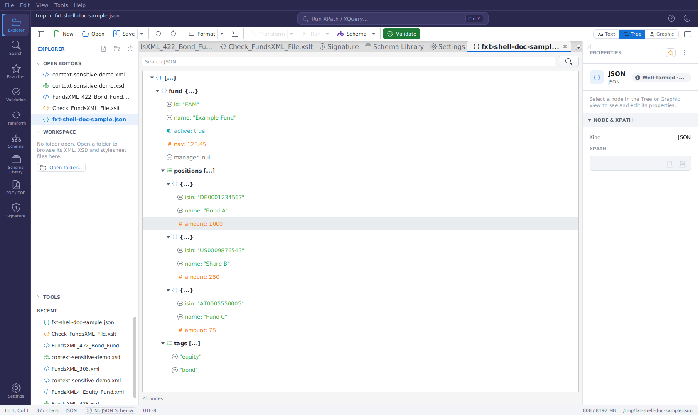
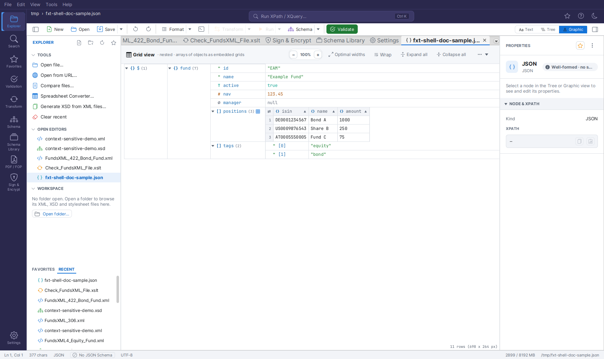

# JSON Editor

The JSON Editor provides a powerful environment for editing, validating, and querying JSON files with support for multiple JSON formats.

> **Note:** The standalone *JSON Editor* tab has been retired. JSON
> editing — text editing, the tree and grid views, and validation — now lives in the
> **Unified Shell**: open a `.json` file and the **Text**, **Tree** and **Graphic** (grid)
> views are available there. The capabilities below are unchanged; they are now part of the
> shell rather than a dedicated sidebar tab.

## Overview

FreeXmlToolkit includes a full-featured JSON Editor that supports:
- **Standard JSON** - RFC 8259 compliant
- **JSONC syntax** - JSON with Comments (single-line `//` and block `/* */`)
- **JSON5 syntax** - trailing commas, unquoted keys, single-quoted strings, and comments

> **File extensions:** `.json`, `.jsonc` and `.json5` all open in the JSON editor
> (tree view, grid view, JSONPath, schema binding). The flavor is detected from the *content*, not
> from the extension - a `.json` file with comments is treated as JSONC just like a
> `.jsonc` file. Only `.json` is offered for operating-system file associations
> (`.jsonc`/`.json5` have no MIME type in the shared databases).


***The Tree view of a JSON document in the Unified Shell***


***The same document in the Graphic (grid) view - the grid the shell also uses for XML***

## Features

### Text Editor

| Feature | Description |
|---------|-------------|
| **Syntax Highlighting** | Color-coded JSON for easy reading |
| **Format** | Pretty-print with the JSON indentation from Settings. Only whitespace changes: comments stay with their members, and quote style, numbers such as `0x1F`, unquoted keys and trailing commas are kept |
| **Sort Keys** | Right-click → **Sort Keys** sorts the members of the top-level object, **Sort Keys Recursively** every object (also inside arrays); comments move with their members, one undo step. The grid offers both for the selected object |
| **Folding** | Fold objects, arrays and long block comments with the arrow in the gutter; **Fold All** / **Unfold All** in the context menu |
| **Schema completion** | With a JSON Schema bound, **Ctrl+Space** lists the properties the object may still get (required ones first, with type and description) and, at a value, the allowed values (`enum`, `const`, `default`, `examples`, `true`/`false`, `null`). It also opens by itself after typing `"` at a key or `:` after a key. A property is inserted with a value skeleton (`""`, `{}`, `[]`) and the caret inside |
| **Schema hover** | Hovering a key or value adds what the schema says: title, type, whether it is required, description, allowed values, format and limits such as `minimum` or `pattern` |
| **Problems in place** | Validation problems are underlined (a schema violation at the member's key, a syntax error at its token), the line gets a red badge, and hovering shows the message. The marks go away with the next edit until the next validation |
| **Minify** | Compress JSON by removing whitespace |
| **Undo/Redo** | Full undo/redo support |
| **Line Numbers** | Numbered lines for easy navigation |
| **Drag & Drop** | Drop JSON files directly into the editor |

### Tree View

The tree view provides a hierarchical view of your JSON structure:

| Feature | Description |
|---------|-------------|
| **Interactive Navigation** | Click on nodes to jump to that location in the text |
| **Expand/Collapse** | Expand or collapse nodes to focus on specific areas |
| **Search** | Search for keys or values within the tree |
| **Sync with Editor** | Synchronize selection between tree and text |
| **Type Icons** | Visual icons for objects, arrays, strings, numbers, booleans, and null |

The tree shares the document model with the grid view and the Properties inspector, so an
edit made there shows up in the tree immediately, and Ctrl+F searches keys and values.

### Grid View

The **Graphic** view mode shows the document as the editable **grid** - the
very same grid the shell uses for XML files, so it is instantly familiar:

| Feature | Description |
|---------|-------------|
| **Rows** | The root `$`, object properties (`key = value`) and array items (`[0]`, `[1]`, …); objects and arrays collapse/expand |
| **Type glyphs** | `{}` object, `[]` array, `"` string, `#` number, `T`/`F` boolean, `∅` null - each in its own colour; strings are shown quoted |
| **Arrays of objects** | Rendered as embedded tables (one column per key); click a column header to sort, expand nested objects inline |
| **Inline editing** | Double-click a value; the type is kept (numbers must stay numbers, booleans toggle, `null` stays `null` unless you type text). Double-click a key to rename it |
| **Context menu** | Add Property / Array Item / Sibling Before / After, Rename Key (F2), Duplicate (Ctrl+D), Copy / Cut / Paste as Sibling / Paste as Child, Copy Cell Content (Ctrl+Shift+C), Copy JSONPath (Ctrl+Alt+X), Copy Node (JSON) (Ctrl+Alt+C), Change Type, Move Up/Down (Alt+↑/↓), Expand All / Collapse All, Sort Column, Delete |
| **Undo/Redo** | Every grid edit is one undo step (Ctrl+Z / Ctrl+Y) and is written back into the text |
| **Search** | Ctrl+F finds keys and values, revealing matches inside collapsed nodes |
| **Zoom & layout** | Zoom the whole grid with Ctrl+mouse wheel, Ctrl + / Ctrl − or the header's zoom pill (Ctrl 0 resets; the factor is shared with the XML grid). Nothing is cut off - long strings wrap onto further lines - and the columns of an array table can be dragged to a new width (double-click the separator to auto-fit). **Expand all** / **Collapse all** buttons sit in the header |

See [Grid View - JSON](grid.md#json-grid) for details.

### Properties Inspector

The **Properties** inspector on the right (Ctrl+Shift+P) works for JSON documents too. Select
a node in the **Tree** or **Graphic** (grid) view and the inspector shows:

- the **key** - editable for object properties (renaming a key here is the same as
  **Rename Key** in the grid; duplicate keys are refused),
- the node **type** (object, array, string, number, boolean, null) and its **depth**,
- the **JSONPath** of the node in the NODE & XPATH line (e.g. `$.items[1]`) - click it to
  copy the path,
- the **value** - editable for strings, numbers, booleans and `null`; the type is kept, so a
  number stays a number.

Edits made in the inspector are undoable (Ctrl+Z) and written back into the text just like
grid edits. See [Properties Inspector - JSON Files](inspector.md#json-files) for details.

With a JSON Schema bound, the inspector's **JSON SCHEMA** section shows what the schema says about
the selected value: type, required, description, allowed values, default, format, limits
(`minimum`, `maxLength`, `pattern`, …) and, for an object, its declared properties (`*` = required).

The schema help follows `$ref` (also into other files, local or downloaded), merges `allOf`, offers the
branches of `anyOf` / `oneOf` that fit the document (a `const` or `enum` on a member picks the
branch) and applies `if` / `then` / `else` when the document decides the condition. It is a guide,
not a validator: `unevaluatedProperties`, `dependentRequired` and conditions on patterns or ranges
are not evaluated - **Validate** checks everything.

#### Quick Fixes

Some schema violations come with a **quick fix** - the light bulb in the gutter, or **Quick Fix**
on the problem in the Problems list:

| Violation | Fix |
|-----------|-----|
| A required property is missing (`required`) | **Add required property "…"**: added as the object's last member, in the object's layout, with a value from the schema (its `const`, `default`, first `enum` value or a sample of its type) |
| A value is not one of the allowed ones (`enum`, `const`) | **Replace with …** one of the allowed values |
| A property the schema does not allow (`additionalProperties: false`) | **Remove property "…"** (with its comma and line) |

A fix changes only the affected text (comments and formatting stay) and is one undo step; the
document is validated again right after.

#### Generate a Sample

**Generate Sample (XML / JSON)…** (toolbar Schema ▾, Tools menu) on a JSON document creates a
sample instance in a new tab: from the open document when it is a JSON Schema, otherwise from
the schema bound to it. Choose **Required properties only** or **All declared properties**.
Values come from `const`, `default`, `enum` and `examples`, else from the type, honouring
`format` (date-time, email, uri, uuid, …), `pattern` (common patterns), `minimum` / `maximum`,
`multipleOf`, `minLength` and `minItems`. Recursive schemas stop after 8 levels; with all
properties, the members of every `oneOf` branch are filled in, so such a sample may need a
manual choice.

### Hover Information

When you hover over any element in the JSON editor, you'll see:
- **JSONPath** - The full path to the current element (e.g., `$.store.book[0].title`)
- **Type** - The JSON type (object, array, string, number, boolean, null)
- **Key** - The property key name
- **Value** - A preview of the value (truncated for long values)

### JSONPath Queries

Execute JSONPath queries to extract data from your JSON documents:

| Query Example | Description |
|---------------|-------------|
| `$.store.book[*].author` | All authors in the store |
| `$..author` | All authors anywhere in the document |
| `$.store.book[?(@.price < 10)]` | Books cheaper than 10 |
| `$.store.book[0,1]` | First two books |
| `$.store.book[-1:]` | Last book |

**To run a query:**
1. Open the **Query Console** (terminal icon in the toolbar, or Ctrl+Shift+X) - with a JSON document active its mode toggle reads **JSONPath** and it evaluates JSONPath
2. Enter your JSONPath expression
3. Run it to see the results in the console's result pane

### Validation

#### Syntax Validation
Click **Validate** to check if your JSON is syntactically correct. Parse errors are reported with
line and column; double-click a problem to jump there. Comments, trailing commas and the other
JSONC / JSON5 forms are valid in such files, and a JSON Schema validates them too.

#### JSON Schema Validation
JSON documents bind a JSON Schema the same way XML documents bind an XSD:

- **Automatic:** a top-level `"$schema"` member pointing at a schema file or URL
  (e.g. `"$schema": "./product-schema.json"`) is detected when the file opens.
  Relative paths resolve against the document's folder; `http(s)` URLs are
  downloaded and cached. (Values pointing at `json-schema.org` meta-schemas are
  dialect declarations, not bindings, and are ignored - unless *you* map that
  meta-schema URI in the Schema Library yourself; none are bundled.) If the
  `$schema` URI isn't directly resolvable, the Schema Library is consulted next -
  see [Schema Library](schema-library.md).
- **Manual:** click the **JSON Schema** indicator in the status bar, use the
  **JSON Schema** source row in the **Validation** panel (Change link, favorites
  star, or drag & drop a `.json` schema onto the row or the status bar).

Validation runs via **Run Validation** in the panel, the toolbar's **Validate**
button / F8, or continuously while typing (**Validate while typing**, on by
default). Schema violations appear in the PROBLEMS list with the offending
**line number** — clicking a problem jumps to it — and are marked in the text
(underline, gutter badge, hover) and in the grid (red row marker with the messages
as tooltip). Each problem also carries the
failing schema keyword and the JSON pointer of the invalid value.

The validator supports JSON Schema **Draft-07**, **2019-09**, and **2020-12**;
the dialect is selected by the schema's own `$schema` declaration (2020-12 is
the default for schemas without one). Relative `$ref`s between schema files
resolve as expected.

!!! tip "Ready-made examples"
    The `examples/json/` folder shipped with the application contains a complete
    demo set: a product-catalog schema with a relative `$ref`, a valid and a
    deliberately invalid instance (six line-navigable violations), and one
    dialect demo each for Draft-07 and 2019-09. Open
    `examples/json/products-invalid.json` and press F8 to see it in action.

## Keyboard Shortcuts

The complete list is on the **[Keyboard Shortcuts](keyboard-shortcuts.md)** page (and in the app under **Help → Keyboard Shortcuts**).

JSON-specific, in the Graphic (grid) view:

| Shortcut | Action |
|----------|--------|
| `F2` | Rename the selected key |
| `Ctrl+D` | Duplicate the selected node (elsewhere Ctrl+D adds the file to favorites) |
| `Alt+↑` / `Alt+↓` | Move the selected node up / down |
| `Ctrl+Alt+X` / `Ctrl+Alt+C` | Copy JSONPath / Copy Node (JSON) |
| `Ctrl+Shift+C` | Copy Cell Content |

## Supported Formats

All three flavors below are recognized in `.json`, `.jsonc` and `.json5` files; the
editor auto-detects the flavor from the content: comments make it JSONC; single-quoted strings,
unquoted keys, trailing commas or JSON5 numbers (`0x1F`, `.5`, `+1`, `Infinity`) make it JSON5. A
`//` or a colon inside a string value does not count, so a plain JSON file with URLs stays JSON.

### JSON (Standard)
```json
{
  "name": "John",
  "age": 30,
  "active": true
}
```

!!! warning "Grid edits rewrite JSONC / JSON5 as standard JSON"
    Comments, unquoted keys, single quotes and trailing commas are not part of the document
    model behind the tree and grid views. Editing in the **grid** (or through the Properties
    inspector) therefore rewrites the file as standard JSON on the first edit - the grid warns
    you once when it opens such a file. Edit in the **Text** view to keep them.

### JSONC syntax (JSON with Comments)
```jsonc
{
  // This is a single-line comment
  "name": "John",
  /* This is a
     multi-line comment */
  "age": 30
}
```

### JSON5 syntax
```json5
{
  // Unquoted keys
  name: 'John',
  // Single quotes
  city: 'New York',
  // Trailing commas allowed
  items: [1, 2, 3,],
}
```

## Converting between XML, JSON and YAML

The **Tools** menu converts the active document:

| Command | From |
|---|---|
| **Convert to JSON…** | XML, YAML |
| **Convert to XML…** | JSON, YAML |
| **Convert to YAML…** | XML, JSON |

When XML is involved, a dialog asks for the mapping (below) and remembers your choice; between JSON
and YAML there is nothing to choose. The result opens in a new, unsaved tab named after the
document (`order.xml` → `order.json`). The converter reads the text of the editor, including
changes that are not saved yet. The indentation follows Settings (XML for XML output, JSON for
JSON and YAML output).

YAML files (`.yaml`, `.yml`) open in the editor as text. They are read as YAML 1.2 (core schema:
`yes` and `on` stay strings); a file with several documents (`---`) becomes an array. YAML is
written in block style. Strings that would otherwise read back as a number, boolean or null are
quoted (`'007'`, `'true'`), so a conversion to YAML and back returns the same data. XML goes to
YAML through its JSON form, with the same mapping. Comments and anchors of a YAML file are not
kept.

### Structured mapping

The default. It works for any XML and gives JSON that reads naturally:

| XML | JSON |
|---|---|
| `<order>…</order>` (the root) | `{"order": …}` |
| `<name>Ada</name>` | `"name": "Ada"` |
| `<item sku="A">Apple</item>` | `"item": {"@sku": "A", "#text": "Apple"}` |
| two or more `<item>` siblings | `"item": [ … ]` |
| `<empty/>` | `"empty": ""` |
| `xmlns:p="urn:p"` | `"@xmlns:p": "urn:p"` |
| comments, processing instructions | dropped |

Element text is kept as it is, as a string. With **Numbers and true/false as JSON numbers and
booleans**, text that is a JSON number (`42`, `1.5`, `-3e2`, but not `007`) or `true`/`false`
becomes a number or boolean.

From JSON to XML the same rules apply in reverse. A top-level object with exactly one property
names the root element; anything else (several properties, an array, a single value) is wrapped
in the root element set in the dialog (default `json`). An array repeats its element; an array
inside an array becomes `<item>` elements. `null` becomes an empty element. A property name that is
not an XML name is adapted: invalid characters become `_`, and a name that starts with a digit
gets a leading `_` (`"first name"` → `first_name`, `"1st"` → `_1st`). A prefix like `p:` stays
when the object declares it with `"@xmlns:p"`.

What the structured mapping cannot keep: the order of differently named siblings
(`<a/><b/><a/>` becomes `"a": [ … ], "b": …`), text between child elements in mixed content (it
is joined into one `#text`), the difference between one element and an array of one, and empty
arrays. Characters that XML 1.0 cannot hold (control characters such as `\u0001`) stop the
conversion to XML; the W3C mapping replaces them.

### W3C mapping (XPath 3.1)

The XML representation of JSON defined for XPath 3.1, as written by `fn:json-to-xml` and read by
`fn:xml-to-json` (Saxon). It converts any JSON to XML and back without loss:

```xml
<map xmlns="http://www.w3.org/2005/xpath-functions">
   <array key="items">
      <number>1</number>
      <string>two</string>
   </array>
   <boolean key="active">true</boolean>
</map>
```

Use it when the XML is processed further with XSLT or XQuery, or when the JSON must come back
unchanged. Converting XML to JSON with this mapping needs a document in that vocabulary;
other XML is refused with a message.

On the command line: [`fxt-cli convert`](command-line.md#convert).

## Toolbar

> JSON files use the shell's single-row editor toolbar. Related
> actions sit in **split buttons** with a visible **▾** arrow menu; see
> [Unified Shell - Toolbar](unified-shell.md#toolbar) for the full reference.

With a JSON file active, the relevant actions are:

| Button | Description |
|--------|-------------|
| **New** | Open the guided New File dialog (includes JSON) |
| **Open** | Open an existing file |
| **Save ▾** | Save the current document; the arrow menu holds **Save As…** and **Save All** |
| **Undo** / **Redo** | Undo or redo changes (icon buttons) |
| **Format ▾** | Pretty-print the JSON with the indentation from Settings → Editor (JSON indent); the arrow menu holds **Minify** (compress by removing whitespace; `null` members are kept) |
| **Query Console** | Toggle the bottom query console - for JSON documents it runs **JSONPath** queries (icon button, Ctrl+Shift+X) |
| **Validate** | Check the JSON syntax (F8) |

Actions that do not apply to JSON (e.g. **Run** or the XSLT transform) are greyed out. The
**Tree** and **Graphic** (grid) views are switched with the Text/Tree/Graphic view switch at
the right end of the toolbar.

## Tree View Icons

| Icon | Type |
|------|------|
| `{ }` | Object (blue) |
| `[ ]` | Array (green) |
| `" "` | String (gray) |
| `#` | Number (orange) |
| Toggle | Boolean (cyan) |
| `-` | Null (gray, italic) |
| `//` | Comment (green, italic) |

## Tips and Best Practices

1. **Use the Tree View** for navigating large JSON documents, and the **Grid View** to edit
   arrays of objects like a table
2. **Enable Auto-Format** after pasting JSON from external sources
3. **Use JSONPath** to quickly extract specific data
4. **Validate against Schema** to ensure data quality
5. **Drag and Drop** files for quick access

## Related

- [XML Editor](xml-editor.md) - Edit XML files with similar features
- [XSLT Developer](xslt-developer.md) - Transform JSON to other formats
