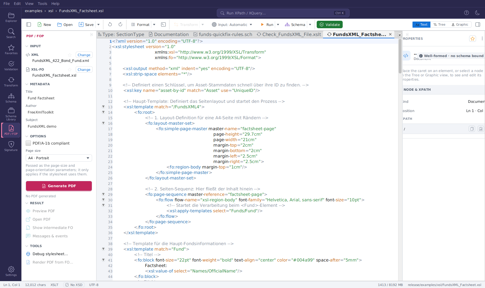

# PDF Generator (FOP)

> **Version:** 2.1.0

Create professional PDF documents from your XML files using Apache FOP (Formatting Objects Processor).

---

## Overview

The PDF Generator combines your XML data with an XSL-FO stylesheet to create formatted PDF documents.


*The PDF / FOP panel with the input files, metadata, and options set*

### How It Works

```
XML Data + XSL-FO Stylesheet = PDF Document
```

1. **XML File** - Your data (the content you want in the PDF)
2. **XSL-FO Stylesheet** - A template defining layout and formatting
3. **PDF Output** - The generated document

---

## The PDF / FOP Panel

In the [Unified Shell](unified-shell.md), open the **PDF / FOP** activity from the activity
bar. The panel is organized into three sections plus the primary action:

| Section | Contents |
|---------|----------|
| **INPUT** | The **XML** (follows the active editor; *Change* fixes it to a file) and the **XSL-FO stylesheet**. Each slot shows the file name on its own line (full path as tooltip); an empty slot shows a hint such as *"No stylesheet — choose or drop a file"* and works like *Change* when clicked |
| **METADATA** | PDF **Title**, **Author** (pre-filled from your user name), **Subject** |
| **OPTIONS** | **PDF/A-1b compliant** toggle and the **Page size** dropdown (A4/Letter · Portrait/Landscape) |
| **Generate PDF** | Asks for the output file and renders off the UI thread (XSLT → XSL-FO → PDF) |
| **RESULT** | **Preview PDF**, **Open PDF**, **Show intermediate FO** (the XSL-FO the stylesheet produced, as an editor tab) and **Messages & events (n)** (the stylesheet's `xsl:message` output and every event Apache FOP raised, in the OUTPUT panel) |
| **TOOLS** | **Debug stylesheet…** runs the XSL-FO stylesheet in the [XSLT debugger](xslt-developer.md#interactive-live-debugger); **Render PDF from FO…** renders the FO of the latest run (e.g. of a debug run) to a PDF |

---

## Step-by-Step Guide

### Step 1: Select Your Files

1. Open your XML data file in the editor (or pick one via the INPUT section's *Change*, or
   **drop** an `.xml` file from your file manager onto the XML row)
2. Click **Change** on the stylesheet row to select your XSL-FO stylesheet - or **drop**
   an `.xsl` / `.xslt` file onto the row

You can also drag and drop files directly into the application.

### Step 2: Set PDF Metadata (Optional)

Add metadata to your PDF document in the **METADATA** section:

| Field | Description |
|-------|-------------|
| **Title** | Document title |
| **Author** | Your name or organization (pre-filled from the configured user name) |
| **Subject** | What the document is about |

### Step 3: Options (Optional)

- **PDF/A-1b compliant** - produces an archival-grade PDF. The stylesheet must use
  embeddable **system fonts** (e.g. `Liberation Sans`); the PDF base-14 fonts
  (Helvetica, Times, Courier) cannot be embedded and FOP will report exactly that.
- **Page size** - a dropdown whose value is passed to the stylesheet as the XSLT parameters
  `page-size` (`A4`/`Letter`) and `page-orientation` (`Portrait`/`Landscape`). As the hint
  below the dropdown says, it **only applies if the stylesheet uses these parameters** -
  stylesheets that declare them can switch their `fo:simple-page-master` accordingly;
  others ignore the setting.

### Step 4: Generate the PDF

Click **Generate PDF**. You are asked where to save the output file, and the PDF is
rendered in the background - the application stays responsive throughout.

### Step 5: Preview

The generated PDF opens in the built-in **PDF preview**. You can:
- Scroll through pages
- Review the layout
- Check formatting

The **Preview** and **Open PDF** buttons re-open the last result at any time.

### Step 6: Understand what FOP did

Every generation keeps the **intermediate XSL-FO** and the messages of both stages:

- **Show intermediate FO** opens the FO document the stylesheet produced as an editor tab -
  the quickest way to see whether a layout problem comes from the stylesheet (wrong FO) or
  from FOP (right FO, unexpected rendering).
- **Messages & events (n)** shows the stylesheet's `xsl:message` output and every event FOP
  raised while rendering - a substituted font, content that overflows its area, an unknown
  property - in the OUTPUT panel. The status line after a successful run counts the FOP
  warnings, so a *Generated: report.pdf · 2 FOP warnings* is worth a look.
- A failed generation puts the stylesheet error (with its line in the `.xsl` file) or FOP's
  reason into OUTPUT as well.

### Debugging the stylesheet

**TOOLS → Debug stylesheet…** runs the XSL-FO stylesheet in the interactive
[XSLT debugger](xslt-developer.md#interactive-live-debugger): set breakpoints in the
stylesheet's gutter, step through templates, watch variables and the context node, read
`xsl:message` output live. The page-size and orientation parameters are passed on. When the
debug run finishes, its FO is in the OUTPUT panel and in the panel's result, so **Show
intermediate FO** and **Render PDF from FO…** work right away - the latter renders exactly the
FO you just debugged to a PDF of your choice.

---

## Favorites Integration

Save frequently used XML and XSL-FO files for quick access:

- Both **INPUT** rows carry a **star menu** next to their *Change* link - **XML** favorites
  for the input, **XSLT** favorites for the stylesheet - so you can pick a favorited file
  in one click.
- **Ctrl+D** (or the Favorites panel's **Add current**) stars the active document.
- The **Favorites** activity (star icon in the activity bar) lists all your saved files.

Learn more: [Favorites System](favorites-system.md)

---

## Features

| Feature | Description |
|---------|-------------|
| **Drag & Drop** | Drop an `.xml` file onto the XML row or an `.xsl` / `.xslt` file onto the stylesheet row; like a favorite pick, the file is also loaded into the editor |
| **Built-in Viewer** | Preview PDFs without leaving the app |
| **PDF Metadata** | Add title, author, and subject |
| **PDF/A-1b** | Optional archival-grade output |
| **Background Rendering** | Generation runs off the UI thread |
| **Favorites** | Quick access to frequently used files |

---

## XSL-FO Basics

XSL-FO (Extensible Stylesheet Language Formatting Objects) defines how your XML content should be formatted in the PDF.

### Simple Example

```xml
<?xml version="1.0" encoding="UTF-8"?>
<xsl:stylesheet version="1.0"
    xmlns:xsl="http://www.w3.org/1999/XSL/Transform"
    xmlns:fo="http://www.w3.org/1999/XSL/Format">

  <xsl:template match="/">
    <fo:root>
      <fo:layout-master-set>
        <fo:simple-page-master master-name="A4"
            page-height="29.7cm" page-width="21cm"
            margin="2cm">
          <fo:region-body/>
        </fo:simple-page-master>
      </fo:layout-master-set>

      <fo:page-sequence master-reference="A4">
        <fo:flow flow-name="xsl-region-body">
          <fo:block font-size="24pt" font-weight="bold">
            <xsl:value-of select="/document/title"/>
          </fo:block>
          <fo:block font-size="12pt">
            <xsl:value-of select="/document/content"/>
          </fo:block>
        </fo:flow>
      </fo:page-sequence>
    </fo:root>
  </xsl:template>

</xsl:stylesheet>
```

### Common FO Elements

| Element | Description |
|---------|-------------|
| `fo:block` | Paragraph or block of text |
| `fo:inline` | Inline text formatting |
| `fo:table` | Tables with rows and cells |
| `fo:external-graphic` | Images |
| `fo:page-number` | Current page number |
| `fo:leader` | Dots, lines, or space (for TOC) |

---

## Tips

- **Validate first** - Ensure your XML and XSL-FO files are valid before generating
- **Check error messages** - If generation fails, read the error details
- **Use the preview** - Review the PDF in the built-in viewer
- **Save to favorites** - Quick access to frequently used files
- **PDF/A and fonts** - For PDF/A-1b output, use embeddable system fonts in your stylesheet
  (the PDF base-14 fonts like Helvetica cannot be embedded)

---

## Troubleshooting

| Problem | Solution |
|---------|----------|
| No output | Check the INPUT section shows both the XML and the XSL-FO stylesheet |
| Font issues (PDF/A) | Use embeddable system fonts in the stylesheet - see the PDF/A-1b note above |
| Image not showing | Check image path is correct and accessible |
| Generation fails | The status shows a short reason; the OUTPUT panel has the stylesheet error with its line, or FOP's reason. **Show intermediate FO** tells you whether the FO itself is what you expect |
| PDF looks wrong (fonts, overflow) | Open **Messages & events** - FOP reports substituted fonts and overflowing content there |
| A template does not fire / wrong values | **TOOLS → Debug stylesheet…** and step through it - see [Debugging the stylesheet](#debugging-the-stylesheet) |

---

## Navigation

| Previous | Home | Next |
|----------|------|------|
| [XSLT Developer](xslt-developer.md) | [Home](index.md) | [Digital Signatures](digital-signatures.md) |

**All Pages:** [Unified Shell](unified-shell.md) | [XML Editor](xml-editor.md) | [XML Features](xml-editor-features.md) | [JSON Editor](json-editor.md) | [XSD Tools](xsd-tools.md) | [Profiled XML Generation](profiled-xml-generation.md) | [XSD Validation](xsd-validation.md) | [XSLT Viewer](xslt-viewer.md) | [XSLT Developer](xslt-developer.md) | [FOP/PDF](pdf-generator.md) | [Signatures](digital-signatures.md) | [IntelliSense](context-sensitive-intellisense.md) | [Schematron](schematron-support.md) | [FundsXML Extensions](fundsxml-extensions.md) | [Favorites](favorites-system.md) | [Templates](template-management.md) | [Tech Stack](technology-stack.md) | [Security](SECURITY.md) | [Licenses](licenses.md)
