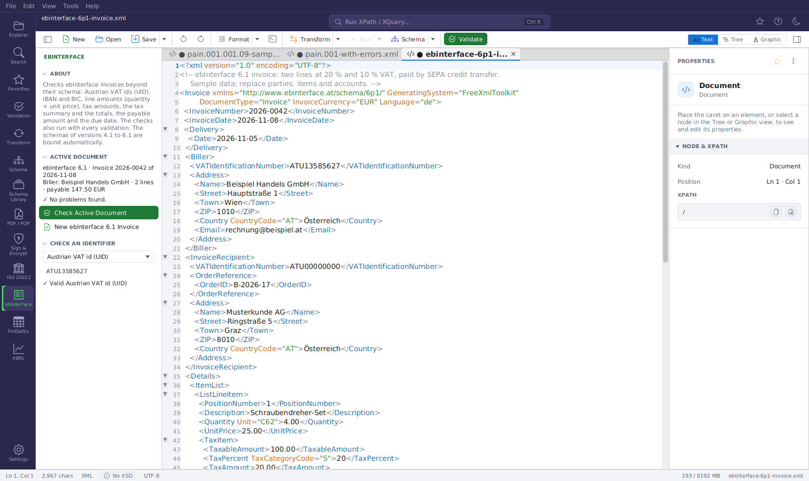
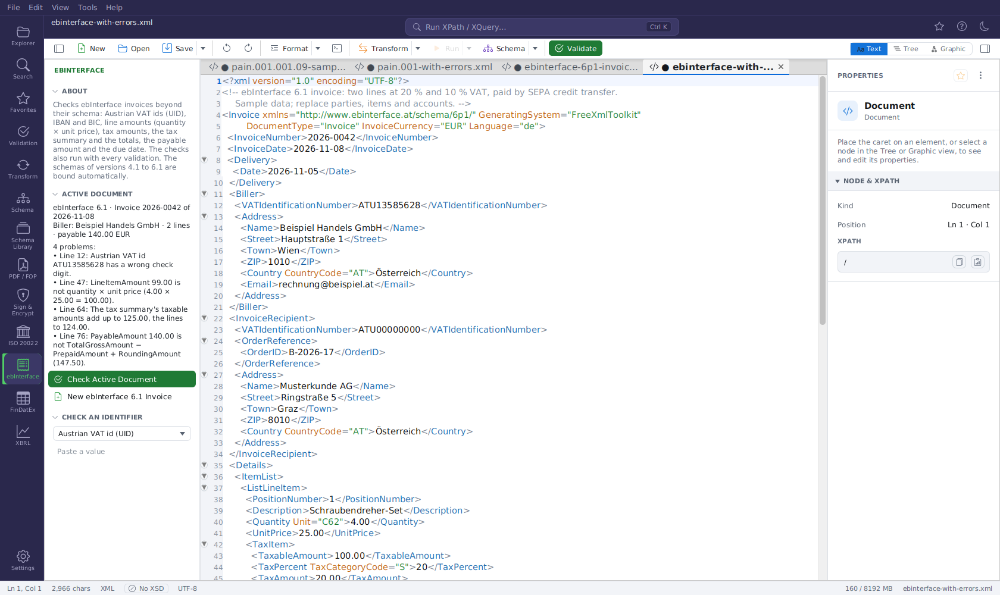

# ebInterface (Austrian e-invoice)

[ebInterface](https://www.ebinterface.at) is the Austrian XML standard for electronic invoices,
accepted by the federal e-invoicing portal (e-Rechnung.gv.at) and many companies. The
**ebInterface** plugin binds its schemas automatically, recalculates the invoice — line amounts,
taxes, totals, payable amount — checks VAT ids and bank details and gives you a sample invoice to
start from.

It is one of the [industry plugins](industry-plugins.md) and **off by default**.



## Switching it on

1. Open **Settings → Extensions → PLUGINS**.
2. Tick **ebInterface (Austrian e-invoice)** and save the settings.
3. Restart FreeXmlToolkit.

A receipt icon (**ebInterface**) then appears in the Activity Bar. Administrators can keep the
plugin off with `plugin.ebinterface.enabled=false` (see [Administration](administration.md)).

## Which documents it handles

XML documents whose root element is `Invoice` in a namespace
`http://www.ebinterface.at/schema/<version>/`, for example `http://www.ebinterface.at/schema/6p1/`.
The version is taken from the namespace (`6p1` → 6.1). All document types share the root `Invoice`
— the `DocumentType` attribute says whether it is an invoice, credit memo, final settlement and so on.

## Schemas

While the plugin is on, the [Schema Library](schema-library.md) contains entries (source *Plugin*)
for the versions **4.1, 4.2, 4.3, 5.0, 6.0 and 6.1**. Opening an invoice binds the schema of its
version by namespace. The schemas are downloaded from the standard's repository on GitHub
(`austriapro/ebinterface-standards`, file `schemas/ebInterface<version>/Invoice.xsd`) the first time
they are needed and cached; the schemas they import (e.g. XML Signature) are resolved the same way.

## The side panel

**ABOUT** — what the plugin checks.

**ACTIVE DOCUMENT** — a summary of the open invoice:

```
ebInterface 6.1 · Invoice 2026-0042 of 2026-11-08
Biller: Beispiel Handels GmbH · 2 lines · payable 147.50 EUR
```

- version, document type (`DocumentType`), invoice number and date;
- the biller's name (`Biller/Address/Name`);
- the number of invoice lines (`ListLineItem`);
- the payable amount (`PayableAmount`) in the invoice currency (`InvoiceCurrency`).

**Check Active Document** runs the checks below on the editor's text (saving is not needed). The
result shows the number of problems and the first ten with their line; **Show All Problems** opens
the complete list as a text document.



**New ebInterface 6.1 Invoice** opens a schema-valid sample invoice as a new document: a biller and
a recipient, two lines at 20 % and 10 % VAT, the tax summary, totals and payment by SEPA credit
transfer. Replace parties, items and accounts with your own data.

**CHECK AN IDENTIFIER** — choose **Austrian VAT id (UID)**, **IBAN** or **BIC** and paste a value:

- UID: `ATU` and eight digits, the last one a check digit after the algorithm of the Austrian tax
  administration (`✗ "ATU1234567" is not an Austrian VAT id (ATU and 8 digits).`);
- IBAN: length of the country and check digits; BIC: form after ISO 9362.

## Checks

The checks follow the rules of the ebInterface 6.1 specification. They run from the side panel and
with **every validation** of an ebInterface invoice — the [Validation panel](validation-panel.md),
**F8** and `fxt-cli validate` — with the source **ebInterface**, next to the schema's problems.

### Identifiers

| Check | Severity | Example message |
|---|---|---|
| every `VATIdentificationNumber` starting with `ATU`: format and check digit. `ATU00000000` (the recipient has no UID) is accepted; ids of other countries are not checked | error | `"ATU1358562" is not an Austrian VAT id (ATU and 8 digits).` |
| every `IBAN`: country length and check digits | error | `IBAN AT611904300234573202 has wrong check digits.` |
| every `BIC` | error | `"BKAUATW" is not a BIC (8 or 11 characters: bank, country, location, optional branch).` |

### Amounts

| Check | Severity | When it is skipped |
|---|---|---|
| **Line amount:** `LineItemAmount` = `Quantity` × `UnitPrice` (÷ the `BaseQuantity` attribute of `UnitPrice`, e.g. a price per 100 pieces) | warning | lines with a surcharge, reduction or other VAT-able tax (any element in the line whose name contains `Reduction`, `Surcharge` or `OtherVATableTax`) |
| **Tax amount:** `TaxAmount` = `TaxableAmount` × `TaxPercent` ÷ 100, for every `TaxItem` (in lines and in the tax summary) and `OtherVATableTax` | warning | — |
| **Tax summary against the lines:** the taxable amounts of `Invoice/Tax/TaxItem` add up to the line amounts | warning | invoices with surcharges or reductions on invoice level (`ReductionAndSurchargeDetails`) |
| **Gross total:** `TotalGrossAmount` = taxable amounts + taxes of the tax summary | warning | invoice-level surcharges or reductions, `OtherTax` |
| **Payable amount:** `PayableAmount` = `TotalGrossAmount` − `PrepaidAmount` + `RoundingAmount` | error | invoices with below-the-line items (`BelowTheLineItem`) |
| **Due date:** `PaymentConditions/DueDate` is not before `InvoiceDate` | warning | dates not in the form `YYYY-MM-DD` |

The first four allow a difference of one cent for rounding; the payable amount must match exactly.
Every message names the expected value, for example:

```
LineItemAmount 120.00 is not quantity × unit price (3 × 50.00 = 150.00).
TaxAmount 25.00 is not 20 % of 100.00 (20.00).
The tax summary's taxable amounts add up to 125.00, the lines to 150.00.
TotalGrossAmount 147.00 is not taxable amounts plus taxes of the tax summary (147.50).
PayableAmount 140.00 is not TotalGrossAmount − PrepaidAmount + RoundingAmount (147.50).
The due date 2026-11-01 is before the invoice date 2026-11-08.
```

## Typical workflow

1. **New ebInterface 6.1 Invoice** — or open an invoice your ERP system produced.
2. Edit it in the Text, Tree or [Grid](grid.md) view; the schema provides auto-completion.
3. Press **F8**: schema errors and the arithmetic checks appear together; click a problem to jump
   to it.
4. Before uploading to e-Rechnung.gv.at, check the saved file in a script:

```bash
fxt-cli validate invoices/2026-0042.xml
```

## What is not checked

- The business rules of the e-Rechnung.gv.at portal that go beyond the specification (e.g. the
  order reference of the federal government, the supplier id).
- VAT ids of other countries, and whether a UID is registered (only its check digit; use the EU
  VIES service for that).
- Calculations in lines with surcharges or reductions, and totals with invoice-level surcharges,
  reductions or other taxes — they are skipped rather than reported wrongly.
- Older versions are checked with the same 6.1 rules; elements that do not exist there are simply
  not found.

## Troubleshooting

| Problem | Solution |
|---|---|
| No schema is bound | Only versions 4.1–6.1 are registered, and GitHub must be reachable once for the download (proxy in **Settings → Network & Security**). |
| A warning about a line amount although the invoice is right | The line probably uses a price unit (`BaseQuantity`) or a discount that is not written as surcharge/reduction. Warnings do not make the document invalid. |
| The check button is disabled | The root is not `Invoice` in an `http://www.ebinterface.at/schema/…` namespace. |
