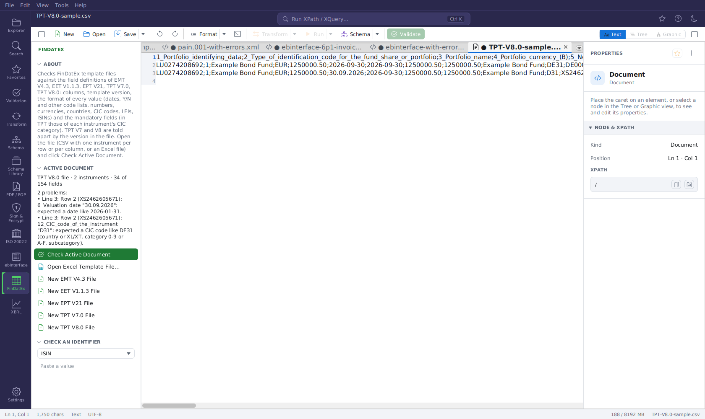

# FinDatEx Templates (EMT, EET, EPT, TPT)

[FinDatEx](https://findatex.eu) (Financial Data Exchange Templates) publishes the data templates
with which fund manufacturers pass product data to distributors and insurers. The **FinDatEx**
plugin checks such template files against the field definitions of the official specifications,
opens Excel template files and creates new, empty template files.

It is one of the [industry plugins](industry-plugins.md) and **off by default**.



## Supported templates

| Template | Version | Purpose | Fields |
|---|---|---|---|
| **EMT** — European MiFID Template | V4.3 | target market and costs under MiFID II | 114 |
| **EET** — European ESG Template | V1.1.3 | sustainability data under SFDR and MiFID | 614 |
| **EPT** — European PRIIPs Template | V2.1 (version value `V21` or `V21UK`) | data for the PRIIPs KID | 144 |
| **TPT** — Solvency II Tripartite Template | V7.0 and V8.0 | look-through of fund holdings for insurers | 152 / 154 |

FinDatEx publishes no XML Schema: the templates are exchanged as CSV or Excel files. The plugin
carries, for every field, its code, definition, codification, the flag M(andatory) / O(ptional) /
C(onditional) / I(ndicative) / N(o longer maintained) and — for TPT — the CIC categories the field
applies to. The definitions are part of the application and are updated with it.

**TPT V7 and V8:** TPT V7 is required for the production of December 2026, V8 becomes mandatory
for the end-March 2027 production, and both may be used in the transition. The plugin checks a file
against the version its `1000_TPT_Version` field names (`V7.0` or `V8.0`). A file naming another
version is checked against V8, and the version is reported.

## Switching it on

1. Open **Settings → Extensions → PLUGINS**.
2. Tick **FinDatEx Templates (EMT, EET, EPT, TPT)** and save the settings.
3. Restart FreeXmlToolkit.

A table icon (**FinDatEx**) then appears in the Activity Bar. Administrators can keep it off with
`plugin.findatex.enabled=false`.

## Opening a file

**CSV files** open like any other file (File → Open, Explorer, drag & drop). The plugin recognises a
template file by its version field anywhere in the first 200 000 characters:

| Template | Version field |
|---|---|
| EMT | `00001_EMT_Version` |
| EET | `00010_EET_Version` |
| EPT | `00001_EPT_Version` |
| TPT | `1000_TPT_Version` |

**Excel files** (`.xlsx`, `.xls`): click **Open Excel Template File…** in the side panel. The first
sheet opens as a new, semicolon-separated text document with the same name and `.csv`:

- dates become `YYYY-MM-DD`, date and time `YYYY-MM-DD hh:mm:ss`;
- numbers are written without formatting (no thousands separator, decimal point);
- Excel booleans become `Y` / `N`; formulas are replaced by their last computed value;
- values containing `;`, quotes or line breaks are quoted.

Save the result if you want to keep it as CSV; the Excel file itself is not changed.

### Layouts

Both layouts used in practice are recognised automatically:

**One instrument per row** under a header row of field codes:

```
00001_EMT_Version;00002_EMT_Producer_Name;00010_Financial_Instrument_Identifying_Data;…
V4.3;Example Asset Management;AT0000A0XYZ1;…
V4.3;Example Asset Management;AT0000A0XYZ2;…
```

**One field per row** (transposed), the field code in the first column and one instrument per
column:

```
1000_TPT_Version;V8.0;V8.0
1_Portfolio_identifying_data;AT0000A0ABC1;AT0000A0ABC1
12_CIC_code_of_the_instrument;DE31;XT72
14_Identification_code_of_the_instrument;DE0001102341;…
```

A file counts as "one instrument per row" when its first row contains at least two known field
codes. The separator — `;`, `,`, `|` or tab — is taken from the first non-empty line (the one that
occurs most often). Quoted values (RFC 4180) may contain separators, line breaks and doubled quotes.
Empty rows (or empty columns in the transposed layout) are skipped.

## The side panel

**ACTIVE DOCUMENT** — what the file is:

```
TPT V8.0 file · 2 instruments · 154 of 154 fields · one instrument per column
```

the template and the version in the file, the number of instruments, how many of the file's
columns are known fields of the template, and the layout when it is transposed.

**Check Active Document** runs the checks below. The result shows the number of problems and the
first ten; **Show All Problems** opens the full list as a text document.

**Actions:**

| Action | What it does |
|---|---|
| **Open Excel Template File…** | Converts the first sheet of an Excel file to CSV text and opens it (see above) |
| **New EMT V4.3 File** | A new file with the header row of all EMT fields and one row with the version and the current date and time (UTC) filled in |
| **New EET V1.1.3 File**, **New EPT V21 File**, **New TPT V7.0 File**, **New TPT V8.0 File** | The same for the other templates |

**CHECK AN IDENTIFIER** — **ISIN** (ISO 6166: form and check digit) and **LEI** (ISO 17442).

## Checks

FinDatEx files are checked **from the side panel** (Check Active Document); they are no XML and
therefore not part of the Validation panel or `fxt-cli validate`.

### Columns and version

| Check | Severity | Example message |
|---|---|---|
| a column appears twice | error | `The field 12_CIC_code_of_the_instrument appears twice.` |
| a column is no field of the template (typo, other version, own additions) | warning | `12_CIC_Code is no field of TPT V8.0.` |
| a generally mandatory field is missing as a column | warning | `Mandatory fields 6_Valuation_date, 7_Reporting_date are missing.` |
| the file has no instruments | warning | `The file has no instruments.` |
| the template version in the file is not the one the checks follow | warning | `Row 1 (…): 00001_EMT_Version "V4.2": the checks follow V4.3; other versions may differ.` |

### Values

Every filled value is checked against the type of its field:

| Field type | Expected | Example message |
|---|---|---|
| date | `YYYY-MM-DD` | `expected a date like 2026-01-31` |
| date and time | `YYYY-MM-DD hh:mm:ss` | `expected a date and time like 2026-01-31 14:30:00` |
| number | a number with decimal point, optional exponent; percentages as fractions | `expected a number (decimal point, 5% = 0.05)` |
| whole number | an integer within the field's range | `expected a number from 1 to 7` |
| closed code list | one of the listed values: `Y` / `N`, `Y` / `N` / `Neutral`, `R` / `P` / `B` / `N`, TPT lists such as `Fixed` / `Floating` / `Variable` / `Inflation_linked` … | `expected one of Y, N` |
| currency | three capital letters (ISO 4217) | `expected an ISO 4217 currency code like EUR` |
| country | ISO 3166 alpha-2 code | `expected an ISO 3166 country code like DE` |
| LEI | form and check digits | `not a valid LEI` |
| CIC code (TPT) | country of listing or `XL` (not listed) / `XT` (not tradable), category `0`–`9` / `A`–`F`, subcategory | `expected a CIC code like DE31 (country or XL/XT, category 0-9 or A-F, subcategory)` |
| identifier | when its identification type field is `1`: a valid ISIN — in TPT the issuer (`47_…`) and issuer group (`50_…`) identifiers must then be a valid LEI | `not a valid ISIN (identification type 1)` |
| text | not longer than the field's maximum length | `longer than 255 characters` |

Value problems are errors and name the row (or, in the transposed layout, the instrument), the
instrument's identifier and the field, and they jump to the line:

```
Row 3 (AT0000A0XYZ2): 00045_Financial_Instrument_Performance_Fee "yes": expected one of Y, N.
Instrument 2 (DE0001102341): 12_CIC_code_of_the_instrument "D31": expected a CIC code like DE31 (…).
```

The instrument's identifier is the identifying-data field of the template; in TPT
`14_Identification_code_of_the_instrument`.

### Mandatory fields

Empty mandatory fields are warnings:

- **EMT, EET, EPT:** the fields flagged M in the general sections — data set information and
  instrument or manufacturer information. In the other sections, whether a field is mandatory
  depends on the reporting flags and on the product, so they are not checked.
- **TPT:** the fields flagged M for the instrument's **CIC category**, the third character of
  `12_CIC_code_of_the_instrument`. Example: `47_Issuer_identification_code` is mandatory for
  categories 0–8 and A–F, but not for 9 (property).

```
Row 2 (XS1234567890): 47_Issuer_identification_code: the field is mandatory for CIC category 2 and empty.
```

Conditional fields (C) are not checked in any template.

At most **500 value problems** are listed per file; after that the check stops with "More than 500
value problems; the rest is not listed."

## Typical workflow

1. **Open Excel Template File…** with the TPT your fund administrator delivered, or open the CSV.
2. **Check Active Document**. Typical findings: dates in `DD.MM.YYYY`, percentages as `5` instead of
   `0.05`, decimal commas, typos in code lists, missing issuer LEIs.
3. Correct the values in the text editor (or open the CSV in a spreadsheet) and check again.
4. To start a new file, use **New … File** — the header row is complete and in the official order.

## Troubleshooting

| Problem | Solution |
|---|---|
| "The active document is not one this plugin checks." | The version field (e.g. `1000_TPT_Version`) is missing or spelled differently. Check the header row / the first column. |
| Many "is no field of" warnings | The file uses another version's field codes, or a header with descriptions instead of codes. |
| All values of a row are shifted | The separator was detected wrongly — the first line must contain the separator that the file uses (e.g. no single-column title line above the header). |
| Excel dates show as numbers | The cells are not formatted as dates in Excel; format them as dates, or correct the values in the CSV. |
