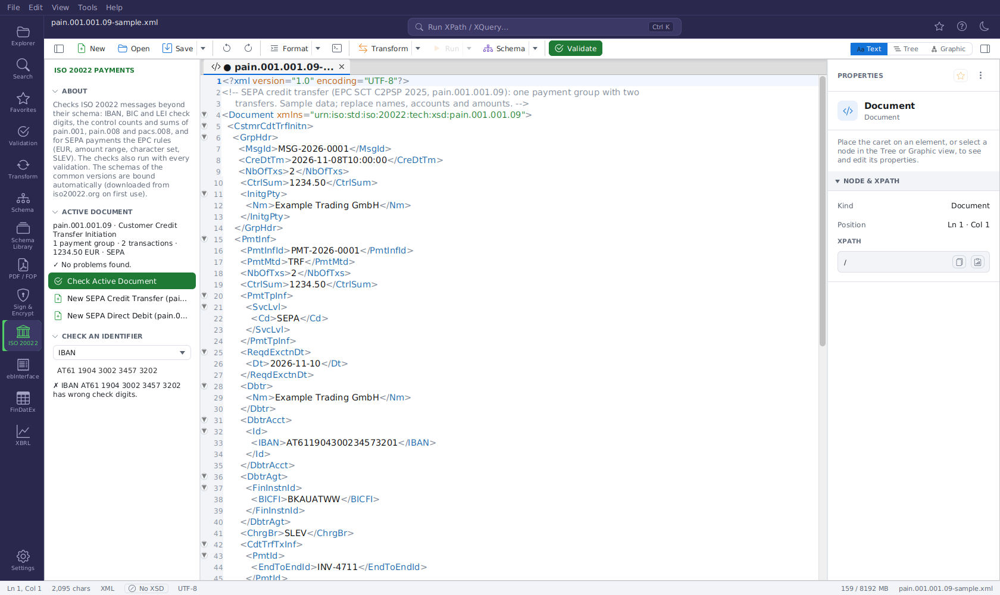
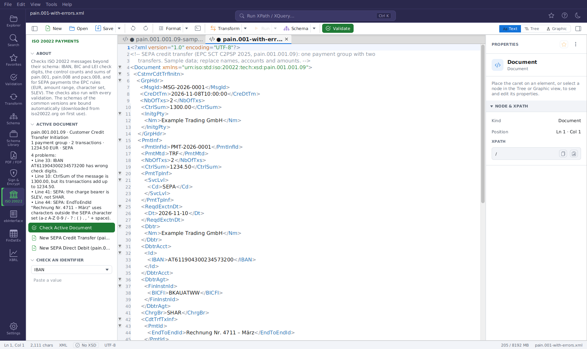

# ISO 20022 Payments (SEPA)

The **ISO 20022** plugin helps with payment messages of the ISO 20022 standard — payment
initiations (`pain`), interbank messages (`pacs`) and account reports (`camt`). It binds the
official XML Schemas automatically, checks what a schema cannot check (check digits, control
sums, the SEPA rules of the European Payments Council) and gives you SEPA sample messages to start
from.

It is one of the [industry plugins](industry-plugins.md) and **off by default**.



## Switching it on

1. Open **Settings → Extensions → PLUGINS**.
2. Tick **ISO 20022 Payments (SEPA)** and save the settings.
3. Restart FreeXmlToolkit.

A bank icon (**ISO 20022**) then appears in the Activity Bar, above Settings. Administrators can
keep the plugin off for everyone with `plugin.iso20022.enabled=false` in `policy.properties`
(see [Administration](administration.md)).

## Which documents it handles

Every XML document whose root element is in a namespace starting with
`urn:iso:std:iso:20022:tech:xsd:` — the rest of the namespace is the message id, for example
`urn:iso:std:iso:20022:tech:xsd:pain.001.001.09`. The plugin knows the names of these message
families:

| Family | Name |
|---|---|
| `pain.001` | Customer Credit Transfer Initiation |
| `pain.002` | Customer Payment Status Report |
| `pain.007` | Customer Payment Reversal |
| `pain.008` | Customer Direct Debit Initiation |
| `pacs.002` | FI To FI Payment Status Report |
| `pacs.004` | Payment Return |
| `pacs.008` | FI To FI Customer Credit Transfer |
| `camt.052` | Bank To Customer Account Report |
| `camt.053` | Bank To Customer Statement |
| `camt.054` | Bank To Customer Debit Credit Notification |
| `camt.056` | FI To FI Payment Cancellation Request |

Other ISO 20022 messages (e.g. `acmt`, `reda`) are recognised as well; the identifier checks below
run on them, the control-sum and SEPA checks do not.

## Schemas

While the plugin is on, the [Schema Library](schema-library.md) contains an entry (source
*Plugin*) for each of these message versions:

| Area | Versions |
|---|---|
| pain | pain.001.001.03, pain.001.001.09, pain.001.001.12, pain.002.001.03, pain.002.001.10, pain.007.001.09, pain.008.001.02, pain.008.001.08, pain.008.001.11 |
| pacs | pacs.002.001.10, pacs.004.001.09, pacs.008.001.08, pacs.008.001.13 |
| camt | camt.052.001.08, camt.053.001.02, camt.053.001.08, camt.054.001.02, camt.054.001.08, camt.056.001.08 |

When you open a message of one of these versions, its schema is bound by namespace — no
`xsi:schemaLocation` needed. The schema is downloaded from iso20022.org
(`https://www.iso20022.org/sites/default/files/documents/messages/<area>/schemas/<message>.xsd`) the
first time it is needed and cached; afterwards it works offline. You get validation,
[auto-completion](context-sensitive-intellisense.md) and the schema facts in the
[Inspector](inspector.md) as with any other schema.

For other versions add the schema to the Schema Library yourself (namespace → file). The entries
of the plugin are never written to your own library; they disappear when the plugin is switched off.

## The side panel

The panel has four parts.

**ABOUT** — a short description of what the plugin checks.

**ACTIVE DOCUMENT** — what the open document is, updated when you switch tabs:

```
pain.001.001.09 · Customer Credit Transfer Initiation
1 payment group · 2 transactions · 1234.50 EUR · SEPA
```

- the message id and its name;
- the number of payment groups (`PmtInf`) and of transactions — counted from the instructed amounts
  (`InstdAmt`) or interbank settlement amounts (`IntrBkSttlmAmt`);
- the total of all amounts, when they all have the same currency;
- **SEPA** when a service level `SvcLvl/Cd` is `SEPA`;
- "(not well-formed)" when the XML cannot be read.

A document that is no ISO 20022 message shows "The active document is not one this plugin checks."
and the check button is disabled.

**Check Active Document** runs the checks below on the editor's text — also on an unsaved
document — in the background. The result lists the number of problems and the first ten with their
line. With more than ten, **Show All Problems** opens the full list as a text document (severity,
line, message per row).



**Actions:**

| Action | What it does |
|---|---|
| **New SEPA Credit Transfer (pain.001)** | Opens a sample `pain.001.001.09` message (SEPA credit transfer, schema-valid, after the EPC guidelines 2025) as a new, unsaved document |
| **New SEPA Direct Debit (pain.008)** | Opens a sample `pain.008.001.08` message (SEPA Core direct debit with mandate) as a new, unsaved document |

Change the names, IBANs and amounts and save it under a name of your choice.

**CHECK AN IDENTIFIER** — pick **IBAN**, **BIC** or **LEI**, paste a value and see at once whether
it is valid (`✓ Valid IBAN`) or why not (`✗ IBAN AT61 1904 3002 3457 3202 has wrong check digits.`).
Spaces in an IBAN are allowed.

## Checks

The checks run from the side panel and with **every validation** of an ISO 20022 message: the
[Validation panel](validation-panel.md), **F8** in the editor and `fxt-cli validate`. Their problems
have the source **ISO 20022** and appear next to the schema's problems. All of them are errors.

### All messages

| Check | Example message |
|---|---|
| `IBAN` values: country code, length of that country, check digits (ISO 13616) | `IBAN DE89370400440532013001 has wrong check digits.` |
| `BICFI`, `BIC`, `AnyBIC`, `BICOrBEI` values: 8 or 11 characters, bank code, country, location (ISO 9362) | `"DEUTDEF" is not a BIC (8 or 11 characters: bank, country, location, optional branch).` |
| `LEI` values: 20 characters and check digits (ISO 17442) | `LEI 5299000J2N45DDNE4Y29 has wrong check digits.` |
| every `Ccy` attribute is three capital letters (ISO 4217 form) | `"eur" is not an ISO 4217 currency code.` |
| the message is well-formed | `The message is not well-formed: …` |

### Control counts and sums

For `pain.001` (credit transfer initiation), `pain.008` (direct debit initiation) and `pacs.008`
(interbank credit transfer):

| Check | Example message |
|---|---|
| `GrpHdr/NbOfTxs` is the number of transactions in the message | `NbOfTxs of the message is 3, but it has 2 transactions.` |
| `GrpHdr/CtrlSum` is the sum of their amounts | `CtrlSum of the message is 1300.00, but its transactions add up to 1234.50.` |
| `PmtInf/NbOfTxs` and `PmtInf/CtrlSum` match the transactions of that payment group (`pain` only) | `CtrlSum of payment group PMT-2026-0001 is 1000, but its transactions add up to 1234.50.` |

Transactions are `CdtTrfTxInf` (amount `Amt/InstdAmt`, in `pacs.008` `IntrBkSttlmAmt`) and
`DrctDbtTxInf` (amount `InstdAmt`). If a transaction has its amount in another form (e.g. an
equivalent amount), the sum is not compared. Missing `NbOfTxs`/`CtrlSum` elements are not reported —
the schema says whether they are required.

### SEPA rules

For every payment group of a `pain.001` or `pain.008` whose service level (`PmtTpInf/SvcLvl/Cd`, in
the group or a transaction) is `SEPA`, after the EPC implementation guidelines 2025 for SEPA Credit
Transfer and SEPA Direct Debit Core (customer-to-PSP):

| Check | Example message |
|---|---|
| amounts are in `EUR` | `SEPA: payments are in EUR only, not CHF.` |
| amounts are between 0.01 and 999 999 999.99 | `SEPA: the amount must be between 0.01 and 999999999.99, not 0.00.` |
| amounts have at most two decimals | `SEPA: amounts have at most 2 decimals (10.005).` |
| `MsgId`, `PmtInfId`, `InstrId`, `EndToEndId`, `MndtId` use only the SEPA character set: `a-z A-Z 0-9 / - ? : ( ) . , ' +` and space | `SEPA: EndToEndId "Rechnung Nr. 4711 – März" uses characters outside the SEPA character set …` |
| these references do not start or end with `/` and contain no `//` | `SEPA: InstrId "/INV-1" must not start or end with / or contain //.` |
| the charge bearer `ChrgBr` is `SLEV` | `SEPA: the charge bearer is SLEV, not SHAR.` |

The references of the group header (`MsgId`) are checked with every SEPA group.

## Typical workflow

1. Click **New SEPA Credit Transfer (pain.001)** — the sample opens with its schema bound.
2. Fill in debtor, creditors and amounts. Auto-completion offers the elements the schema allows.
3. Press **F8** (or **Check Active Document**): schema errors and the plugin's checks appear
   together; a click on a problem jumps to the line.
4. Correct `NbOfTxs` and `CtrlSum` when you add or remove transactions — the check tells you the
   right values.
5. Save the file and check it again from the command line before sending it to the bank:

```bash
fxt-cli validate payments/2025-11-salaries.xml
```

`fxt-cli validate` loads the switched-on plugins, so the same checks run there (exit code 1 on
errors, see [Command Line](command-line.md)).

## What is not checked

- Bank-specific rules beyond the EPC guidelines (e.g. national variants, cut-off times, the
  maximum number of transactions a bank accepts).
- Whether an IBAN or BIC exists — only its form and check digits.
- Rules of SEPA Instant, SDD B2B or other schemes; the SEPA rules apply to groups with service
  level `SEPA` in `pain.001`/`pain.008` only.
- Business rules of `camt` and `pacs.002`/`pacs.004` messages besides identifiers and currencies.

## Troubleshooting

| Problem | Solution |
|---|---|
| No schema is bound to my message | Check the version in the namespace: only the versions listed above are bound. Add others in the Schema Library. |
| The schema cannot be loaded when it is first needed | iso20022.org must be reachable once (proxy settings in **Settings → Network & Security**). Afterwards the cached copy is used. See [Operation without Internet](offline-operation.md) for prepared machines. |
| The ISO 20022 activity is missing | The plugin is off, or your administrator disabled it. Check **Settings → Extensions → PLUGINS**. |
| The check button is disabled | The active document is not an ISO 20022 message (root namespace not `urn:iso:std:iso:20022:tech:xsd:…`). |
