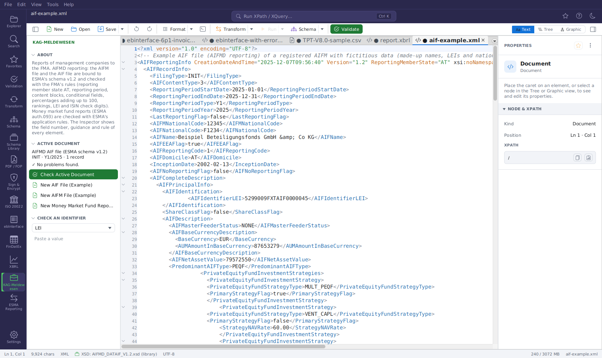
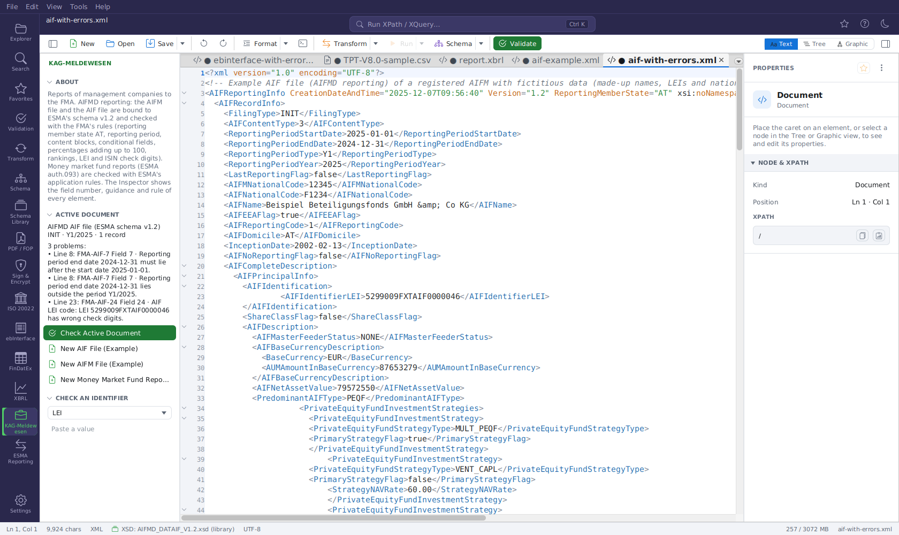

# KAG-Meldewesen (FMA)

The **KAG-Meldewesen** extension supports reports of Austrian management companies (KAG, AIFM) to the
Austrian Financial Market Authority (FMA):

- the **AIFMD reporting** (Annex IV of Regulation (EU) 231/2013, § 22 AIFMG): the **AIFM file** and
  the **AIF file** in ESMA's XML format;
- the **money market fund report** (Article 37 of Regulation (EU) 2017/1131, quarterly via the FMA
  to ESMA) in ESMA's ISO 20022 format.

| Report | Root element | Schema |
|---|---|---|
| AIFM file | `AIFMReportingInfo` | ESMA `AIFMD_DATMAN_V1.2.xsd` |
| AIF file | `AIFReportingInfo` | ESMA `AIFMD_DATAIF_V1.2.xsd` |
| Money market fund report | `BizData` (head.003) with `Document` (auth.093), or `Document` alone | ESMA MMF schemas v04.1 |

The extension is **off by default**: switch it on in **Settings → Extensions → INSTALLED EXTENSIONS**
(`plugin.kag-meldewesen.enabled`) and restart.

## What it does

- **Schema binding:** both files are bound to ESMA's schemas v1.2 (shipped with the application) by
  their root element - validation (**F8**), IntelliSense, the grid and the Inspector use them.
- **FMA rules:** the FMA's *Prüfregeln AIF / AIFM Reporting File* (as of 29.01.2024) run with every
  validation (**F8**, Validation panel, `fxt-cli validate`). Each finding names the rule
  (`FMA-AIF-<field>`, `FMA-AIFM-<field>` after the field number of ESMA's tables) and the field, and
  jumps to its line:
    - reporting member state `AT`, reporting period (start date matches the period type, end date
      after the start and inside the period), change quarter of a reporting obligation change;
    - the blocks an AIF content type requires (principal information, individual information,
      leverage under Article 24(2) and 24(4)), nothing below `AIFCompleteDescription` when the
      no-reporting flag is set;
    - conditional fields: share class, master-feeder, base currency and FX rate, instrument
      identification (ISIN, AII), asset types `NTA`, market code types `MIC` / `OTC` / `NOT`,
      private equity only fields, risk measure types (`NET_DV01`, `NET_CS01`, `VEGA_EXPO`, `VAR` …),
      counterparty and CCP exposures, redemption rights, borrowing sources;
    - percentages that add up to 100 % (strategies, geographical focus of NAV and AuM, investor
      concentration, trading and clearing mechanisms, portfolio liquidity, investor groups,
      financing liquidity), with 0.5 percentage points for rounding;
    - rankings: the values of a ranked list do not grow with the ranking;
    - NAV not above the AuM, main instruments not above the AuM (1 % tolerance), inception date
      before the reporting period, monthly values only for months of the reporting period;
    - LEI and ISIN check digits.

  The checks of the national codes against the lists of the Incoming Platform can only run there.
- **Field labels:** select an element (text, tree or grid) and the Inspector's DOCUMENTATION starts
  with its ESMA field number and name, the M/C/O/F obligation, the FMA's rule and ESMA's technical
  guidance; the grid shows the same as tooltip of the element's name.
- **Status bar badge:** `AIFMD AIF Y1/2025`, `AIFMD AIFM Q4/2025`; a click opens the side panel.
- **KAG-Meldewesen activity:** what the active document is, **Check Active Document**, an identifier
  checker (LEI, ISIN, BIC) and two examples (**New AIF File**, **New AIFM File**) with fictitious data.
- **Help menu:** **FMA AIFMD Reporting** opens the FMA's page with the rules and samples.

Submit the files on the FMA Incoming Platform. The schemas are installed under
`~/.freeXmlToolkit/kag-meldewesen/aifmd-1.2/`.

## Money market fund report

The report is bound to ESMA's schemas v04.1 - the envelope (`BizData`, head.003), the business
application header (head.001) and the report (auth.093) together - and checked with the application
rules of ESMA's *MMF validation rules v07* that need only the file (`ESMA-MMF-<field code>`):

- header: sender `AT` (the FMA), recipient `EU`, message definition `auth.093.001.01`, creation date
  after the reporting end date;
- reporting year from 2020, period ranges (from/to quarter), start and end date inside the quarters,
  the authorising country equal to the sender, no two reports of one MMF and period in a file;
- share classes (one flagged with the highest NAV), inception, merger and liquidation dates;
- daily and weekly maturing assets below 100 %, the liquidity profile (four ranges, each once,
  adding up to 100 %), the yield breakdowns (each range type once), the input factor of the
  macro-economic stress scenarios;
- assets: counterparty name without LEI, no accrued interest for the valuation methods `MTMO` and
  `AMCS`, reset dates after the reporting end date, amounts in the base currency next to the EUR
  amounts;
- ISO 4217 currencies, ISO 3166 and EU countries, ISIN and LEI check digits.

Checks against ESMA's register (authorised MMFs, earlier reports) only run at ESMA. **New Money
Market Fund Report (Example)** opens a fictitious report.

## Sources

ESMA: AIFMD reporting XML documents v1.2 (2013-1361) and IT technical guidance rev 6 (2013-1358).
FMA: *Informationen zum Inhalt und zur Übermittlung des AIFMD-Reportings* (December 2023) and the
*Prüfregeln* (29.01.2024). ESMA: MMF reporting XML schemas v04.1 and validation rules v07
(esma65-8-6480). The field catalogues are generated with `scripts/aifmd-fields.py` and
`scripts/esma-mmf-fields.py`.

## Planned

The UCITS derivative risk report under the 4. DeRiMV follows once its XSD (published on the Incoming
Platform only) is available.
