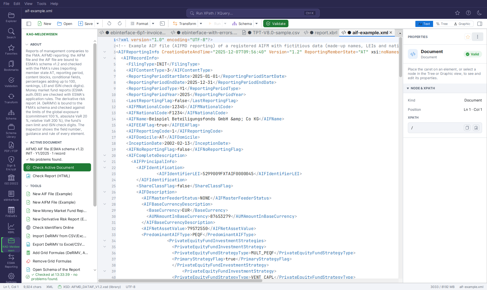
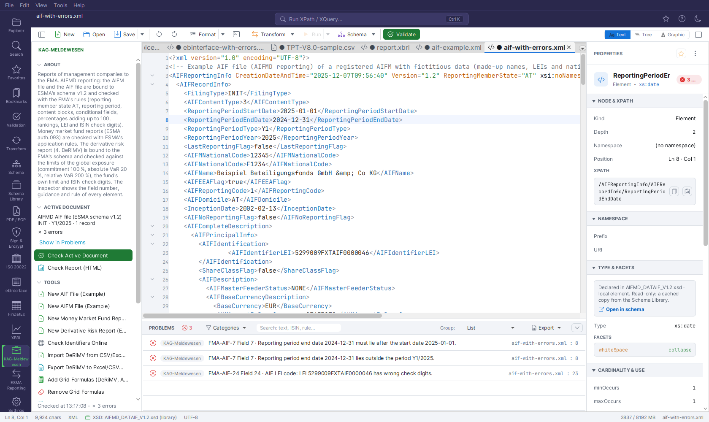

# KAG-Meldewesen (FMA)

The **KAG-Meldewesen** extension supports reports of Austrian management companies (KAG, AIFM) to the
Austrian Financial Market Authority (FMA):

- the **AIFMD reporting** (Annex IV of Regulation (EU) 231/2013, § 22 AIFMG): the **AIFM file** and
  the **AIF file** in ESMA's XML format;
- the **money market fund report** (Article 37 of Regulation (EU) 2017/1131, quarterly via the FMA
  to ESMA) in ESMA's ISO 20022 format;
- the **derivative risk report** of UCITS management companies (§ 2a of the 4. DeRiMV, quarterly) in
  the FMA's XML format.

| Report | Root element | Schema |
|---|---|---|
| AIFM file | `AIFMReportingInfo` | ESMA `AIFMD_DATMAN_V1.2.xsd` |
| AIF file | `AIFReportingInfo` | ESMA `AIFMD_DATAIF_V1.2.xsd` |
| Money market fund report | `BizData` (head.003) with `Document` (auth.093), or `Document` alone | ESMA MMF schemas v04.1 |
| Derivative risk report | `Derivatemeldung` (no namespace) | FMA `Derivatemeldung.xsd` + `DerivateTypes.xsd` (2016) |

The extension is **off by default**: switch it on in **Settings → Extensions → INSTALLED EXTENSIONS**
(`plugin.kag-meldewesen.enabled`) and restart.

## What it does

- **Schema binding:** both files are bound to ESMA's schemas v1.2 (shipped with the application) by
  their root element - validation (**F8**), IntelliSense, the grid and the Inspector use them.
- **FMA rules:** the FMA's *Prüfregeln AIF / AIFM Reporting File* (as of 29.01.2024) run with every
  validation (**F8**, Validation panel, `fxt-cli validate`). Each finding names the rule
  (`FMA-AIF-<field>`, `FMA-AIFM-<field>` after the field number of ESMA's tables) and the field, and
  jumps to its line:
    - reporting member state `AT`, reporting period (start date matches the period type, end date
      after the start and inside the period), change quarter of a reporting obligation change;
    - the blocks an AIF content type requires (principal information, individual information,
      leverage under Article 24(2) and 24(4)), nothing below `AIFCompleteDescription` when the
      no-reporting flag is set;
    - conditional fields: share class, master-feeder, base currency and FX rate, instrument
      identification (ISIN, AII), asset types `NTA`, market code types `MIC` / `OTC` / `NOT`,
      private equity only fields, risk measure types (`NET_DV01`, `NET_CS01`, `VEGA_EXPO`, `VAR` …),
      counterparty and CCP exposures, redemption rights, borrowing sources;
    - percentages that add up to 100 % (strategies, geographical focus of NAV and AuM, investor
      concentration, trading and clearing mechanisms, portfolio liquidity, investor groups,
      financing liquidity), with 0.5 percentage points for rounding;
    - rankings: the values of a ranked list do not grow with the ranking;
    - NAV not above the AuM, main instruments not above the AuM (1 % tolerance), inception date
      before the reporting period, monthly values only for months of the reporting period;
    - individual exposures: every sub-asset type of the main instruments appears among them
      (`FMA-AIF-121`), long and short currency exposures add up to the AuM within 1 %
      (`FMA-AIF-129`), transaction type and voting rights required for private equity
      (`FMA-AIF-134`, `FMA-AIF-136`);
    - LEI and ISIN check digits.

  The checks of the national codes against the lists of the Incoming Platform can only run there.
- **Field labels:** select an element (text, tree or grid) and the Inspector's DOCUMENTATION starts
  with its ESMA field number and name, the M/C/O/F obligation, the FMA's rule and ESMA's technical
  guidance; the grid shows the same as tooltip of the element's name.
- **Status bar badge:** `AIFMD AIF Y1/2025`, `AIFMD AIFM Q4/2025`, `MMF Q1–Q4/2026`, `DeRiMV Q4/2025`; a click
  opens the side panel.
- **KAG-Meldewesen activity:** what the active document is and how many errors and warnings its last
  check found, **Check Active Document** (like **F8**: the problems go to the PROBLEMS panel below the editor
  with a click to the line), **Check Report (HTML)**, the TOOLS below, OPTIONS and an identifier checker (LEI,
  ISIN, BIC).
- **Tools:** examples with fictitious data (**New AIF File**, **New AIFM File**, **New Money Market Fund
  Report**, **New Derivative Risk Report**), **Import DeRiMV from CSV/Excel…**, **Export DeRiMV to Excel/CSV…**,
  **Add / Remove Grid Formulas**, **Open Schema of the Report** and **Schema Documentation (HTML)**.
- **Templates, queries, favorites:** opening the panel adds the four reports as templates (**File → New**,
  category *KAG-Meldewesen*), analysis queries for the Query Console (tag `kag-meldewesen`: DeRiMV funds by use
  of the limit or per method, AIF records, main instruments, geographical sums, MMF fund reports) and the
  installed schemas as favorites.
- **Field labels in the text:** rest the mouse on a tag name and a popup shows the field number, name and rule.
- **Help menu:** **FMA AIFMD Reporting** opens the FMA's page with the rules and samples.

Submit the files on the FMA Incoming Platform. The schemas are installed under
`~/.freeXmlToolkit/kag-meldewesen/aifmd-1.2/`.

## Money market fund report

The report is bound to ESMA's schemas v04.1 - the envelope (`BizData`, head.003), the business
application header (head.001) and the report (auth.093) together - and checked with the application
rules of ESMA's *MMF validation rules v07* that need only the file (`ESMA-MMF-<field code>`):

- header: sender `AT` (the FMA), recipient `EU`, message definition `auth.093.001.01`, creation date
  after the reporting end date;
- reporting year from 2020, period ranges (from/to quarter), start and end date inside the quarters,
  the authorising country equal to the sender, no two reports of one MMF and period in a file;
- share classes (one flagged with the highest NAV), inception, merger and liquidation dates;
- daily and weekly maturing assets below 100 %, the liquidity profile (four ranges, each once,
  adding up to 100 %), the yield breakdowns (each range type once), the input factor of the
  macro-economic stress scenarios;
- assets: counterparty name without LEI, no accrued interest for the valuation methods `MTMO` and
  `AMCS`, reset dates after the reporting end date, amounts in the base currency next to the EUR
  amounts;
- ISO 4217 currencies, ISO 3166 and EU countries, ISIN and LEI check digits.

The content rules of the same table:

| Area | Checks |
|---|---|
| Fund data | no overlapping reporting periods of one MMF in a year (6); LEI of the MMF and its manager required unless the data set action is `NOTX` (16, 24); a warning when the MMF's LEI is reused for a sponsor, counterparty or fund held; manager codes and authorising countries (26, 27); depositary LEI (37); master LEI and name iff the fund is a feeder (41–45); last report sent vs. liquidation or merger date (56, warning); funds above EUR 100 million report one quarter at a time (59, warning) |
| Yields, stress tests | cumulative returns: six range types, each once, and a warning for a range the inception date allows but which has no rate (68); rate vs. "not available" by MMF type (72–76, warnings); stress test dates: older than 6 months or a year, not 30/06 or 31/12, not all the same (80, warnings); scenario codes, `LST-01` required for CNAV and LVNAV funds (83) |
| Assets | CFI code fits the asset type (ESMA's table of CFI constructs; 93, 121, 148, 178, 211); a warning for an asset without LEI (96, 124, 152, 181, 198, 214); credit assessment `UFVB` / `NOVF`, and `NOAP` outside money market instruments of EU public issuers (118, 145, 230, warnings); amortised cost in a VNAV fund (117, 144, warning); accrued interest required for `MTMA` (110); reverse repo collateral iff an `RVPO` asset exists (231) |
| Liabilities | investor concentration, investor groups and countries add up to 99.99–100.01 % (238–255); notice period 0 days in a UCITS (257, warning); four arrangement types, each once with a rate, `OTHR` described (258–260); monthly figures for every month of every quarter in the period and none outside (261–328); quoted currency = base currency, rate 1 for EUR (311–327) |
| LVNAV data | only for LVNAV funds, dates not after the reporting end, CFI code among the portfolio's (warning), price and NAV differences (warnings), basis-point thresholds of the deviations, measure date inside the period and after the event date (329–352) |

Of the table's 254 rule items, 211 run in the application; the other 43 need data only ESMA has:
GLEIF, ESMA's register of authorised MMFs and earlier reports of the same MMF. **New Money
Market Fund Report (Example)** opens a fictitious report.

## Check report

**Check Report (HTML)** opens a page in the preview: counts of errors and warnings, every finding grouped by
rule with the field it belongs to (`FMA-AIF-48` → *Field 48 · …*) and its line. For a DeRiMV report it adds
a table of every fund: exposure, maximum, the legal limit of its method and how much of it the fund uses,
the fund's own limit (absolute VaR) and its use, the most used first; funds above a limit are red, those at
90 % or more (or the threshold of the options) amber.

## Options

| Option | Default | Effect |
|---|---|---|
| AIFMD: tolerance of sums of percentages | 0.5 percentage points | how far a list that must add up to 100 % may be off |
| DeRiMV: relative VaR warning above | 200 % | the relative VaR limit of rule `DeRiMV-7` |
| DeRiMV: warn from this use of a limit | off, 90 % | rule `DeRiMV-use`: a warning for a fund within its limit but at this share of it or more |

Settings `kag.aifmd.sumTolerance`, `kag.derimv.relativeVarLimit`, `kag.derimv.utilisationWarning`,
`kag.derimv.utilisationWarningAt`; a change counts from the next check.

## Grid formulas

**Add Grid Formulas** opens a copy of a DeRiMV report or an AIF file in the **Graphic** view with
[grid formulas](grid.md) and a saved filter, inserted into the text so the rest of the file stays as it was:

- DeRiMV, on `Derivatemeldung`: funds, funds per method, highest use of a legal limit, funds at the warning
  threshold or above, funds above a limit, highest absolute VaR; the filter shows the funds at the threshold or
  above (switched off until you click it);
- AIF file: the sum of every percentage list that must add up to 100 (geographical focus of NAV and AuM,
  strategies, investor concentration, trading and clearing, portfolio liquidity, investor groups, financing).

**Remove Grid Formulas** opens a copy without them - submit that one.

## Derivative risk report (4. DeRiMV)

The whole report of a management company is one XML file (§ 2a Abs. 1): the company's name, bank code
(BLZ), year and quarter as attributes of `Derivatemeldung`, then one `InvestmentFonds` per UCITS with the
items of § 2a Abs. 2 (as amended by BGBl. II Nr. 242/2016): FMA code, ISIN, fund name, global exposure at
the reporting date and the maximum of the period in percent, the method (`Comm`, `aVaR`, `rVaR`) and,
optionally, the fund's own limit. It is bound to the FMA's schema of 2016 (installed under
`~/.freeXmlToolkit/kag-meldewesen/derimv-2016/`) and checked with these rules (`DeRiMV-<item>`):

| Rule | Check | Severity |
|---|---|---|
| `DeRiMV-4` | ISIN check digit; every ISIN once in the file | error |
| `DeRiMV-7` | exposure at the reporting date not above the period maximum | error |
| `DeRiMV-7` | commitment approach at most 100 % of the net asset value, absolute VaR at most 20 % | error |
| `DeRiMV-7` | relative VaR at most 200 % (twice the reference portfolio's VaR) | warning |
| `DeRiMV-9` | absolute VaR: period maximum not above the fund's own limit, own limit not above 20 % | warning |
| `DeRiMV-period` | the quarter has ended; reports from the reporting date 31 December 2016 | warning |

The FMA publishes no rule catalogue for this report, so the rules follow the regulation. The report
carries no confidence level, holding period, reference portfolio or net asset value - these VaR
parameters cannot be checked on the file. The relative VaR check is only a warning: reports give the
ratio to the reference portfolio (limit 200 %), while the formula of § 16 Abs. 1 Z 3 since 2016 measures
the excess over it (limit 100 %), and the regulation does not say which of the two the field holds. The
FMA codes per fund are provided on the Incoming
Platform. **New Derivative Risk Report (Example)** opens a fictitious report.

### From and to a spreadsheet

Risk management often keeps the report as CSV or Excel in the FMA's former CSV layout: row 1 holds the
management company, the bank code and the period as `JJJJQ` (`20254` = Q4/2025), then one row per fund with
the columns A–G FMA code, ISIN, fund name, exposure, maximum of the period, method and own limit (CSV with
semicolons and a decimal comma). **Import DeRiMV from CSV/Excel…** turns such a file into the XML report,
opens it and checks it: the encoding (UTF-8 or Windows-1252) and the decimal separator are detected, the
method is normalised (`avar` → `aVaR`), values get two decimals, a bank code is padded to five digits and a
fund name cut to 100 characters. Rows that need a look (no ISIN, a value that is no number, an unknown method)
are listed in the side panel; they are imported as they are, so the check shows them in the report.
**Export DeRiMV to Excel/CSV…** writes the active report as an Excel workbook in the application's style (sheet
*Funds* with one row per fund, sheet *Info* with the header) or - for a `.csv` name - in the CSV layout; both
can be imported again.

## Sources

ESMA: AIFMD reporting XML documents v1.2 (2013-1361) and IT technical guidance rev 6 (2013-1358).
FMA: *Informationen zum Inhalt und zur Übermittlung des AIFMD-Reportings* (December 2023) and the
*Prüfregeln* (29.01.2024). ESMA: MMF reporting XML schemas v04.1 and validation rules v07
(esma65-8-6480). The field catalogues are generated with `scripts/aifmd-fields.py` and
`scripts/esma-mmf-fields.py`. 4. DeRiMV (BGBl. II Nr. 266/2011 as amended by BGBl. II Nr. 242/2016) and
the FMA's XSD of 6 October 2016; its field labels (`derimv/derimv-fields.json`) are written by hand.
