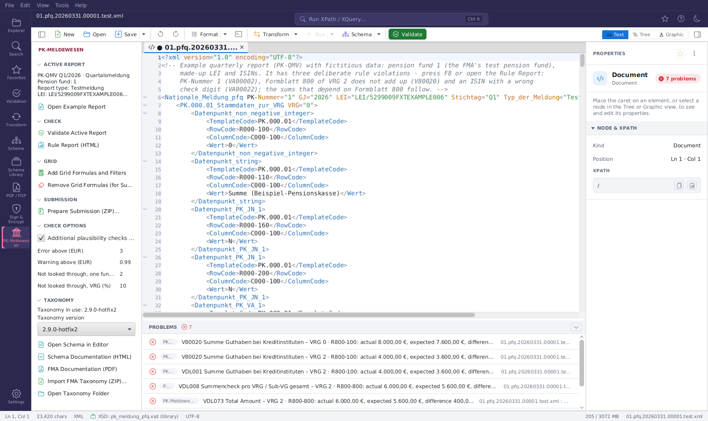
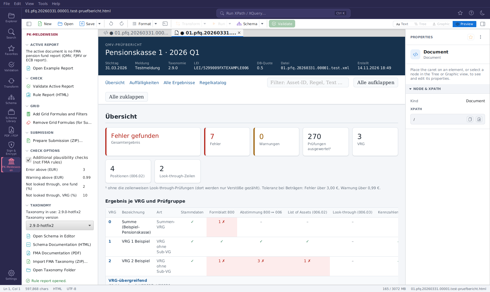

# PK-Meldewesen (FMA)

The **PK-Meldewesen** extension supports the reports Austrian pension funds (*Pensionskassen*)
send to the Austrian Financial Market Authority (FMA). One taxonomy describes all three of them:

| Report | Regulation | Module | Root element |
|---|---|---|---|
| Quarterly report (*Quartalsmeldung*) | PK-QMV 2025 | `pfq` | `Nationale_Meldung_pfq` |
| Annual report (*Jahresmeldung*) | PK-FJMV 2025 | `pfa` | `Nationale_Meldung_pfa` |
| ECB report (*EZB-Meldung*) | Regulation (EU) 2018/231 | `pfe` | `EZB_Meldung_pfe` |

The reports have no XML namespace; they are recognised by their root element. The FMA's
taxonomy **2.9.0 Hotfix2** (as of 21.07.2026: the three XSDs, the documentation and the
Business-Templates, Dictionary, Positionsbeschreibung and Validierungen workbooks) is shipped with
the application.

## Switching it on

The extension is **off by default**. Tick **PK-Meldewesen (FMA)** in
**Settings → Extensions → INSTALLED EXTENSIONS** - it applies at once. When you open a report while
it is off, a bar above the editor offers it once (**Enable PK-Meldewesen** / **Not now**).
Administrators can remove it completely with `plugin.pk-meldewesen.enabled=false`, see
[Administration](administration.md).

## What it does

- **Schema binding:** a report gets the schema of its module from the taxonomy in use, by its root
  element. This also works when the report's `xsi:noNamespaceSchemaLocation` points to a path on
  the sender's network (e.g. `\\server\share\pk_meldung_pfq_2.9.0.xsd`) that cannot be reached -
  validation (**F8**), IntelliSense, the grid and the Inspector then use the FMA schema.
- **Status bar badge:** the active report is labelled with its kind and period, e.g.
  **PK-QMV Q1/2026**, **PK-FJMV 2025** or **PK-EZB Q4/2025**; a click opens the side panel.
- **PK-Meldewesen activity** (side panel):
    - **ACTIVE REPORT** - module, pension fund number, report type (e.g. *Testmeldung*), LEI and
      the taxonomy the report declares; **Open Example Report** opens a quarterly report of a
      fictitious pension fund with a few rule violations to try everything out;
    - **CHECK** - **Validate Active Report** validates it against its schema and the FMA rules
      (as **F8** does); **Rule Report (HTML)** opens the rule report in the preview;
    - **GRID** - grid formulas and filters (see below);
    - **SUBMISSION** - **Prepare Submission (ZIP)…** (see below);
    - **CHECK OPTIONS** - the additional plausibility checks and the limits of the rules (see below);
    - **TAXONOMY** - the taxonomy in use (a note appears when the report declares another one) and
      the **Taxonomy version** to use, **Import FMA Taxonomy (ZIP)…** (see below), **Open Schema in
      Editor** (the schema of the active report's module), **Schema Documentation (HTML)**, **FMA
      Documentation (PDF)** and **Open Taxonomy Folder** with the workbooks.
- **Help menu:** links to the FMA's pension fund reporting page and to the FMA Incoming Platform,
  where the reports are submitted.

The taxonomy is installed under `~/.freeXmlToolkit/pk-meldewesen/<version>/`.

## Newer taxonomies

The FMA publishes each taxonomy as a ZIP file on its PK-Meldewesen page (an automatic download is not
possible). **TAXONOMY → Import FMA Taxonomy (ZIP)…** takes the schemas (`pk_meldung_pf?_<version>.xsd`),
the workbooks and the documentation from it - other files are skipped - into a folder named after
the schemas' version, e.g. `2.10.0-hotfix1`. Importing the same version again replaces it.

The newest installed version is used unless another is chosen under **Taxonomy version**. The
choice applies at once: reports opened from then on are bound to its schemas (they are registered
from a copy in `_active/`), and the FMA labels come from its workbooks. The FMA rules are those of
taxonomy 2.9.0 Hotfix2 whatever version is chosen.

## Query snippets, templates and favorites

Once the extension is used, it adds:

- six analysis queries to the **Query Console** snippets (tag `pk-meldewesen`): balance sheet total
  per VRG, market value per CIC category, positions without ISIN, the ten largest positions, the
  not looked-through share per fund and the derivatives;
- three templates for **File → New** (category *PK-Meldewesen*): the quarterly, annual and ECB report
  with the master data of the total VRG (PK.000.01);
- favorites (folder *PK-Meldewesen*) for the three schemas and the FMA documentation.

## FMA rules (quarterly report)

The rules of the FMA's *PK-Meldewesen_Validierungen 2.9.0 Hotfix2* workbook (master data,
Formblatt 800 sums and sign conventions, reconciliation of Formblatt 800 with the List of Assets
and the look-through, asset fields, Formblatt 900, checks across VRG and of the report header)
run on every quarterly report while the extension is on:

- **Validation (F8, Validation panel, `fxt-cli validate`):** each finding is listed with its FMA
  code (e.g. `VDL010`, `V80020`; the rule id when there is no code), the rule's name, the VRG, the
  object (row code, asset id, look-through underlying) and the detail - for sums the actual and
  expected amounts and the difference. A double-click jumps to the line: the fact of a row code,
  the entry of an asset, or the template when the finding concerns the VRG as a whole. Errors are
  *Blocking* rules, warnings *Non-Blocking* ones.
- **Rule Report (HTML):** a dashboard per VRG, all findings, all results (also the passed checks)
  and the rule catalogue with a comment and an XPath query per rule. It opens in the preview as
  `<name>-pruefbericht.html`; save it with **File → Save As**. The report is in German, like the
  FMA's rule texts.

**CHECK OPTIONS** in the side panel (stored at once, used by validation and report):

| Option | Default | Meaning |
|---|---|---|
| Additional plausibility checks | on | Checks that are not FMA rules (ids `INT_…`): VRG number and parent VRG, asset information without a position, market value vs. look-through, look-through ratios and allocation key figures |
| Error above (EUR) | 3 | Amount differences above this value are errors |
| Warning above (EUR) | 0.99 | Amount differences above this value (up to the error limit) are warnings |
| Not looked through, one fund (%) | 2 | Warning when a fund's share not looked through exceeds this % of the VRG |
| Not looked through, VRG (%) | 10 | Warning when the VRG's share not looked through exceeds this % |

The settings keys are `pk.rules.additional`, `pk.rules.tolerance`, `pk.rules.toleranceWarning`,
`pk.rules.lookThroughAsset` and `pk.rules.lookThroughTotal`. The annual and the ECB report are
checked against their schema only. A 180 MB quarterly report takes about 20 seconds and needs
about 2 GB of memory.

## FMA labels

The codes of a report get the names and explanations of the taxonomy's *Positionsbeschreibung*
and *Dictionary* workbooks:

- **Inspector:** select an element (in the text, the tree or the grid) and the DOCUMENTATION
  section starts with its FMA label - for a fact (`Datenpunkt` with `RowCode`) the row and the
  column (`R800-110 · Laufende Guthaben`, `C800-100 · Bilanzwert`), for a field of an open list its
  column (`Wert_C1130PK` → `C1130PK · HTM`), for a template its name - followed by the domain, the
  reporting obligation (*Meldepflicht*) and the FMA's explanation. A value from a code list is
  named too (`N = Nein`, `1 = VRG ohne Sub-VG`).
- **Grid:** the same text is the tooltip of an element's name.
- **Text editor:** hover over a row code (`R800-110`), a column code (`C800-100`, `Wert_C0010PK`) or
  a template code (`PK.006.02.01.01`); a column code is looked up in the template it is in.

The workbooks are read once per taxonomy version (a few seconds, in the background, when the first
report is opened) and kept as `labels.json` in the taxonomy folder.

## Grid formulas and filters (quarterly report)

**GRID → Add Grid Formulas and Filters** opens a copy of the report (`<name>-grid.xml`) in the
Graphic view in which every table shows formulas with their live result - sums per hundred of
Formblatt 800, the reconciliation with the List of Assets and the look-through, counts - and a saved
filter per table (switched off; click its funnel line to switch it on). The formulas are processing
instructions (`<?fxt-formula …?>`, `<?fxt-filter …?>`) and change no data; see
[Grid formulas](grid.md).

They must not be submitted: **Remove Grid Formulas (for Submission)** opens a copy without them
(`<name>-clean.xml`). Running either again gives the same file.

## Preparing the submission

The FMA expects each report as a UTF-8 XML file packed in a ZIP file of the same name, both named
`pk.modul.stichtag.lfd-nr[.zusatz]` in lower case - e.g. `34.pfq.20190331.00001.test.zip` with
`34.pfq.20190331.00001.test.xml` inside. **SUBMISSION → Prepare Submission (ZIP)…**:

1. cleans the active report: grid formulas and filters are removed and the XML declaration names
   UTF-8 (the open document is not changed);
2. checks the cleaned file against the schema of its module and the FMA rules (the additional
   plausibility checks are not counted) and shows the result - the FMA rejects reports with
   *Blocking* errors, but a ZIP can still be created, e.g. for a test report;
3. proposes the folder of the report and the **next running number**: one more than the highest
   number of an XML or ZIP file of the same pension fund, module and reference date in that folder
   (the FMA counts test reports too). The suffix is `test` for a report whose `Typ_der_Meldung` is a
   test report, and may be any word of letters (or empty);
4. **Create ZIP** writes `<name>.zip` - never over an existing file.

The reference date of the name is the end of the quarter (`Stichtag` Q1–Q4) or of the year (annual
report). Submit the ZIP on the FMA Incoming Platform (**Help → FMA Incoming Platform**).

## Large reports

Real quarterly reports can be 150 MB and more. The extension reads only the start of a document
to recognise it. For files above 50 MB the editor offers the [Large File Viewer](large-files.md),
which validates against the bound schema while streaming the file.

