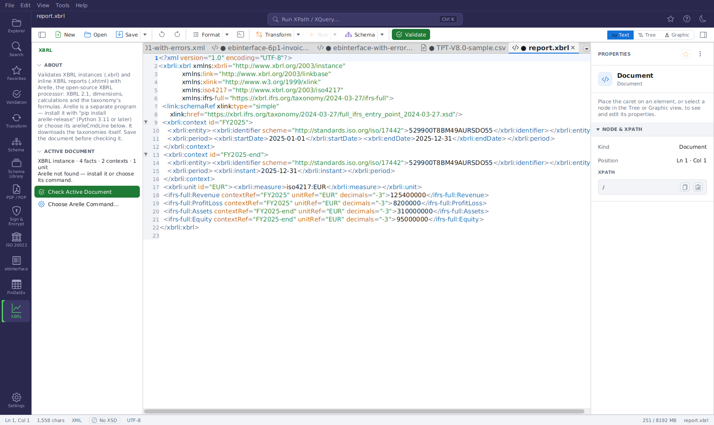

# XBRL (with Arelle)

XBRL (eXtensible Business Reporting Language) is the XML standard for financial and regulatory
reports — annual reports in ESEF, supervisory reports (COREP, FINREP, Solvency II QRTs) and many
more. The **XBRL** plugin recognises XBRL instances and inline XBRL reports, shows what they contain
and validates them with [Arelle](https://arelle.org), the open-source XBRL processor.

It is one of the [industry plugins](industry-plugins.md) and **off by default**.



## Why Arelle?

An XBRL document is only meaningful together with its **taxonomy**: the schemas and linkbases it
references, which define the concepts, the dimensions and the calculation and formula rules.
Validating XBRL means XBRL 2.1, XBRL Dimensions, calculation linkbases and XBRL Formula — exactly
what Arelle does, and what a plain XML Schema validation cannot do. FreeXmlToolkit therefore runs
Arelle as a separate program. Arelle is **not bundled**; you install it once.

## Setting it up

1. **Switch the plugin on:** **Settings → Extensions → PLUGINS**, tick **XBRL (with Arelle)**,
   save, restart. A chart icon (**XBRL**) appears in the Activity Bar.
2. **Install Arelle** (Python 3.11 or later):

    ```bash
    pip install arelle-release
    ```

    This puts the command `arelleCmdLine` on the PATH (Windows: `arelleCmdLine.exe` in Python's
    `Scripts` folder). With a virtual environment or `pipx install arelle-release` it lands in that
    environment's `bin` / `Scripts` folder instead.

3. **Tell FreeXmlToolkit where it is**, if it is not on the PATH: click **Choose Arelle Command…**
   in the XBRL side panel and pick the `arelleCmdLine` program. The choice is stored in the setting
   `plugin.xbrl.arelleCommand`; leave it empty to search the PATH again. On Windows `.exe`, `.cmd`
   and plain names are searched.

The side panel shows which Arelle is used (`Arelle: /home/me/.local/bin/arelleCmdLine`) or
"Arelle not found — install it or choose its command."

## Which documents it handles

| Kind | Recognised by |
|---|---|
| **XBRL instance** (`.xbrl`, `.xml`) | root element `xbrl` in the namespace `http://www.xbrl.org/2003/instance` |
| **Inline XBRL report** (`.xhtml`, `.html`) | root element `html` and the inline XBRL namespace `http://www.xbrl.org/2013/inlineXBRL` in the document |

## The side panel

**ACTIVE DOCUMENT** — what the document contains:

```
XBRL instance · 248 facts · 12 contexts · 3 units
Arelle: /usr/local/bin/arelleCmdLine
```

- **facts:** in an instance, the elements with a `contextRef` that are not part of the XBRL
  structure itself; in inline XBRL, the `ix:nonFraction` (numbers) and `ix:nonNumeric` (texts)
  elements;
- **contexts** (`xbrli:context`) and **units** (`xbrli:unit`);
- which Arelle is used.

**Check Active Document** runs Arelle on the **saved file**: Arelle reads the file from disk and
resolves the taxonomy references relative to it. Save the document first — for an unsaved document
the check reports "Save the document first: Arelle reads the file and its taxonomy references."
Unsaved changes in the editor are not seen by Arelle.

The command run is

```
arelleCmdLine -f <file> -v --logFile <temporary file>.json --logFileMode w --logFormat "%(message)s"
```

Arelle writes its messages as JSON into the temporary file, which is read and deleted afterwards.

`-v` validates the instance against its taxonomy: XBRL 2.1, dimensions, calculations and the
taxonomy's formulas. The result shows Arelle's **errors and warnings** with their code and line,
for example

```
Line 57: [xbrl.4.6.2:numericUnit] Fact eu:Assets of context C1 must have a unit
Line 112: [xbrldie:PrimaryItemDimensionallyInvalidError] …
```

Information messages (timings, loading progress) are left out. Inconsistencies and fatal messages
count as errors. Lines are given when Arelle names a place in the checked file; problems in the
taxonomy have no line. **Show All Problems** opens the full list as a text document.

A run stops after **10 minutes** ("Arelle did not finish within 10 minutes."). Large taxonomies
take a while on the first run because Arelle downloads them; later runs use Arelle's cache.

## Taxonomies and network

Arelle loads the taxonomies the document references (`link:schemaRef`) from the internet and
caches them, with its **own** network settings. The proxy settings of FreeXmlToolkit do not apply
to it; configure a proxy for Arelle with its `--proxy` option in a wrapper script, or through the
`HTTP_PROXY` / `HTTPS_PROXY` environment variables. For offline machines, prepare Arelle's cache or
taxonomy packages (`--packages`) and point the plugin to a wrapper script that adds these options.

## In scripts

XBRL documents are not checked by the [Validation panel](validation-panel.md) or `fxt-cli validate`
(those see them as plain XML). Run Arelle directly in scripts and pipelines:

```bash
arelleCmdLine -f report.xbrl -v --logFile report-log.json
```

## Troubleshooting

| Problem | Solution |
|---|---|
| "Arelle was not found." | Install it with `pip install arelle-release`, or choose `arelleCmdLine` with **Choose Arelle Command…**. A configured path that no longer exists also counts as not found. |
| "Save the document first …" | Save the file; Arelle reads it from disk. |
| "Arelle wrote no log (exit code …)" | Arelle could not start or crashed. Run the command above in a terminal to see its output (e.g. a missing Python package). |
| The file name contains characters that cmd.exe would interpret | On Windows a `.cmd`/`.bat` launcher cannot safely receive names with `& | < > ^ % !` or quotes. Rename the file or choose `arelleCmdLine.exe` instead of a script. |
| Taxonomy cannot be loaded | Arelle needs the internet (or a taxonomy package) — see [Taxonomies and network](#taxonomies-and-network). |
| The check takes long | The first run downloads the taxonomy; later runs are faster. |
