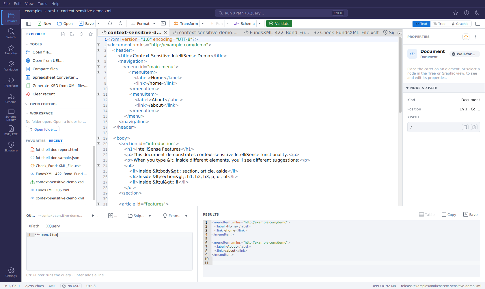
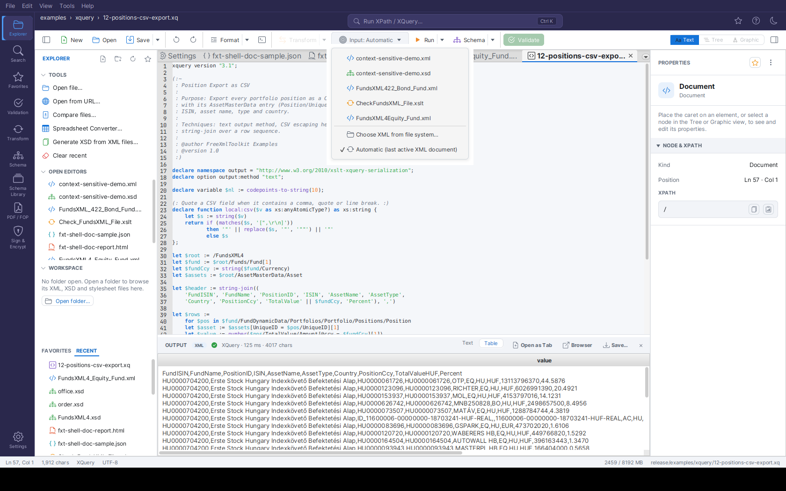

# Query Console & Query Documents

XPath, XQuery and JSONPath queries run either in the **Query Console** at the bottom of the editor (Ctrl+K) or as query documents (`.xq`, `.xpath`) with an input selector.

## Query Console

> Run XPath, XQuery and JSONPath against the open document right from the editor. This is
> the one place for queries - the Transform panel links here with its **Open Query Console**
> button.

The **Query Console** is a panel that opens along the **bottom of the editor**. Toggle it with the
**terminal icon** in the editor toolbar or with **Ctrl+Shift+X**; **Ctrl+K** (or a click on the
header search pill) opens it and focuses the query input. Close it with the **✕** button at its
top right. It runs against whichever
document is currently active, so it is the fastest way to probe an XML or JSON file while you work.

*The Query Console with IntelliSense: typing `/` in the XPath input opens the completion popup
(document elements and axes). The mode toggle and Run are on the left; on the right, the results
pane shows the previous run's XML result with syntax highlighting.*

### Layout

- **Left - the query:**
  - An **XPath | XQuery** mode switch; the active mode is filled in the accent colour. The
    mode is also named on the **Run** button (*Run XPath* / *Run XQuery*), in the hint below the
    input (*XPath mode · …*) and in the empty input's example. While a JSON document is active,
    the XPath segment reads **JSONPath**. Next to the switch: the document the query runs against.
  - The query input **with IntelliSense** (autocomplete): suggestions pop up as you type after
    `/`, `//`, `@`, `[`, `(`, `$` and `::`, or on demand with **Ctrl+Space**. It suggests element
    and attribute names from the active document, XPath/XQuery functions, axes, operators and
    (in XQuery mode) FLWOR keywords. Use ↑/↓ to navigate and **Enter**/**Tab** to accept.
  - The query is **syntax-highlighted** as you type: keywords, functions, axes, variables,
    strings, numbers and comments each get their own color.
  - To run: press **Ctrl+Enter** in either mode (Enter inserts a new line, so queries can
    span several lines; a hint below the query says so). The **Run** button works in both modes.
  - **Run** - Execute the query against the active document.
  - **Save** - Save the current expression as a reusable snippet (see below).
  - **Snippets** - A menu of your saved XPath and XQuery snippets; pick one to load it (the console
    switches to the matching mode automatically).
  - **Examples** - Inserts a built-in XQuery example: **Simple**, **FLWOR**, **HTML report** or
    **Data-quality check**.
- **Right - the results:**
  - A read-only, selectable results editor with **line numbers** showing the query
    result. **XML results are
    syntax-highlighted** (tags, attributes, values, comments), and **JSON results** (e.g. from
    JSONPath queries) get JSON highlighting; scalar results and messages stay plain.
  - **Copy** - Copy the full result to the clipboard.
  - **Table** - Shows the last XQuery result as a table in the
    [OUTPUT panel](transform-panel.md#the-output-panel-results) (enabled after an XQuery run whose result can be
    shown as a table).

Like the text editor, every console area zooms with the mouse: hold **Ctrl** and scroll the
**mouse wheel** over the query input or the results to change that area's font size
(**Ctrl+0** resets it).

### Running a Query

1. Open the console (**Ctrl+K**, the header search pill, the terminal icon, or **Ctrl+Shift+X**) - it opens focused on the query input.
2. Choose **XPath** or **XQuery** with the mode toggle.
3. Type your expression, then click **Run** (in XPath mode, **Enter** also runs).
4. The result appears on the right. Use **Copy** to put it on the clipboard.

The console always runs against the **active** document. For an **XML** document it evaluates the
expression directly; for a **JSON** document the toggle reads **JSONPath** and the input is
evaluated as a **JSONPath** expression. When no document is open, **Run** is disabled and the results pane shows
*"No document open."*

The `map:`, `array:` and `math:` function namespaces are
**pre-declared** in the console, so XPath 3.1 expressions using `map:merge()`,
`array:size()`, `math:pow()` etc. run directly - no namespace prolog needed.

!!! note
    The Query Console is an additional, faster access point - it does not replace the **Transform**
    activity. For XSLT transformations, parameters, recent-stylesheet history, watch-and-rerun, and
    the OUTPUT panel's result table and HTML preview, use the [Transform Panel](transform-panel.md#transform-panel).

### Saving and Loading Snippets

Reusable XPath **and** XQuery expressions are saved as **snippets**:

- **Save** - Prompts for a name and stores the current expression. XPath snippets are saved as
  `.xpath` files and XQuery snippets as `.xquery` files.
- **Snippets** - Lists every saved snippet, prefixed with its kind (*XPath* / *XQuery*). Selecting
  one loads it into the console and switches to the matching mode.

Snippets are kept in the shared query folder.

Saved snippets can be **managed** directly from the menu. Each snippet's
submenu offers, next to *Load into console* and *Open in editor*:

- **Overwrite with current query** - Replaces the saved expression with the console's current
  input of the snippet's kind (an `.xpath` snippet always takes the XPath input, an `.xquery`
  snippet the XQuery input), after a confirmation.
- **Rename…** - Prompts for a new name (pre-filled with the current one). Names already in use
  are refused.
- **Delete…** - Deletes the snippet file, after a confirmation.

The entries in the **FUNDSXML** section (see below) are read-only - they are re-registered from
the FundsXML content cache on every start and therefore offer no management actions.

Looking for ready-made queries? The installation's `examples/xpath/` folder contains
**32 XPath 3.1 examples** and `examples/xquery/` contains **17 XQuery 3.1 scripts**
(data-quality checks plus a reporting series producing CSV, ASCII tables/charts,
Markdown and JSON), all written for the FundsXML4 sample files in `examples/xml/`.
Paste them into the console, or copy the `.xpath` files into your query folder to have
them appear in the **Snippets** menu. See the `README.md` in each folder for details.

When the optional [FundsXML extension](fundsxml-extensions.md) is
enabled, the **Snippets** menu also shows a **FUNDSXML** section with the XPath/XQuery
example queries shipped with the FundsXML examples (for example *fund-summary*,
*top-holdings*, *look-through*, *aggregate-by-assettype*). Selecting one loads it into the
console and switches the XPath/XQuery mode to match. These entries come from the FundsXML
content cache and are re-registered automatically on every start.

## XPath / XQuery Autocomplete

The XPath/XQuery inputs of the Query Console offer context-aware
autocomplete in both the XPath and
XQuery input fields. Suggestions appear automatically after trigger characters (`/`, `[`, `@`, `(`,
`$`, `::`) or on demand with **Ctrl+Space**. Depending on context it suggests element names, attribute
names, XPath axes, functions, and (in XQuery) variables. Navigate with the arrow keys and press
**Enter** or **Tab** to insert; **Escape** dismisses the popup. Functions and axes are inserted with
their parentheses / `::` automatically.

### Saving, Loading and Examples

Saved queries are the Query Console's **Snippets** menu, and its **Examples** menu inserts the
built-in XQuery examples - see [Saving and Loading Snippets](#saving-and-loading-snippets).

## Query Documents & the Input Selector {#query-documents-the-target-selector}

> XPath and XQuery files are first-class editor documents: open a
> `.xq` or `.xpath` file (or any file from `examples/xpath/` and `examples/xquery/`),
> press **Run Query**, and read the result in the OUTPUT panel - no console or panel
> switching required.

*An XQuery document from `examples/xquery/` with the **Input** dropdown open: pick an
open XML-family document, a file from disk, or Automatic (the most recently active XML
document, here checked). Below, the OUTPUT panel shows the query's CSV result.*

### Query documents

`.xq`, `.xquery`, `.xqm`, `.xqy` (XQuery) and `.xpath` (XPath) files open in a dedicated
query editor with XPath/XQuery syntax highlighting and the same context-aware
[autocomplete](#xpath-xquery-autocomplete) as the Query Console. They appear in the
Explorer workspace tree, the file choosers and drag & drop like every other supported
type.

### Running

- **Run Query** (the toolbar's **Run** button, or `Ctrl+Enter`) runs the active
  XPath/XQuery document. The **Run ▾** arrow menu lists all three run actions explicitly.
- **Run Transform** does the same for an active **XSLT** stylesheet - output format
  auto-detected from its `xsl:output` declaration.
- **Run Pipeline** covers **XProc** documents (see [XProc Pipelines](xproc.md#xproc-pipelines)).

Results appear in the **[OUTPUT panel](transform-panel.md#the-output-panel-results)** docked below the
editor, with execution time and result size in the status line. A tabular XQuery result
(a sequence of similar elements) additionally offers a **Table** view; HTML results get
a preview, and everything can be opened as an editor tab, opened in the browser, or
saved from the panel's header buttons.

### The Input dropdown {#the-target-dropdown}

The query, stylesheet or pipeline runs against an **XML input document**. The
**Input** dropdown in the editor toolbar (its label reads *"Input: …"* followed by the chosen document) (shown only for query/XSLT/XProc documents)
controls which one:

- **Automatic (last active XML document)** - the default: the most recently active
  XML-family document (XML, XSD, XSLT, Schematron, XProc). The active document itself is
  never chosen - an XSLT stylesheet does not transform itself.
- **An open document** - pick any other open XML-family tab. The run uses the tab's
  **live editor text**, including unsaved changes.
- **Choose XML from file system…** - pick a file without opening it; it is read fresh
  on every run.

The choice is remembered **per document** for the session. If a chosen target tab is
closed, the run falls back to Automatic. With no XML-family document available at all,
Run Query/Run Transform show a short guard message instead of failing.

!!! tip
    Ready-made queries ship in `examples/xpath/` (32 expressions) and `examples/xquery/`
    (17 scripts) - open any of them and press `Ctrl+Enter` against a FundsXML sample from
    `examples/xml/`. See [Bundled Example Collections](xml-editor.md#bundled-example-collections).
