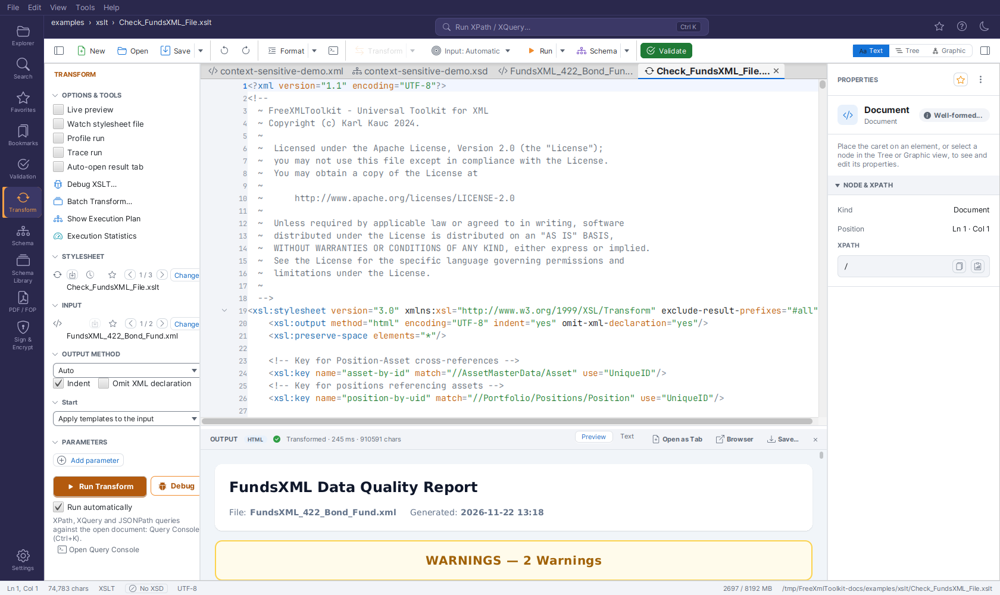

# Transform Panel

The panel has collapsible sections (STYLESHEET, INPUT, OUTPUT METHOD, PARAMETERS), one primary
**Run Transform** button and a **Run automatically** checkbox next to it. Results appear in the
**[OUTPUT panel](#the-output-panel-results)** below the editor, not as an editor tab. Run options
and advanced tools share the **OPTIONS & TOOLS** section at the top. For the task view see
[Run a transformation](../guides/transform-query/run-xslt.md).

The **Transform** panel (open it from the **Transform** icon in the activity bar on the
left) runs XSLT transformations. XPath, XQuery and JSONPath queries against the open
document live in the [Query Console](../guides/transform-query/query-console.md#query-console) - the panel shows a short hint with an
**Open Query Console** button for them. The panel
header reads **TRANSFORM**; the run options and tools are in the **OPTIONS & TOOLS**
section (see [OPTIONS & TOOLS](#the-transform-menu) below). Each section header
is clickable to collapse or expand that section.

!!! tip
    For a quick transform without opening this panel, right-click XML files in the Explorer
    and choose **[Transform with …](workspace.md#explorer-context-menu)**. It shares
    the same recent-stylesheet list and shows its result in the same OUTPUT panel.

## SCENARIO

Shown only while a [project](../guides/projects.md) is open: pick one of the project's saved transformation
scenarios to fill stylesheet, input, parameters and output method in one step, run it with **Run
Scenario** (writes its output file), save the current settings as a scenario (disk button) or remove
one (trash button). For a scenario with an expected result, **Check** compares the run's result
with it; after a failed check, **Differences** opens both in the Compare view and **Accept** makes
the current result the expected one. See [Projects and Transformation Scenarios](../guides/projects.md#transformation-scenarios)
and [Regression checks](../guides/projects.md#regression-checks).

## STYLESHEET

- Shows the **name of the chosen XSLT stylesheet** on its own line below the icon, the
  favorites/browse controls and **Change** (long names are shortened in the middle; hover
  for the full path). While no stylesheet is set, the row reads *"No stylesheet — choose or
  drop a file"* - clicking it works like **Change**.
- **Use current tab** (the arrow-into-box button in the row, also first in the **Change** menu) -
  makes the XSLT tab you are editing the stylesheet; enabled while an XSLT tab is active.
- **Change** opens a menu:
    - **Select XSLT file…** - pick an `.xsl` / `.xslt` file from disk (it is also loaded into
      the editor).
    - **Open tabs** - every XSLT document open in the editor, the active tab first and marked
      *(active)*. It does not matter how the tab was opened: File → Open, the Explorer, a new
      file, or a stylesheet the [AI assistant](../guides/ai-assistant.md) generated and you opened in a
      new tab. The transform runs the tab's **editor text**, including unsaved changes; an
      unsaved tab is marked *unsaved* (relative `xsl:include` / `xsl:import` paths of an unsaved
      tab resolve against the input's folder). When you close a saved tab, its file stays the
      stylesheet. **Debug** and **Save scenario** need a saved stylesheet.
- The **clock icon** opens the **recent stylesheets** menu: reapply a recently used
  stylesheet in a single click (it is also loaded into the editor), or choose **Clear recent**
  to empty the list.
- The **star icon** opens your **XSLT favorites** - see
  [Browsing favorites with ◀ / ▶](#browsing-favorites) below. A picked stylesheet is also
  loaded into the editor.
- **Drag & drop**: drop an `.xsl` / `.xslt` file from your file
  manager straight onto the STYLESHEET row - it becomes the current stylesheet and is loaded
  into the editor, exactly as if you had picked it from a favorite. While dragging, the row glows
  **green** when the file can be loaded and **red** when it has the wrong extension (a
  red drop is rejected). As with favorites, the transform **runs automatically** as soon
  as both a stylesheet and an input are ready (while **Run automatically** is checked).

## INPUT

The INPUT section shows which document the transform will use as its input (the name on
its own line, the full path as tooltip; *"No input — open a document or drop a file"* while
there is none):

- By default the input **follows the active editor document**: switch to another tab and
  the next run transforms that document (the shown input name updates live).
- **Use current tab** (the arrow-into-box button in the row, also in the **Change** menu) - makes
  the XML tab you are editing the input; it stays the input when you switch tabs. Enabled while an
  XML tab is active.
- **Change** opens a small menu:
    - **Select XML file…** - transform a fixed XML file from disk instead, regardless of
      which editor tab is active.
    - **Use active editor** - go back to following the active tab.
    - **Open tabs** - every XML document open in the editor (saved or not, the active one
      first). The chosen tab stays the input while you switch to other tabs - for example to
      edit the stylesheet - and its current editor text is transformed. The chosen stylesheet tab
      is never offered as input.
- The **star icon** opens your **XML favorites** - see
  [Browsing favorites with ◀ / ▶](#browsing-favorites) below. A picked input is also opened
  in the editor and becomes the active tab.
- **Drag & drop**: drop an `.xml` file from your file manager
  straight onto the INPUT row to transform that file - exactly like picking a favorite: it
  becomes the input and opens as the active editor tab. The same **green** (loadable) / **red** (rejected) drag-over
  feedback applies, and the transform **runs automatically** as soon as both a stylesheet
  and an input are ready (while **Run automatically** is checked).

## Browsing favorites with ◀ / ▶ {#browsing-favorites}

Pick stylesheets and input files straight from your
[Favorites](../guides/edit-xml/favorites.md) and page through them, so you can run the same
stylesheet over many files, or many stylesheets over one file, without ever opening a
file chooser.



Both the **STYLESHEET** and the **INPUT** rows carry a **star icon**, a pair of
**◀ / ▶ navigation buttons**, and a small **"i / n" position label**. The ◀ / ▶ buttons and
the label only appear once the browse list holds **at least two** entries.

- The **star menu** lists the favorites of the matching type - **XSLT** favorites for
  STYLESHEET, **XML** favorites for INPUT - grouped by their folder (category). An
  **"All … favorites"** entry at the top selects the whole list at once.
- **Picking a favorite** (or an "All"/folder entry) does three things: it sets the current
  file, it builds a **browse list** from that selection, and it **loads the file into the
  editor**. An input comes to the front as the active tab. A stylesheet opens *behind* the
  active tab while the input follows the active document (otherwise the stylesheet would become
  its own input); with a fixed input file it comes to the front too. The same happens on every
  ◀ / ▶ step.
- The **◀ / ▶ buttons** then step backward and forward through that browse list. Browsing
  is **cyclic**: pressing ▶ on the last entry wraps to the first, and ◀ on the first wraps
  to the last. The **"i / n" label** shows your position (for example, *3 / 12*).
- Each ◀ / ▶ step **runs the transformation automatically** (while **Run automatically** is
  checked) - but only once **both** sides
  are ready: a stylesheet is selected **and** an input is available (either a chosen input
  file or the active editor document). Until both are present, stepping just loads the file
  without transforming.

This supports two common workflows:

1. **Fix the input, step through stylesheets.** Keep one XML file as input, then page
   through several data-quality or reporting stylesheets with ▶ to see each result in turn.
2. **Fix the stylesheet, step through inputs.** Choose one XSLT stylesheet, then page
   through many XML input files with ▶ to apply the same transformation to each.

The existing **Change** file chooser, the **clock** (recent stylesheets) menu, and **Use
active editor** all keep working exactly as before.

## OUTPUT METHOD

A single dropdown with **Auto, XML, HTML, XHTML, Text, JSON**. **Auto** (the
default) detects the output format from the stylesheet's `xsl:output` declaration; pick a
concrete format to override the detection. For the method the stylesheet declares, its own
`xsl:output` settings win (`indent`, `doctype-…`, `html-version`, `encoding`): an
`html-version="5"` stylesheet gets an HTML5 doctype, `indent="no"` stays unindented.

Below it, two options apply where the stylesheet says nothing:

- **Indent** (on by default) - indent the result.
- **Omit XML declaration** (off by default) - leave out `<?xml …?>`.

Both are remembered (settings `transform.output.indent`, `transform.output.omitDeclaration`) and also apply to
XSLT runs from the Run menu and to query results.

Once an [external XSLT processor](../guides/transform-query/external-processors.md) is configured, a **Processor** dropdown appears below it:
the bundled **Saxon HE** or one of your processors. The choice is remembered.

## START

Where the transformation starts. Saxon HE's XSLT 3.0 entry points, read from the stylesheet:

| Choice | What runs |
|--------|-----------|
| **Apply templates to the input** (default) | The template rules matching the input's document node, in the default mode - the classic transformation. |
| **Initial template (xsl:initial-template)** | The stylesheet's `xsl:initial-template`. Preselected when the stylesheet has one. |
| **Mode: …** | The template rules of that mode on the input. |
| **Template: …** | A named template. |
| **Function: f:name#n** | A function declared `visibility="public"`; one field per argument appears below (typed as text, converted to the parameter's type). |

A template or function start needs **no input document**; with one, it is the global context item (`.` at the
top level). These starts run on the bundled Saxon HE - with an external processor the choice is disabled - and
without profile or trace. The command line has the same with
[`--initial-template` / `--initial-mode`](../automate/command-line.md).

## PARAMETERS

Define XSLT parameters as **name = value** rows:

- The parameters the stylesheet **declares** (`xsl:param` at the top level) appear as rows by themselves, with the
  declared type as placeholder (e.g. `xs:integer`); a **required** one (`required="yes"`) is shown bold and the run
  stops with a message until it has a value. An offered row left empty keeps the stylesheet's default.
- **Add parameter** adds a row of your own; each row has its own **remove** button.
- The values are text and are **converted to the declared type**: `21` reaches `as="xs:integer"` as a number, a
  date as `xs:date`. A value that does not fit is reported with the parameter's name.

## External XSLT processors {#external-xslt-processors}

The **XSLT processor** choice runs the transformation with Saxon HE 13, xsltproc or another
external program instead of the built-in Saxon HE - see
[External XSLT processors](../guides/transform-query/external-processors.md).

## Debugging a stylesheet {#xslt-debugger}

**Debug**, next to **Run Transform**, starts the interactive debugger on the same stylesheet and
input - see [Debugger](../guides/transform-query/debug.md).

## Queries (XPath, XQuery, JSONPath)

The Transform panel no longer has its own XPATH and XQUERY sections. Below the run
controls, a short hint and an **Open Query Console** button take you to the
[Query Console](../guides/transform-query/query-console.md#query-console), which runs XPath, XQuery and JSONPath queries against the
open document and offers the saved queries (**Snippets** menu) and the XQuery **Examples**.

## OPTIONS & TOOLS {#the-transform-menu}

The collapsible **OPTIONS & TOOLS** section at the top of the panel (open by default - click
its header to collapse it) holds everything secondary. First the run
**options**, as checkboxes:

| Option | What it does |
|-------|--------------|
| **Live preview** | Re-runs the transform automatically (debounced) while you edit the input document. |
| **Watch stylesheet file** | Re-runs the transform whenever the chosen stylesheet changes on disk - handy while editing the stylesheet in another tool. |
| **Profile run** | The transform runs under the XSLT profiler and opens a **Profile** tab: hot spots by self time, call tree, flame graph and time per line (see [XSLT Developer → Performance and Profiling](../guides/transform-query/profile.md)). |
| **Trace run** | A transform also opens a **Trace** tool tab (template matches + `xsl:message` output). |
| **Auto-open result tab** | Additionally opens every successful result as a regular editor tab (HTML/XHTML results open rendered in the [Preview](../get-started/workspace-tour.md#html-preview) view). **Off by default.** |

Below the options, the advanced **tools** are labelled rows (icon + name):

| Row | What it does |
|-----|--------------|
| **Debug XSLT…** | Same as the **Debug** button next to **Run Transform**: opens the stylesheet (with the breakpoints set in its gutter) and the **DEBUG** dock below the editor - see [Debugging a Stylesheet](../guides/transform-query/debug.md). |
| **Batch Transform…** | Runs the chosen stylesheet - or, when no stylesheet is set, the active XQuery document - over many XML files, with per-file results and "Save All". |
| **Generate stylesheet…** | Shown while the [AI assistant](../guides/ai-assistant.md) is on: writes an XSLT stylesheet from the panel's input document and a **target sample** you choose (optionally its schema and notes). The stylesheet is compiled and run in a sandbox and its output checked before it opens as a new, unsaved tab - choose it there with **Use current tab** in the STYLESHEET row. See [A stylesheet from a target sample](../guides/ai-assistant.md#a-stylesheet-from-a-target-sample). |
| **Show Execution Plan** | Opens a **Plan** tab with Saxon's execution plan of the stylesheet: every template and function after optimization (which steps were rewritten, inlined or pre-evaluated) - useful to understand why a stylesheet is slow. Also on the Run menu for an XSLT or XQuery tab. |
| **Execution Statistics** | Opens the **Execution Statistics** tool tab (duration, CPU and memory per XSLT/XQuery/validation run). Runs are only recorded while **Record execution statistics** is enabled in the Settings page's **DEVELOPER** card. |

!!! note
    By default the stylesheet runs on Saxon's XSLT 3.0 processor, whatever its `version`
    attribute says. With **expert mode** on (Settings → Schemas & Validation → Standards), an **XSLT version** picker
    appears under the output method: XSLT 1.0 runs on the JDK's own XSLT 1.0 processor, and
    XSLT 2.0 is checked for newer constructs first. When that check refuses a stylesheet,
    the OUTPUT panel lists the issues and offers **Run anyway**. See
    [Language Versions](standards-versions.md).

## The OUTPUT Panel (Results)

Transform and query results appear in an **OUTPUT panel
docked below the editor**.

All Transform-panel results - XSLT transforms, XPath/JSONPath queries, and XQuery runs -
appear in an **OUTPUT panel** that docks **below the editor**: the source document stays
on top and the result shows underneath, while the Properties inspector keeps its full
height. The panel **persists across activity switches**, so the last result stays visible
while you work elsewhere.

The OUTPUT panel header shows:

- A **format badge** (XML, HTML, …) for the result.
- A **status**: a green check with `Transformed · N ms · M chars` on success (how long the
  run took and how large the output is), or a red error icon with the error message on
  failure.
- **View toggles** - **Preview | Text | Table**:
    - **Text** - the result in a **read-only code editor** (the default):
      line numbers, syntax highlighting matching the result format (XML or JSON;
      plain text otherwise), and font zoom with **Ctrl+mouse wheel** (**Ctrl+0** resets).
      A very large result (over 2 million characters) shows only its start with a note;
      **Open as Tab**, **Browser** and **Save…** use the whole result.
    - **Preview** - the result rendered as a web page; available for **HTML/XHTML**
      results only.
    - **Table** - available for **XQuery** results (and Query Console **XPath** results) that return a **sequence** of items
      (auto-selected when applicable). Each item becomes a row, and the columns are taken
      from each item's child elements (or, if an item has no child elements, its
      attributes). A sequence of plain values is shown in a single **value** column.
- **Actions**:
    - **Open as Tab** (*Open result as editor tab*) - opens the result as a regular document
      (`Transform-Result.xml` / `.html` / `.json` / `.txt`) that you can edit and save.
      An **HTML/XHTML result** opens as an HTML document rendered in the
      [Preview](../get-started/workspace-tour.md#html-preview) view (switch to Text to see the markup); re-running the
      transform updates the open result tab, re-rendering the preview if it is showing.
      An **XML result** gets a schema for validation and IntelliSense like an opened file: the
      `xsi:schemaLocation` / `xsi:noNamespaceSchemaLocation` it declares (a relative location
      resolves against the input's folder), else a Schema Library entry, else the schema of the
      transform's input - if that schema declares the result's root element (e.g. a stylesheet
      that only adds or removes annotations).
    - **Browser** (*Open in browser*) - opens the result (typically HTML) in your system web browser.
    - **Save…** (*Save result…*) - writes the result straight to a file.
    - **✕** - hides the OUTPUT panel; it reappears automatically on the next run.

!!! note
    In earlier versions, every transform opened a `Transform-Result.*` editor tab, and HTML
    output additionally opened an "HTML Preview" tool tab. Both were replaced by the OUTPUT
    panel: an editor tab now opens only via the panel's **Open result as editor tab** action
    or the **Auto-open result tab** option in OPTIONS & TOOLS, and HTML is rendered inline via
    the panel's **Preview** view.

### Messages, trace and compile errors

Under the result, a **Messages (n)** strip lists what the run said besides its output - click it to open the list:

- `xsl:message` output (`[INFO]`, `[TERMINATE]`),
- `trace()` output (`[TRACE]`) - it used to go to the console no one sees,
- the stylesheet's **compile warnings** (`[WARNING …]`, e.g. a variable nothing uses) and, after a failed compile,
  its errors.

Double-click a line (or press Enter) to open the stylesheet - or the included / imported module - at that line.

When a stylesheet does not compile, the result area lists every error with its code, the position, the source line
with a `^` under the failing part (the token inside a `select`, a wrong attribute, an unknown instruction) and a hint
for the usual cause, for example:

```
[XPST0017] Cannot find a 1-argument function named ocunt() (line 3, column 22)
    <xsl:value-of select="ocunt(//item)"/>
                          ^^^^^
```

XSLT documents are also **checked while you type**: a pause compiles the stylesheet (with the open tabs' texts of
its includes and imports), wavy-underlines the errors in the text and lists them - and the warnings - in the
**PROBLEMS** panel (source *XSLT*; an error in a module names the module). Stylesheets over 2 MB are not checked;
the setting `xslt.liveCheck=false` turns it off.

## See also

- [Run a transformation](../guides/transform-query/run-xslt.md) - the steps from stylesheet to result, parameters, batch runs
- [Debugger](../guides/transform-query/debug.md) and [Profile a transformation](../guides/transform-query/profile.md)
- [Test with XSpec](../guides/transform-query/xspec.md) - test suites for stylesheets
- [XProc pipelines](../guides/transform-query/xproc.md) - run `.xpl` pipelines
- [External XSLT processors](../guides/transform-query/external-processors.md)
- [XSLT and XQuery examples](../guides/transform-query/examples.md) - patterns to copy
- [Projects & scenarios](../guides/projects.md) - keep a transformation with its input and output
