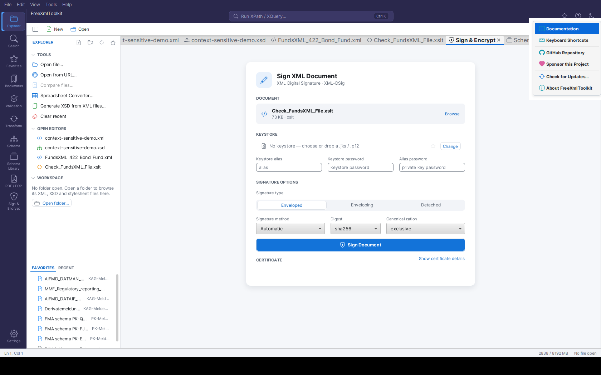

# Workspace reference

Every part of the window in one place: menu bar, toolbar, the Explorer, Favorites and Bookmarks
panels, the status bar and the Help menu. For a first walk through the window see the
[Tour of the workspace](../get-started/workspace-tour.md).

## Panels and pages

Each activity in the activity bar has its own page in this documentation:

| Activity | Page |
|----------|------|
| Explorer, Favorites, Bookmarks | this page |
| Search | [Search and replace in files](../guides/edit-xml/search-in-files.md) |
| Validation | [Validate](../guides/validate/index.md), [Working with problems](../guides/validate/problems.md) |
| Transform | [Transform & query](transform-panel.md), [Query console](../guides/transform-query/query-console.md), [XProc pipelines](../guides/transform-query/xproc.md) |
| Schema | [The Schema panel](../guides/design-schemas/schema-panel.md), [Design schemas](../guides/design-schemas/index.md) |
| Schema Library | [Schema Library](../guides/design-schemas/schema-library.md) |
| PDF / FOP | [PDF with XSL-FO](../guides/publish-pdf.md) |
| Sign & Encrypt | [Sign and encrypt](../guides/sign-encrypt/index.md) |
| FundsXML and other extensions | [Industry standards](../industry/index.md) |
| Settings | [Settings](settings.md) |
| Properties (right-hand panel) | [Properties Inspector](inspector.md) |

## Menu Bar {#menu-bar}

The menu bar offers every shell action by name, with its keyboard shortcut next to it. Items that
do not apply to the active document are greyed out (e.g. **Type Editor** is only available for XSD
schemas, **Save** needs an open document).

| Menu | Contents |
|------|----------|
| **File** | New…, Open…, Open in Large File Viewer…, Open from URL…, **Open Recent** (the last opened files), **Open Favorite** (all favorites, by folder, plus Manage Favorites…), Close Tab, Save, Save As…, Save All, **Export View…** (see [Exporting a Graphical View](../get-started/workspace-tour.md#export-view)), Settings…, Exit (Ctrl+Q; asks to save unsaved changes first) |
| **Edit** | Undo, Redo, Find…, Replace…, Find in Files…, Replace in Files…, **Copy View as Image**, Format Document, Minify, Insert Template… |
| **View** | The view modes (Text / Tree / Graphic / Overview / Preview), Side Panel, Properties Inspector, Query Console, Favorites Panel, **Activities** (jump to any activity), **Show Constraints in Diagram**, **Show Constraints on Target Nodes**, Toggle Light / Dark Theme, Full Screen |
| **Tools** | Validate, Run, Transform with XSLT…, Debug with XSLT… (Shift+F5), Run XSpec Tests, Debug Configuration…, Re-run Last Debug (Ctrl+Shift+F5), Toggle Breakpoint (F9), Run to Cursor (Ctrl+F10), Set Schema…, Generate Documentation…, Generate Sample XML…, Generate XSD from XML, Generate XSD from XML Files…, Type Editor, Compare with File…, Compare Folders…, Merge Files…, Spreadsheet Converter…, Convert to JSON…, Convert to XML…, Convert to YAML…, Add to Favorites |
| **Help** | Documentation, Keyboard Shortcuts, FundsXML Website and FundsXML Schema Docs (only while the [FundsXML extension](../industry/fundsxml.md) is enabled), Report a Problem… (when error reporting is enabled), GitHub Repository, Sponsor this Project, Check for Updates…, About FreeXmlToolkit - see [Help Menu & About](#help-menu-about) |

### macOS

On macOS the menus appear in the **system menu bar** and follow the platform conventions:

- The **FreeXmlToolkit** application menu holds **About FreeXmlToolkit**, **Check for Updates…**,
  **Settings…** (**Cmd+,**), **Hide FreeXmlToolkit** (**Cmd+H**), **Hide Others**, **Show All** and
  **Quit FreeXmlToolkit** (**Cmd+Q**). These items are therefore not repeated in File and Help.
- A **Window** menu offers Minimize, Zoom and Bring All to Front.
- All shortcuts use **Cmd** instead of Ctrl. Because **Cmd+H** hides the application, **Find and
  Replace** is **Alt+Cmd+F** on macOS; full screen is **Ctrl+Cmd+F** (F11 works too).

## Toolbar

> The editor toolbar is a **single slim row**. Related actions sit in **split buttons**
> with a visible **▾** arrow menu: **Save As / Save All** live under **Save ▾**, **Minify**
> under **Format ▾**, **Run Query / Run Transform / Run Pipeline** under **Run ▾**, and
> **Set XSD Schema… / Generate Documentation… / Type Editor…** under **Schema ▾**.

The toolbar shows only what you can use right now. **Without a document** - on the Welcome
page, or while a page such as **Settings**, **Sign & Encrypt** or **Schema Library** is in front - it
shows just **New** and **Open**; the document groups (Save, Undo/Redo, Format, Query Console,
Transform, Run, Schema, Validate) and the **Text / Tree / Graphic** view switch are hidden
rather than shown greyed out. They come back as soon as a document tab is active.

There is no hidden "overflow" menu. Less frequent tools - **Insert Template…** (Ctrl+T),
**Compare with File…** and **Spreadsheet Converter…** (Ctrl+E) - are in the
[Menu Bar](#menu-bar) (**Edit** and **Tools** menus) instead of the toolbar; their shortcuts
work as before. Only when the window gets very narrow does the row wrap onto a second line as a
fallback. The toolbar groups its actions three ways:

### Labeled buttons (frequent actions)

- **New** (Ctrl+N) - Open the guided [New File dialog](../guides/edit-xml/working-with-files.md#new-file-dialog) to create an XML, XSD, XSLT, Schematron, JSON, XProc, XQuery, XPath, or HTML file from a template or schema
- **Open** (Ctrl+O) - Open one or more files
- **Validate** (F8) - Validate the active document; this is the toolbar's primary action and the only filled button in the row - it is filled in the green of the Validation workflow (see [Colours: workflows and actions](../get-started/workspace-tour.md#colours-workflows-and-actions)). XML validates against the bound XSD/Schematron if one is set, otherwise for well-formedness. The page you work on stays: the problems open in the **PROBLEMS** panel below the editor (at the first one), the status bar shows the result, and a short note at the bottom right says *✓ Valid* or how many errors, warnings and hints were found. The **Validation** page shows the result too when you open it.

### Split buttons (click the ▾ arrow for related actions)

Clicking the button itself runs the main action; clicking the small **▾ arrow** opens a menu
with the closely related actions:

| Split button | Primary click | Arrow (▾) menu |
|--------------|---------------|----------------|
| **Save** | Save the current tab (Ctrl+S) | **Save As…** (Ctrl+Shift+S) - save under a new name (the file chooser is pre-set to the tab's file type) · **Save All** - save every open tab at once |
| **Format** | Pretty-print the active document (Shift+Alt+F; note: **Ctrl+Shift+F** opens the [Search panel](../guides/edit-xml/search-in-files.md), not document search). XML is indented by two spaces per level and every start tag stays on one line, however many attributes it carries | **Minify** - remove all insignificant whitespace |
| **Run** | Run the active document against the selected **Input** (Ctrl+Enter) - the primary click automatically runs whichever action the active file type supports | **Run Query** (XPath/XQuery) · **Run Transform** (XSLT) · **Debug Transform** (XSLT, Shift+F5 - the active stylesheet in the [debugger](../guides/transform-query/debug.md)) · **Debug Query** (XQuery, Shift+F5 - the same debugger on a query) · **Profile Query** (XQuery - the [profiler](../guides/transform-query/profile.md#profiling-an-xquery) on a query) · **Debug Schematron** (Schematron, Shift+F5 - the debugger on the Schematron's checks, against the selected Input; the primary click on a Schematron tab) · **Run Pipeline** (XProc) · **Check Compatibility** (XSLT, XQuery, XPath, Schematron; only in expert mode - checks the document against the chosen [language version](standards-versions.md) without running it) |
| **Transform** | **Transform with XSLT…** - opens the [Transform panel](transform-panel.md#transform-panel) on the active XML document, asks for a stylesheet if none is set, and runs it there (result in the OUTPUT panel) | **Transform with XSLT…** · **Debug with XSLT…** (Shift+F5) - the same, but in the [debugger](../guides/transform-query/debug.md) |
| **Schema** | **Set XSD Schema…** - bind an XSD to the active document for IntelliSense and validation | **Set XSD Schema…** · **Generate Documentation…** (HTML/PDF/Word for the active XSD) · **Type Editor…** (edit a named type of the active XSD) · **Generate XSD from XML** (infer a schema from the active XML document) · **Generate XSD from XML Files…** (infer one schema from several XML files) |

- **Transform** is a split button, see above: the primary click transforms, the ▾ arrow offers **Debug with XSLT…**

### Icon-only buttons (hover for the tooltip)

- **Undo** (Ctrl+Z) / **Redo** (Ctrl+Y)
- **Query Console** - Shows / hides the bottom XPath/XQuery console (terminal icon). **Ctrl+Shift+X**
  shows or hides it; **Ctrl+K** (and the header's *Run XPath / XQuery…* pill) opens it and puts the
  cursor in the query.

### Type-gating and the Input dropdown {#type-gating-and-the-target-dropdown}

The document actions act on the **active document** and are **enabled only when they apply to
its type** (greyed out otherwise) - this covers **Validate**, **Transform with XSLT…**, the
**Run** button and its menu entries (and **Tools → Run** / **F5**), and the Schema menu's **Generate Documentation…** /
**Type Editor…** / **Generate Sample XML…** (also in **Tools**). The **Input** dropdown (labelled *"Input: …"*, formerly *Target*) appears next to **Run** only while a query, XSLT, or
XProc document is active and selects the XML document the run works on. See
[Editor Toolbar Document Actions](#editor-toolbar-document-actions) and
[Query Documents & the Input Selector](../guides/transform-query/query-console.md#query-documents-the-target-selector) below.

## Editor Toolbar Document Actions

> Trigger per-document operations from the editor toolbar without leaving
> the editor or switching the left activity bar.

The editor toolbar includes a group of **document actions** that act on the **active
document**. They are arranged as follows: **Validate**
and **Transform with XSLT…** are their own buttons; **Run Query / Run Transform / Run Pipeline**
are the **Run ▾** split button (the primary click runs whichever of the three the active file
type supports); **Generate Documentation…** and **Type Editor…** sit in the **Schema ▾** split
button's menu next to **Set XSD Schema…**. Each action is **type-gated**: it is enabled only
when it applies to the active document's type, and disabled (greyed out) otherwise.
**Tools → Run** and **F5** follow the same rule: they only run XQuery, XPath, XSLT and XProc
documents (Tools → Run is greyed out for other documents, and F5 does nothing). To validate,
use **F8**, **Tools → Validate**, the toolbar's **Validate** button or the Validation panel's
**Run Validation** - all four start the same validation run.

| Action | Applies to | What it does |
|--------|-----------|--------------|
| **Validate** | XML, XSD, XSLT, Schematron, JSON | Validates the active document and lists any problems (or reports it is valid / well-formed). For an XML document this uses the bound XSD/Schematron if one is set; a JSON document uses its bound JSON Schema if one is set, otherwise it is checked for syntax only. |
| **Transform with XSLT…** | XML | Opens the [Transform panel](transform-panel.md#transform-panel) on the active XML document, asks you to pick a stylesheet if none is set, and runs it there - with the panel's parameters and output method; the result appears in the [OUTPUT panel](transform-panel.md#the-output-panel-results) (including **Save**). Also available as **Tools → Transform with XSLT…**. |
| **Generate Documentation…** (Schema ▾ menu) | XSD | Lets you choose a format - **HTML**, **PDF**, or **Word** - and an output location, then generates the schema documentation there. |
| **Type Editor…** (Schema ▾ menu) | XSD | Lets you pick one of the schema's named types and opens it in a focused Type Editor tab. |
| **Input** (dropdown) | XQuery, XPath, XSLT, XProc | Selects the XML document the next run works on: Automatic (last active XML document), any open XML-family tab, or a file chosen from disk. Remembered per document. |
| **Run Query** (Run ▾) | XQuery, XPath | Runs the active query against the selected target and shows the result in the [OUTPUT panel](transform-panel.md#the-output-panel-results) (`Ctrl+Enter`). |
| **Run Transform** (Run ▾) | XSLT | Runs the active stylesheet against the selected target, output format auto-detected from `xsl:output` (`Ctrl+Enter`). |
| **Run Pipeline** (Run ▾) | XProc | Runs the active pipeline with XML Calabash, the selected target feeding the `source` port (`Ctrl+Enter`). |
| **Check Compatibility** (Run ▾, expert mode) | XSLT, XQuery, XPath, Schematron | Checks the active document against the chosen [language version](standards-versions.md) without running it and lists the issues in Problems. |

These actions reuse the same engines as the corresponding activity-bar panels - they are simply a
faster way to reach them.

!!! tip
    Generate Documentation works from the schema's **last-saved** version on disk so that relative
    `xs:include` / `xs:import` references resolve correctly. **Save** the XSD first to document your
    latest edits.

## Explorer Panel

Open the **Explorer** panel from the activity bar to manage files.

- **Header actions** (top right): New file, Open folder, Refresh workspace and the **star**
  ([Favorites quick access](#favorites-quick-access)). **New file**
  opens the same guided [New File dialog](../guides/edit-xml/working-with-files.md#new-file-dialog) as the toolbar's **New** button.
The sections appear from top to bottom in this order:

- **OPEN EDITORS** - one row per open document. The **active document is highlighted**
  (blue, bold) and unsaved documents show a **dot** on the right. Click a row to switch to
  that document. The list shows about six rows; with more open documents it scrolls, so the
  workspace tree below keeps its space. The rows follow the order of the editor tabs -
  [drag a tab](../get-started/workspace-tour.md#editor-tabs) to reorder both.
- **Workspace** - the file tree of the opened folder; the section is titled after the
  folder's name. Folders expand with their chevron; double-click (or Enter) opens a file.
  Only XML-family and JSON files are shown. While no folder is open, the section shows a
  short hint (*"No folder open. Open a folder to browse its XML, XSD and stylesheet files
  here."*) and an **Open folder…** button.
- **TOOLS** - a collapsible section above the files with the file tools. It is **open by
  default**; whether you leave it open or closed is remembered. Transforming and
  Schematron-validating the selected files is done from the workspace tree's
  [context menu](#explorer-context-menu); the tools of the other workflows (validate,
  transform, schema documentation, …) live in their own activities.

    | Row | What it does |
    |-----|--------------|
    | **Open file…** | Opens a file with a file chooser. |
    | **Open from URL…** | Opens a file from a web address (same as **File → Open from URL…**). |
    | **Compare files…** | With **two files selected** in the workspace tree: compares them side by side. With **one file selected**: asks for a second file and compares the two. With **no selection**: compares the active document with a file you pick (same as **Tools → Compare with File…**). Disabled while there is neither a selection nor an open document. |
    | **Spreadsheet Converter…** | Converts between XML and Excel / CSV (same as **Tools → Spreadsheet Converter…**, Ctrl+E). |
    | **Generate XSD from XML files…** | Infers one schema from the **XML files selected** in the workspace tree and opens it as a new tab; with no XML file selected, asks you to pick the files (same as **Tools → Generate XSD from XML Files…**). |
    | **Clear recent** | Empties the **RECENT** list. |

- **FAVORITES | RECENT** - two tabs at the bottom (drag the thin grip above them to change
  their height). **FAVORITES** lists all your favorites (uncategorized first, then by folder,
  the folder shown in grey after the name); a favorite whose file no longer exists is shown
  greyed out and struck through. Right-click for **Open**, **Reveal in Workspace** and
  **Remove from Favorites**. **RECENT** lists the recently opened files. A click opens the
  file. The chosen tab is remembered; at first start FAVORITES is shown when you have
  favorites. **Ctrl+D** adds the active document to your favorites; rename them and sort
  them into folders in the [Favorites](#favorites-panel) activity.
- **Collapsible sections** - the **OPEN EDITORS**, workspace and **TOOLS** section headers
  are clickable: click a header to collapse or expand its section (the chevron next to the
  title flips accordingly). Use this to give the file tree more room when you have many
  open editors.

!!! note "Binding an XSD"
    The Explorer has no XSD picker. Bind a schema to the active document via the status-bar
    **schema indicator**, **Tools → Set Schema…** / the toolbar's **Schema ▾** button, or the
    Validation panel's **SOURCES** section.

### Transform and Validate from the Explorer {#explorer-context-menu}

> Run an XSLT stylesheet or a Schematron against XML files straight from the Explorer,
> without switching to the Transform or Validation activity first.

Select one or more XML files in the workspace tree (hold **Ctrl** or **Shift** while clicking
to select several), then **right-click** them. The context menu offers:

| Entry | What it does |
|-------|--------------|
| **Open** | Opens the selected file(s) in the editor. |
| **Transform with *&lt;stylesheet&gt;*** | Transforms the selection with the last-used stylesheet (the entry names it). Reads **Transform with XSLT…** while no stylesheet has been used yet - you are then asked to pick one. |
| **Transform with Other Stylesheet ▸** | Lists your recently used stylesheets and **Choose stylesheet…**; picking one makes it the current stylesheet and runs the transform. |
| **Validate with *&lt;Schematron&gt;*** | Validates the selection with the last-used Schematron (the entry names it). Reads **Validate with Schematron…** while none has been used yet - you are then asked to pick one. |
| **Validate with Other Schematron ▸** | Lists your recently used Schematrons, your Schematron **Favorites**, **Choose Schematron…** and **Clear recent**. |
| **Compare Selected Files** | Compares the two selected files side by side (enabled with exactly two files selected). |
| **Generate XSD from Selected** | Infers one schema from the selected XML files and opens it as a new tab. |

When nothing is selected in the tree, Transform and Validate use the **active editor
document** (if it is XML).

The last-used stylesheet and Schematron are **sticky** and **shared with the
[Transform panel](transform-panel.md#transform-panel)** and the [Validation panel](../guides/validate/index.md#validation-panel): both
places draw from the same recent lists.

**What Transform does** depends on how many XML files are selected:

- **One XML file** (or the active document): the stylesheet runs and the result appears in
  the docked **[Transform OUTPUT panel](transform-panel.md#the-output-panel-results)** below the editor. HTML
  dashboards render in the **Preview** (WebView). The output format is auto-detected from the
  stylesheet's `xsl:output` declaration.
- **Several XML files**: the **Batch Transform** tool tab opens, pre-loaded with those files,
  and the run starts automatically. Save the results with **Save All…**.

**What Validate does:** the chosen Schematron is also **bound to the active document**, so the
Validation panel and live validation use it too. The result is shown in the **Validation**
activity: a single document runs through the normal single-file flow (problems list, detailed
Schematron report), a multi-file selection through the **batch** flow with one RESULTS row per
file. Batch runs additionally check each file against the **active document's bound XSD** (if
any) - bind or clear the XSD in the Validation panel's SOURCES section to control that.

!!! tip
    Primary workflow: choose your stylesheet once, then just select another XML file in the
    tree and right-click **Transform with *&lt;stylesheet&gt;*** again - the stylesheet stays
    put. For output-format overrides, parameters, watch-and-rerun, and the result table, use
    the full [Transform panel](transform-panel.md#transform-panel).

## Favorites Panel

### Favorites Quick Access

Favorites can be opened from everywhere, without switching activities:

- the **star** in the header bar (next to **?**) - available in every activity and also on
  the Settings, Schema Library and Signature pages,
- the **star** in the Explorer header and the Explorer's **FAVORITES** tab,
- **File → Open Favorite**.

The star menus list every favorite (whatever its type, grouped by folder once you use
folders, missing files left out), followed by **Add Active Document** (Ctrl+D) and
**Manage Favorites…** (opens the Favorites activity). Opening a favorite here counts for
the *Recently Used* / *Most Popular* collections.

### Favorites Activity

Open the **Favorites** panel from the star icon in the activity bar for one-click access to
your saved files.

- Favorites are grouped by their **folder** as soon as you use folders (the rest gathers
  under *Uncategorized*); without folders they group by **file type**. Every entry shows a
  **colored type icon**.
- The **search field** filters the list by name or path as you type.
- Click a favorite to open it as an editor tab. Right-click for **Open**, **Rename…**,
  **Move to folder** (existing folders, *(No folder)*, or **New folder…**), and **Remove**.
- The action rows at the top: **Add current** stars the active document, **Manage…** opens the
  management view described below.

### Manage Favorites (editor area)

Click **Manage…** to open the full management view as a tab in the main editor area:

- A **FOLDERS** list on the left filters the table (*All*, the smart collections,
  *Uncategorized*, your folders) and offers **New…**, **Rename…**, and **Delete** (deleting
  a folder moves its favorites to *Uncategorized* - nothing is lost).
- **Smart collections**: **Recently Used** (favorites you actually opened, latest first)
  and **Most Popular** (most-opened first) - opening a favorite anywhere in the app feeds
  them automatically.
- The **table** lists Name / Type / Folder / Path: double-click the **Name** cell to rename
  inline, pick a different **Folder** directly in the cell, double-click a row to open the
  file, right-click to **Open** or **Remove from favorites**.
- The **DETAILS** pane (right) shows the selected favorite's path, type, added date and
  usage, plus an editable **NOTES** field (saved when you leave it).
- The **search field** (top right) filters across all favorites by name or path;
  **Clean up** removes favorites whose files no longer exist.
- **Drag & drop**: drop files onto the Favorites side panel to add them as favorites.

See [Favorites System](../guides/edit-xml/favorites.md) for more.

## Bookmarks Panel {#bookmarks}

Mark lines in any text editor with **Ctrl+F2** (or a click left of the line number), name them, number them 1–9
(**Ctrl+Shift+digit** sets, **Ctrl+digit** jumps) and move between them with **F2** / **Shift+F2**. Bookmarks
follow your edits, are kept across restarts and show as marks over the editor's scroll bar. The **Bookmarks**
activity lists them for all files, grouped by file. See **[Bookmarks](../guides/edit-xml/bookmarks.md)**.

## Status Bar

> The schema indicator shows the schema *loading lifecycle*, so you can
> tell exactly when IntelliSense (XML) or schema validation (JSON) becomes available.

The status bar at the bottom of the window includes (left to right):

- The **caret position** (`Ln 1, Col 1`), the **character count** of the active document and
  its **file type** label (XML, XSD, XSLT, …).
- A **schema indicator** showing the schema-binding state of the active document — an
  **XSD** for XML-family documents, a **JSON Schema** for JSON documents:

    | State | Meaning |
    |-------|---------|
    | **Detecting XSD…** (hourglass) | The linked schema is being detected and parsed in the background - IntelliSense is not available *yet*. |
    | **XSD: name** (green check) | The schema is loaded - **IntelliSense and schema validation are available**. |
    | **No XSD** (clickable chip) | The document references no schema - IntelliSense is limited. Click the chip to bind one. |
    | **XSD 1.1 schema** / **XSD 1.0 schema** | The active document **is** an XSD schema itself. The version comes from `vc:minVersion` on `xs:schema`; without it the schema counts as XSD 1.0 (1.1 features still validate). Clicking it does nothing. |
    | **XSD error** (amber warning) | The document references a schema that could not be found or parsed - IntelliSense is unavailable. Bind one manually to fix it. |

    For JSON documents the same four states read **"Detecting JSON Schema…"**,
    **"JSON Schema: name"**, **"No JSON Schema"** and **"JSON Schema error"**, and refer
    to schema *validation* (JSON has no schema-driven IntelliSense).

    A loaded schema's label also shows *how* it was bound: a plain **"XSD: name"** when the
    document declared the location itself, **"XSD: name (catalog)"** when an XML catalog
    entry resolved it (bookmark icon), **"XSD: name (library)"** when a Schema Library
    mapping resolved it (collection icon), and **"XSD: name (manual)"** when you picked it
    by hand — the tooltip adds the resolved catalog target or matched namespace/root
    element plus the schema's absolute path.

    **Click the indicator** (in any state except for an open XSD schema) to choose a schema file (`.xsd`, or `.json` for
    JSON documents) and bind it to the active
    document; for XML the binding drives both **IntelliSense** and **schema validation**,
    for JSON it drives **validation**. (The editor
    toolbar's **Schema** button - **Set XSD Schema…** - does the same.) Hovering shows a tooltip explaining
    what the binding currently provides.

    The indicator is also a **drop target**: drop an `.xsd` file (or a `.json` schema,
    for JSON documents) from
    your file manager onto it to bind the schema to the active document in one move - it
    glows **green** while a loadable file hovers over it and **red** for a wrong file type
    (which is rejected).
- An **encoding label**: the character encoding the file was read in - taken from a byte order
  mark or the XML declaration's `encoding="…"`, otherwise **UTF-8** (a file that is not valid
  UTF-8 and declares nothing is read as **windows-1252**). Saving writes the file back in that
  encoding; change the `encoding` of the XML declaration to save in another one. Characters the
  encoding cannot hold are saved as character references such as `&#x20AC;`.
- A **save confirmation** (right-hand side, green check) for three seconds after a save: **Saved orders.xml
  (12:55:18)**, after **Save All** **Saved 3 files (…)** or **No unsaved changes**. It is shown again on every
  save, also when the file had no changes.
- A **last run** item (right-hand side) showing the last recorded XSLT/XQuery/validation run -
  it appears only while **Record execution statistics** (**Settings → Extensions → DEVELOPER**) is on;
  **click it** to open the **Execution Statistics** tool tab.
- A **memory monitor** showing the JVM heap usage as **used / max MB**. **Click it** to run
  garbage collection, which can free memory after working with large files.
- The **file path** of the active document (or *No file open*).

## After an Export {#after-an-export}

Whenever the application writes a file you asked for - Excel and CSV exports, reports, a view as image, query and
transformation results, statistics, a submission ZIP, a folder of generated files - a dialog confirms where it was
saved (the path can be copied) and offers:

- **Open** - the file in the program your system uses for it (Excel for `.xlsx`, the browser for `.html` …); for a
  folder, **Open Folder**;
- **Show in Folder** - selects the file in Explorer, Finder or your file manager;
- **OK** - closes the dialog.

Tick **Don't show this again** to get a short note at the bottom right instead, with an **Open** link; switch the
dialog back on under **Settings → Files → After an Export**. Exports whose result already shows - a PDF in the
preview, a result opened as a tab, documentation opened with *Open after generation* - do not ask. The command line
never shows the dialog.

## Help Menu & About {#help-menu-about}

Help is not a side panel - it lives in the **Help** menu of the menu bar. The **?** button in
the header bar and the **F1** key open the same menu as a popup, right where you are working.
It contains:

*The Help menu, opened with the **?** button or F1*

| Item | What it does |
|------|--------------|
| **Documentation** | Opens the online documentation |
| **Keyboard Shortcuts** | Lists all keyboard shortcuts |
| **FundsXML Website** / **FundsXML Schema Docs** | Only while the [FundsXML extension](../industry/fundsxml.md) is enabled |
| **Report a Problem…** | Sends an anonymous error report (only while error reporting is enabled, see below) |
| **GitHub Repository** | Opens the project page on GitHub |
| **Sponsor this Project** | Opens the GitHub Sponsors page |
| **Check for Updates…** | Looks for a newer version |
| **About FreeXmlToolkit** | Shows the version and build, licenses and links |

On **macOS**, **Check for Updates…** and **About FreeXmlToolkit** are in the **FreeXmlToolkit**
application menu instead (see [macOS](#macos)). To find out which version you are running, open
**About FreeXmlToolkit**.

- **Sponsor this Project** opens the project's [GitHub Sponsors](https://github.com/sponsors/karlkauc)
  page in your browser. The same link is in the **About** dialog, as a small banner on the
  **Welcome** page and under **Settings → Extensions → SUPPORT THE PROJECT**.

- **Report a Problem…** opens the **Send Error Report** dialog. Describe what you were doing,
  optionally leave an email address if you would like a reply, and click **Send**. The report
  is sent anonymously - no GitHub account is needed. The collapsible **Preview of the data that
  will be sent** shows exactly what is transmitted.
- The **About** dialog offers the same **Report a problem…** button next to **Report an issue**
  (which opens the GitHub Issues page).
- When an **error dialog** appears, it has a **Send error report…** button that opens the same
  dialog. Tick **Include technical details** to attach the anonymous error signature (exception
  type and code locations - never messages, paths or content).

These buttons are only shown while **Send anonymous error reports** is enabled in
[Settings](settings.md#settings-page). See [Privacy & Anonymous Telemetry](../administer/privacy-telemetry.md) for details.
