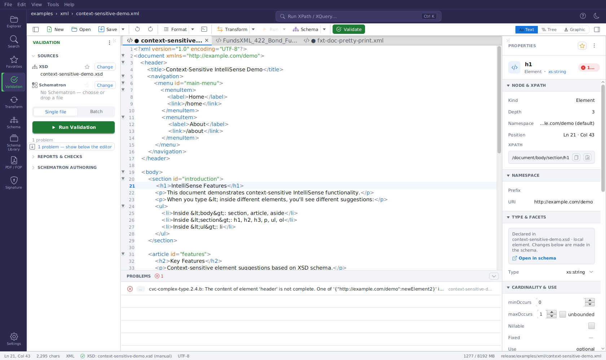
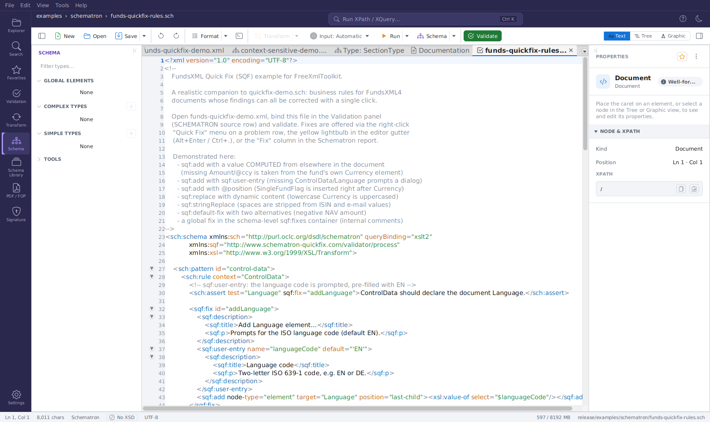

# Schema Support

FreeXmlToolkit supports different schema formats for validating your XML and JSON files. This page explains what's supported and what isn't.

---

## Overview

Schemas define rules for your XML documents - what elements are allowed, what order they should be in, and what values they can contain.

---

## Supported Schema Formats

### XSD (XML Schema Definition)

*The Validation panel - an XML document checked against its bound XSD schema*

**Full Support** - The main schema format used for XML validation.

| Feature | Description |
|---------|-------------|
| **Validation** | Check if XML files follow schema rules |
| **Auto-Completion** | Get suggestions while typing based on schema |
| **Auto-Detection** | Schema is found automatically from XML files |
| **Documentation** | Generate readable documentation from schemas |
| **Sample Data** | Create test XML files from schema definitions |
| **Visual Display** | See schema structure as diagrams |

**What You Can Define:**
- Elements and their order
- Required and optional fields
- Data types (text, numbers, dates)
- Allowed values
- Documentation

### Schematron

*A Schematron rules file (.sch) open as a normal document in the editor*

**Business Rules** - For validation rules that go beyond structure.

| Feature | Description |
|---------|-------------|
| **Custom Rules** | Write your own validation logic |
| **Real-time Checking** | See errors as you edit |
| **Clear Messages** | Define helpful error messages |
| **Flexible Rules** | Apply different rules in different situations |

**Best For:**
- "If field A is filled, then field B must also be filled"
- "The total must equal the sum of all items"
- "Each ID must be unique in the document"

### JSON Schema

**Full Support (for JSON documents)** - The standard schema format for validating JSON files.

| Feature | Description |
|---------|-------------|
| **Validation** | Check if JSON files follow schema rules |
| **Auto-Detection** | A schema referenced by the document's `$schema` member is bound automatically |
| **Manual Binding** | Bind a schema via the status bar indicator, the Validation panel, or drag & drop |
| **Line Numbers** | Each problem points to the offending line in your document |
| **Dialects** | Draft-07, 2019-09, and 2020-12 |

JSON Schemas bind and validate the same way XSD schemas do for XML - see the
[JSON Editor](json-editor.md) page for details.

### XML Catalogs (OASIS)

**Full Support** - Register one or more OASIS `catalog.xml` files in the
[Schema Library](schema-library.md)'s Catalogs tab to resolve `system`, `public`, `uri`,
`rewriteSystem`, `rewriteURI`, `nextCatalog` and `xml:base` entries when the toolkit looks
up an `xs:import`/`xs:include` or a schema reference by system ID. During validation the
lookup tries the **system identifier**, then the **public identifier** (`public` entries),
then the namespace, so `public` entries resolve schemas too.

---

## DTD and RELAX NG

Documents can be validated against a **DTD** or a **RELAX NG** schema (XML syntax `.rng`, compact
syntax `.rnc`). Validation is exact (Xerces for DTDs, Jing for RELAX NG); IntelliSense, the grid's
entry helpers and the Properties inspector use an XML Schema translated from the grammar (Trang),
which for some RELAX NG constructs is an approximation. There is no graphical editor, diagram or
documentation generator for these languages.

**Which grammar is used**, when no XSD is bound:

| The document has | It is validated against |
|---|---|
| `<!DOCTYPE book SYSTEM "book.dtd">` or `PUBLIC "…" "…"` | that DTD (and the internal subset, if any) |
| `<!DOCTYPE book [ … ]>` (only an internal subset) | the internal subset |
| `<?xml-model href="book.rng" schematypens="http://relaxng.org/ns/structure/1.0"?>` | that RELAX NG schema |
| `<?xml-model href="book.rnc" type="application/relax-ng-compact-syntax"?>` | that compact-syntax schema |

An `xsi:schemaLocation` (XSD) takes precedence. You can also bind a `.dtd`, `.rng` or `.rnc` file like
an XSD: click the schema indicator in the status bar, use **Change** in the Validation panel, or drop
the file there. A document's own DOCTYPE wins over a bound DTD.

**Where DTDs come from:** the XML catalogs and the [Schema Library](schema-library.md) first (public
and system identifiers — the way to use DocBook, XHTML or other standard DTDs offline), then local
files relative to the document, then — for `http`/`https` addresses only — the schema cache, which
downloads once through the proxy settings. A DTD that cannot be loaded is reported as a warning and
the document is checked for well-formedness only.

**Security:** external entities (`<!ENTITY x SYSTEM "…">`) are never read, entity expansion is limited
(no "billion laughs"), and DTDs are loaded only as described above. **Settings → Network & Security →
Validate documents against their DTD** switches DTD validation off; administrators can lock it
(`security.dtd.allowed=false`, see [Administration](administration.md)).

On the command line, `fxt-cli validate -x book.rng …` binds a grammar for all files, and declared
DOCTYPEs and `xml-model` instructions are used like `xsi:schemaLocation` (see
[Command Line](command-line.md#validate)).

---

## How to Use Schemas

### Loading a Schema

1. **Automatic:** Open an XML file that references a schema
   (`xsi:schemaLocation` / `xsi:noNamespaceSchemaLocation`) - it is bound automatically
2. **Manual:** Open the **Validation** panel and click **Change** on the XSD row - or click
   the **XSD indicator** in the status bar and pick an `.xsd` file
3. **Drag & Drop:** Drop an `.xsd` file onto the Validation panel's XSD row or onto the
   status bar's XSD indicator

A **Schematron** rules file binds the same way via the Validation panel's Schematron row.
Schematron files themselves (`.sch`) open as normal documents in the editor.

For **JSON documents**, a **JSON Schema** binds the same way: automatically via the
document's `$schema` member, or manually via the status bar's JSON Schema indicator,
the Validation panel's JSON Schema row, or drag & drop.

### Validation Workflow

1. Open your XML file
2. Bind (or auto-detect) the schema
3. Click **Run Validation** in the Validation panel (or press **F8**) - or enable
   **Validate while typing** to check continuously
4. Problems appear in the **PROBLEMS** list, each tagged with its source (XSD, Schematron,
   Well-formed); click one to jump to the problem location
5. Fix issues and re-validate

### Using Both XSD and Schematron

For the best validation coverage:
- Use **XSD** for structure (elements, order, types)
- Use **Schematron** for business rules (relationships, conditions)

---

## Tips

| Tip | Description |
|-----|-------------|
| **Start with XSD** | XSD handles most validation needs |
| **Add Schematron later** | For business rules XSD can't express |
| **Use auto-detection** | Let the app find your schema automatically |
| **Check error messages** | They tell you exactly what's wrong |
