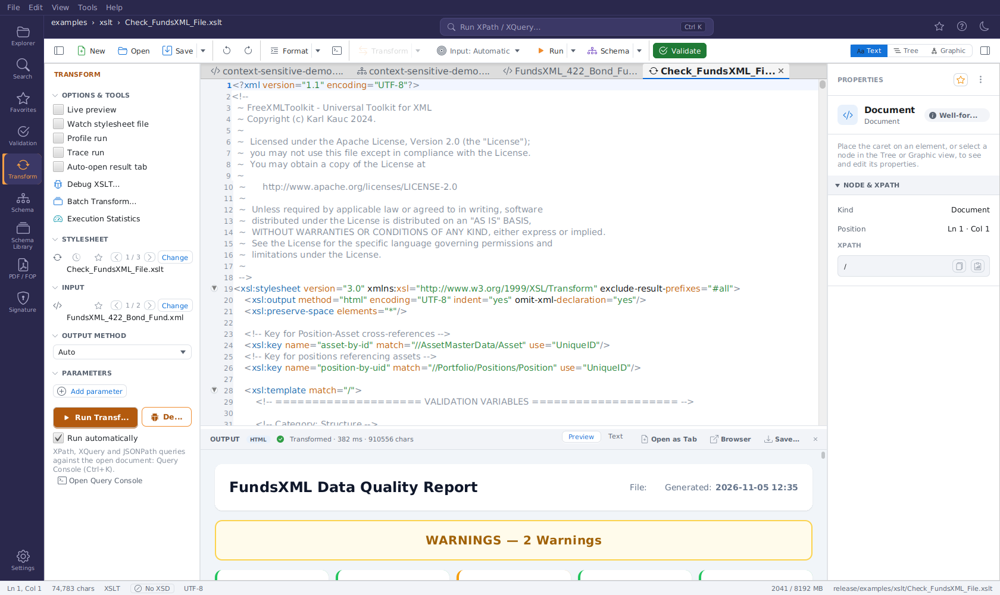

# Transform Panel

> The panel is organized into **collapsible sections**
> (STYLESHEET, INPUT, OUTPUT METHOD, PARAMETERS) with a single primary
> **Run Transform** button and a **Run automatically** checkbox next to it. Results do not open as an editor tab -
> they appear in the **[OUTPUT panel](#the-output-panel-results)** docked below the
> editor. The run options (checkboxes) and the advanced tools share the
> **OPTIONS & TOOLS** section at the top of the panel.

The **Transform** panel (open it from the **Transform** icon in the activity bar on the
left) runs XSLT transformations. XPath, XQuery and JSONPath queries against the open
document live in the [Query Console](query-console.md#query-console) - the panel shows a short hint with an
**Open Query Console** button for them. The panel
header reads **TRANSFORM**; the run options and tools are in the **OPTIONS & TOOLS**
section (see [OPTIONS & TOOLS](#the-transform-menu) below). Each section header
is clickable to collapse or expand that section.

!!! tip
    For a quick transform without opening this panel, right-click XML files in the Explorer
    and choose **[Transform with …](unified-shell.md#explorer-context-menu)**. It shares
    the same recent-stylesheet list and shows its result in the same OUTPUT panel.

## STYLESHEET

- Shows the **name of the chosen XSLT stylesheet** on its own line below the icon, the
  favorites/browse controls and **Change** (long names are shortened in the middle; hover
  for the full path). While no stylesheet is set, the row reads *"No stylesheet — choose or
  drop a file"* - clicking it works like **Change**.
- **Change** - pick an `.xsl` / `.xslt` file from disk (it is also loaded into the editor).
- The **clock icon** opens the **recent stylesheets** menu: reapply a recently used
  stylesheet in a single click (it is also loaded into the editor), or choose **Clear recent**
  to empty the list.
- The **star icon** opens your **XSLT favorites** - see
  [Browsing favorites with ◀ / ▶](#browsing-favorites) below. A picked stylesheet is also
  loaded into the editor.
- **Drag & drop**: drop an `.xsl` / `.xslt` file from your file
  manager straight onto the STYLESHEET row - it becomes the current stylesheet and is loaded
  into the editor, exactly as if you had picked it from a favorite. While dragging, the row glows
  **green** when the file can be loaded and **red** when it has the wrong extension (a
  red drop is rejected). As with favorites, the transform **runs automatically** as soon
  as both a stylesheet and an input are ready (while **Run automatically** is checked).

## INPUT

The INPUT section shows which document the transform will use as its input (the name on
its own line, the full path as tooltip; *"No input — open a document or drop a file"* while
there is none):

- By default the input **follows the active editor document**: switch to another tab and
  the next run transforms that document (the shown input name updates live).
- **Change** opens a small menu with two options:
    - **Select XML file…** - transform a fixed XML file from disk instead, regardless of
      which editor tab is active.
    - **Use active editor** - go back to following the active tab.
- The **star icon** opens your **XML favorites** - see
  [Browsing favorites with ◀ / ▶](#browsing-favorites) below. A picked input is also opened
  in the editor and becomes the active tab.
- **Drag & drop**: drop an `.xml` file from your file manager
  straight onto the INPUT row to transform that file - exactly like picking a favorite: it
  becomes the input and opens as the active editor tab. The same **green** (loadable) / **red** (rejected) drag-over
  feedback applies, and the transform **runs automatically** as soon as both a stylesheet
  and an input are ready (while **Run automatically** is checked).

## Browsing favorites with ◀ / ▶ {#browsing-favorites}

> Pick stylesheets and input files straight from your
> [Favorites](favorites-system.md) and page through them, so you can run the same
> stylesheet over many files, or many stylesheets over one file, without ever opening a
> file chooser.

Both the **STYLESHEET** and the **INPUT** rows carry a **star icon**, a pair of
**◀ / ▶ navigation buttons**, and a small **"i / n" position label**. The ◀ / ▶ buttons and
the label only appear once the browse list holds **at least two** entries.

- The **star menu** lists the favorites of the matching type - **XSLT** favorites for
  STYLESHEET, **XML** favorites for INPUT - grouped by their folder (category). An
  **"All … favorites"** entry at the top selects the whole list at once.
- **Picking a favorite** (or an "All"/folder entry) does three things: it sets the current
  file, it builds a **browse list** from that selection, and it **loads the file into the
  editor**. An input comes to the front as the active tab. A stylesheet opens *behind* the
  active tab while the input follows the active document (otherwise the stylesheet would become
  its own input); with a fixed input file it comes to the front too. The same happens on every
  ◀ / ▶ step.
- The **◀ / ▶ buttons** then step backward and forward through that browse list. Browsing
  is **cyclic**: pressing ▶ on the last entry wraps to the first, and ◀ on the first wraps
  to the last. The **"i / n" label** shows your position (for example, *3 / 12*).
- Each ◀ / ▶ step **runs the transformation automatically** (while **Run automatically** is
  checked) - but only once **both** sides
  are ready: a stylesheet is selected **and** an input is available (either a chosen input
  file or the active editor document). Until both are present, stepping just loads the file
  without transforming.

This supports two common workflows:

1. **Fix the input, step through stylesheets.** Keep one XML file as input, then page
   through several data-quality or reporting stylesheets with ▶ to see each result in turn.
2. **Fix the stylesheet, step through inputs.** Choose one XSLT stylesheet, then page
   through many XML input files with ▶ to apply the same transformation to each.

The existing **Change** file chooser, the **clock** (recent stylesheets) menu, and **Use
active editor** all keep working exactly as before.

## OUTPUT METHOD

A single dropdown with **Auto, XML, HTML, XHTML, Text, JSON**. **Auto** (the
default) detects the output format from the stylesheet's `xsl:output` declaration; pick a
concrete format to override the detection.

## PARAMETERS

Define XSLT parameters as **name = value** rows:

- **Add parameter** adds a new row.
- Each row has its own **remove** button.
- The values are passed to the stylesheet on every run.

## Running a Transformation

1. Choose a stylesheet (**STYLESHEET → Change**, or pick one from the recent menu).
2. Check the **INPUT** section shows the document you want to transform.
3. Click **Run Transform**.

The **Run automatically** checkbox next to **Run Transform** (on by default) controls the
automatic run that starts when you drop a stylesheet or input, pick one from your favorites,
or browse with ◀ / ▶. Uncheck it to only set the file and run with **Run Transform** yourself.

The result appears in the **OUTPUT panel** below the editor - see
[The OUTPUT Panel](#the-output-panel-results) below.

## Debugging a Stylesheet {#xslt-debugger}

**Debug** (next to **Run Transform**) runs the same stylesheet over the same input as **Run
Transform** (the INPUT file when one is set by dropping, a favorite or ◀ / ▶ browsing, otherwise
the active document) in the interactive XSLT debugger. The other ways in are **Tools → Debug with XSLT…**, the
**Transform ▾ → Debug with XSLT…** toolbar entry, **Run ▾ → Debug Transform** for an active
XSLT document (against the toolbar's **Input** target), the **PDF / FOP** panel's
**Debug stylesheet…**, and **Shift+F5** whenever a document is open.

What happens:

1. The stylesheet opens as a document. The debugger runs its **editor text** - unsaved changes
   included, also of open included modules - under the file's location, so relative
   `xsl:include` / `xsl:import` hrefs resolve (a new stylesheet must be saved once). Every saved XSLT document already has
   a **breakpoint gutter**: click the slot left of a line to toggle a red breakpoint, before or
   during a session (the click does not move the caret). Breakpoints are **remembered per
   file** across sessions and restarts, including those set in included modules.
2. The **DEBUG** dock opens *below* the editor, so the stylesheet stays visible while you
   step. The dock shares its space with **OUTPUT**; a small **OUTPUT | DEBUG** strip switches
   between them, and a result that arrives while DEBUG is in front marks the OUTPUT toggle.
3. The run starts and **pauses at the first instruction** when there are no breakpoints
   (**Pause on entry**, a toggle in the dock's header), otherwise at the first breakpoint.
   The paused line is tinted in the editor and marked with a green arrow in the gutter (a
   yellow arrow on a breakpoint line). When Saxon pauses inside an included module, that
   file opens, with its own breakpoints in its gutter.

The dock's header holds the controls - **Continue** (F5), **Pause** (F6, breaks into a running transformation), **Run to Cursor** (Ctrl+F10; also gutter right-click → Run to Here, and it starts the debugger when none runs), **Step Into** (F7), **Step Over**
(F8), **Step Out** (Shift+F8), **Restart** (runs again from the start with the same
breakpoints, reading the stylesheet again from the editor), **Stop**, **Pause on entry**, **Mute** (all breakpoints off, steps still work), **Show in editor**, **Show input** (the paused context node in the input XML, which is tinted blue there), **Evaluate** (Alt+F8: any XPath in the selected frame, with a history on Up/Down)
and **✕** (ends the session). Below it, two tab groups show the paused state - **Variables |
Watch** on the left, **Call Stack | Messages | Breakpoints | Output** on the right, with a draggable
divider whose position is remembered. Messages and Breakpoints carry a count badge; a failed
run brings Messages to the front. The panels:

| Panel | Shows |
|-------|-------|
| **Variables** | The context item (`.`), `position()` / `last()`, the XSLT context (mode, `current-group()` / `current-grouping-key()`, `regex-group(n)`, tunnel parameters, accumulator values), every local variable in scope and every global variable that has been evaluated so far - with real values and XDM types, as a tree: nodes unfold into attributes and children, sequences, maps and arrays into their items; each row's XPath can be watched. While paused, the stylesheet also shows each variable's value at the end of its declaration line ([details](debugger.md#values-in-the-code)), and resting the mouse on a `$variable` (or a selected XPath) shows its value in a popup. **Click a value** to open it in a window with the full, highlighted value, Copy, and an XPath field that runs against it ([details](debugger.md#viewing-a-value-in-full)) |
| **Watch** | Your XPath expressions, evaluated **against the paused context item** with the variables in scope (`count(item)`, `$total`, `position()`); re-evaluated at every pause. **Add** / **Remove** sit above the table (or Variables → right-click → **Add to Watches**); Delete removes, F2 / double-click edits an expression; click a value to open the full result. Watches are saved per stylesheet |
| **Call Stack** | Template and function frames (instructions nested inside them are dimmed), each with its module and line; loops show their current item, e.g. *ForEach (3 of 222)*; double-click jumps there, also into an include. **Selecting a frame switches Variables and Watch to that frame** (its context item, own locals and the globals). **Enter** / **Open Value…** opens the frame's context item, with XPath over that frame's own variables |
| **Messages** | `xsl:message` output and Saxon warnings **as they happen**, with their stylesheet location; double-click jumps to the line. Filter by level and text, **Copy**, **Clear** |
| **Breakpoints** | All breakpoints of the session, grouped by file (checkbox = enabled · file · line · condition · hit rule · hits of this run; after a completed run, breakpoints it never reached are flagged and drawn amber in the gutter) with **Remove** / **Edit…** / **Template…** (break whenever a template rule, named template, function or mode is entered, at any line) / **Clear all** / **Break on ▾** (dynamic errors - pausing at the failing instruction with its variables -, terminating or all `xsl:message`) above the list (Delete removes the selected one); double-click jumps to the line; right-click an entry for per-file Enable / Disable / Remove and **Export / Import Breakpoints…**. Right-click a gutter slot for a **conditional breakpoint** (XPath, pauses only when true), a **logpoint** (writes `item {@id}`-style messages to Messages, optionally without pausing) or a **hit count** rule (exactly / from / every N-th hit) - [details](debugger.md#conditional-breakpoints) |
| **Output** | The output written so far, refreshed at every pause; the complete result once the run finishes. Secondary results (`xsl:result-document`, kept in memory) are selectable; **Documents** lists and opens what `doc()` / `document()` / `collection()` loaded |

When the run ends, the status reads *Finished · N ms* and the **result lands in the OUTPUT
panel** (the OUTPUT toggle lights up; DEBUG stays in front so the messages remain readable).
A failed run shows the error with its location in **Messages**. The debugger runs on its own
Saxon processor, so a normal **Run Transform** during a paused session is unaffected.
**Tools → Debug Configuration…** saves per stylesheet the input (Run target or a file), parameters, output format and pause on entry; **Re-run Last Debug** (Ctrl+Shift+F5) repeats the last debug run with its input read again.
Details and stylesheet tips: [XSLT Developer → Interactive Live Debugger](debugger.md#interactive-live-debugger).

## Queries (XPath, XQuery, JSONPath)

The Transform panel no longer has its own XPATH and XQUERY sections. Below the run
controls, a short hint and an **Open Query Console** button take you to the
[Query Console](query-console.md#query-console), which runs XPath, XQuery and JSONPath queries against the
open document and offers the saved queries (**Snippets** menu) and the XQuery **Examples**.

## OPTIONS & TOOLS {#the-transform-menu}

The collapsible **OPTIONS & TOOLS** section at the top of the panel (open by default - click
its header to collapse it) holds everything secondary. First the run
**options**, as checkboxes:

| Option | What it does |
|-------|--------------|
| **Live preview** | Re-runs the transform automatically (debounced) while you edit the input document. |
| **Watch stylesheet file** | Re-runs the transform whenever the chosen stylesheet changes on disk - handy while editing the stylesheet in another tool. |
| **Profile run** | A transform also opens a read-only **Profile** tool tab (timings + per-template execution times). |
| **Trace run** | A transform also opens a **Trace** tool tab (template matches + `xsl:message` output). |
| **Auto-open result tab** | Additionally opens every successful result as a regular editor tab (HTML/XHTML results open rendered in the [Preview](unified-shell.md#html-preview) view). **Off by default.** |

Below the options, the advanced **tools** are labelled rows (icon + name):

| Row | What it does |
|-----|--------------|
| **Debug XSLT…** | Same as the **Debug** button next to **Run Transform**: opens the stylesheet (with the breakpoints set in its gutter) and the **DEBUG** dock below the editor - see [Debugging a Stylesheet](#xslt-debugger). |
| **Batch Transform…** | Runs the chosen stylesheet - or, when no stylesheet is set, the active XQuery document - over many XML files, with per-file results and "Save All". |
| **Execution Statistics** | Opens the **Execution Statistics** tool tab (duration, CPU and memory per XSLT/XQuery/validation run). Runs are only recorded while **Record execution statistics** is enabled in the Settings page's **DEVELOPER** card. |

> XSLT version selection (1.0/2.0/3.0) is intentionally not offered: Saxon HE
> auto-detects the version from the stylesheet's `version` attribute, so an
> explicit selector would be cosmetic.

## The OUTPUT Panel (Results)

> Transform and query results appear in an **OUTPUT panel
> docked below the editor** instead of opening editor tabs and a separate
> HTML-preview tool tab.

All Transform-panel results - XSLT transforms, XPath/JSONPath queries, and XQuery runs -
appear in an **OUTPUT panel** that docks **below the editor**: the source document stays
on top and the result shows underneath, while the Properties inspector keeps its full
height. The panel **persists across activity switches**, so the last result stays visible
while you work elsewhere.

The OUTPUT panel header shows:

- A **format badge** (XML, HTML, …) for the result.
- A **status**: a green check with `Transformed · N ms · M chars` on success (how long the
  run took and how large the output is), or a red error icon with the error message on
  failure.
- **View toggles** - **Preview | Text | Table**:
    - **Text** - the result in a **read-only code editor** (the default):
      line numbers, syntax highlighting matching the result format (XML or JSON;
      plain text otherwise), and font zoom with **Ctrl+mouse wheel** (**Ctrl+0** resets).
    - **Preview** - the result rendered as a web page; available for **HTML/XHTML**
      results only.
    - **Table** - available for **XQuery** results that return a **sequence** of items
      (auto-selected when applicable). Each item becomes a row, and the columns are taken
      from each item's child elements (or, if an item has no child elements, its
      attributes). A sequence of plain values is shown in a single **value** column.
- **Actions**:
    - **Open as Tab** (*Open result as editor tab*) - opens the result as a regular document
      (`Transform-Result.xml` / `.html` / `.json` / `.txt`) that you can edit and save.
      An **HTML/XHTML result** opens as an HTML document rendered in the
      [Preview](unified-shell.md#html-preview) view (switch to Text to see the markup); re-running the
      transform updates the open result tab, re-rendering the preview if it is showing.
    - **Browser** (*Open in browser*) - opens the result (typically HTML) in your system web browser.
    - **Save…** (*Save result…*) - writes the result straight to a file.
    - **✕** - hides the OUTPUT panel; it reappears automatically on the next run.

!!! note
    In earlier versions, every transform opened a `Transform-Result.*` editor tab, and HTML
    output additionally opened an "HTML Preview" tool tab. Both were replaced by the OUTPUT
    panel: an editor tab now opens only via the panel's **Open result as editor tab** action
    or the **Auto-open result tab** option in OPTIONS & TOOLS, and HTML is rendered inline via
    the panel's **Preview** view.
