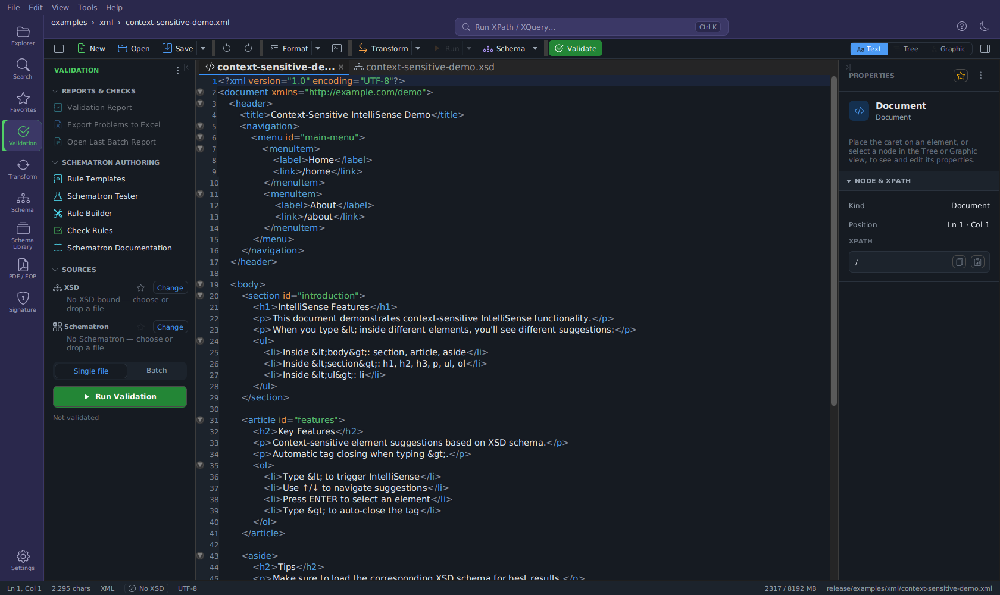
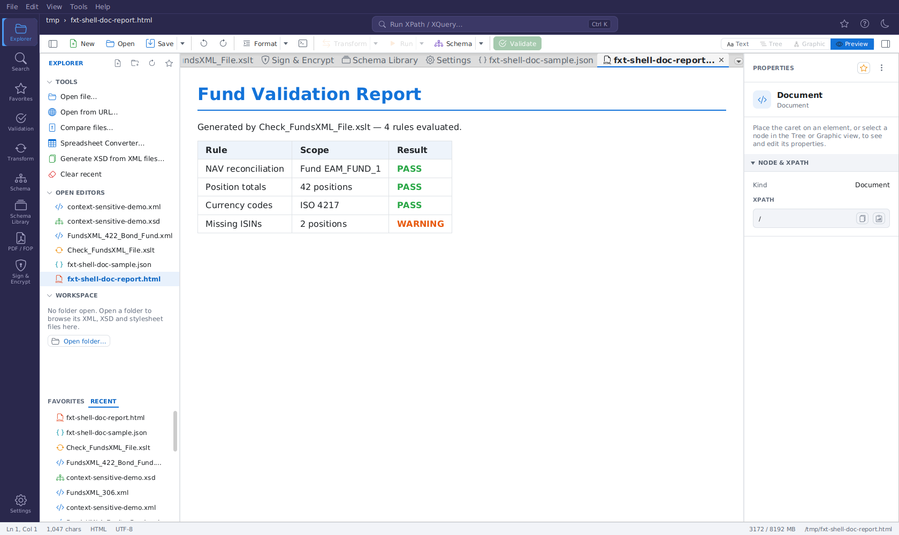
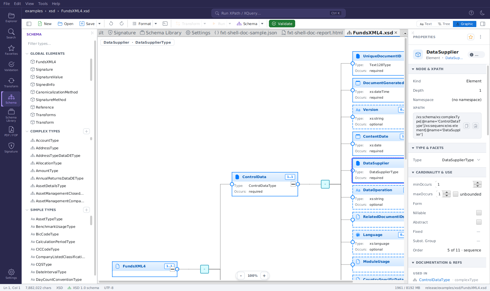
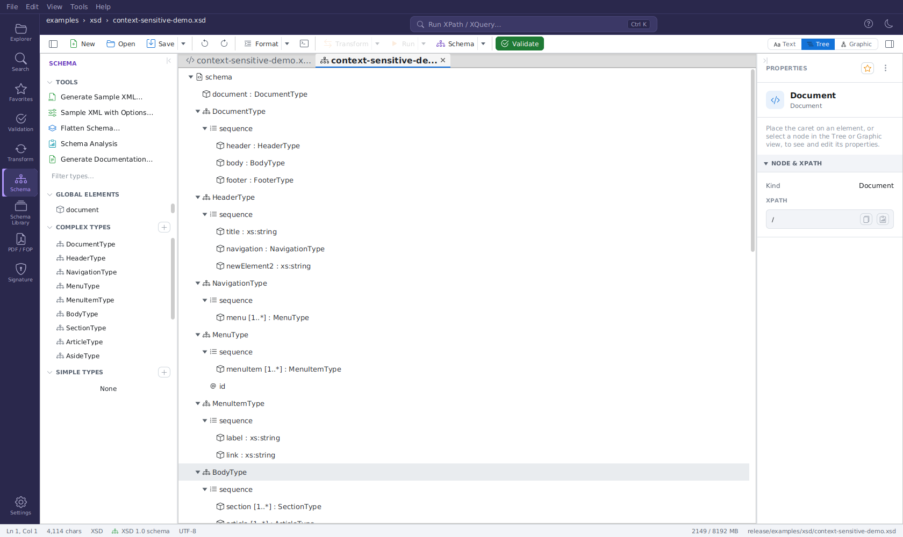
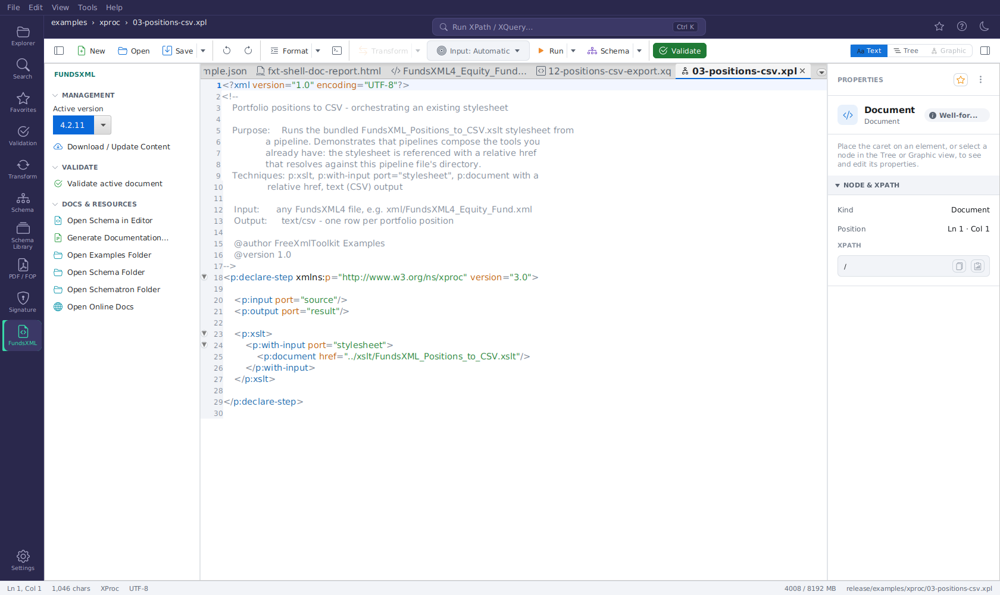
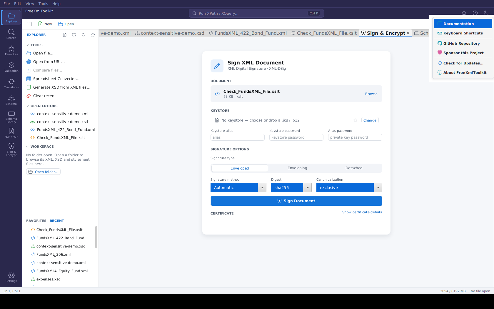
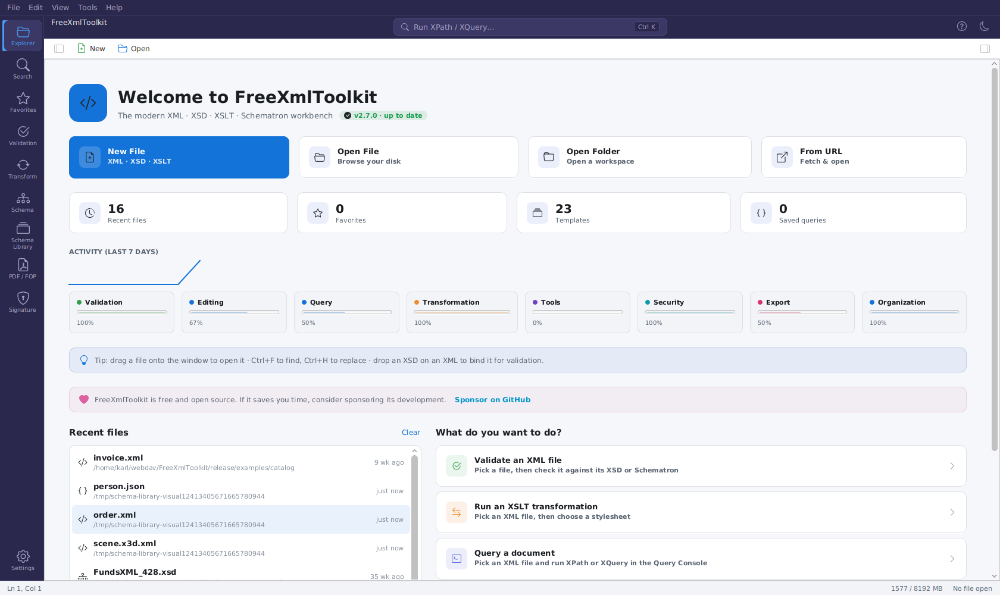
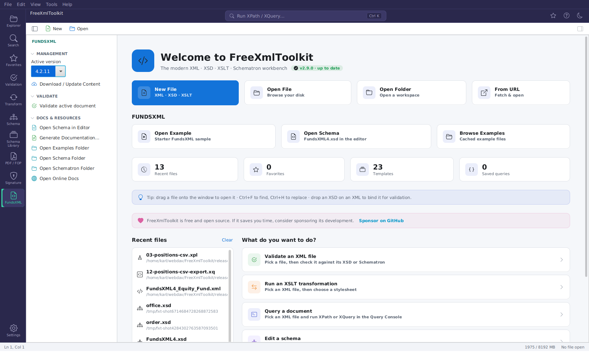

# Unified Shell

> The application opens directly into the **Unified Shell** - one workspace that
> combines XML, XSD, XSLT, XProc, Schematron and JSON editing with all the validation,
> transformation, signing and documentation tools. The separate legacy tabs have
> been consolidated here.

## Overview

The Unified Shell is the single workspace for everything FreeXmlToolkit does. Instead of
switching between separate editor pages, you open files as tabs in the central **editor
host** and reach every tool through the **activity bar** on the left. You can work with an
XML file next to its XSD schema, XSLT stylesheets and Schematron rules at the same time.

*The Unified Shell: activity bar (left), Explorer side panel, editor host with an XML file
(Text/Tree/Graphic view toggle), the Properties inspector (right) and the status bar.*

### Layout

| Area | Purpose |
|------|---------|
| **Activity bar** (far left) | Switch tools / side panels: Explorer, Search, Favorites, Validation, Transform, Schema, Schema Library (its label wraps onto two lines), PDF/FOP, Signature, Settings - plus a **FundsXML** activity when the optional [FundsXML extension](fundsxml-extensions.md) is enabled (see [FundsXML Panel](#fundsxml-panel)). **Always visible** - it cannot be collapsed. (**Settings**, **Schema Library** and **Signature** open as a full page in the editor area - see [Settings Page](settings.md#settings-page), [Schema Library Page](#schema-library-page) and [Signature Page](#signature-panel). Help is not an activity - it is the **Help** menu, see [Help Menu & About](#help-menu-about).) |
| **Menu bar** (very top) | **File / Edit / View / Tools / Help** - every action of the toolbar, the Activity Bar and the keyboard shortcuts in one place (see [Menu Bar](#menu-bar)). On macOS it is the system menu bar at the top of the screen. |
| **Header bar** (top) | The breadcrumb (application / active file), a centered **search pill** (*"Run XPath / XQuery…"*, shortcut **Ctrl+K**) that opens the bottom [Query Console](query-console.md#query-console) when clicked, the **?** button (opens the [Help menu](#help-menu-about) as a popup - same as **F1**) and the Theme button. |
| **Side panel** | The panel for the selected activity (e.g. the Transform panel, the Validation panel). **Resizable and collapsible** (see [Resizing and collapsing the side panels](#collapsing-the-side-panels)). |
| **Editor host** (center) | Tabs of open documents, each with the Text, Tree and Graphic view modes - plus a rendered **Preview** for HTML documents (see [View Modes](#view-modes)). |
| **Inspector** (right) | View **and edit** the selected node's properties from any view. **Resizable and collapsible** (see [Resizing and collapsing the side panels](#collapsing-the-side-panels)). Hidden automatically while a page without a document (Settings, Schema Library, Signature, reports, tool tabs) is selected. |
| **Status bar** (bottom) | Caret position (Ln/Col), character count, file type, the XSD / IntelliSense indicator, the encoding label (the charset the file was read in and is saved in, e.g. UTF-8 or ISO-8859-1), the last recorded run (Developer feature), a memory indicator and the active file's path (see [Status Bar](#status-bar)). |

#### Resizing and collapsing the side panels {#collapsing-the-side-panels}

Both the **left side panel** and the **right Properties inspector** can be resized and
collapsed to give the editor more room - the activity bar always stays visible.

**Resizing** - the panels are not fixed-width:

- **Drag the thin divider line** between a panel and the editor to make the panel wider or
  narrower (the mouse pointer turns into a horizontal resize arrow over the divider). Widen
  the panel when file names, validation messages, or property values get truncated.
- Each panel keeps a **minimum width of 200 px**, and the editor in the middle always keeps
  at least **320 px** - you cannot drag a panel so far that the editor disappears.
- The chosen widths are **remembered across restarts** (per user).
- When you **resize the window**, the panels keep their pixel width - only the editor column
  grows or shrinks (the same behavior as VS Code).

**Collapsing** - each panel can also be hidden completely:

- **Collapse**: click the discreet collapse button at the panel's inner edge (a chevron
  pointing at a bar: `|<` on the left panel, `>|` on the inspector). The panel is hidden
  completely.
- **Re-open**: click the matching toggle button in the editor toolbar (left-most toggle, a
  sidebar icon, for the side panel; right-most toggle, a mirrored sidebar icon, for the
  inspector) - the same mechanism on both sides. Selecting any
  activity from the activity bar also re-opens the left side panel. A re-opened panel comes
  back at its **last dragged width**.
- The collapsed/expanded state is **remembered across restarts** and can also be changed under
  **Settings → Appearance → LAYOUT** ("Show left side panel" / "Show Properties (inspector) panel").
- **The inspector only appears next to documents.** When you switch to a tab that is not a
  document - **Settings**, **Schema Library**, **Signature**, a report or another tool tab - the
  inspector hides automatically, so the page gets the full width. Its toggle button is greyed out
  on such tabs. As soon as you select a document tab again, the inspector comes back. Your own
  show/hide choice is not changed by this - if you had hidden the inspector, it stays hidden.

### Key Features

- **Multi-tab editing** - Open multiple files of different types in one view
- **Automatic file type detection** - Files are recognized by extension (.xml/.wsdl, .xsd, .xsl/.xslt, .xpl/.xproc, .xq/.xquery/.xqm/.xqy, .xpath, .sch/.schematron, .json/.jsonc/.json5, .html/.htm/.xhtml); anything else opens as plain text
- **View modes per document** - Text, Tree and Graphic, all over one shared model, plus a rendered **Preview** for HTML documents (see [View Modes](#view-modes))
- **Inspector editing everywhere** - edit node properties from the Text, Tree and Graphic views, not just one
- **Type picker with explanations** - the inspector's **Type** field and *Change Type…* in the
  diagram and tree context menus list the schema's own types and every XSD built-in datatype,
  and a side pane explains the highlighted one (see [Choosing a type](inspector.md#type-picker))
- **Integrated XPath/XQuery** - a bottom [Query Console](query-console.md#query-console) queries the active
  XML/JSON file right from the editor (Ctrl+Shift+X)
- **Editor toolbar actions** - run [Validate, Transform, Run, Generate Documentation and the Type
  Editor](#editor-toolbar-document-actions) for the active document without switching activities
- **Search & Replace** - Ctrl+F / Ctrl+H across the editor, in **every view mode**: the Text
  view searches the raw text, the Tree and Graphic views search the nodes themselves (names,
  documentation, attributes, enumeration and facet values, comments)
- **Find in Files & XPath search** - the **Search** activity
  (Ctrl+Shift+F) searches and replaces across **all files of a folder**, by plain text or
  by XPath expression (see [Search Panel](#search-panel))
- **Resizable side panels** - drag the divider lines to give the side
  panel or the Properties inspector more room; the widths are remembered across restarts
  (see [Resizing and collapsing the side panels](#collapsing-the-side-panels))
- **Favorites** - Quick access to frequently used files

### Colours: workflows and actions

Colour tells you two things at a glance, and the two never mix on one surface:

- **Which workflow you are in.** Every activity has its own accent colour: Explorer brand
  blue, Search indigo, Favorites amber, Validation green, Transform orange, Schema purple,
  Schema Library grape, PDF / FOP rose, Signature cyan, FundsXML teal. The colour appears only on the
  chrome that names the workflow: the bar next to the selected Activity-Bar icon, the panel
  title (VALIDATION, TRANSFORM, …), the panel's one primary button (Run Validation, Run
  Transform, Generate PDF, Validate Signature), the tint of the matching toolbar group, the
  icons of the Welcome page's task list and the "last run" badge in the status bar. Settings stays
  neutral, so the default view of the app looks as before.
- **What an action does.** Menu items and the action rows of the side panels colour their icon
  by the kind of action, in every editor and every view: green adds or creates (Add, Paste,
  Duplicate, Validate, Generate), red removes (Delete, Remove, Clear, Cut), orange edits in
  place (Rename, Edit value), cyan navigates to something that already exists (Go to
  Definition, Reveal, Find, opening a favorite or a generated PDF), purple changes structure
  (Change Type, Cardinality, Move Up/Down), blue runs a tool (Format, Sort, Save, Export,
  Download, "Open file…" with a file chooser) and grey is neutral (Copy, Expand/Collapse,
  Undo/Redo).

Result colours always win: a failed run shows a red icon on an orange Transform badge, a
passed validation a green check. Both layers switch with the light/dark theme:

## Getting Started

1. The Unified Shell opens automatically on startup.
2. Use the **Explorer** activity (or **File → Open**) to open files; **File → New** (Ctrl+N) opens the guided [New File dialog](#new-file-dialog) to create a new file from a template or schema. You can also **drag & drop** files from your file manager anywhere onto the window - every [supported file type](#supported-file-types) (XML, XSD, XSLT, XProc, XQuery, XPath, Schematron, JSON, HTML) opens as a new tab; other files are ignored.
3. Files open as tabs in the editor host - switch tabs by clicking their headers (drag a header to reorder, right-click it for [tab actions](#editor-tabs)), and switch view modes (Text / Tree / Graphic - plus **Preview** for HTML files) with the segmented view switch.

After the first start, a small **Anonymous usage statistics** notice appears once in the
bottom-right corner of the window. It explains that FreeXmlToolkit sends anonymous usage
statistics and error reports (never file names, paths or content). Click **OK** to continue,
**Settings…** to switch it off, or **What is sent?** to see the exact data. Nothing is sent
before you have acknowledged this notice. See [Privacy & Anonymous Telemetry](telemetry.md).

## New File Dialog

> Creating a new file opens a guided dialog instead of silently
> opening an empty, untitled document. You can pick a starting template or an XSD schema, so
> a new file already has a sensible structure.

The **New File** dialog opens whenever you create a new document - from the toolbar **New**
button (Ctrl+N), the **Explorer** panel's **New file** action, or the **New File** card on the
Welcome screen. It walks you through a few simple choices and then opens (and optionally saves)
the new document.

| Field | What it does |
|-------|--------------|
| **File type** | Choose **XML**, **XSD**, **XSLT**, **Schematron**, **JSON**, **XProc**, **XQuery**, **XPath**, or **HTML**. The rest of the dialog adapts to your choice. |
| **Template** | A list of available templates - the built-in library plus your own templates from Settings - **automatically filtered to the selected file type**. The default is **"— None —"** (start blank). Picking a parameterized template prompts you for its values when the file is created. |
| **Schema** | *(plain XML only, and only when no template is chosen.)* Pick an XSD to base the document on - from your **Favorites**, your **Recent files**, or **Browse…** to select a file. The chosen schema is also bound to the new document, so it appears in the Validation panel and drives IntelliSense. |
| **Pre-fill mandatory nodes (empty)** | *(shown with the Schema option, on by default.)* When a schema is selected, the new document is pre-populated with all required elements and attributes (left empty) generated from that schema, giving you a ready-to-fill skeleton. |
| **Save to** | *(optional.)* Choose a location with **Browse…** to write the file to disk immediately and open it. Leave it empty to open the document as an **untitled** tab - you will be asked for a location the first time you Save. |

### What you get

- **A template** is rendered into the new document (prompting for any parameters first).
- **XML with a schema and "Pre-fill mandatory nodes"** produces a skeleton containing every
  mandatory element and attribute from that schema.
- **Otherwise** you get a minimal, valid starting point for the chosen type: an XML declaration
  for XML, an `xs:schema` skeleton for XSD, an `xsl:stylesheet` (version 3.0) skeleton for
  XSLT, an ISO-Schematron skeleton for Schematron, `{}` for JSON, a `p:declare-step`
  skeleton (with `source`/`result` ports and `p:identity`) for XProc, an
  `xquery version "3.1";` prolog for XQuery, and a minimal HTML5 page skeleton for HTML.

## View Modes

> The segmented view switch offers the **Text**, **Tree**, and **Graphic** view
> modes - each with its own icon - plus, for **HTML documents only**, a rendered read-only
> **Preview** (eye icon) - the Preview segment only appears while an HTML document is
> active. There is no separate **Grid** mode - the grid is part of
> **Graphic**.

Every document tab offers the same view modes:

| Mode | What it shows |
|------|---------------|
| **Text** | Source code editing with syntax highlighting |
| **Tree** | The document as a hierarchical tree |
| **Graphic** | A visual editor that depends on the document type: for **XML**, **XSLT**, **Schematron** and **JSON** files it shows the editable XMLSpy-style **grid**; for **XSD** files it shows the **schema diagram** |
| **Preview** | *(HTML documents only.)* The page rendered read-only in an embedded web view - see [HTML Preview](#html-preview) |

All views share one in-memory model per document, so edits and Undo/Redo history are preserved
when you switch views.

### The Grid (Graphic view for XML)

The Graphic view of XML and JSON documents is an editable grid with tables for repeating elements, opened cells, entry helpers, filters and formulas - see **[Grid View](grid.md)**.

### HTML Preview (Preview view for HTML) {#html-preview}

HTML documents (`.html`, `.htm`, `.xhtml`) get their own **Preview** view mode - the eye
icon in the segmented view switch - that renders the page read-only, the way a browser
would show it:

- **HTML files open in Preview by default.** Whether you open them from the Explorer, by
  drag & drop, or via the Open dialog, you see the rendered page first.
- **Editing happens in the Text view.** Switch to **Text** to change the markup, then
  switch back to **Preview** - it re-renders your current editor text, including unsaved
  changes.
- **Tree and Graphic are disabled for HTML documents**, because HTML output is often not
  well-formed XML.
- **Transform results render here too.** The OUTPUT panel's **Open result as editor tab**
  opens an HTML/XHTML transform result as an HTML document showing its Preview, and
  re-running the transform updates the open result tab live - see
  [The OUTPUT Panel](transform-panel.md#the-output-panel-results).

!!! note "Preview limitations"
    - The page is rendered **without a base URL**, so **relative references** - external
      CSS files, images - do not resolve. **Inline styles render fine.** To view a
      transform result together with its external assets, use the OUTPUT panel's
      **Open in browser** action instead.
    - **Ctrl+F** in the Preview searches the document's underlying **markup text**, not
      the rendered page.
    - The Preview is **read-only** - all editing happens in the Text view.

## Every Picked File Opens in the Editor {#picked-files}

Whichever way you pick a file, it is loaded into the editor as a tab (an open tab is reused):
**File → Open…** and **Open Recent**, the Welcome page's recent list, the Explorer and Favorites
panels, drag & drop onto the window or onto a panel row, and on every page the **Change** /
**Choose…** dialogs, the **recent** menus (Transform clock icon, Explorer *Transform with Other
Stylesheet* / *Validate with Other Schematron*) and the favorites star menus.

- An **input** (Transform or PDF/FOP XML input) becomes the active tab.
- A **stylesheet** opens behind the active tab while the input follows the active document,
  and in front when the input is a fixed file.
- A **schema, Schematron, JSON Schema, catalog or query target** opens behind the active
  tab, so the document it applies to stays in front.
- On a page in the main area (Signature, Schema Library) the file opens behind the page.

Not loaded: keystores and trust stores (binary files), and spreadsheets for import (the
converted XML opens instead).

## Working with Editor Tabs {#editor-tabs}

- **Reorder tabs** by dragging a tab header left or right. The Explorer's
  [OPEN EDITORS](#explorer-panel) list follows the new order.
- **Right-click a tab** for a menu that acts on *that* tab, even if it is not the active one:

| Menu item | What it does |
|-----------|--------------|
| **Reload from Disk** | Reads the file again. If the document has unsaved changes, you are asked first. Not available for untitled documents. |
| **Close** | Closes the tab (asks to save unsaved changes). |
| **Close Others** | Closes every other tab. Each tab with unsaved changes still asks to save; **Cancel** stops closing the rest. |
| **Save** / **Save As…** | Saves the document. For an untitled document, **Save** works like **Save As…**. |
| **Copy Path** | Copies the file's full path to the clipboard. |
| **Reveal in File Manager** | Shows the file in Windows Explorer, the macOS Finder or your Linux file manager, with the file selected (if the file manager cannot select it, its folder opens). |
| **Reveal in Explorer Panel** | Opens the [Explorer](#explorer-panel) and selects the file in the workspace tree. If the file lies outside the current workspace, its folder becomes the workspace. |

Copy Path and the two Reveal items need a saved file, so they are disabled for untitled
documents. Tabs that show no document - tool tabs such as the Type Editor, a diff or a PDF
preview - only offer **Close** and **Close Others**.

## Files Changed Outside the Editor {#external-changes}

The shell watches the files of all open tabs. When another program changes or deletes one
of them, a dialog asks what to do - checked every two seconds while the FreeXmlToolkit
window is active, and immediately when you switch back to it.

| Situation | Choice | Result |
|-----------|--------|--------|
| **File changed on disk** | **Reload** | The tab shows the file's new content. Unsaved changes in that tab are discarded (the dialog warns you when there are any). Caret position and view mode (Text / Tree / Graphic) are kept. |
| | **Ignore** | The tab keeps its content and is marked as unsaved (**●**), because it now differs from the file. Saving overwrites the external change. You are not asked again until the file changes once more. |
| **File deleted on disk** | **Keep** | The tab stays open and is marked as unsaved (**●**). **Save** creates the file again. |
| | **Close** | The tab is closed, including any unsaved changes. |

Closing the dialog with **Esc** counts as **Ignore** / **Keep**. With several affected files
the dialogs appear one after the other, each with its tab brought to the front.

!!! note
    - Saving from the editor itself never triggers the dialog, and neither does a file that
      was merely touched or rewritten with identical content.
    - Changing a tab's file from elsewhere in the application - for example saving the right
      side of a diff, or exporting a result over a file that is open - is reported like any
      other outside change.
    - Untitled documents are not watched.

## Supported File Types

| Type | Extensions | Features |
|------|-----------|----------|
| **XML** | .xml, .wsdl | Text + graphic view, XSD/Schematron linking, IntelliSense, continuous validation |
| **XSD** | .xsd | Text + graphic view, Type Library, Type Editor, Schema Analysis, Documentation, Sample Data, Flatten |
| **XSLT** | .xsl, .xslt | XSLT editor + XML input + output preview, live transform, parameters, performance metrics |
| **XProc** | .xpl, .xproc | Pipeline editor (Text + Tree view), Run Pipeline via the embedded XML Calabash engine - see [XProc Pipelines](xproc.md#xproc-pipelines) |
| **XQuery** | .xq, .xquery, .xqm, .xqy | Query editor with highlighting + IntelliSense, Run Query against a selectable target - see [Query Documents](query-console.md#query-documents-the-target-selector) |
| **XPath** | .xpath | Single-expression query editor, Run Query against a selectable target - see [Query Documents](query-console.md#query-documents-the-target-selector) |
| **Schematron** | .sch, .schematron | Code editor + Visual Builder + Tester + Documentation Generator |
| **JSON** | .json, .jsonc, .json5 | Text + tree + editable **grid** view (see [The Grid for JSON](grid.md#json-grid)), JSONPath queries, JSON Schema validation. The JSON/JSONC/JSON5 flavor is detected from the content, so comments and trailing commas are accepted in any of the three. |
| **HTML** | .html, .htm, .xhtml | Rendered read-only **Preview** (the default view) + Text editing; also the format of HTML/XHTML transform results opened as editor tabs - see [HTML Preview](#html-preview) |

## Menu Bar {#menu-bar}

The menu bar offers every shell action by name, with its keyboard shortcut next to it. Items that
do not apply to the active document are greyed out (e.g. **Type Editor** is only available for XSD
schemas, **Save** needs an open document).

| Menu | Contents |
|------|----------|
| **File** | New…, Open…, Open from URL…, **Open Recent** (the last opened files), Close Tab, Save, Save As…, Save All, Settings…, Exit (Ctrl+Q; asks to save unsaved changes first) |
| **Edit** | Undo, Redo, Find…, Replace…, Find in Files…, Replace in Files…, Format Document, Minify, Insert Template… |
| **View** | The view modes (Text / Tree / Graphic / Preview), Side Panel, Properties Inspector, Query Console, Favorites Panel, **Activities** (jump to any activity), **Show Constraints in Diagram**, Toggle Light / Dark Theme, Full Screen |
| **Tools** | Validate, Run, Transform with XSLT…, Debug with XSLT… (Shift+F5), Debug Configuration…, Re-run Last Debug (Ctrl+Shift+F5), Toggle Breakpoint (F9), Run to Cursor (Ctrl+F10), Set Schema…, Generate Documentation…, Generate Sample XML…, Generate XSD from XML, Generate XSD from XML Files…, Type Editor, Compare with File…, Spreadsheet Converter…, Add to Favorites |
| **Help** | Documentation, Keyboard Shortcuts, FundsXML Website and FundsXML Schema Docs (only while the [FundsXML extension](fundsxml-extensions.md) is enabled), Report a Problem… (when error reporting is enabled), GitHub Repository, Sponsor this Project, Check for Updates…, About FreeXmlToolkit - see [Help Menu & About](#help-menu-about) |

### macOS

On macOS the menus appear in the **system menu bar** and follow the platform conventions:

- The **FreeXmlToolkit** application menu holds **About FreeXmlToolkit**, **Check for Updates…**,
  **Settings…** (**Cmd+,**), **Hide FreeXmlToolkit** (**Cmd+H**), **Hide Others**, **Show All** and
  **Quit FreeXmlToolkit** (**Cmd+Q**). These items are therefore not repeated in File and Help.
- A **Window** menu offers Minimize, Zoom and Bring All to Front.
- All shortcuts use **Cmd** instead of Ctrl. Because **Cmd+H** hides the application, **Find and
  Replace** is **Alt+Cmd+F** on macOS; full screen is **Ctrl+Cmd+F** (F11 works too).

## Toolbar

> The editor toolbar is a **single slim row**. Related actions sit in **split buttons**
> with a visible **▾** arrow menu: **Save As / Save All** live under **Save ▾**, **Minify**
> under **Format ▾**, **Run Query / Run Transform / Run Pipeline** under **Run ▾**, and
> **Set XSD Schema… / Generate Documentation… / Type Editor…** under **Schema ▾**.

The toolbar shows only what you can use right now. **Without a document** - on the Welcome
page, or while a page such as **Settings**, **Signature** or **Schema Library** is in front - it
shows just **New** and **Open**; the document groups (Save, Undo/Redo, Format, Query Console,
Transform, Run, Schema, Validate) and the **Text / Tree / Graphic** view switch are hidden
rather than shown greyed out. They come back as soon as a document tab is active.

There is no hidden "overflow" menu. Less frequent tools - **Insert Template…** (Ctrl+T),
**Compare with File…** and **Spreadsheet Converter…** (Ctrl+E) - are in the
[Menu Bar](#menu-bar) (**Edit** and **Tools** menus) instead of the toolbar; their shortcuts
work as before. Only when the window gets very narrow does the row wrap onto a second line as a
fallback. The toolbar groups its actions three ways:

### Labeled buttons (frequent actions)

- **New** (Ctrl+N) - Open the guided [New File dialog](#new-file-dialog) to create an XML, XSD, XSLT, Schematron, JSON, XProc, XQuery, XPath, or HTML file from a template or schema
- **Open** (Ctrl+O) - Open one or more files
- **Validate** (F8) - Validate the active document; this is the toolbar's primary action and the only filled button in the row - it is filled in the green of the Validation workflow (see [Colours: workflows and actions](#colours-workflows-and-actions)). XML validates against the bound XSD/Schematron if one is set, otherwise for well-formedness.

### Split buttons (click the ▾ arrow for related actions)

Clicking the button itself runs the main action; clicking the small **▾ arrow** opens a menu
with the closely related actions:

| Split button | Primary click | Arrow (▾) menu |
|--------------|---------------|----------------|
| **Save** | Save the current tab (Ctrl+S) | **Save As…** (Ctrl+Shift+S) - save under a new name (the file chooser is pre-set to the tab's file type) · **Save All** - save every open tab at once |
| **Format** | Pretty-print the active document (Shift+Alt+F; note: **Ctrl+Shift+F** opens the [Search panel](#search-panel), not document search). XML is indented by two spaces per level and every start tag stays on one line, however many attributes it carries | **Minify** - remove all insignificant whitespace |
| **Run** | Run the active document against the selected **Input** (Ctrl+Enter) - the primary click automatically runs whichever action the active file type supports | **Run Query** (XPath/XQuery) · **Run Transform** (XSLT) · **Debug Transform** (XSLT, Shift+F5 - the active stylesheet in the [debugger](transform-panel.md#xslt-debugger)) · **Debug Query** (XQuery, Shift+F5 - the same debugger on a query) · **Debug Schematron** (Schematron, Shift+F5 - the debugger on the Schematron's checks, against the selected Input; the primary click on a Schematron tab) · **Run Pipeline** (XProc) |
| **Transform** | **Transform with XSLT…** - opens the [Transform panel](transform-panel.md#transform-panel) on the active XML document, asks for a stylesheet if none is set, and runs it there (result in the OUTPUT panel) | **Transform with XSLT…** · **Debug with XSLT…** (Shift+F5) - the same, but in the [debugger](transform-panel.md#xslt-debugger) |
| **Schema** | **Set XSD Schema…** - bind an XSD to the active document for IntelliSense and validation | **Set XSD Schema…** · **Generate Documentation…** (HTML/PDF/Word for the active XSD) · **Type Editor…** (edit a named type of the active XSD) · **Generate XSD from XML** (infer a schema from the active XML document) · **Generate XSD from XML Files…** (infer one schema from several XML files) |

- **Transform** is a split button, see above: the primary click transforms, the ▾ arrow offers **Debug with XSLT…**

### Icon-only buttons (hover for the tooltip)

- **Undo** (Ctrl+Z) / **Redo** (Ctrl+Y)
- **Query Console** - Shows / hides the bottom XPath/XQuery console (terminal icon). **Ctrl+Shift+X**
  shows or hides it; **Ctrl+K** (and the header's *Run XPath / XQuery…* pill) opens it and puts the
  cursor in the query.

### Type-gating and the Input dropdown {#type-gating-and-the-target-dropdown}

The document actions act on the **active document** and are **enabled only when they apply to
its type** (greyed out otherwise) - this covers **Validate**, **Transform with XSLT…**, the
**Run** button and its menu entries (and **Tools → Run** / **F5**), and the Schema menu's **Generate Documentation…** /
**Type Editor…** / **Generate Sample XML…** (also in **Tools**). The **Input** dropdown (labelled *"Input: …"*, formerly *Target*) appears next to **Run** only while a query, XSLT, or
XProc document is active and selects the XML document the run works on. See
[Editor Toolbar Document Actions](#editor-toolbar-document-actions) and
[Query Documents & the Input Selector](query-console.md#query-documents-the-target-selector) below.

## Panel Toggles

- **Side panel** (Ctrl+L) - Show/hide the left side panel (the active activity's Explorer,
  Validation, Transform, Schema, … panel); the same as the collapse button (`|<`) at the panel's inner edge
- **Query Console** (Ctrl+Shift+X) - Show/hide the bottom XPath/XQuery query console (terminal
  icon in the editor toolbar). See [Query Console](query-console.md#query-console) below.
- **Properties** (Ctrl+Shift+P) - Show/hide properties and validation sidebar. For XML files,
  the properties inspector lets you view **and edit** a node's properties (element name,
  namespace, attributes, and text content) from **all three** views - Text, Tree, and Graphic
  (the grid). For XSD files, the same inspector lets you edit a schema node's
  properties from **all three** XSD views - Text, Tree, and Graphic. See
  [Properties Inspector](inspector.md#properties-inspector) below.
- **Favorites** (Ctrl+Shift+D) - Show/hide the favorites panel (Ctrl+D adds the active document to favorites)

## XSD Views & Tools

When editing an XSD file, the editor host and the **Schema** activity provide:

*An XSD open in the Graphic view, with the Schema activity panel (Type Library, Flatten,
Schema Analysis, Generate Sample XML / Documentation) on the left.*

*The same schema in the Tree view - select a node to edit its properties in the inspector.*

- **Text** - Source code editing with syntax highlighting; moving the caret into a schema construct also lets you edit its properties in the Properties pane (see [Properties Inspector](inspector.md#properties-inspector))
- **Graphic** - Visual schema diagram of cards (name, type, cardinality - see [Reading a Card](xsd-tools.md#reading-a-card)); drag cards to move nodes, hold Ctrl (Cmd on macOS) to copy (see [Moving and Copying by Drag and Drop](xsd-tools.md#drag-and-drop-in-the-diagram))
- **Type Editor** - Edit ComplexTypes graphically, SimpleTypes with form editor
- **Analysis** - The **Schema Analysis** tool tab: statistics incl. complexity metrics, unused types / groups and circular references, a Types tab with usage locations and "Remove unused", quality checks with score, identity constraints, XPath validation - every finding reveals its node in the Tree view, and the whole report exports as CSV / JSON / HTML / PDF / Excel (see [Schema Analysis](xsd-tools.md#5-schema-analysis))
- **Documentation** - Generate HTML/Word/PDF documentation (see below)
- **Sample Data** - Generate sample XML from the schema
- **Flatten** - Merge included schemas into a single standalone file. The **Flatten Schema…** button opens an options dialog first: strip annotations, strip XML comments, remove unused global types and groups, and minify the output — all checked by default for a minimal schema suited to server-side validation; uncheck everything for a plain flatten that keeps documentation. Imports (`xs:import`, different namespaces) are never merged. See [XSD Flattener](xsd-tools.md#8-xsd-flattener) for details.

!!! note "Missing imported schemas resolve automatically"
    If a schema's `xs:import` points to a file that is not found next to the schema, the
    toolkit looks it up in the Schema Library and your XML catalogs, then in the schema
    cache, and finally downloads it from the declared or namespace URL into the cache -
    so the imported types still appear in the Tree and Graphic views, even offline on
    later loads. Nested imports inside imported schemas are followed too, and your own
    schema files are never modified. See
    [Automatic Resolution of Imported Schemas](xsd-tools.md#automatic-resolution-of-imported-schemas).

### The Schema Panel

The **Schema** activity's side panel lists the active schema's top-level declarations,
grouped into **GLOBAL ELEMENTS**, **COMPLEX TYPES**, and **SIMPLE TYPES** (collapsible
sections), with a **filter field** above them. Click a declaration to reveal it in the Tree
view; double-click a type to open it in its dedicated **Type Editor** tab; right-click for
**Reveal in Tree / Open Type Editor / Find Usage**. The **+** button in the COMPLEX TYPES and
SIMPLE TYPES headers declares a new type and opens it in its Type Editor
(see [Creating a New Type](xsd-tools.md#creating-a-new-type)). The schema tools (Generate Sample XML…, Sample XML with Options…, Flatten Schema…,
Schema Analysis, Generate Documentation…) are **labelled rows in the TOOLS section at the top
of the panel** - each row shows an icon and the tool's name, so nothing hides behind a
tooltip. TOOLS starts open; click its header to collapse it.

**Generate XSD from XML** (infer a schema from the active XML document) and **Generate XSD
from XML Files…** (infer one schema from several XML files) are not in the Schema panel -
they are in the editor toolbar's **Schema ▾** split menu.

The **whole panel is a drop zone**: drop an `.xsd` file from your
file manager anywhere on it to **open that schema as a document** - the panel then shows
its declarations. Unlike the picker drop targets elsewhere in the shell, this drop
*opens* the file rather than binding or selecting anything. While dragging, the panel
shows a **dashed green border** with a soft tint for an `.xsd` file and a **dashed red
border** for any other extension - a red drop is rejected and does not open the file.

### Documentation Generator (editor area)

**Generate Documentation…** (Schema panel **TOOLS** section or the editor toolbar's **Schema ▾** menu) opens the generator as
a tab in the main editor area with the full option set:

- **SOURCE & OUTPUT** - the XSD (the active schema is pre-filled) and the output folder
  (HTML) or file (PDF/Word).
- **FORMAT** - HTML, PDF, or Word.
- **OPTIONS** - **Markdown rendering** (*All documentation*, *Per node (`@markdown`)*, or
  *Off*), type definitions in source code, documentation in diagrams, SVG overview page,
  metadata, the diagram image format (SVG/PNG/JPG), and a **favicon** (.ico/.png/.svg)
  embedded into the generated HTML site. See
  [Generation Options](xsd-tools.md#generation-options) for what the Markdown settings do.
- **PDF/WORD OPTIONS** *(shown for those formats)* - page size (A4/Letter/Legal, PDF also
  A3), orientation, and the content building blocks (cover page, table of contents, data
  dictionary, schema/element diagrams). PDF additionally offers the **color scheme**
  (Blue/Green/Purple/Grayscale/Professional), a **watermark** (Draft/Confidential/Internal
  Use Only), page numbers, and PDF bookmarks.
- **LANGUAGES** - **Scan languages** discovers the `xml:lang` documentation languages in
  the schema; pick which to include and the fallback language.
- **PROGRESS** - the right-hand log streams the pipeline's task messages live while
  generating; the run can be **cancelled**, and the result can open automatically.

## XSLT Features

XSLT work happens in the [Transform Panel](transform-panel.md#transform-panel) (Activity Bar → **Transform**):

- **Run Transform** - Run an XSLT transformation against the chosen input
- **Live preview** (OPTIONS & TOOLS section) - Re-run automatically while you edit
- **Parameters** - Define XSLT parameters (name = value rows)
- **Output method** - Auto-detect or choose XML, HTML, XHTML, Text, or JSON output
- **Timing** - The OUTPUT panel status shows execution time and output size
- **Debug** (next to **Run Transform**, also **Tools → Debug with XSLT…** / **Shift+F5**) - the
  interactive debugger: breakpoints, stepping, variables, call stack, watches and live
  `xsl:message` output in a **DEBUG** dock below the stylesheet - see
  [Debugging a Stylesheet](transform-panel.md#xslt-debugger)
- **Profile / Trace** (OPTIONS & TOOLS section) - Per-template timings and the
  template-match trace with `xsl:message` output of a normal run
- **Open in browser** - View HTML output in your default browser from the OUTPUT panel

## XProc Pipelines

`.xpl` / `.xproc` documents run with the embedded XML Calabash 3 engine - see **[XProc Pipelines](xproc.md)**.

## Transform Panel

The **Transform** activity runs XSLT transformations: stylesheet, input, output method, parameters, live transform, debugging and the OUTPUT panel - see **[Transform Panel](transform-panel.md)**.

## Explorer Panel

Open the **Explorer** panel from the activity bar to manage files.

- **Header actions** (top right): New file, Open folder, Refresh workspace. **New file**
  opens the same guided [New File dialog](#new-file-dialog) as the toolbar's **New** button.
The sections appear from top to bottom in this order:

- **OPEN EDITORS** - one row per open document. The **active document is highlighted**
  (blue, bold) and unsaved documents show a **dot** on the right. Click a row to switch to
  that document. The list shows about six rows; with more open documents it scrolls, so the
  workspace tree below keeps its space. The rows follow the order of the editor tabs -
  [drag a tab](#editor-tabs) to reorder both.
- **Workspace** - the file tree of the opened folder; the section is titled after the
  folder's name. Folders expand with their chevron; double-click (or Enter) opens a file.
  Only XML-family and JSON files are shown. While no folder is open, the section shows a
  short hint (*"No folder open. Open a folder to browse its XML, XSD and stylesheet files
  here."*) and an **Open folder…** button.
- **TOOLS** - a collapsible section above the files with the **Open file…** and
  **Clear recent** rows. It is **open by default**; whether you leave it open or closed
  is remembered. Transforming and Schematron-validating the selected files is done from the
  workspace tree's [context menu](#explorer-context-menu).
- **RECENT** - at the bottom, the recently opened files; click one to reopen it (drag the
  thin grip above the list to change its height). Favorites are not listed here: manage them
  in the [Favorites](#favorites-panel) activity (**View → Favorites Panel**, Ctrl+Shift+D)
  and use them via the star menus; **Ctrl+D** adds the active document to your favorites.
- **Collapsible sections** - the **OPEN EDITORS**, workspace and **TOOLS** section headers
  are clickable: click a header to collapse or expand its section (the chevron next to the
  title flips accordingly). Use this to give the file tree more room when you have many
  open editors.

!!! note "Binding an XSD"
    The Explorer has no XSD picker. Bind a schema to the active document via the status-bar
    **schema indicator**, **Tools → Set Schema…** / the toolbar's **Schema ▾** button, or the
    Validation panel's **SOURCES** section.

### Transform and Validate from the Explorer {#explorer-context-menu}

> Run an XSLT stylesheet or a Schematron against XML files straight from the Explorer,
> without switching to the Transform or Validation activity first.

Select one or more XML files in the workspace tree (hold **Ctrl** or **Shift** while clicking
to select several), then **right-click** them. The context menu offers:

| Entry | What it does |
|-------|--------------|
| **Open** | Opens the selected file(s) in the editor. |
| **Transform with *&lt;stylesheet&gt;*** | Transforms the selection with the last-used stylesheet (the entry names it). Reads **Transform with XSLT…** while no stylesheet has been used yet - you are then asked to pick one. |
| **Transform with Other Stylesheet ▸** | Lists your recently used stylesheets and **Choose stylesheet…**; picking one makes it the current stylesheet and runs the transform. |
| **Validate with *&lt;Schematron&gt;*** | Validates the selection with the last-used Schematron (the entry names it). Reads **Validate with Schematron…** while none has been used yet - you are then asked to pick one. |
| **Validate with Other Schematron ▸** | Lists your recently used Schematrons, your Schematron **Favorites**, **Choose Schematron…** and **Clear recent**. |

When nothing is selected in the tree, Transform and Validate use the **active editor
document** (if it is XML).

The last-used stylesheet and Schematron are **sticky** and **shared with the
[Transform panel](transform-panel.md#transform-panel)** and the [Validation panel](validation-panel.md#validation-panel): both
places draw from the same recent lists.

**What Transform does** depends on how many XML files are selected:

- **One XML file** (or the active document): the stylesheet runs and the result appears in
  the docked **[Transform OUTPUT panel](transform-panel.md#the-output-panel-results)** below the editor. HTML
  dashboards render in the **Preview** (WebView). The output format is auto-detected from the
  stylesheet's `xsl:output` declaration.
- **Several XML files**: the **Batch Transform** tool tab opens, pre-loaded with those files,
  and the run starts automatically. Save the results with **Save All…**.

**What Validate does:** the chosen Schematron is also **bound to the active document**, so the
Validation panel and live validation use it too. The result is shown in the **Validation**
activity: a single document runs through the normal single-file flow (problems list, detailed
Schematron report), a multi-file selection through the **batch** flow with one RESULTS row per
file. Batch runs additionally check each file against the **active document's bound XSD** (if
any) - bind or clear the XSD in the Validation panel's SOURCES section to control that.

!!! tip
    Primary workflow: choose your stylesheet once, then just select another XML file in the
    tree and right-click **Transform with *&lt;stylesheet&gt;*** again - the stylesheet stays
    put. For output-format overrides, parameters, watch-and-rerun, and the result table, use
    the full [Transform panel](transform-panel.md#transform-panel).

## Search Panel

> A dedicated **Search** activity brings VS-Code-style
> **Find in Files** with Replace, plus an **XPath search & replace** that works across
> whole folders. **Heads-up:** its shortcut is **Ctrl+Shift+F** - formatting
> lives on **Shift+Alt+F** (see
> [Keyboard Shortcuts](keyboard-shortcuts.md#keyboard-shortcuts)).

Open the **Search** panel from the magnifying-glass icon in the activity bar (directly
below Explorer), or press **Ctrl+Shift+F** - any text selected in the editor is
prefilled as the search term - or **Ctrl+Shift+H**, which opens the same panel with the
replace row already expanded. A **Find text | Find by XPath** toggle at the top switches between the
panel's two modes.

### Find text (Find in Files)

Searches all files of a folder for plain text. Results appear **as you type** - the
search re-runs automatically after a short pause.

- **Where it searches** - the **Search in folder** line shows the folder's name (hover
  for the full path, or *"No folder — choose one"* when none is set). By default it is the
  folder opened in the **Explorer** workspace (falling back to the last-used directory);
  the **Browse** button picks any other folder. The **Files matching** field filters which
  files are searched - it defaults to the
  XML-family extensions
  (`*.xml,*.xsd,*.xsl,*.xslt,*.sch,*.schematron,*.json,*.xq,*.xquery,*.xqm,*.xqy,*.xpath,*.xpl,*.xproc`).
- **Options** - labelled switches below the search field: **Match case**, **Whole word**,
  **Regex** (regular expression) and **Replace** (shows the replace row).
- **Results** - before the first search, the result area shows a short hint on what to
  type. Matches are grouped **file → matches** in a tree with checkboxes. Click
  a match to open the file and select the exact match in the Text view. All matches in
  the active document are also **highlighted in the editor** (translucent amber).
- **Limits** - files larger than 20 MB and binary files are skipped, and at most 1000
  matches are listed per file (the file then shows a *"More matches not shown"* note).
  Open documents with **unsaved changes** are searched via their live editor content, so
  what you see in the editor is what is found.

#### Replace in Files

Click the **Replace** switch (or open the panel with **Ctrl+Shift+H**) to reveal the replace
row:

1. Type the replacement text. In regular-expression mode, **$1**-style group references
   in the replacement insert the matched groups.
2. **Untick** any matches you want to keep - only the **checked** matches are replaced.
3. Click **Replace…** and confirm the summary dialog.

Replacements are applied safely:

- **Open documents** are edited **in the editor**, as exactly **one undo step per
  document** - press Ctrl+Z to revert everything at once, then save normally.
- **Files not open in the editor** are written to disk atomically, preserving their
  encoding (BOM, ISO-8859-1, …) and line endings.
- A file that **changed on disk after the search ran** is skipped and reported - it is
  never overwritten with stale results. Re-run the search and replace again.

### Find by XPath

Find & replace by XPath in a document or across a folder. For queries against the open
document, use the [Query Console](query-console.md#query-console) (Ctrl+K).

Evaluates an **XPath 3.1** expression (Saxon; the `map`, `array`, `math`, `fn` and `xs`
prefixes are pre-declared) and lists the matching nodes:

- **Scope** - a **Document | Folder** toggle: evaluate against the **active document**,
  or against every file of a **folder** (with its own file-glob filter, default
  `*.xml`). The folder line shows the folder's name (full path as tooltip), or *"No
  folder — choose one"* when none is set. Before the first search, the result area shows
  a short hint.
- **Namespaces** - enter bindings as `prefix=uri` lines (an empty prefix sets the
  default element namespace). The **Detect** button reads the bindings from the active
  document's root element, so you rarely have to type them.
- **Find matches** lists the matched **elements, attributes and text nodes** with line
  numbers and a short preview. Click a result to navigate to the exact node; matches are
  highlighted in the editor. Nodes that cannot be mapped to a text position (comments,
  processing instructions) are excluded and reported as a count.

#### Replacing via XPath

Pick a **Replace** mode, then click **Replace checked…** and confirm - as in Find text mode,
only the **checked** matches are changed:

| Mode | What it does |
|------|--------------|
| **Set value** | Sets the matched element's text (or the matched attribute's value) to a literal you type. |
| **Compute value (XPath)** | Computes the new value **per match**, with the matched node as the context - for example `concat(., '-suffix')` or `string(number(.) * 2)`. |
| **Delete nodes** | Removes the matched nodes: elements (including the whole line when the element sits alone on it), attributes (with the surrounding whitespace), or text. |
| **Replace with XML** | Replaces matched **elements** with an XML fragment you enter. The fragment is checked for well-formedness, and multi-line fragments are re-indented to fit their new location. |

All XPath replacements are **formatting-preserving text edits** - outside the replaced
ranges the document stays byte-for-byte identical. In the active document the whole
replacement is **one undo step** (Ctrl+Z reverts it). In folder mode, open files are
edited via the editor and all other files are written to disk atomically, with the same
changed-on-disk staleness check as Find text mode.

## Favorites Panel

Open the **Favorites** panel from the star icon in the activity bar for one-click access to
your saved files.

- Favorites are grouped by their **folder** as soon as you use folders (the rest gathers
  under *Uncategorized*); without folders they group by **file type**. Every entry shows a
  **colored type icon**.
- The **search field** filters the list by name or path as you type.
- Click a favorite to open it as an editor tab. Right-click for **Open**, **Rename…**,
  **Move to folder** (existing folders, *(No folder)*, or **New folder…**), and **Remove**.
- The action rows at the top: **Add current** stars the active document, **Manage…** opens the
  management view described below.

### Manage Favorites (editor area)

Click **Manage…** to open the full management view as a tab in the main editor area:

- A **FOLDERS** list on the left filters the table (*All*, the smart collections,
  *Uncategorized*, your folders) and offers **New…**, **Rename…**, and **Delete** (deleting
  a folder moves its favorites to *Uncategorized* - nothing is lost).
- **Smart collections**: **Recently Used** (favorites you actually opened, latest first)
  and **Most Popular** (most-opened first) - opening a favorite anywhere in the app feeds
  them automatically.
- The **table** lists Name / Type / Folder / Path: double-click the **Name** cell to rename
  inline, pick a different **Folder** directly in the cell, double-click a row to open the
  file, right-click to **Open** or **Remove from favorites**.
- The **DETAILS** pane (right) shows the selected favorite's path, type, added date and
  usage, plus an editable **NOTES** field (saved when you leave it).
- The **search field** (top right) filters across all favorites by name or path;
  **Clean up** removes favorites whose files no longer exist.
- **Drag & drop**: drop files onto the Favorites side panel to add them as favorites.

See [Favorites System](favorites-system.md) for more.

## Validation Panel

The **Validation** activity validates the active document or whole folders against XSD, Schematron and JSON Schema and lists the problems - see **[Validation Panel](validation-panel.md)**.

## Schema Panel: Sample-Data Generation

Open the **Schema** panel from the activity bar while an XSD file is active. Alongside type
browsing, the panel offers actions to generate sample XML from the schema:

- **Generate Sample XML** - The simple generator. It builds one sample document using
  mandatory-only / maximum-occurrence options and realistic example values.
- **Sample XML with Options…** - Opens a dialog for full control over how the sample
  data is built (see below).

### Advanced Sample-Data Generation

> A rule-based generator with per-XPath strategies, batch output, and
> reusable profiles.

The advanced dialog turns the schema's XPaths into an editable table. For each XPath you
choose a generation **Strategy** plus a value or pattern:

| Strategy | What It Produces |
|----------|------------------|
| **Auto** | Type-based automatic value (the default) |
| **Fixed Value** | A fixed literal you type |
| **Sequence** | An auto-incrementing value from a pattern (for example `ORD-{seq:4}`) |
| **Enum Cycle** | Cycles through the allowed enumeration values |
| **Template** | A string built from a template with placeholders |
| **Random from List** | A random pick from a comma-separated list |
| **XPath Reference** | Copies the value from another XPath |
| **XSD Example** | An example value taken from the schema's annotations |
| **Omit / Empty / Null** | Skip the node, leave it empty, or set `xsi:nil` |

You can also set **batch options** - a **count** and a **file-name pattern** (for example
`order_001.xml`, `order_002.xml`) - and **Save** / **Load** named **profiles** so you can reuse
a configuration later.

The dialog can either generate a **single document** (which opens in a new tab) or a **batch**
of files written to a folder you choose. For a full walkthrough, see
[Profiled XML Generation](profiled-xml-generation.md) and the
[Sample XML Generator](xsd-tools.md#7-sample-xml-generator) section of the XSD Tools guide.

## Signature Page {#signature-panel}

Clicking **Signature** in the activity bar opens one page, **Signature**, as a tab in the main
editor area. The side panel on the left only lists the four actions in order of use - **Sign XML
File**, **Validate Signature**, **Create Certificate** and **Expert Mode**. Click one to show it on
the page; the current action is highlighted, and the status message of the previous action is
cleared.

The page is built the same way for every action, from top to bottom:

1. A **header** naming the selected action.
2. **DOCUMENT** - the XML file to work on: the active document by default, **Browse** picks a
   different file. Shown for **Sign XML File**, **Validate Signature** and **Expert Mode**.
3. **KEYSTORE** - the keystore file, **Keystore alias**, **Keystore password** and **Alias
   password**, entered only once and shared by the actions that need them (**Sign XML File** and
   **Create Certificate**). The keystore slot shows the file name on its own line (full path as
   tooltip); while none is chosen it reads *"No keystore — choose or drop a .jks / .p12"*, and
   clicking it works like **Change**.
4. The **form of the action** with its primary button (for example **Sign Document**).
5. The **status line** with the outcome of the last action.

Secondary actions such as **Validate (Details)** are labelled rows (icon + name) below the primary
button. The keystore row also carries a **star menu** that lists your favorited keystores -
keystore files (`.jks`, `.p12`, `.pfx`, `.keystore`) are their own **Keystore**
favorite type with a lock icon (see [Favorites](favorites-system.md)):

- **Sign XML File** *(default)* - The document to sign (DOCUMENT row), the keystore (KEYSTORE),
  the signature type and algorithm (RSA-SHA256 · C14N exclusive), and a
  **Sign Document** button. Signature types: **Enveloped** (the signature is inserted into the
  document, written as `name.signed.xml`), **Enveloping** (the content is wrapped in a
  `ds:Object` inside the signature, also `name.signed.xml`; comments and processing
  instructions outside the root element are not kept) and **Detached** (a separate
  `name.sig.xml` that references the original - validate that file and keep both in the same
  folder; the card shows this hint when Detached is selected). The result is opened in a
  background tab; the page stays in front and offers **Validate this signature**, which switches
  to Validate Signature with the signed file and runs the check. The saved file on disk is signed - if the document has unsaved changes, you are
  first asked whether to save them (see [Tools that read the saved file](#tools-that-read-the-saved-file)).
  **Show certificate details** loads the keystore's certificate and shows the mockup's
  certificate inspector: subject (CN/O/C) with a self-signed/CA badge, the validity window
  with a *"Valid · N days remaining"* banner (red when expired), serial, signature
  algorithm, key usage, and the **SHA-256 fingerprint** with a copy button.
- **Validate Signature** - **Run Validation** checks the signature of the document in the
  page's **DOCUMENT** row (the active document unless you picked another one with **Browse**);
  **Validate (Details)** opens a detailed report (validity + signing-certificate details).
  The result is explained in plain language: a valid signature
  shows a green status; a document without a signature shows a red hint suggesting you sign
  it first; an invalid signature opens an error dialog that explains the document was
  modified after signing and names what failed (the signature value or a specific
  reference); a signature whose certificate cannot be used (not embedded, only referenced,
  or an unsupported algorithm) opens a dialog telling you to ask the sender for a signature
  that embeds an RSA X.509 certificate - or use **Validate (Details)**; signatures using
  the weak SHA-1 algorithm are rejected for security (re-sign with SHA-256 or SHA-512).
  Any other error shows a dialog with collapsible technical details.
- **Create Certificate** - Creates a self-signed certificate / keystore from the DN fields,
  using the alias and passwords from the KEYSTORE row. The new keystore is selected
  automatically so you can sign immediately.
- **Expert Mode** - Full PKIX trust validation of the document in the DOCUMENT row: choose a
  **trust store** (defaults to the JVM's built-in `cacerts`; the trust store row also has a **star
  menu** with your favorited keystores), enter its **Trust store password** if it has one (the
  field is optional and separate from the keystore password), optionally tick **Check revocation
  (OCSP/CRL)**, then **Validate (Trust)** produces a trust report (trusted / trust anchor / revocation /
  timestamp).

The **KEYSTORE row** and Expert Mode's **trust store row** are also
**drop targets**: drop a keystore file (`.jks`, `.keystore`, `.p12`, `.pfx`) from your
file manager onto either row to select it - the row glows **green** while a loadable file
hovers over it and **red** for a wrong file type (which is rejected), and the drop
behaves exactly like choosing the file via **Change** or a favorite.

Missing inputs are highlighted: signing without a keystore marks the
keystore entry in red, and a blank alias or password is marked in red when you sign or
create a certificate. The highlight disappears as soon as you start typing in the field.

See [XML Digital Signatures](digital-signatures.md) for full details.

## PDF / FOP Panel

The **PDF / FOP** panel renders the XML to PDF with an XSL-FO stylesheet (Apache FOP):

- **INPUT** - The **XML** (follows the active editor; *Change* can fix it to a file) and the
  **XSL-FO stylesheet** (*Change*). Each slot shows its caption, the favorites button and
  *Change* on the first line and the file name on its own second line (full path as
  tooltip); an empty slot shows a hint such as *"No stylesheet — choose or drop a file"*,
  and clicking it works like *Change*. Both rows also carry a **star
  menu** next to their *Change* link - **XML** favorites for the input, **XSLT** favorites
  for the stylesheet - so you can pick a favorited file in one click (see
  [Favorites](favorites-system.md)). Both rows are also **drop
  targets**: drop an `.xml` file onto the XML row or an `.xsl` / `.xslt` file onto the
  stylesheet row - the row glows **green** while a loadable file hovers over it and
  **red** for a wrong file type (which is rejected), and the drop behaves exactly like a
  favorite: the file is also loaded into the editor (the XML as the active tab, the
  stylesheet behind it unless the XML input is fixed).
- **METADATA** - PDF document **Title**, **Author** (pre-filled from your configured user
  name) and **Subject**, embedded into the generated PDF.
- **OPTIONS** - **PDF/A-1b compliant** renders an archival-grade PDF (requires the
  stylesheet to use embeddable system fonts - the built-in base-14 fonts like Helvetica
  cannot be embedded, and the error message will say so). **Page size** is a dropdown (A4/Letter,
  Portrait/Landscape); a hint below it explains that the choice is passed as the
  `page-size` and `page-orientation` parameters and **only applies if the stylesheet uses
  them**.
- **Generate PDF** asks for the output file, renders off the UI thread (XSLT → XSL-FO →
  PDF), and opens the result in the in-app **PDF preview**; the **RESULT** rows **Preview
  PDF** and **Open PDF** re-open it any time. **Show intermediate FO** opens the XSL-FO the
  stylesheet produced as an editor tab, and **Messages & events (n)** lists the stylesheet's
  `xsl:message` output and every event Apache FOP raised (substituted fonts, overflowing
  content, unknown properties, …) in the OUTPUT panel - the status line counts the FOP
  warnings. A failed generation puts the stylesheet error with its location, or FOP's
  reason, into OUTPUT as well.
- **TOOLS → Debug stylesheet…** runs the XSL-FO stylesheet in the
  [XSLT debugger](transform-panel.md#xslt-debugger) (breakpoints, stepping, variables, live messages); the
  page-size parameters are passed on. The FO a finished debug run produced lands in OUTPUT
  and in the panel's result, so **Show intermediate FO** and **Render PDF from FO…** (renders
  that FO to a PDF of your choice) work right after debugging.

See [PDF Generator](pdf-generator.md) for stylesheet guidance.

## FundsXML Panel

> Content downloads and updates **automatically** in the
> background; the panel gained a **progress bar** with stage text and an
> **Open Schema in Editor** button.

The **FundsXML** activity appears in the activity bar only when the optional
[FundsXML extension](fundsxml-extensions.md) is enabled (**Settings → Extensions → FUNDSXML**).
Enabling it is enough - the official FundsXML schema, examples, Schematron rules and query
snippets download automatically in the background, and a toast notification appears when
they are ready.

The panel offers three collapsible sections whose actions are labelled rows (icon + name):

- **MANAGEMENT** - Pick the **Active version** among the downloaded schema releases, or
  click **Download / Update Content** to force a manual refresh. A **progress bar with
  stage text** at the bottom tracks any running download - including the automatic
  background ones triggered at startup or by the daily update check.
- **VALIDATE** - **Validate active document** checks the open XML against the active
  FundsXML schema.
- **DOCS & RESOURCES** - **Open Schema in Editor** opens the active version's
  `FundsXML4.xsd` as a normal editor tab (Text or Graphic/diagram view);
  **Generate Documentation…** produces browsable HTML docs; the **Open … Folder**
  rows show the cached examples, schema and Schematron files; **Open Online Docs**
  opens fundsxml.org.

See the [FundsXML Extensions guide](fundsxml-extensions.md) for the full feature
description, cache locations and troubleshooting.

## Schema Library Page {#schema-library-page}

The **Schema Library** activity (icon: collection) manages namespace → schema mappings used
to auto-bind XML, XSD and JSON documents that don't carry an explicit schema reference.
Like Settings, it opens as a **page** - a tab named **Schema Library** in the main editor
area, where all table columns fit. The page has three tabs - **Mappings**, **Catalogs** and
**Cache** - each with clearly labelled action buttons, and a shared status line at the bottom.
The side panel on the left lists the same three sections: click one to jump to that tab; the
tab you are on is highlighted. **Settings → Schemas & Validation → SCHEMA LIBRARY → Manage schema cache…** opens the page directly on
the **Cache** tab. See the [Schema Library guide](schema-library.md) for the full reference,
including the resolution order, the bundled standards list and troubleshooting.

## Help Menu & About {#help-menu-about}

Help is not a side panel - it lives in the **Help** menu of the menu bar. The **?** button in
the header bar and the **F1** key open the same menu as a popup, right where you are working.
It contains:

*The Help menu, opened with the **?** button or F1*

| Item | What it does |
|------|--------------|
| **Documentation** | Opens the online documentation |
| **Keyboard Shortcuts** | Lists all keyboard shortcuts |
| **FundsXML Website** / **FundsXML Schema Docs** | Only while the [FundsXML extension](fundsxml-extensions.md) is enabled |
| **Report a Problem…** | Sends an anonymous error report (only while error reporting is enabled, see below) |
| **GitHub Repository** | Opens the project page on GitHub |
| **Sponsor this Project** | Opens the GitHub Sponsors page |
| **Check for Updates…** | Looks for a newer version |
| **About FreeXmlToolkit** | Shows the version and build, licenses and links |

On **macOS**, **Check for Updates…** and **About FreeXmlToolkit** are in the **FreeXmlToolkit**
application menu instead (see [macOS](#macos)). To find out which version you are running, open
**About FreeXmlToolkit**.

- **Sponsor this Project** opens the project's [GitHub Sponsors](https://github.com/sponsors/karlkauc)
  page in your browser. The same link is in the **About** dialog, as a small banner on the
  **Welcome** page and under **Settings → Extensions → SUPPORT THE PROJECT**.

- **Report a Problem…** opens the **Send Error Report** dialog. Describe what you were doing,
  optionally leave an email address if you would like a reply, and click **Send**. The report
  is sent anonymously - no GitHub account is needed. The collapsible **Preview of the data that
  will be sent** shows exactly what is transmitted.
- The **About** dialog offers the same **Report a problem…** button next to **Report an issue**
  (which opens the GitHub Issues page).
- When an **error dialog** appears, it has a **Send error report…** button that opens the same
  dialog. Tick **Include technical details** to attach the anonymous error signature (exception
  type and code locations - never messages, paths or content).

These buttons are only shown while **Send anonymous error reports** is enabled in
[Settings](settings.md#settings-page). See [Privacy & Anonymous Telemetry](telemetry.md) for details.

## Settings Page

Settings open as a page in the editor area (**Ctrl+,**), grouped into colour-coded cards - see **[Settings](settings.md)** for every option.

## Welcome / Dashboard

> The welcome screen starts from **tasks**, not tools: a short list titled
> *"What do you want to do?"* takes you straight to the right panel. On a first start it stays
> uncluttered and offers a ready-made example to try.

When no document is open, the editor shows a welcome dashboard with:

- **Quick cards** - **New File**, **Open File**, **Open Folder** and **From URL**. While you
  have no recent files yet, a fifth card **Open an Example** is shown (see
  [Trying the bundled example](#trying-the-bundled-example) below).
- **Stat cards** - At-a-glance counts of your **Recent files**, **Favorites**, **Templates**,
  and **Saved queries**. They appear only once at least one of them is above zero, so a
  fresh installation does not show a row of zeros.
- **Activity trend** - The **ACTIVITY (LAST 7 DAYS)** chart appears only once you have used
  the application in the last seven days.
- **Tips banner** - A short hint banner with handy shortcuts (for example, drag a file onto the
  window to open it, or use Ctrl+F / Ctrl+H to find and replace).
- **Recent files** list - Click an entry to reopen it. While the list is still empty it
  shows a hint: files you open or create appear here - start with **Open File** or
  **New File** above.
- **What do you want to do?** - A task list with six rows:

    | Task | What happens |
    |------|--------------|
    | **Validate an XML file** | Asks for a file, opens it, shows the [Validation panel](validation-panel.md#validation-panel) and validates it as soon as it is loaded |
    | **Run an XSLT transformation** | Asks for an XML file, opens it and shows the [Transform panel](transform-panel.md#transform-panel), where you choose the stylesheet |
    | **Query a document** | Asks for an XML file, opens it and opens the [Query Console](query-console.md#query-console) for XPath / XQuery |
    | **Edit a schema** | Asks for an XSD file, opens it and shows the Schema panel |
    | **Create a PDF** | Asks for an XML file, opens it and shows the **PDF / FOP** panel, where you pick the XSL-FO stylesheet |
    | **Sign or verify a document** | Opens the **Signature** page directly (no file needed first) |

    If you cancel the file chooser, nothing happens. The other activities (Explorer, Search,
    Favorites, Settings, …) are always one click away in the Activity Bar.

- **FUNDSXML quick access** - When the optional
  [FundsXML extension](fundsxml-extensions.md) is enabled and its content is cached, an
  extra row with three cards appears: **Open Example** (opens a compact starter sample),
  **Open Schema** (opens `FundsXML4.xsd` in the editor) and **Browse Examples** (opens the
  cached examples folder). The row shows up live as soon as the automatic background
  download finishes.

### Trying the bundled example {#trying-the-bundled-example}

**Open an Example** gives you something to experiment with right away. It copies a small
example set into `~/.freeXmlToolkit/examples/getting-started/` in your home folder and opens
`order.xml`:

- `order.xml` - an order document that already points to its schema, so it is
  **validated against `order.xsd` immediately** - no need to bind a schema yourself.
- `order.xsd` - the schema for the order.
- `order-summary.xslt` - a stylesheet that turns the order into an HTML summary.

If the files already exist there (for example because you edited them), they are kept and
not overwritten. A comment at the top of `order.xml` suggests what to try next:

1. Press **F8** to validate the document.
2. Switch between the **Tree** and **Graphic** views.
3. Choose **Tools → Transform with XSLT…** and pick `order-summary.xslt`.
4. Open the **Query Console** (Ctrl+Shift+X) and run `sum(//item/(@quantity * @price))` to
   get the order total.

## Tools that read the saved file {#tools-that-read-the-saved-file}

Some tools read the document **from disk** rather than from the editor: **Generate Sample
XML…** and **Sample XML with Options…** (Schema panel), **Generate Documentation…** and
**signing** a document (Signature). If the document has **unsaved changes**, they first ask
*"Save changes to <file> first?"*:

- **Save and Continue** - saves the document, then runs the tool on the saved file.
- **Use Saved Version** - runs the tool on the file as it is on disk; your unsaved editor
  changes are not included.
- **Cancel** - does nothing.

## Status Bar

> The schema indicator shows the schema *loading lifecycle*, so you can
> tell exactly when IntelliSense (XML) or schema validation (JSON) becomes available.

The status bar at the bottom of the window includes (left to right):

- The **caret position** (`Ln 1, Col 1`), the **character count** of the active document and
  its **file type** label (XML, XSD, XSLT, …).
- A **schema indicator** showing the schema-binding state of the active document — an
  **XSD** for XML-family documents, a **JSON Schema** for JSON documents:

    | State | Meaning |
    |-------|---------|
    | **Detecting XSD…** (hourglass) | The linked schema is being detected and parsed in the background - IntelliSense is not available *yet*. |
    | **XSD: name** (green check) | The schema is loaded - **IntelliSense and schema validation are available**. |
    | **No XSD** (clickable chip) | The document references no schema - IntelliSense is limited. Click the chip to bind one. |
    | **XSD 1.1 schema** / **XSD 1.0 schema** | The active document **is** an XSD schema itself. The version comes from `vc:minVersion` on `xs:schema`; without it the schema counts as XSD 1.0 (1.1 features still validate). Clicking it does nothing. |
    | **XSD error** (amber warning) | The document references a schema that could not be found or parsed - IntelliSense is unavailable. Bind one manually to fix it. |

    For JSON documents the same four states read **"Detecting JSON Schema…"**,
    **"JSON Schema: name"**, **"No JSON Schema"** and **"JSON Schema error"**, and refer
    to schema *validation* (JSON has no schema-driven IntelliSense).

    A loaded schema's label also shows *how* it was bound: a plain **"XSD: name"** when the
    document declared the location itself, **"XSD: name (catalog)"** when an XML catalog
    entry resolved it (bookmark icon), **"XSD: name (library)"** when a Schema Library
    mapping resolved it (collection icon), and **"XSD: name (manual)"** when you picked it
    by hand — the tooltip adds the resolved catalog target or matched namespace/root
    element plus the schema's absolute path.

    **Click the indicator** (in any state except for an open XSD schema) to choose a schema file (`.xsd`, or `.json` for
    JSON documents) and bind it to the active
    document; for XML the binding drives both **IntelliSense** and **schema validation**,
    for JSON it drives **validation**. (The editor
    toolbar's **Schema** button - **Set XSD Schema…** - does the same.) Hovering shows a tooltip explaining
    what the binding currently provides.

    The indicator is also a **drop target**: drop an `.xsd` file (or a `.json` schema,
    for JSON documents) from
    your file manager onto it to bind the schema to the active document in one move - it
    glows **green** while a loadable file hovers over it and **red** for a wrong file type
    (which is rejected).
- An **encoding label**: the character encoding the file was read in - taken from a byte order
  mark or the XML declaration's `encoding="…"`, otherwise **UTF-8** (a file that is not valid
  UTF-8 and declares nothing is read as **windows-1252**). Saving writes the file back in that
  encoding; change the `encoding` of the XML declaration to save in another one. Characters the
  encoding cannot hold are saved as character references such as `&#x20AC;`.
- A **last run** item (right-hand side) showing the last recorded XSLT/XQuery/validation run -
  it appears only while **Record execution statistics** (**Settings → Extensions → DEVELOPER**) is on;
  **click it** to open the **Execution Statistics** tool tab.
- A **memory monitor** showing the JVM heap usage as **used / max MB**. **Click it** to run
  garbage collection, which can free memory after working with large files.
- The **file path** of the active document (or *No file open*).

## Keyboard Shortcuts

All shortcuts are listed on the **[Keyboard Shortcuts](keyboard-shortcuts.md)** page and in the app under **Help → Keyboard Shortcuts**.

## Compare & Merge

**Tools → Compare with File…** compares the active document (XML, XSD or any other text file)
with another file, side by side, and lets you merge the differences.

1. Choose **Tools → Compare with File…** and pick a file to compare against the current document.
2. A new tab opens titled `Compare: <left> ↔ <right>` with synchronized scrolling and live re-diff.
3. Changed lines are highlighted, with intra-line word-level coloring.

Merge controls let you reconcile the two files:

| Control | Shortcut | Action |
|---------|----------|--------|
| **Prev** / **Next** | Alt+Up / Alt+Down | Jump between changed chunks |
| Per-chunk arrows | - | Apply a single change left→right or right→left |
| **All →** / **All ←** | - | Apply every change in one direction |
| **Re-compute** | - | Recompute the diff manually |
| **Save Left** / **Save Right** | - | Write a pane back to its file |

The diff recomputes automatically about 300 ms after you stop typing.

## Jump to Validation Errors

Validation errors appear in the **Properties / Validation** sidebar (Ctrl+Shift+P). **Double-click**
any error to jump straight to its location:

- In the **Text** view the caret moves to the exact line and column, with the offending text highlighted.
- In the **Graphic** view the matching element is selected, flashed, and scrolled into view.
- In split mode both views navigate at once.

## Properties Inspector

The right-hand **Properties** inspector shows and edits the selected node of XML, XSD and JSON documents in every view - see **[Properties Inspector](inspector.md)**.

## Editor Toolbar Document Actions

> Trigger per-document operations from the editor toolbar without leaving
> the editor or switching the left activity bar.

The editor toolbar includes a group of **document actions** that act on the **active
document**. They are arranged as follows: **Validate**
and **Transform with XSLT…** are their own buttons; **Run Query / Run Transform / Run Pipeline**
are the **Run ▾** split button (the primary click runs whichever of the three the active file
type supports); **Generate Documentation…** and **Type Editor…** sit in the **Schema ▾** split
button's menu next to **Set XSD Schema…**. Each action is **type-gated**: it is enabled only
when it applies to the active document's type, and disabled (greyed out) otherwise.
**Tools → Run** and **F5** follow the same rule: they only run XQuery, XPath, XSLT and XProc
documents (Tools → Run is greyed out for other documents, and F5 does nothing). To validate,
use **F8**, **Tools → Validate**, the toolbar's **Validate** button or the Validation panel's
**Run Validation** - all four start the same validation run.

| Action | Applies to | What it does |
|--------|-----------|--------------|
| **Validate** | XML, XSD, XSLT, Schematron, JSON | Validates the active document and lists any problems (or reports it is valid / well-formed). For an XML document this uses the bound XSD/Schematron if one is set; a JSON document uses its bound JSON Schema if one is set, otherwise it is checked for syntax only. |
| **Transform with XSLT…** | XML | Opens the [Transform panel](transform-panel.md#transform-panel) on the active XML document, asks you to pick a stylesheet if none is set, and runs it there - with the panel's parameters and output method; the result appears in the [OUTPUT panel](transform-panel.md#the-output-panel-results) (including **Save**). Also available as **Tools → Transform with XSLT…**. |
| **Generate Documentation…** (Schema ▾ menu) | XSD | Lets you choose a format - **HTML**, **PDF**, or **Word** - and an output location, then generates the schema documentation there. |
| **Type Editor…** (Schema ▾ menu) | XSD | Lets you pick one of the schema's named types and opens it in a focused Type Editor tab. |
| **Input** (dropdown) | XQuery, XPath, XSLT, XProc | Selects the XML document the next run works on: Automatic (last active XML document), any open XML-family tab, or a file chosen from disk. Remembered per document. |
| **Run Query** (Run ▾) | XQuery, XPath | Runs the active query against the selected target and shows the result in the [OUTPUT panel](transform-panel.md#the-output-panel-results) (`Ctrl+Enter`). |
| **Run Transform** (Run ▾) | XSLT | Runs the active stylesheet against the selected target, output format auto-detected from `xsl:output` (`Ctrl+Enter`). |
| **Run Pipeline** (Run ▾) | XProc | Runs the active pipeline with XML Calabash, the selected target feeding the `source` port (`Ctrl+Enter`). |

These actions reuse the same engines as the corresponding activity-bar panels - they are simply a
faster way to reach them.

!!! tip
    Generate Documentation works from the schema's **last-saved** version on disk so that relative
    `xs:include` / `xs:import` references resolve correctly. **Save** the XSD first to document your
    latest edits.

## Query Console

The **Query Console** (Ctrl+K) runs XPath, XQuery and JSONPath against the open document; `.xq` / `.xpath` documents run against a selectable input - see **[Query Console & Query Documents](query-console.md)**.

## Drag and Drop

Drag files from your file manager directly into the editor to open them. Multiple files can be dropped at once.

The file **pickers and source rows** across the shell are **drop
targets too**:

- Drop an `.xsl` / `.xslt` file onto the Transform panel's **[STYLESHEET](transform-panel.md#stylesheet)** row
  to make it the current stylesheet.
- Drop an `.xml` file onto the Transform panel's **[INPUT](transform-panel.md#input)** row to make it the
  transform's input file. On both Transform panel rows a drop behaves like picking a
  favorite: the file is loaded into the editor and the transform **runs automatically** once
  both a stylesheet and an input are ready (while **Run automatically** is checked).
- Drop a `.sch` / `.schematron` file onto the Validation panel's
  **[SCHEMATRON source row](validation-panel.md#sources)** to make it the current
  Schematron (and bind it to the active document). Like every schema, stylesheet or input
  dropped on a panel row, it is also loaded into the editor - schemas behind the document
  they are bound to, inputs as the active tab.
- Drop an `.xsd` file onto the Validation panel's **[XSD source row](validation-panel.md#sources)** or onto
  the **[schema indicator in the status bar](#status-bar)** (shown for XML-family documents)
  to bind that schema to the active document.
- Drop a `.json` schema onto the Validation panel's **[JSON Schema source row](validation-panel.md#sources)**
  or onto the **[schema indicator in the status bar](#status-bar)** (while a JSON document
  is active) to bind it for JSON validation.
- Drop an `.xml` file onto the **[PDF / FOP panel](#pdf-fop-panel)**'s XML input row, or
  an `.xsl` / `.xslt` file onto its XSL-FO stylesheet row, to set the PDF rendering
  sources.
- Drop a keystore file (`.jks`, `.keystore`, `.p12`, `.pfx`) onto the
  **[Signature page](#signature-panel)**'s KEYSTORE row or Expert Mode's trust store row.
- Drop an `.xsd` file anywhere on the **[Schema panel](#the-schema-panel)** (Type
  Library) to **open it as a document** - unlike the targets above, this drop *opens* the
  file instead of binding or selecting it; the panel shows a **dashed** green/red border
  while you drag.

While you drag, the target shows **green** feedback when the file can be loaded there and
**red** feedback when the extension does not match - a red drop is rejected and does
**not** open the file in the editor. On the picker and source-row targets, a valid drop
behaves exactly like choosing the file via **Change** or a favorite: it is recorded in
the recent list (where the target has one) and shared between the Explorer bars and the
panels. The feedback colors follow the light and dark theme.

## Where the former tabs went

The former per-tool tabs and where their features live now are listed in **[What's New](whats-new.md#where-the-former-tabs-went)**.
