# Unified Shell

> The application opens directly into the **Unified Shell** - one workspace that
> combines XML, XSD, XSLT, XProc, Schematron and JSON editing with all the validation,
> transformation, signing and documentation tools. The separate legacy tabs have
> been consolidated here.

## Overview

The Unified Shell is the single workspace for everything FreeXmlToolkit does. Instead of
switching between separate editor pages, you open files as tabs in the central **editor
host** and reach every tool through the **activity bar** on the left. You can work with an
XML file next to its XSD schema, XSLT stylesheets and Schematron rules at the same time.

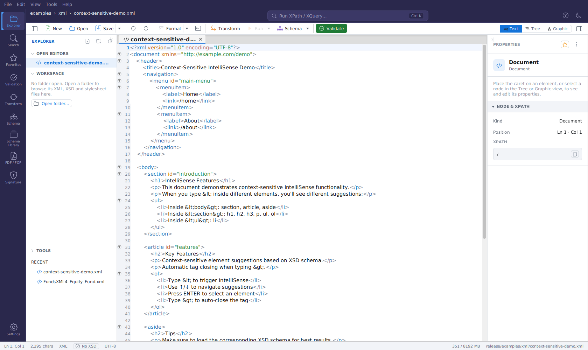
*The Unified Shell: activity bar (left), Explorer side panel, editor host with an XML file
(Text/Tree/Graphic view toggle), the Properties inspector (right) and the status bar.*

### Layout

| Area | Purpose |
|------|---------|
| **Activity bar** (far left) | Switch tools / side panels: Explorer, Search, Favorites, Validation, Transform, Schema, Schema Library (its label wraps onto two lines), PDF/FOP, Signature, Settings - plus a **FundsXML** activity when the optional [FundsXML extension](fundsxml-extensions.md) is enabled (see [FundsXML Panel](#fundsxml-panel)). **Always visible** - it cannot be collapsed. (**Settings**, **Schema Library** and **Signature** open as a full page in the editor area - see [Settings Page](#settings-page), [Schema Library Page](#schema-library-page) and [Signature Page](#signature-panel). Help is not an activity - it is the **Help** menu, see [Help Menu & About](#help-menu-about).) |
| **Menu bar** (very top) | **File / Edit / View / Tools / Help** - every action of the toolbar, the Activity Bar and the keyboard shortcuts in one place (see [Menu Bar](#menu-bar)). On macOS it is the system menu bar at the top of the screen. |
| **Header bar** (top) | The breadcrumb (application / active file), a centered **search pill** (*"Run XPath / XQuery…"*, shortcut **Ctrl+K**) that opens the bottom [Query Console](#query-console) when clicked, the **?** button (opens the [Help menu](#help-menu-about) as a popup - same as **F1**) and the Theme button. |
| **Side panel** | The panel for the selected activity (e.g. the Transform panel, the Validation panel). **Resizable and collapsible** (see [Resizing and collapsing the side panels](#collapsing-the-side-panels)). |
| **Editor host** (center) | Tabs of open documents, each with the Text, Tree and Graphic view modes - plus a rendered **Preview** for HTML documents (see [View Modes](#view-modes)). |
| **Inspector** (right) | View **and edit** the selected node's properties from any view. **Resizable and collapsible** (see [Resizing and collapsing the side panels](#collapsing-the-side-panels)). Hidden automatically while a page without a document (Settings, Schema Library, Signature, reports, tool tabs) is selected. |
| **Status bar** (bottom) | Caret position (Ln/Col), character count, file type, the XSD / IntelliSense indicator, the encoding label (the charset the file was read in and is saved in, e.g. UTF-8 or ISO-8859-1), the last recorded run (Developer feature), a memory indicator and the active file's path (see [Status Bar](#status-bar)). |

#### Resizing and collapsing the side panels {#collapsing-the-side-panels}

Both the **left side panel** and the **right Properties inspector** can be resized and
collapsed to give the editor more room - the activity bar always stays visible.

**Resizing** - the panels are not fixed-width:

- **Drag the thin divider line** between a panel and the editor to make the panel wider or
  narrower (the mouse pointer turns into a horizontal resize arrow over the divider). Widen
  the panel when file names, validation messages, or property values get truncated.
- Each panel keeps a **minimum width of 200 px**, and the editor in the middle always keeps
  at least **320 px** - you cannot drag a panel so far that the editor disappears.
- The chosen widths are **remembered across restarts** (per user).
- When you **resize the window**, the panels keep their pixel width - only the editor column
  grows or shrinks (the same behavior as VS Code).

**Collapsing** - each panel can also be hidden completely:

- **Collapse**: click the discreet collapse button at the panel's inner edge (a chevron
  pointing at a bar: `|<` on the left panel, `>|` on the inspector). The panel is hidden
  completely.
- **Re-open**: click the matching toggle button in the editor toolbar (left-most toggle, a
  sidebar icon, for the side panel; right-most toggle, a mirrored sidebar icon, for the
  inspector) - the same mechanism on both sides. Selecting any
  activity from the activity bar also re-opens the left side panel. A re-opened panel comes
  back at its **last dragged width**.
- The collapsed/expanded state is **remembered across restarts** and can also be changed under
  **Settings → Appearance → Layout** ("Show left side panel" / "Show Properties (inspector) panel").
- **The inspector only appears next to documents.** When you switch to a tab that is not a
  document - **Settings**, **Schema Library**, **Signature**, a report or another tool tab - the
  inspector hides automatically, so the page gets the full width. Its toggle button is greyed out
  on such tabs. As soon as you select a document tab again, the inspector comes back. Your own
  show/hide choice is not changed by this - if you had hidden the inspector, it stays hidden.

### Key Features

- **Multi-tab editing** - Open multiple files of different types in one view
- **Automatic file type detection** - Files are recognized by extension (.xml/.wsdl, .xsd, .xsl/.xslt, .xpl/.xproc, .xq/.xquery/.xqm/.xqy, .xpath, .sch/.schematron, .json/.jsonc/.json5, .html/.htm/.xhtml); anything else opens as plain text
- **View modes per document** - Text, Tree and Graphic, all over one shared model, plus a rendered **Preview** for HTML documents (see [View Modes](#view-modes))
- **Inspector editing everywhere** - edit node properties from the Text, Tree and Graphic views, not just one
- **Type picker with explanations** - the inspector's **Type** field and *Change Type…* in the
  diagram and tree context menus list the schema's own types and every XSD built-in datatype,
  and a side pane explains the highlighted one (see [Choosing a type](#type-picker))
- **Integrated XPath/XQuery** - a bottom [Query Console](#query-console) queries the active
  XML/JSON file right from the editor (Ctrl+Shift+X)
- **Editor toolbar actions** - run [Validate, Transform, Run, Generate Documentation and the Type
  Editor](#editor-toolbar-document-actions) for the active document without switching activities
- **Search & Replace** - Ctrl+F / Ctrl+H across the editor, in **every view mode**: the Text
  view searches the raw text, the Tree and Graphic views search the nodes themselves (names,
  documentation, attributes, enumeration and facet values, comments)
- **Find in Files & XPath search** - the **Search** activity
  (Ctrl+Shift+F) searches and replaces across **all files of a folder**, by plain text or
  by XPath expression (see [Search Panel](#search-panel))
- **Resizable side panels** - drag the divider lines to give the side
  panel or the Properties inspector more room; the widths are remembered across restarts
  (see [Resizing and collapsing the side panels](#collapsing-the-side-panels))
- **Favorites** - Quick access to frequently used files

### Colours: workflows and actions

Colour tells you two things at a glance, and the two never mix on one surface:

- **Which workflow you are in.** Every activity has its own accent colour: Explorer brand
  blue, Search indigo, Favorites amber, Validation green, Transform orange, Schema purple,
  Schema Library grape, PDF / FOP rose, Signature cyan, FundsXML teal. The colour appears only on the
  chrome that names the workflow: the bar next to the selected Activity-Bar icon, the panel
  title (VALIDATION, TRANSFORM, …), the panel's one primary button (Run Validation, Run
  Transform, Generate PDF, Validate Signature), the tint of the matching toolbar group, the
  icons of the Welcome page's task list and the "last run" badge in the status bar. Settings stays
  neutral, so the default view of the app looks as before.
- **What an action does.** Menu items and the action rows of the side panels colour their icon
  by the kind of action, in every editor and every view: green adds or creates (Add, Paste,
  Duplicate, Validate, Generate), red removes (Delete, Remove, Clear, Cut), orange edits in
  place (Rename, Edit value), cyan navigates to something that already exists (Go to
  Definition, Reveal, Find, opening a favorite or a generated PDF), purple changes structure
  (Change Type, Cardinality, Move Up/Down), blue runs a tool (Format, Sort, Save, Export,
  Download, "Open file…" with a file chooser) and grey is neutral (Copy, Expand/Collapse,
  Undo/Redo).

Result colours always win: a failed run shows a red icon on an orange Transform badge, a
passed validation a green check. Both layers switch with the light/dark theme:

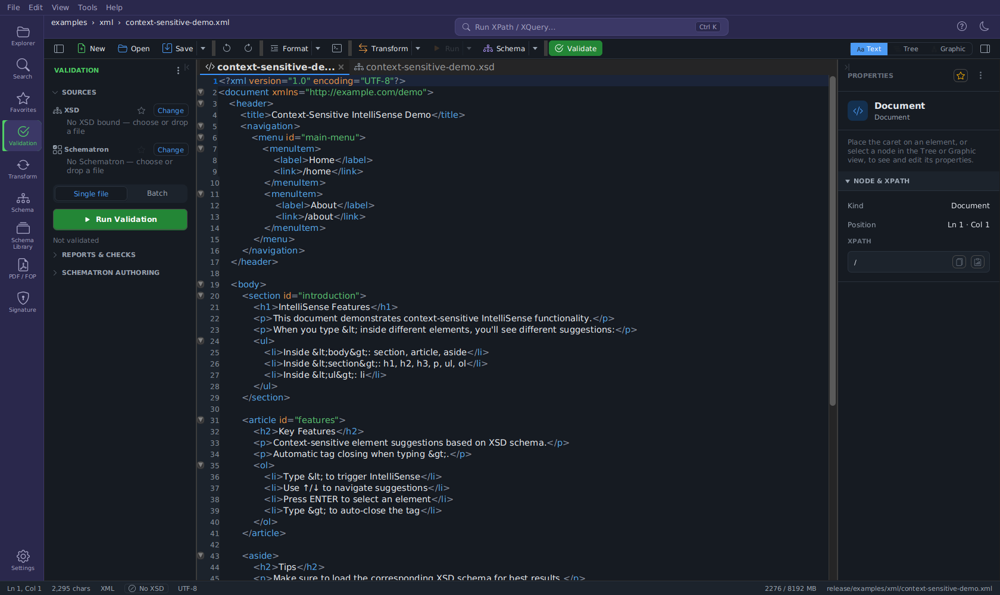

## Getting Started

1. The Unified Shell opens automatically on startup.
2. Use the **Explorer** activity (or **File → Open**) to open files; **File → New** (Ctrl+N) opens the guided [New File dialog](#new-file-dialog) to create a new file from a template or schema. You can also **drag & drop** files from your file manager anywhere onto the window - every [supported file type](#supported-file-types) (XML, XSD, XSLT, XProc, XQuery, XPath, Schematron, JSON, HTML) opens as a new tab; other files are ignored.
3. Files open as tabs in the editor host - switch tabs by clicking their headers (drag a header to reorder, right-click it for [tab actions](#editor-tabs)), and switch view modes (Text / Tree / Graphic - plus **Preview** for HTML files) with the segmented view switch.

After the first start, a small **Anonymous usage statistics** notice appears once in the
bottom-right corner of the window. It explains that FreeXmlToolkit sends anonymous usage
statistics and error reports (never file names, paths or content). Click **OK** to continue,
**Settings…** to switch it off, or **What is sent?** to see the exact data. Nothing is sent
before you have acknowledged this notice. See [Privacy & Anonymous Telemetry](telemetry.md).

## New File Dialog

> Creating a new file opens a guided dialog instead of silently
> opening an empty, untitled document. You can pick a starting template or an XSD schema, so
> a new file already has a sensible structure.

The **New File** dialog opens whenever you create a new document - from the toolbar **New**
button (Ctrl+N), the **Explorer** panel's **New file** action, or the **New File** card on the
Welcome screen. It walks you through a few simple choices and then opens (and optionally saves)
the new document.

| Field | What it does |
|-------|--------------|
| **File type** | Choose **XML**, **XSD**, **XSLT**, **Schematron**, **JSON**, **XProc**, **XQuery**, **XPath**, or **HTML**. The rest of the dialog adapts to your choice. |
| **Template** | A list of available templates - the built-in library plus your own templates from Settings - **automatically filtered to the selected file type**. The default is **"— None —"** (start blank). Picking a parameterized template prompts you for its values when the file is created. |
| **Schema** | *(plain XML only, and only when no template is chosen.)* Pick an XSD to base the document on - from your **Favorites**, your **Recent files**, or **Browse…** to select a file. The chosen schema is also bound to the new document, so it appears in the Validation panel and drives IntelliSense. |
| **Pre-fill mandatory nodes (empty)** | *(shown with the Schema option, on by default.)* When a schema is selected, the new document is pre-populated with all required elements and attributes (left empty) generated from that schema, giving you a ready-to-fill skeleton. |
| **Save to** | *(optional.)* Choose a location with **Browse…** to write the file to disk immediately and open it. Leave it empty to open the document as an **untitled** tab - you will be asked for a location the first time you Save. |

### What you get

- **A template** is rendered into the new document (prompting for any parameters first).
- **XML with a schema and "Pre-fill mandatory nodes"** produces a skeleton containing every
  mandatory element and attribute from that schema.
- **Otherwise** you get a minimal, valid starting point for the chosen type: an XML declaration
  for XML, an `xs:schema` skeleton for XSD, an `xsl:stylesheet` (version 3.0) skeleton for
  XSLT, an ISO-Schematron skeleton for Schematron, `{}` for JSON, a `p:declare-step`
  skeleton (with `source`/`result` ports and `p:identity`) for XProc, an
  `xquery version "3.1";` prolog for XQuery, and a minimal HTML5 page skeleton for HTML.

## View Modes

> The segmented view switch offers the **Text**, **Tree**, and **Graphic** view
> modes - each with its own icon - plus, for **HTML documents only**, a rendered read-only
> **Preview** (eye icon) - the Preview segment only appears while an HTML document is
> active. There is no separate **Grid** mode - the grid is part of
> **Graphic**.

Every document tab offers the same view modes:

| Mode | What it shows |
|------|---------------|
| **Text** | Source code editing with syntax highlighting |
| **Tree** | The document as a hierarchical tree |
| **Graphic** | A visual editor that depends on the document type: for **XML**, **XSLT**, **Schematron** and **JSON** files it shows the editable XMLSpy-style **grid**; for **XSD** files it shows the **schema diagram** |
| **Preview** | *(HTML documents only.)* The page rendered read-only in an embedded web view - see [HTML Preview](#html-preview) |

All views share one in-memory model per document, so edits and Undo/Redo history are preserved
when you switch views.

### The Grid (Graphic view for XML)

When an XML-instance document (XML, XSLT, or Schematron) is in the **Graphic** view, the editor
shows the editable grid, laid out like XMLSpy's Grid View:

- A **header strip** at the top reads *"Grid view · nested · repeating elements as embedded
  grids"* and offers the **zoom pill** (`− 100% +`), **Optimal widths**, the **Wrap** toggle,
  **Expand all** / **Collapse all**, and a **⋯** menu with the cell-height limit.
- **Nested containers.** Every element is a row with a **name cell** (expand arrow, type icon,
  bold name) and, to its right, either its **value cell** or the **block** of its children. A
  child block is docked at the parent's value column, so the structure reads as nested boxes;
  an expanded container's name cell spans its whole child block. Each block has its own
  name-column width (the widest name in it).
- **Type icons** follow XMLSpy: `<>` element, `=` attribute, `Abc` text, `[ ]` CDATA, `<!`
  comment, `<?` processing instruction. Colours come from the application theme (light/dark).
- **Attributes always show** as `=` rows directly beneath their element - also while the
  element itself is collapsed.
- **Collapsed containers show a grey one-line preview** of their content (the markup without
  whitespace, cut off with "…"); hovering the preview shows a longer excerpt as a tooltip.
- **Counts.** A container's name is followed by its child count `(n)`; a repeating group shows
  the number of its members and a small table glyph.
- **Nothing is cut off.** Values take the width their content needs; long values **wrap** onto
  further lines (the row grows). Very wide content is reached with the horizontal scrollbar
  (Shift+wheel).
- **Zoom** the whole grid - text, rows, icons and embedded tables - with **Ctrl+mouse wheel**,
  **Ctrl +** / **Ctrl −** (10 % steps, 50-300 %) or the `−`/`+` buttons; **Ctrl 0** or a
  click on the percentage resets to 100 %. The zoom factor is remembered across files, XML
  and JSON grids and restarts.
- **Repeating elements** (two or more siblings with the same name) are rendered as an
  **embedded table beside the group's name cell**: one row per element (numbered in the
  first column), one column per attribute (`=`) and child element (`<>`). Click the small
  **arrow at the right of a column header** to **sort** the group (also: **Sort Column** in the
  context menu); cells with nested structure expand inline.
- **Open whole rows and columns.** Click a **row number** to select the whole row, click a
  **column header** (its name, not the arrow) to select the whole column; **Shift+click**
  extends to more rows or columns. Then press **+** to open the nested cells of the selection
  one level, and again for the next level inside them; **−** closes the deepest open level
  first, then the cells. The same entries are in the **Table** submenu (**Expand / Collapse
  Selected Cells**). Without a table selection, **+** / **−** open and close the selected
  grid rows one level. Open cells stay open after edits.
- **Table or rows.** The small table glyph after the group's name (or the context menu's
  **Display as Table**) switches the group between the table and XMLSpy's standard display,
  where every member is its own row numbered `<1>`, `<2>`, … The choice is kept per group
  while the document is open.
- **Flip Rows/Columns.** The corner cell of a table (or the context menu entry) transposes
  it: the columns become rows and the numbered members become columns - handy for wide
  tables with few rows. Sorting, editing and the inline sub-trees keep working.
- **Whole rows and columns.** Right-click inside a table for the **Table** submenu: **Insert
  Row Before / After** and **Append Row** add a member with every column present but empty;
  **Insert Column Before / After…** adds an attribute (type `@name`) or a child element
  (`name`) to every member; **Rename Column…** (also: double-click a column header) renames
  it in every member. Each of these is one undo step. Typing into an empty cell whose
  member lacks that child element creates the element. **Drag a column header** onto another
  header to move that column - a blue line shows where it lands; the child element (or
  attribute) moves in every member, one undo step. Attributes move only among attributes.
- **Cell colours.** *Settings → Editor → Grid table colours* sets your own colours for table
  headers, missing cells, the selection and the focus frame - separately for the light and the
  dark theme (switch the theme to set the other one). Open grids repaint at once; switching the
  option off returns to the theme colours.
- **Spreadsheet exchange.** Click a table cell to select it, **Shift+click** another cell
  (or a row number) to select a range, **Ctrl+A** selects the whole table. **Ctrl+C** copies
  the selection as tab-separated text (the whole table with a header line); the context menu
  offers **Copy Table as Tab-separated Text**. Copy a range in Excel or LibreOffice, select a
  table cell and press **Ctrl+V**: the values fill the table from that cell to the right and
  down, overwriting existing cells; extra rows become new elements. One undo step.
- **Column widths.** Name columns and table columns size themselves to their content. Drag
  the hairline between a name column and its values (or a column separator in a table's
  header row) to resize it - text re-wraps to the new width - and **double-click the line**
  to return to automatic sizing. Each nested block has its own name-column width. **Optimal
  widths** in the header resets every column at once. Dragged widths survive edits and undo.
- **Wrap** (header toggle, remembered across restarts) switches word wrap off: every value
  stays on one line and the grid grows to the right instead. The **⋯** menu limits the
  **cell height** to 3, 6 or 12 lines (longer values end with "…"), also remembered.
- **Keyboard navigation** works as soon as the view opens (no click needed):
  **↑/↓** walk the rows, **→** expands a collapsed element, **←** collapses it (or jumps to
  the parent), **Space** or **Enter** toggles a container (on a leaf row Enter starts renaming it),
  **Home/End** jump to the first/last row, **F2** renames, and the usual **Ctrl+C/X/V**,
  **Ctrl+D** (duplicate) and **Delete** act on the selected node.
- **Several rows at once.** **Ctrl+click** adds or removes a row from the selection,
  **Shift+click** selects every sibling between the selected row and the clicked one.
  **Shift+click on the arrow** of a selected row expands or collapses all selected rows.
- **Expand Fully** (**Ctrl+Shift++**) opens the selected container with everything below it;
  **Collapse Unselected** (**Ctrl+Shift+−**) folds every container except the path to the
  selection. Both, plus **Expand All / Collapse All**, are in the context menu. The expanded
  state and the selection survive edits, undo and sorting (rows are tracked by their XPath).
- **Editing every node kind.** Double-click a value to edit it - also comments, CDATA sections
  and processing instructions; double-click the name of an attribute or a processing
  instruction to rename it. **Click the type icon** of a row (or press **Ctrl+Alt+T**) to
  change the node's type - element, attribute, text, CDATA, comment or processing instruction;
  name and value are kept, attributes move into their element's attribute list. Containers
  with child elements keep their type. **Wrap in Element…** (**Ctrl+Alt+W**, context menu)
  puts a new parent element around the selected node. **Edit as Raw Text…** (**Ctrl+Alt+R**)
  opens the selected element's content as markup (entities unresolved) and parses it back;
  not well-formed markup is reported and the editor reopens. All of these are undoable.
- **Sibling groups** for very large files (**⋯** menu → *Sibling groups: 100 / 1,000 / 10,000
  nodes*, remembered): an element with more children than that shows them in collapsed groups
  such as `record <1001..2000>`; opening a group closes the other groups of the same element.
- **Validation markers.** After a validation (Validation panel), rows whose element has a
  problem show a red **!** at the end of the name cell and a red value; hover the row for the
  message. Problems inside a repeating group mark the member's row number. The markers clear
  on the next grid edit and come back with the next validation.
- **Split view.** The header's **⋯** menu splits the grid *top / bottom* or *side by side* into
  two views of the same document; each scrolls, expands and selects on its own, and an edit in
  one appears in the other at once. *Single view* closes the second one.
- **Entry helpers.** The header's panel button (right of *Collapse all*) opens the entry
  helpers beside the grid, as in XMLSpy. They need an XSD bound to the document and follow the
  selected row. **Siblings** lists the attributes and elements the schema allows next to the
  selected node, **Children** lists those allowed inside the selected element, and **Values**
  lists the enumeration values of the selected element or attribute. Entries that are already
  there and cannot occur again are greyed out. Required ones (`use="required"`, `minOccurs` ≥ 1
  outside an optional or choice group) carry a red **!**. A double-click inserts:
  - Siblings: after the selected node; the buttons insert before it or append at the end.
  - Children: as the last child of the selected element. An attribute starts with its schema
    default.
  - Values: sets the value.

  Every insertion is one undo step. The panel stays open or closed across sessions.
- **Scroll header.** While you scroll through a long element, a bar at the top shows the
  path of containers you are inside (`root › section › body`); click one to select it and
  scroll back to its start.
- **Drag & drop.** Drag a node by its name cell: drop it on the upper or lower third of another
  name cell to place it before / after that node, on the middle (or anywhere in an expanded
  element's cell) to append it as a child. A blue line or frame shows the target; hold **Ctrl**
  to copy instead of move. Text dragged in from other applications replaces a value when dropped
  on a value cell; dropped on a name cell, an XML fragment becomes new nodes and plain text a
  text node. A node is never dropped into its own subtree; every drop is one undo step.
- **Filters.** Right-click an element → **Filter…** and enter an XQuery 3.1 expression evaluated
  with that element as context, e.g. `Month[number(Min) > 10]`: below the element only the
  matching nodes (with their ancestors and subtrees) stay visible, repeating groups shrink to
  their matching members. A blue funnel line under the element shows the expression - click
  the funnel to switch the filter off and on, double-click the line to edit it, clear it to
  remove the filter. **Filter to Focus** filters the root down to the selected node. Filters
  only change the display, never the document; an invalid expression is reported and
  filters nothing. Filters live while the document is open.
- **Formulas.** Right-click an element → **Add Formula…**: a name and an XQuery 3.1 expression
  evaluated with that element as context (e.g. `avg(Month/Min)`). The formula row (icon `ƒ`)
  shows the expression and, below it, the live result - or the error in red; double-click the
  expression or the name to edit it. Formulas are saved in the file as
  `<?fxt-formula name="…" expression="…"?>` instructions. **Store Formula Result in Document**
  also writes the result into an element named after the formula, right after it;
  **Recalculate Stored Formula Results** refreshes all of them in one undo step.
- **Search** (Ctrl+F) finds names and values in the rows and in the cells of embedded tables;
  a table hit expands the group and selects the matching cell.
- **Copy XPath / Copy Node**: the grid's context menu offers **Copy XPath** (**Ctrl+Alt+X**),
  **Copy Cell Content** (**Ctrl+Shift+C**) and **Copy Node (XML)** (**Ctrl+Alt+C**); all three
  shortcuts also work directly on the selected node. **Ctrl+Shift+X** toggles the Query
  Console everywhere, including while the grid has focus.

### The Grid (Graphic view for JSON) {#json-grid}

JSON documents (`.json`, `.jsonc`, `.json5`) get the **same grid** in the **Graphic** view -
same header strip, same rows, same keyboard shortcuts and context menu - so a JSON file
looks and feels exactly like an XML file in the grid:

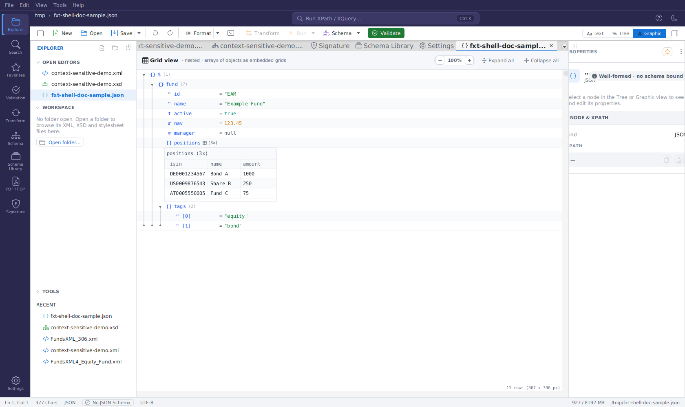

- The **root** value is the `$` row; **object properties** and **array items** (`[0]`, `[1]`, …)
  are the rows beneath it. Objects and arrays are collapsible containers showing their child
  count; scalar properties show as `key = value` rows.
- Every row carries a **type glyph** in its own colour: `{}` object, `[]` array, `"` string,
  `#` number, `T`/`F` boolean and `∅` null. **Strings are shown quoted** (`= "Alice"`) - like
  XML leaf values - so `"42"` and `42` are never confused.
- **Arrays of objects** are rendered as **embedded grids** (a table with one column per key,
  merged across all items), exactly like repeating elements in XML. The arrow in a column
  header **sorts** the array (numbers, dates and strings are recognised), nested objects expand
  inline; a click on the header's name selects the column, **+** / **−** open and close its
  nested objects level by level, as in XML.
- **Inline editing** keeps the value's type: double-click a number and type a number
  (anything else is rejected with a hint and the editor stays open), booleans toggle between
  `true`/`false`, `null` stays `null` unless you type text. Double-click a key to rename it
  (duplicate keys are refused).
- The context menu mirrors the XML one: **Add** (Property / Array Item / Sibling Before /
  After), **Rename Key** (F2), **Duplicate** (Ctrl+D), **Copy / Cut / Paste as Sibling /
  Paste as Child**, **Copy Cell Content**, **Copy JSONPath** (Ctrl+Alt+X - e.g.
  `$.items[1].name`), **Copy Node (JSON)** (Ctrl+Alt+C), **Change Type** (String / Number /
  Boolean / Null / Object / Array), **Move Up / Down** (Alt+↑/↓), **Expand Fully / Collapse
  Unselected**, **Display as Table**, **Flip Rows/Columns**, **Copy Table as Tab-separated
  Text**, **Expand All / Collapse All**, **Sort Column** and **Delete**. Copy Cell Content is
  Ctrl+Shift+C, as in the XML grid.
- All edits go through the document's **undo history** (Ctrl+Z / Ctrl+Y) and are written back
  into the text - the Text, Tree and Graphic views share one model, and the **Properties**
  inspector edits keys and values from any of them.
- **Same layout and controls as the XML grid.** Objects and arrays are nested blocks with
  one-line previews when collapsed; the header strip offers the **zoom pill**, **Optimal
  widths**, **Wrap**, **Expand all** / **Collapse all** and the **⋯** menu (cell-height limit,
  sibling groups); name and table columns can be dragged to a new width (double-click to
  auto-fit). **Expand Fully** (Ctrl+Shift++) and **Collapse Unselected** (Ctrl+Shift+−),
  **Display as Table** / **Flip Rows/Columns** for arrays of objects, the scroll header and
  the search in table cells all work as described above. Table cells can be selected and
  copied as tab-separated text (Ctrl+C or **Copy Table as Tab-separated Text**); Ctrl+V
  overwrites existing cells only. The zoom factor is shared with the XML grid.
- **Change a value's type** by clicking its type glyph (or Ctrl+Alt+T on the selected row):
  a popup lists the other types. Number ↔ String ↔ Boolean ↔ Null convert the value
  (`"42"` → `42`); Object and Array start empty. One undo step.
- **Drag & drop:** drag a row by its name cell onto another row - the upper part of the name
  cell inserts **before** it, the lower part **after** it, the middle of an object or array
  **into** it; hold **Ctrl** to copy instead of move. A property moved into another object
  keeps its key (made unique with `_copy` if it is taken); an item moved into an object gets
  the key `item`. JSON text dragged in from another application becomes a new value (an
  object dropped into an object adds its properties), plain text a string; dropped on a value
  cell it replaces the value. A node can never be dropped into itself.
- **Table** submenu (right-click a cell of an array-of-objects table): **Insert Row Before /
  After**, **Append Row** (a new object with every column as an empty string), **Insert
  Column Before / After…** (the key in every object, next to the clicked column) and
  **Rename Column…** (also a double-click on the column header; refused as a whole when an
  object already uses the new key). Each is one undo step.
- **XML only:** **Wrap in Element**, **Edit as Raw Text**, filters, formulas and validation
  markers.

!!! warning "Comments and JSON5 syntax are not preserved"
    The grid edits the parsed *model*. Comments (JSONC) and JSON5 syntax (unquoted keys,
    single quotes, trailing commas) are not part of it, so the **first grid edit rewrites the
    file as standard JSON**. The grid shows a warning the first time it opens such a file;
    if you need to keep the comments, edit in the Text view instead.

### HTML Preview (Preview view for HTML) {#html-preview}

HTML documents (`.html`, `.htm`, `.xhtml`) get their own **Preview** view mode - the eye
icon in the segmented view switch - that renders the page read-only, the way a browser
would show it:

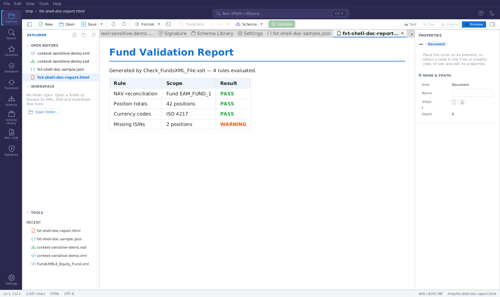

- **HTML files open in Preview by default.** Whether you open them from the Explorer, by
  drag & drop, or via the Open dialog, you see the rendered page first.
- **Editing happens in the Text view.** Switch to **Text** to change the markup, then
  switch back to **Preview** - it re-renders your current editor text, including unsaved
  changes.
- **Tree and Graphic are disabled for HTML documents**, because HTML output is often not
  well-formed XML.
- **Transform results render here too.** The OUTPUT panel's **Open result as editor tab**
  opens an HTML/XHTML transform result as an HTML document showing its Preview, and
  re-running the transform updates the open result tab live - see
  [The OUTPUT Panel](#the-output-panel-results).

!!! note "Preview limitations"
    - The page is rendered **without a base URL**, so **relative references** - external
      CSS files, images - do not resolve. **Inline styles render fine.** To view a
      transform result together with its external assets, use the OUTPUT panel's
      **Open in browser** action instead.
    - **Ctrl+F** in the Preview searches the document's underlying **markup text**, not
      the rendered page.
    - The Preview is **read-only** - all editing happens in the Text view.

## Every Picked File Opens in the Editor {#picked-files}

Whichever way you pick a file, it is loaded into the editor as a tab (an open tab is reused):
**File → Open…** and **Open Recent**, the Welcome page's recent list, the Explorer and Favorites
panels, drag & drop onto the window or onto a panel row, and on every page the **Change** /
**Choose…** dialogs, the **recent** menus (Transform clock icon, Explorer *Transform with Other
Stylesheet* / *Validate with Other Schematron*) and the favorites star menus.

- An **input** (Transform or PDF/FOP XML input) becomes the active tab.
- A **stylesheet** opens behind the active tab while the input follows the active document,
  and in front when the input is a fixed file.
- A **schema, Schematron, JSON Schema, catalog or query target** opens behind the active
  tab, so the document it applies to stays in front.
- On a page in the main area (Signature, Schema Library) the file opens behind the page.

Not loaded: keystores and trust stores (binary files), and spreadsheets for import (the
converted XML opens instead).

## Working with Editor Tabs {#editor-tabs}

- **Reorder tabs** by dragging a tab header left or right. The Explorer's
  [OPEN EDITORS](#explorer-panel) list follows the new order.
- **Right-click a tab** for a menu that acts on *that* tab, even if it is not the active one:

| Menu item | What it does |
|-----------|--------------|
| **Reload from Disk** | Reads the file again. If the document has unsaved changes, you are asked first. Not available for untitled documents. |
| **Close** | Closes the tab (asks to save unsaved changes). |
| **Close Others** | Closes every other tab. Each tab with unsaved changes still asks to save; **Cancel** stops closing the rest. |
| **Save** / **Save As…** | Saves the document. For an untitled document, **Save** works like **Save As…**. |
| **Copy Path** | Copies the file's full path to the clipboard. |
| **Reveal in File Manager** | Shows the file in Windows Explorer, the macOS Finder or your Linux file manager, with the file selected (if the file manager cannot select it, its folder opens). |
| **Reveal in Explorer Panel** | Opens the [Explorer](#explorer-panel) and selects the file in the workspace tree. If the file lies outside the current workspace, its folder becomes the workspace. |

Copy Path and the two Reveal items need a saved file, so they are disabled for untitled
documents. Tabs that show no document - tool tabs such as the Type Editor, a diff or a PDF
preview - only offer **Close** and **Close Others**.

## Files Changed Outside the Editor {#external-changes}

The shell watches the files of all open tabs. When another program changes or deletes one
of them, a dialog asks what to do - checked every two seconds while the FreeXmlToolkit
window is active, and immediately when you switch back to it.

| Situation | Choice | Result |
|-----------|--------|--------|
| **File changed on disk** | **Reload** | The tab shows the file's new content. Unsaved changes in that tab are discarded (the dialog warns you when there are any). Caret position and view mode (Text / Tree / Graphic) are kept. |
| | **Ignore** | The tab keeps its content and is marked as unsaved (**●**), because it now differs from the file. Saving overwrites the external change. You are not asked again until the file changes once more. |
| **File deleted on disk** | **Keep** | The tab stays open and is marked as unsaved (**●**). **Save** creates the file again. |
| | **Close** | The tab is closed, including any unsaved changes. |

Closing the dialog with **Esc** counts as **Ignore** / **Keep**. With several affected files
the dialogs appear one after the other, each with its tab brought to the front.

!!! note
    - Saving from the editor itself never triggers the dialog, and neither does a file that
      was merely touched or rewritten with identical content.
    - Changing a tab's file from elsewhere in the application - for example saving the right
      side of a diff, or exporting a result over a file that is open - is reported like any
      other outside change.
    - Untitled documents are not watched.

## Supported File Types

| Type | Extensions | Features |
|------|-----------|----------|
| **XML** | .xml, .wsdl | Text + graphic view, XSD/Schematron linking, IntelliSense, continuous validation |
| **XSD** | .xsd | Text + graphic view, Type Library, Type Editor, Schema Analysis, Documentation, Sample Data, Flatten |
| **XSLT** | .xsl, .xslt | XSLT editor + XML input + output preview, live transform, parameters, performance metrics |
| **XProc** | .xpl, .xproc | Pipeline editor (Text + Tree view), Run Pipeline via the embedded XML Calabash engine - see [XProc Pipelines](#xproc-pipelines) |
| **XQuery** | .xq, .xquery, .xqm, .xqy | Query editor with highlighting + IntelliSense, Run Query against a selectable target - see [Query Documents](#query-documents-the-target-selector) |
| **XPath** | .xpath | Single-expression query editor, Run Query against a selectable target - see [Query Documents](#query-documents-the-target-selector) |
| **Schematron** | .sch, .schematron | Code editor + Visual Builder + Tester + Documentation Generator |
| **JSON** | .json, .jsonc, .json5 | Text + tree + editable **grid** view (see [The Grid for JSON](#json-grid)), JSONPath queries, JSON Schema validation. The JSON/JSONC/JSON5 flavor is detected from the content, so comments and trailing commas are accepted in any of the three. |
| **HTML** | .html, .htm, .xhtml | Rendered read-only **Preview** (the default view) + Text editing; also the format of HTML/XHTML transform results opened as editor tabs - see [HTML Preview](#html-preview) |

## Menu Bar {#menu-bar}

The menu bar offers every shell action by name, with its keyboard shortcut next to it. Items that
do not apply to the active document are greyed out (e.g. **Type Editor** is only available for XSD
schemas, **Save** needs an open document).

| Menu | Contents |
|------|----------|
| **File** | New…, Open…, Open from URL…, **Open Recent** (the last opened files), Close Tab, Save, Save As…, Save All, Settings…, Exit (Ctrl+Q; asks to save unsaved changes first) |
| **Edit** | Undo, Redo, Find…, Replace…, Find in Files…, Replace in Files…, Format Document, Minify, Insert Template… |
| **View** | The view modes (Text / Tree / Graphic / Preview), Side Panel, Properties Inspector, Query Console, Favorites Panel, **Activities** (jump to any activity), Toggle Light / Dark Theme, Full Screen |
| **Tools** | Validate, Run, Transform with XSLT…, Debug with XSLT… (Shift+F5), Toggle Breakpoint (F9), Set Schema…, Generate Documentation…, Type Editor, Compare with File…, Spreadsheet Converter…, Add to Favorites |
| **Help** | Documentation, Keyboard Shortcuts, FundsXML Website and FundsXML Schema Docs (only while the [FundsXML extension](fundsxml-extensions.md) is enabled), Report a Problem… (when error reporting is enabled), GitHub Repository, Sponsor this Project, Check for Updates…, About FreeXmlToolkit - see [Help Menu & About](#help-menu-about) |

### macOS

On macOS the menus appear in the **system menu bar** and follow the platform conventions:

- The **FreeXmlToolkit** application menu holds **About FreeXmlToolkit**, **Check for Updates…**,
  **Settings…** (**Cmd+,**), **Hide FreeXmlToolkit** (**Cmd+H**), **Hide Others**, **Show All** and
  **Quit FreeXmlToolkit** (**Cmd+Q**). These items are therefore not repeated in File and Help.
- A **Window** menu offers Minimize, Zoom and Bring All to Front.
- All shortcuts use **Cmd** instead of Ctrl. Because **Cmd+H** hides the application, **Find and
  Replace** is **Alt+Cmd+F** on macOS; full screen is **Ctrl+Cmd+F** (F11 works too).

## Toolbar

> The editor toolbar is a **single slim row**. Related actions sit in **split buttons**
> with a visible **▾** arrow menu: **Save As / Save All** live under **Save ▾**, **Minify**
> under **Format ▾**, **Run Query / Run Transform / Run Pipeline** under **Run ▾**, and
> **Set XSD Schema… / Generate Documentation… / Type Editor…** under **Schema ▾**.

The toolbar shows only what you can use right now. **Without a document** - on the Welcome
page, or while a page such as **Settings**, **Signature** or **Schema Library** is in front - it
shows just **New** and **Open**; the document groups (Save, Undo/Redo, Format, Query Console,
Transform, Run, Schema, Validate) and the **Text / Tree / Graphic** view switch are hidden
rather than shown greyed out. They come back as soon as a document tab is active.

There is no hidden "overflow" menu. Less frequent tools - **Insert Template…** (Ctrl+T),
**Compare with File…** and **Spreadsheet Converter…** (Ctrl+E) - are in the
[Menu Bar](#menu-bar) (**Edit** and **Tools** menus) instead of the toolbar; their shortcuts
work as before. Only when the window gets very narrow does the row wrap onto a second line as a
fallback. The toolbar groups its actions three ways:

### Labeled buttons (frequent actions)

- **New** (Ctrl+N) - Open the guided [New File dialog](#new-file-dialog) to create an XML, XSD, XSLT, Schematron, JSON, XProc, XQuery, XPath, or HTML file from a template or schema
- **Open** (Ctrl+O) - Open one or more files
- **Validate** (F8) - Validate the active document; this is the toolbar's primary action and the only filled button in the row - it is filled in the green of the Validation workflow (see [Colours: workflows and actions](#colours-workflows-and-actions)). XML validates against the bound XSD/Schematron if one is set, otherwise for well-formedness.

### Split buttons (click the ▾ arrow for related actions)

Clicking the button itself runs the main action; clicking the small **▾ arrow** opens a menu
with the closely related actions:

| Split button | Primary click | Arrow (▾) menu |
|--------------|---------------|----------------|
| **Save** | Save the current tab (Ctrl+S) | **Save As…** (Ctrl+Shift+S) - save under a new name (the file chooser is pre-set to the tab's file type) · **Save All** - save every open tab at once |
| **Format** | Pretty-print the active document (Shift+Alt+F; note: **Ctrl+Shift+F** opens the [Search panel](#search-panel), not document search). XML is indented by two spaces per level and every start tag stays on one line, however many attributes it carries | **Minify** - remove all insignificant whitespace |
| **Run** | Run the active document against the selected **Input** (Ctrl+Enter) - the primary click automatically runs whichever action the active file type supports | **Run Query** (XPath/XQuery) · **Run Transform** (XSLT) · **Debug Transform** (XSLT, Shift+F5 - the active stylesheet in the [debugger](#xslt-debugger)) · **Debug Query** (XQuery, Shift+F5 - the same debugger on a query) · **Debug Schematron** (Schematron, Shift+F5 - the debugger on the Schematron's checks, against the selected Input; the primary click on a Schematron tab) · **Run Pipeline** (XProc) |
| **Transform** | **Transform with XSLT…** - opens the [Transform panel](#transform-panel) on the active XML document, asks for a stylesheet if none is set, and runs it there (result in the OUTPUT panel) | **Transform with XSLT…** · **Debug with XSLT…** (Shift+F5) - the same, but in the [debugger](#xslt-debugger) |
| **Schema** | **Set XSD Schema…** - bind an XSD to the active document for IntelliSense and validation | **Set XSD Schema…** · **Generate Documentation…** (HTML/PDF/Word for the active XSD) · **Type Editor…** (edit a named type of the active XSD) · **Generate XSD from XML** (infer a schema from the active XML document) · **Generate XSD from XML Files…** (infer one schema from several XML files) |

- **Transform** is a split button, see above: the primary click transforms, the ▾ arrow offers **Debug with XSLT…**

### Icon-only buttons (hover for the tooltip)

- **Undo** (Ctrl+Z) / **Redo** (Ctrl+Y)
- **Query Console** - Shows / hides the bottom XPath/XQuery console (terminal icon). **Ctrl+Shift+X**
  shows or hides it; **Ctrl+K** (and the header's *Run XPath / XQuery…* pill) opens it and puts the
  cursor in the query.

### Type-gating and the Input dropdown {#type-gating-and-the-target-dropdown}

The document actions act on the **active document** and are **enabled only when they apply to
its type** (greyed out otherwise) - this covers **Validate**, **Transform with XSLT…**, the
**Run** button and its menu entries (and **Tools → Run** / **F5**), and the Schema menu's **Generate Documentation…** /
**Type Editor…** / **Generate Sample XML…** (also in **Tools**). The **Input** dropdown (labelled *"Input: …"*, formerly *Target*) appears next to **Run** only while a query, XSLT, or
XProc document is active and selects the XML document the run works on. See
[Editor Toolbar Document Actions](#editor-toolbar-document-actions) and
[Query Documents & the Input Selector](#query-documents-the-target-selector) below.

## Panel Toggles

- **Side panel** (Ctrl+L) - Show/hide the left side panel (the active activity's Explorer,
  Validation, Transform, Schema, … panel); the same as the collapse button (`|<`) at the panel's inner edge
- **Query Console** (Ctrl+Shift+X) - Show/hide the bottom XPath/XQuery query console (terminal
  icon in the editor toolbar). See [Query Console](#query-console) below.
- **Properties** (Ctrl+Shift+P) - Show/hide properties and validation sidebar. For XML files,
  the properties inspector lets you view **and edit** a node's properties (element name,
  namespace, attributes, and text content) from **all three** views - Text, Tree, and Graphic
  (the grid). For XSD files, the same inspector lets you edit a schema node's
  properties from **all three** XSD views - Text, Tree, and Graphic. See
  [Properties Inspector](#properties-inspector) below.
- **Favorites** (Ctrl+Shift+D) - Show/hide the favorites panel (Ctrl+D adds the active document to favorites)

## XSD Views & Tools

When editing an XSD file, the editor host and the **Schema** activity provide:

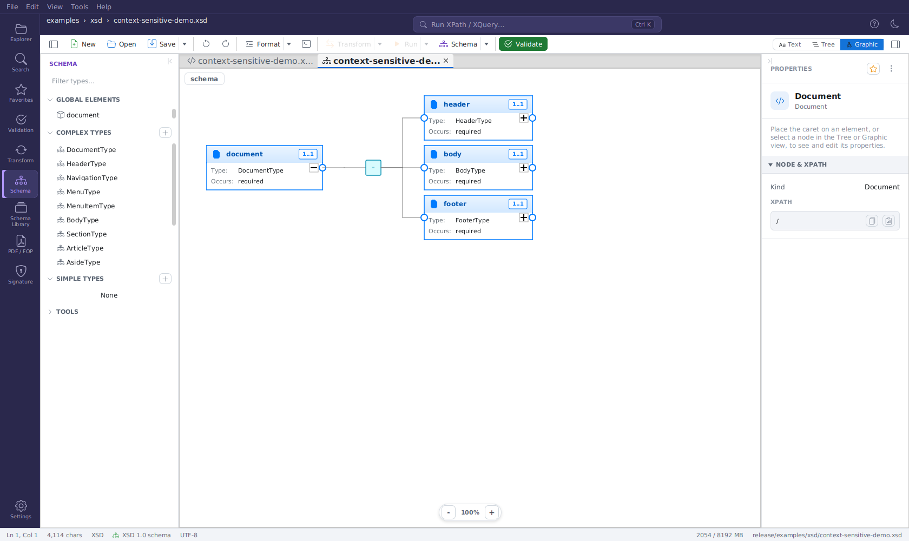
*An XSD open in the Graphic view, with the Schema activity panel (Type Library, Flatten,
Schema Analysis, Generate Sample XML / Documentation) on the left.*

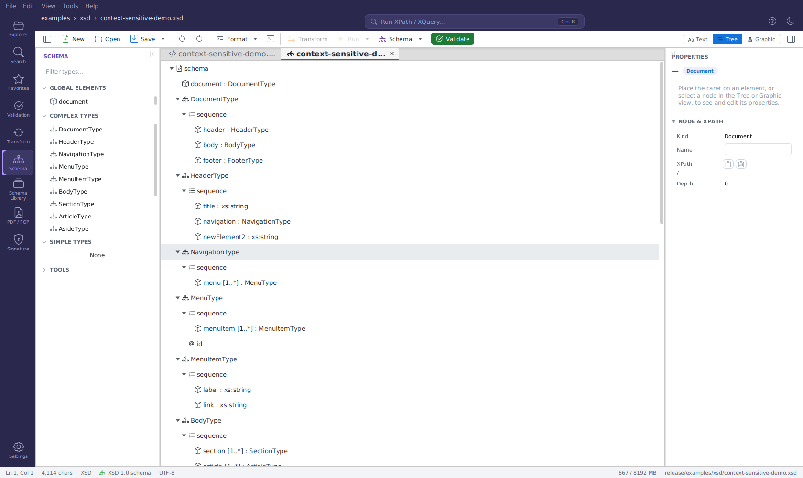
*The same schema in the Tree view - select a node to edit its properties in the inspector.*

- **Text** - Source code editing with syntax highlighting; moving the caret into a schema construct also lets you edit its properties in the Properties pane (see [Properties Inspector](#properties-inspector))
- **Graphic** - Visual XMLSpy-style schema diagram; drag cards to move nodes, hold Ctrl (Cmd on macOS) to copy (see [Moving and Copying by Drag and Drop](xsd-tools.md#drag-and-drop-in-the-diagram))
- **Type Editor** - Edit ComplexTypes graphically, SimpleTypes with form editor
- **Analysis** - The **Schema Analysis** tool tab: statistics incl. complexity metrics, unused types / groups and circular references, a Types tab with usage locations and "Remove unused", quality checks with score, identity constraints, XPath validation - every finding reveals its node in the Tree view, and the whole report exports as CSV / JSON / HTML / PDF / Excel (see [Schema Analysis](xsd-tools.md#5-schema-analysis))
- **Documentation** - Generate HTML/Word/PDF documentation (see below)
- **Sample Data** - Generate sample XML from the schema
- **Flatten** - Merge included schemas into a single standalone file. The **Flatten Schema…** button opens an options dialog first: strip annotations, strip XML comments, remove unused global types and groups, and minify the output — all checked by default for a minimal schema suited to server-side validation; uncheck everything for a plain flatten that keeps documentation. Imports (`xs:import`, different namespaces) are never merged. See [XSD Flattener](xsd-tools.md#8-xsd-flattener) for details.

!!! note "Missing imported schemas resolve automatically"
    If a schema's `xs:import` points to a file that is not found next to the schema, the
    toolkit looks it up in the Schema Library and your XML catalogs, then in the schema
    cache, and finally downloads it from the declared or namespace URL into the cache -
    so the imported types still appear in the Tree and Graphic views, even offline on
    later loads. Nested imports inside imported schemas are followed too, and your own
    schema files are never modified. See
    [Automatic Resolution of Imported Schemas](xsd-tools.md#automatic-resolution-of-imported-schemas).

### The Schema Panel

The **Schema** activity's side panel lists the active schema's top-level declarations,
grouped into **GLOBAL ELEMENTS**, **COMPLEX TYPES**, and **SIMPLE TYPES** (collapsible
sections), with a **filter field** on top. Click a declaration to reveal it in the Tree
view; double-click a type to open it in its dedicated **Type Editor** tab; right-click for
**Reveal in Tree / Open Type Editor / Find Usage**. The **+** button in the COMPLEX TYPES and
SIMPLE TYPES headers declares a new type and opens it in its Type Editor
(see [Creating a New Type](xsd-tools.md#creating-a-new-type)). The schema tools (Generate Sample XML…, Sample XML with Options…, Flatten Schema…,
Schema Analysis, Generate Documentation…) are **labelled rows in the TOOLS section below
the type lists** - each row shows an icon and the tool's name, so nothing hides behind a
tooltip. TOOLS starts collapsed; click its header to expand it.

**Generate XSD from XML** (infer a schema from the active XML document) and **Generate XSD
from XML Files…** (infer one schema from several XML files) are not in the Schema panel -
they are in the editor toolbar's **Schema ▾** split menu.

The **whole panel is a drop zone**: drop an `.xsd` file from your
file manager anywhere on it to **open that schema as a document** - the panel then shows
its declarations. Unlike the picker drop targets elsewhere in the shell, this drop
*opens* the file rather than binding or selecting anything. While dragging, the panel
shows a **dashed green border** with a soft tint for an `.xsd` file and a **dashed red
border** for any other extension - a red drop is rejected and does not open the file.

### Documentation Generator (editor area)

**Generate Documentation…** (Schema panel **TOOLS** section or the editor toolbar's **Schema ▾** menu) opens the generator as
a tab in the main editor area with the full option set:

- **SOURCE & OUTPUT** - the XSD (the active schema is pre-filled) and the output folder
  (HTML) or file (PDF/Word).
- **FORMAT** - HTML, PDF, or Word.
- **OPTIONS** - **Markdown rendering** (*All documentation*, *Per node (`@markdown`)*, or
  *Off*), type definitions in source code, documentation in diagrams, SVG overview page,
  metadata, the diagram image format (SVG/PNG/JPG), and a **favicon** (.ico/.png/.svg)
  embedded into the generated HTML site. See
  [Generation Options](xsd-tools.md#generation-options) for what the Markdown settings do.
- **PDF/WORD OPTIONS** *(shown for those formats)* - page size (A4/Letter/Legal, PDF also
  A3), orientation, and the content building blocks (cover page, table of contents, data
  dictionary, schema/element diagrams). PDF additionally offers the **color scheme**
  (Blue/Green/Purple/Grayscale/Professional), a **watermark** (Draft/Confidential/Internal
  Use Only), page numbers, and PDF bookmarks.
- **LANGUAGES** - **Scan languages** discovers the `xml:lang` documentation languages in
  the schema; pick which to include and the fallback language.
- **PROGRESS** - the right-hand log streams the pipeline's task messages live while
  generating; the run can be **cancelled**, and the result can open automatically.

## Query Documents & the Input Selector {#query-documents-the-target-selector}

> XPath and XQuery files are first-class editor documents: open a
> `.xq` or `.xpath` file (or any file from `examples/xpath/` and `examples/xquery/`),
> press **Run Query**, and read the result in the OUTPUT panel - no console or panel
> switching required.

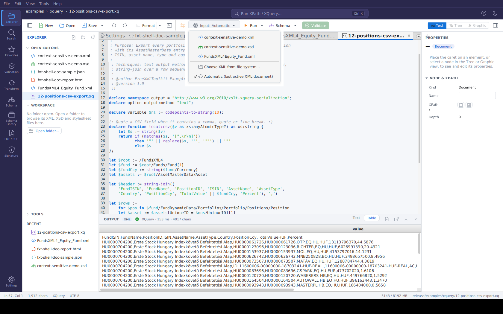
*An XQuery document from `examples/xquery/` with the **Input** dropdown open: pick an
open XML-family document, a file from disk, or Automatic (the most recently active XML
document, here checked). Below, the OUTPUT panel shows the query's CSV result.*

### Query documents

`.xq`, `.xquery`, `.xqm`, `.xqy` (XQuery) and `.xpath` (XPath) files open in a dedicated
query editor with XPath/XQuery syntax highlighting and the same context-aware
[autocomplete](#xpath-xquery-autocomplete) as the Query Console. They appear in the
Explorer workspace tree, the file choosers and drag & drop like every other supported
type.

### Running

- **Run Query** (the toolbar's **Run** button, or `Ctrl+Enter`) runs the active
  XPath/XQuery document. The **Run ▾** arrow menu lists all three run actions explicitly.
- **Run Transform** does the same for an active **XSLT** stylesheet - output format
  auto-detected from its `xsl:output` declaration.
- **Run Pipeline** covers **XProc** documents (see [XProc Pipelines](#xproc-pipelines)).

Results appear in the **[OUTPUT panel](#the-output-panel-results)** docked below the
editor, with execution time and result size in the status line. A tabular XQuery result
(a sequence of similar elements) additionally offers a **Table** view; HTML results get
a preview, and everything can be opened as an editor tab, opened in the browser, or
saved from the panel's header buttons.

### The Input dropdown {#the-target-dropdown}

The query, stylesheet or pipeline runs against an **XML input document**. The
**Input** dropdown in the editor toolbar (its label reads *"Input: …"* followed by the chosen document) (shown only for query/XSLT/XProc documents)
controls which one:

- **Automatic (last active XML document)** - the default: the most recently active
  XML-family document (XML, XSD, XSLT, Schematron, XProc). The active document itself is
  never chosen - an XSLT stylesheet does not transform itself.
- **An open document** - pick any other open XML-family tab. The run uses the tab's
  **live editor text**, including unsaved changes.
- **Choose XML from file system…** - pick a file without opening it; it is read fresh
  on every run.

The choice is remembered **per document** for the session. If a chosen target tab is
closed, the run falls back to Automatic. With no XML-family document available at all,
Run Query/Run Transform show a short guard message instead of failing.

!!! tip
    Ready-made queries ship in `examples/xpath/` (32 expressions) and `examples/xquery/`
    (17 scripts) - open any of them and press `Ctrl+Enter` against a FundsXML sample from
    `examples/xml/`. See [Bundled Example Collections](xml-editor.md#bundled-example-collections).

## XSLT Features

XSLT work happens in the [Transform Panel](#transform-panel) (Activity Bar → **Transform**):

- **Run Transform** - Run an XSLT transformation against the chosen input
- **Live preview** (OPTIONS & TOOLS section) - Re-run automatically while you edit
- **Parameters** - Define XSLT parameters (name = value rows)
- **Output method** - Auto-detect or choose XML, HTML, XHTML, Text, or JSON output
- **Timing** - The OUTPUT panel status shows execution time and output size
- **Debug** (next to **Run Transform**, also **Tools → Debug with XSLT…** / **Shift+F5**) - the
  interactive debugger: breakpoints, stepping, variables, call stack, watches and live
  `xsl:message` output in a **DEBUG** dock below the stylesheet - see
  [Debugging a Stylesheet](#xslt-debugger)
- **Profile / Trace** (OPTIONS & TOOLS section) - Per-template timings and the
  template-match trace with `xsl:message` output of a normal run
- **Open in browser** - View HTML output in your default browser from the OUTPUT panel

## XProc Pipelines

XProc 3.0 pipelines (`.xpl`, `.xproc`) are first-class editor
documents, executed with the embedded **XML Calabash 3** engine:

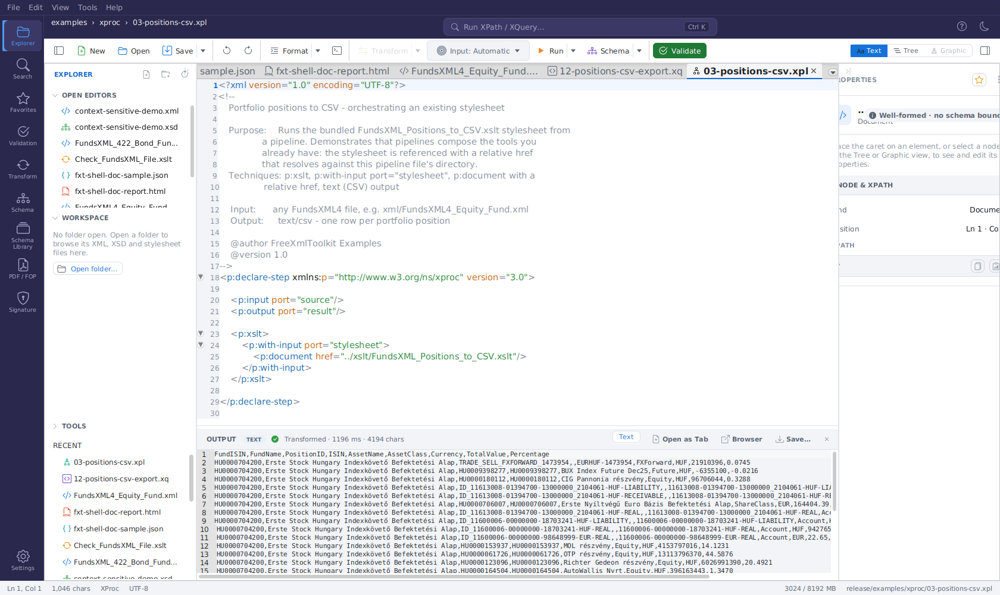
*The bundled `03-positions-csv.xpl` example after **Run Pipeline**: the pipeline runs
the CSV export stylesheet (referenced with a relative href) against the Automatic
target and streams the result into the OUTPUT panel.*

- **Run Pipeline** (the toolbar's **Run** button or its ▾ menu, or `Ctrl+Enter`) runs the active pipeline. The
  primary input (`source` port) is the document chosen in the **Input** dropdown —
  by default the most recently active XML document, exactly like
  [Run Query and Run Transform](#query-documents-the-target-selector).
- Relative `href`s in the pipeline (`p:document`, `p:xslt` stylesheets, Schematron
  schemas) resolve against the pipeline file's directory.
- Results appear in the **OUTPUT panel**; XML, HTML, text/CSV and JSON outputs are
  routed to the matching view automatically.
- Self-contained pipelines (no input ports, or ports with default bindings) run
  without a target.
- **File → New** offers an XProc skeleton (`p:declare-step` with `source`/`result`
  ports and `p:identity`).
- Ready-to-run examples ship in `examples/xproc/` — see
  [Bundled Example Collections](xml-editor.md#bundled-example-collections).

!!! note "Saxon-HE limitations"
    `p:validate-with-xml-schema` and `p:xsl-formatter` require Saxon-EE and are not
    available; use the Validation activity (Xerces, full XSD 1.1) and the PDF/FOP
    activity instead. `p:validate-with-json-schema` is not supported in this bundle.

## Transform Panel

> The panel is organized into **collapsible sections**
> (STYLESHEET, INPUT, OUTPUT METHOD, PARAMETERS) with a single primary
> **Run Transform** button and a **Run automatically** checkbox next to it. Results do not open as an editor tab -
> they appear in the **[OUTPUT panel](#the-output-panel-results)** docked below the
> editor. The run options (checkboxes) and the advanced tools share the collapsed
> **OPTIONS & TOOLS** section below the run button.

The **Transform** panel (open it from the **Transform** icon in the activity bar on the
left) runs XSLT transformations. XPath, XQuery and JSONPath queries against the open
document live in the [Query Console](#query-console) - the panel shows a short hint with an
**Open Query Console** button for them. The panel
header reads **TRANSFORM**; the run options and tools are in the **OPTIONS & TOOLS**
section (see [OPTIONS & TOOLS](#the-transform-menu) below). Each section header
is clickable to collapse or expand that section.

!!! tip
    For a quick transform without opening this panel, right-click XML files in the Explorer
    and choose **[Transform with …](#explorer-context-menu)**. It shares
    the same recent-stylesheet list and shows its result in the same OUTPUT panel.

### STYLESHEET

- Shows the **name of the chosen XSLT stylesheet** on its own line below the icon, the
  favorites/browse controls and **Change** (long names are shortened in the middle; hover
  for the full path). While no stylesheet is set, the row reads *"No stylesheet — choose or
  drop a file"* - clicking it works like **Change**.
- **Change** - pick an `.xsl` / `.xslt` file from disk (it is also loaded into the editor).
- The **clock icon** opens the **recent stylesheets** menu: reapply a recently used
  stylesheet in a single click (it is also loaded into the editor), or choose **Clear recent**
  to empty the list.
- The **star icon** opens your **XSLT favorites** - see
  [Browsing favorites with ◀ / ▶](#browsing-favorites) below. A picked stylesheet is also
  loaded into the editor.
- **Drag & drop**: drop an `.xsl` / `.xslt` file from your file
  manager straight onto the STYLESHEET row - it becomes the current stylesheet and is loaded
  into the editor, exactly as if you had picked it from a favorite. While dragging, the row glows
  **green** when the file can be loaded and **red** when it has the wrong extension (a
  red drop is rejected). As with favorites, the transform **runs automatically** as soon
  as both a stylesheet and an input are ready (while **Run automatically** is checked).

### INPUT

The INPUT section shows which document the transform will use as its input (the name on
its own line, the full path as tooltip; *"No input — open a document or drop a file"* while
there is none):

- By default the input **follows the active editor document**: switch to another tab and
  the next run transforms that document (the shown input name updates live).
- **Change** opens a small menu with two options:
    - **Select XML file…** - transform a fixed XML file from disk instead, regardless of
      which editor tab is active.
    - **Use active editor** - go back to following the active tab.
- The **star icon** opens your **XML favorites** - see
  [Browsing favorites with ◀ / ▶](#browsing-favorites) below. A picked input is also opened
  in the editor and becomes the active tab.
- **Drag & drop**: drop an `.xml` file from your file manager
  straight onto the INPUT row to transform that file - exactly like picking a favorite: it
  becomes the input and opens as the active editor tab. The same **green** (loadable) / **red** (rejected) drag-over
  feedback applies, and the transform **runs automatically** as soon as both a stylesheet
  and an input are ready (while **Run automatically** is checked).

### Browsing favorites with ◀ / ▶ {#browsing-favorites}

> Pick stylesheets and input files straight from your
> [Favorites](favorites-system.md) and page through them, so you can run the same
> stylesheet over many files, or many stylesheets over one file, without ever opening a
> file chooser.

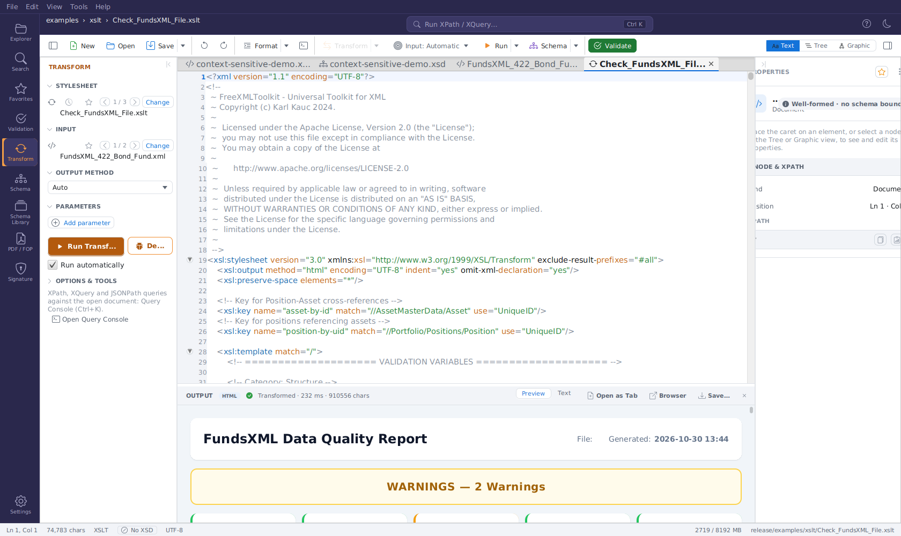

Both the **STYLESHEET** and the **INPUT** rows carry a **star icon**, a pair of
**◀ / ▶ navigation buttons**, and a small **"i / n" position label**. The ◀ / ▶ buttons and
the label only appear once the browse list holds **at least two** entries.

- The **star menu** lists the favorites of the matching type - **XSLT** favorites for
  STYLESHEET, **XML** favorites for INPUT - grouped by their folder (category). An
  **"All … favorites"** entry at the top selects the whole list at once.
- **Picking a favorite** (or an "All"/folder entry) does three things: it sets the current
  file, it builds a **browse list** from that selection, and it **loads the file into the
  editor**. An input comes to the front as the active tab. A stylesheet opens *behind* the
  active tab while the input follows the active document (otherwise the stylesheet would become
  its own input); with a fixed input file it comes to the front too. The same happens on every
  ◀ / ▶ step.
- The **◀ / ▶ buttons** then step backward and forward through that browse list. Browsing
  is **cyclic**: pressing ▶ on the last entry wraps to the first, and ◀ on the first wraps
  to the last. The **"i / n" label** shows your position (for example, *3 / 12*).
- Each ◀ / ▶ step **runs the transformation automatically** (while **Run automatically** is
  checked) - but only once **both** sides
  are ready: a stylesheet is selected **and** an input is available (either a chosen input
  file or the active editor document). Until both are present, stepping just loads the file
  without transforming.

This supports two common workflows:

1. **Fix the input, step through stylesheets.** Keep one XML file as input, then page
   through several data-quality or reporting stylesheets with ▶ to see each result in turn.
2. **Fix the stylesheet, step through inputs.** Choose one XSLT stylesheet, then page
   through many XML input files with ▶ to apply the same transformation to each.

The existing **Change** file chooser, the **clock** (recent stylesheets) menu, and **Use
active editor** all keep working exactly as before.

### OUTPUT METHOD

A single dropdown with **Auto, XML, HTML, XHTML, Text, JSON**. **Auto** (the
default) detects the output format from the stylesheet's `xsl:output` declaration; pick a
concrete format to override the detection.

### PARAMETERS

Define XSLT parameters as **name = value** rows:

- **Add parameter** adds a new row.
- Each row has its own **remove** button.
- The values are passed to the stylesheet on every run.

### Running a Transformation

1. Choose a stylesheet (**STYLESHEET → Change**, or pick one from the recent menu).
2. Check the **INPUT** section shows the document you want to transform.
3. Click **Run Transform**.

The **Run automatically** checkbox next to **Run Transform** (on by default) controls the
automatic run that starts when you drop a stylesheet or input, pick one from your favorites,
or browse with ◀ / ▶. Uncheck it to only set the file and run with **Run Transform** yourself.

The result appears in the **OUTPUT panel** below the editor - see
[The OUTPUT Panel](#the-output-panel-results) below.

### Debugging a Stylesheet {#xslt-debugger}

**Debug** (next to **Run Transform**) runs the same stylesheet over the same input as **Run
Transform** (the INPUT file when one is set by dropping, a favorite or ◀ / ▶ browsing, otherwise
the active document) in the interactive XSLT debugger. The other ways in are **Tools → Debug with XSLT…**, the
**Transform ▾ → Debug with XSLT…** toolbar entry, **Run ▾ → Debug Transform** for an active
XSLT document (against the toolbar's **Input** target), the **PDF / FOP** panel's
**Debug stylesheet…**, and **Shift+F5** whenever a document is open.

What happens:

1. The stylesheet opens as a document. The debugger runs its **editor text** - unsaved changes
   included, also of open included modules - under the file's location, so relative
   `xsl:include` / `xsl:import` hrefs resolve (a new stylesheet must be saved once). Every saved XSLT document already has
   a **breakpoint gutter**: click the slot left of a line to toggle a red breakpoint, before or
   during a session (the click does not move the caret). Breakpoints are **remembered per
   file** across sessions and restarts, including those set in included modules.
2. The **DEBUG** dock opens *below* the editor, so the stylesheet stays visible while you
   step. The dock shares its space with **OUTPUT**; a small **OUTPUT | DEBUG** strip switches
   between them, and a result that arrives while DEBUG is in front marks the OUTPUT toggle.
3. The run starts and **pauses at the first instruction** when there are no breakpoints
   (**Pause on entry**, a toggle in the dock's header), otherwise at the first breakpoint.
   The paused line is tinted in the editor and marked with a green arrow in the gutter (a
   yellow arrow on a breakpoint line). When Saxon pauses inside an included module, that
   file opens, with its own breakpoints in its gutter.

The dock's header holds the controls - **Continue** (F5), **Pause** (F6, breaks into a running transformation), **Run to Cursor** (Ctrl+F10; also gutter right-click → Run to Here, and it starts the debugger when none runs), **Step Into** (F7), **Step Over**
(F8), **Step Out** (Shift+F8), **Restart** (runs again from the start with the same
breakpoints, reading the stylesheet again from the editor), **Stop**, **Pause on entry**, **Mute** (all breakpoints off, steps still work), **Show in editor**, **Show input** (the paused context node in the input XML, which is tinted blue there), **Evaluate** (Alt+F8: any XPath in the selected frame, with a history on Up/Down)
and **✕** (ends the session). Below it, two tab groups show the paused state - **Variables |
Watch** on the left, **Call Stack | Messages | Breakpoints | Output** on the right, with a draggable
divider whose position is remembered. Messages and Breakpoints carry a count badge; a failed
run brings Messages to the front. The panels:

| Panel | Shows |
|-------|-------|
| **Variables** | The context item (`.`), `position()` / `last()`, the XSLT context (mode, `current-group()` / `current-grouping-key()`, `regex-group(n)`, tunnel parameters, accumulator values), every local variable in scope and every global variable that has been evaluated so far - with real values and XDM types, as a tree: nodes unfold into attributes and children, sequences, maps and arrays into their items; each row's XPath can be watched. While paused, the stylesheet also shows each variable's value at the end of its declaration line ([details](xslt-developer.md#values-in-the-code)), and resting the mouse on a `$variable` (or a selected XPath) shows its value in a popup. **Click a value** to open it in a window with the full, highlighted value, Copy, and an XPath field that runs against it ([details](xslt-developer.md#viewing-a-value-in-full)) |
| **Watch** | Your XPath expressions, evaluated **against the paused context item** with the variables in scope (`count(item)`, `$total`, `position()`); re-evaluated at every pause. **Add** / **Remove** sit above the table (or Variables → right-click → **Add to Watches**); Delete removes, F2 / double-click edits an expression; click a value to open the full result. Watches are saved per stylesheet |
| **Call Stack** | Template and function frames (instructions nested inside them are dimmed), each with its module and line; loops show their current item, e.g. *ForEach (3 of 222)*; double-click jumps there, also into an include. **Selecting a frame switches Variables and Watch to that frame** (its context item, own locals and the globals). **Enter** / **Open Value…** opens the frame's context item, with XPath over that frame's own variables |
| **Messages** | `xsl:message` output and Saxon warnings **as they happen**, with their stylesheet location; double-click jumps to the line. Filter by level and text, **Copy**, **Clear** |
| **Breakpoints** | All breakpoints of the session, grouped by file (checkbox = enabled · file · line · condition · hit rule · hits of this run; after a completed run, breakpoints it never reached are flagged and drawn amber in the gutter) with **Remove** / **Edit…** / **Template…** (break whenever a template rule, named template, function or mode is entered, at any line) / **Clear all** / **Break on ▾** (dynamic errors - pausing at the failing instruction with its variables -, terminating or all `xsl:message`) above the list (Delete removes the selected one); double-click jumps to the line; right-click an entry for per-file Enable / Disable / Remove and **Export / Import Breakpoints…**. Right-click a gutter slot for a **conditional breakpoint** (XPath, pauses only when true), a **logpoint** (writes `item {@id}`-style messages to Messages, optionally without pausing) or a **hit count** rule (exactly / from / every N-th hit) - [details](xslt-developer.md#conditional-breakpoints) |
| **Output** | The output written so far, refreshed at every pause; the complete result once the run finishes. Secondary results (`xsl:result-document`, kept in memory) are selectable; **Documents** lists and opens what `doc()` / `document()` / `collection()` loaded |

When the run ends, the status reads *Finished · N ms* and the **result lands in the OUTPUT
panel** (the OUTPUT toggle lights up; DEBUG stays in front so the messages remain readable).
A failed run shows the error with its location in **Messages**. The debugger runs on its own
Saxon processor, so a normal **Run Transform** during a paused session is unaffected.
**Tools → Debug Configuration…** saves per stylesheet the input (Run target or a file), parameters, output format and pause on entry; **Re-run Last Debug** (Ctrl+Shift+F5) repeats the last debug run with its input read again.
Details and stylesheet tips: [XSLT Developer → Interactive Live Debugger](xslt-developer.md#interactive-live-debugger).

### Queries (XPath, XQuery, JSONPath)

The Transform panel no longer has its own XPATH and XQUERY sections. Below the run
controls, a short hint and an **Open Query Console** button take you to the
[Query Console](#query-console), which runs XPath, XQuery and JSONPath queries against the
open document and offers the saved queries (**Snippets** menu) and the XQuery **Examples**.

### OPTIONS & TOOLS {#the-transform-menu}

The collapsible **OPTIONS & TOOLS** section below the **Run Transform** button (collapsed by
default - click its header to expand it) holds everything secondary. First the run
**options**, as checkboxes:

| Option | What it does |
|-------|--------------|
| **Live preview** | Re-runs the transform automatically (debounced) while you edit the input document. |
| **Watch stylesheet file** | Re-runs the transform whenever the chosen stylesheet changes on disk - handy while editing the stylesheet in another tool. |
| **Profile run** | A transform also opens a read-only **Profile** tool tab (timings + per-template execution times). |
| **Trace run** | A transform also opens a **Trace** tool tab (template matches + `xsl:message` output). |
| **Auto-open result tab** | Additionally opens every successful result as a regular editor tab (HTML/XHTML results open rendered in the [Preview](#html-preview) view). **Off by default.** |

Below the options, the advanced **tools** are labelled rows (icon + name):

| Row | What it does |
|-----|--------------|
| **Debug XSLT…** | Same as the **Debug** button next to **Run Transform**: opens the stylesheet (with the breakpoints set in its gutter) and the **DEBUG** dock below the editor - see [Debugging a Stylesheet](#xslt-debugger). |
| **Batch Transform…** | Runs the chosen stylesheet - or, when no stylesheet is set, the active XQuery document - over many XML files, with per-file results and "Save All". |
| **Execution Statistics** | Opens the **Execution Statistics** tool tab (duration, CPU and memory per XSLT/XQuery/validation run). Runs are only recorded while **Record execution statistics** is enabled in the Settings page's **DEVELOPER** card. |

> XSLT version selection (1.0/2.0/3.0) is intentionally not offered: Saxon HE
> auto-detects the version from the stylesheet's `version` attribute, so an
> explicit selector would be cosmetic.

### The OUTPUT Panel (Results)

> Transform and query results appear in an **OUTPUT panel
> docked below the editor** instead of opening editor tabs and a separate
> HTML-preview tool tab.

All Transform-panel results - XSLT transforms, XPath/JSONPath queries, and XQuery runs -
appear in an **OUTPUT panel** that docks **below the editor**: the source document stays
on top and the result shows underneath, while the Properties inspector keeps its full
height. The panel **persists across activity switches**, so the last result stays visible
while you work elsewhere.

The OUTPUT panel header shows:

- A **format badge** (XML, HTML, …) for the result.
- A **status**: a green check with `Transformed · N ms · M chars` on success (how long the
  run took and how large the output is), or a red error icon with the error message on
  failure.
- **View toggles** - **Preview | Text | Table**:
    - **Text** - the result in a **read-only code editor** (the default):
      line numbers, syntax highlighting matching the result format (XML or JSON;
      plain text otherwise), and font zoom with **Ctrl+mouse wheel** (**Ctrl+0** resets).
    - **Preview** - the result rendered as a web page; available for **HTML/XHTML**
      results only.
    - **Table** - available for **XQuery** results that return a **sequence** of items
      (auto-selected when applicable). Each item becomes a row, and the columns are taken
      from each item's child elements (or, if an item has no child elements, its
      attributes). A sequence of plain values is shown in a single **value** column.
- **Actions**:
    - **Open as Tab** (*Open result as editor tab*) - opens the result as a regular document
      (`Transform-Result.xml` / `.html` / `.json` / `.txt`) that you can edit and save.
      An **HTML/XHTML result** opens as an HTML document rendered in the
      [Preview](#html-preview) view (switch to Text to see the markup); re-running the
      transform updates the open result tab, re-rendering the preview if it is showing.
    - **Browser** (*Open in browser*) - opens the result (typically HTML) in your system web browser.
    - **Save…** (*Save result…*) - writes the result straight to a file.
    - **✕** - hides the OUTPUT panel; it reappears automatically on the next run.

!!! note
    In earlier versions, every transform opened a `Transform-Result.*` editor tab, and HTML
    output additionally opened an "HTML Preview" tool tab. Both were replaced by the OUTPUT
    panel: an editor tab now opens only via the panel's **Open result as editor tab** action
    or the **Auto-open result tab** option in OPTIONS & TOOLS, and HTML is rendered inline via
    the panel's **Preview** view.

## Explorer Panel

Open the **Explorer** panel from the activity bar to manage files.

- **Header actions** (top right): New file, Open folder, Refresh workspace. **New file**
  opens the same guided [New File dialog](#new-file-dialog) as the toolbar's **New** button.
The sections appear from top to bottom in this order:

- **OPEN EDITORS** - one row per open document. The **active document is highlighted**
  (blue, bold) and unsaved documents show a **dot** on the right. Click a row to switch to
  that document. The list shows about six rows; with more open documents it scrolls, so the
  workspace tree below keeps its space. The rows follow the order of the editor tabs -
  [drag a tab](#editor-tabs) to reorder both.
- **Workspace** - the file tree of the opened folder; the section is titled after the
  folder's name. Folders expand with their chevron; double-click (or Enter) opens a file.
  Only XML-family and JSON files are shown. While no folder is open, the section shows a
  short hint (*"No folder open. Open a folder to browse its XML, XSD and stylesheet files
  here."*) and an **Open folder…** button.
- **TOOLS** - a collapsible section below the files with the **Open file…** and
  **Clear recent** rows. It is **collapsed by default**; whether you leave it open or closed
  is remembered. Transforming and Schematron-validating the selected files is done from the
  workspace tree's [context menu](#explorer-context-menu).
- **RECENT** - at the bottom, the recently opened files; click one to reopen it (drag the
  thin grip above the list to change its height). Favorites are not listed here: manage them
  in the [Favorites](#favorites-panel) activity (**View → Favorites Panel**, Ctrl+Shift+D)
  and use them via the star menus; **Ctrl+D** adds the active document to your favorites.
- **Collapsible sections** - the **OPEN EDITORS**, workspace and **TOOLS** section headers
  are clickable: click a header to collapse or expand its section (the chevron next to the
  title flips accordingly). Use this to give the file tree more room when you have many
  open editors.

!!! note "Binding an XSD"
    The Explorer has no XSD picker. Bind a schema to the active document via the status-bar
    **schema indicator**, **Tools → Set Schema…** / the toolbar's **Schema ▾** button, or the
    Validation panel's **SOURCES** section.

### Transform and Validate from the Explorer {#explorer-context-menu}

> Run an XSLT stylesheet or a Schematron against XML files straight from the Explorer,
> without switching to the Transform or Validation activity first.

Select one or more XML files in the workspace tree (hold **Ctrl** or **Shift** while clicking
to select several), then **right-click** them. The context menu offers:

| Entry | What it does |
|-------|--------------|
| **Open** | Opens the selected file(s) in the editor. |
| **Transform with *&lt;stylesheet&gt;*** | Transforms the selection with the last-used stylesheet (the entry names it). Reads **Transform with XSLT…** while no stylesheet has been used yet - you are then asked to pick one. |
| **Transform with Other Stylesheet ▸** | Lists your recently used stylesheets and **Choose stylesheet…**; picking one makes it the current stylesheet and runs the transform. |
| **Validate with *&lt;Schematron&gt;*** | Validates the selection with the last-used Schematron (the entry names it). Reads **Validate with Schematron…** while none has been used yet - you are then asked to pick one. |
| **Validate with Other Schematron ▸** | Lists your recently used Schematrons, your Schematron **Favorites**, **Choose Schematron…** and **Clear recent**. |

When nothing is selected in the tree, Transform and Validate use the **active editor
document** (if it is XML).

The last-used stylesheet and Schematron are **sticky** and **shared with the
[Transform panel](#transform-panel)** and the [Validation panel](#validation-panel): both
places draw from the same recent lists.

**What Transform does** depends on how many XML files are selected:

- **One XML file** (or the active document): the stylesheet runs and the result appears in
  the docked **[Transform OUTPUT panel](#the-output-panel-results)** below the editor. HTML
  dashboards render in the **Preview** (WebView). The output format is auto-detected from the
  stylesheet's `xsl:output` declaration.
- **Several XML files**: the **Batch Transform** tool tab opens, pre-loaded with those files,
  and the run starts automatically. Save the results with **Save All…**.

**What Validate does:** the chosen Schematron is also **bound to the active document**, so the
Validation panel and live validation use it too. The result is shown in the **Validation**
activity: a single document runs through the normal single-file flow (problems list, detailed
Schematron report), a multi-file selection through the **batch** flow with one RESULTS row per
file. Batch runs additionally check each file against the **active document's bound XSD** (if
any) - bind or clear the XSD in the Validation panel's SOURCES section to control that.

!!! tip
    Primary workflow: choose your stylesheet once, then just select another XML file in the
    tree and right-click **Transform with *&lt;stylesheet&gt;*** again - the stylesheet stays
    put. For output-format overrides, parameters, watch-and-rerun, and the result table, use
    the full [Transform panel](#transform-panel).

## Search Panel

> A dedicated **Search** activity brings VS-Code-style
> **Find in Files** with Replace, plus an **XPath search & replace** that works across
> whole folders. **Heads-up:** its shortcut is **Ctrl+Shift+F** - formatting
> lives on **Shift+Alt+F** (see
> [Keyboard Shortcuts](#keyboard-shortcuts)).

Open the **Search** panel from the magnifying-glass icon in the activity bar (directly
below Explorer), or press **Ctrl+Shift+F** - any text selected in the editor is
prefilled as the search term - or **Ctrl+Shift+H**, which opens the same panel with the
replace row already expanded. A **Find text | Find by XPath** toggle at the top switches between the
panel's two modes.

### Find text (Find in Files)

Searches all files of a folder for plain text. Results appear **as you type** - the
search re-runs automatically after a short pause.

- **Where it searches** - the **Search in folder** line shows the folder's name (hover
  for the full path, or *"No folder — choose one"* when none is set). By default it is the
  folder opened in the **Explorer** workspace (falling back to the last-used directory);
  the **Browse** button picks any other folder. The **Files matching** field filters which
  files are searched - it defaults to the
  XML-family extensions
  (`*.xml,*.xsd,*.xsl,*.xslt,*.sch,*.schematron,*.json,*.xq,*.xquery,*.xqm,*.xqy,*.xpath,*.xpl,*.xproc`).
- **Options** - labelled switches below the search field: **Match case**, **Whole word**,
  **Regex** (regular expression) and **Replace** (shows the replace row).
- **Results** - before the first search, the result area shows a short hint on what to
  type. Matches are grouped **file → matches** in a tree with checkboxes. Click
  a match to open the file and select the exact match in the Text view. All matches in
  the active document are also **highlighted in the editor** (translucent amber).
- **Limits** - files larger than 20 MB and binary files are skipped, and at most 1000
  matches are listed per file (the file then shows a *"More matches not shown"* note).
  Open documents with **unsaved changes** are searched via their live editor content, so
  what you see in the editor is what is found.

#### Replace in Files

Click the **Replace** switch (or open the panel with **Ctrl+Shift+H**) to reveal the replace
row:

1. Type the replacement text. In regular-expression mode, **$1**-style group references
   in the replacement insert the matched groups.
2. **Untick** any matches you want to keep - only the **checked** matches are replaced.
3. Click **Replace…** and confirm the summary dialog.

Replacements are applied safely:

- **Open documents** are edited **in the editor**, as exactly **one undo step per
  document** - press Ctrl+Z to revert everything at once, then save normally.
- **Files not open in the editor** are written to disk atomically, preserving their
  encoding (BOM, ISO-8859-1, …) and line endings.
- A file that **changed on disk after the search ran** is skipped and reported - it is
  never overwritten with stale results. Re-run the search and replace again.

### Find by XPath

Find & replace by XPath in a document or across a folder. For queries against the open
document, use the [Query Console](#query-console) (Ctrl+K).

Evaluates an **XPath 3.1** expression (Saxon; the `map`, `array`, `math`, `fn` and `xs`
prefixes are pre-declared) and lists the matching nodes:

- **Scope** - a **Document | Folder** toggle: evaluate against the **active document**,
  or against every file of a **folder** (with its own file-glob filter, default
  `*.xml`). The folder line shows the folder's name (full path as tooltip), or *"No
  folder — choose one"* when none is set. Before the first search, the result area shows
  a short hint.
- **Namespaces** - enter bindings as `prefix=uri` lines (an empty prefix sets the
  default element namespace). The **Detect** button reads the bindings from the active
  document's root element, so you rarely have to type them.
- **Find matches** lists the matched **elements, attributes and text nodes** with line
  numbers and a short preview. Click a result to navigate to the exact node; matches are
  highlighted in the editor. Nodes that cannot be mapped to a text position (comments,
  processing instructions) are excluded and reported as a count.

#### Replacing via XPath

Pick a **Replace** mode, then click **Replace checked…** and confirm - as in Find text mode,
only the **checked** matches are changed:

| Mode | What it does |
|------|--------------|
| **Set value** | Sets the matched element's text (or the matched attribute's value) to a literal you type. |
| **Compute value (XPath)** | Computes the new value **per match**, with the matched node as the context - for example `concat(., '-suffix')` or `string(number(.) * 2)`. |
| **Delete nodes** | Removes the matched nodes: elements (including the whole line when the element sits alone on it), attributes (with the surrounding whitespace), or text. |
| **Replace with XML** | Replaces matched **elements** with an XML fragment you enter. The fragment is checked for well-formedness, and multi-line fragments are re-indented to fit their new location. |

All XPath replacements are **formatting-preserving text edits** - outside the replaced
ranges the document stays byte-for-byte identical. In the active document the whole
replacement is **one undo step** (Ctrl+Z reverts it). In folder mode, open files are
edited via the editor and all other files are written to disk atomically, with the same
changed-on-disk staleness check as Find text mode.

## Favorites Panel

Open the **Favorites** panel from the star icon in the activity bar for one-click access to
your saved files.

- Favorites are grouped by their **folder** as soon as you use folders (the rest gathers
  under *Uncategorized*); without folders they group by **file type**. Every entry shows a
  **colored type icon**.
- The **search field** filters the list by name or path as you type.
- Click a favorite to open it as an editor tab. Right-click for **Open**, **Rename…**,
  **Move to folder** (existing folders, *(No folder)*, or **New folder…**), and **Remove**.
- The action rows at the top: **Add current** stars the active document, **Manage…** opens the
  management view described below.

### Manage Favorites (editor area)

Click **Manage…** to open the full management view as a tab in the main editor area:

- A **FOLDERS** list on the left filters the table (*All*, the smart collections,
  *Uncategorized*, your folders) and offers **New…**, **Rename…**, and **Delete** (deleting
  a folder moves its favorites to *Uncategorized* - nothing is lost).
- **Smart collections**: **Recently Used** (favorites you actually opened, latest first)
  and **Most Popular** (most-opened first) - opening a favorite anywhere in the app feeds
  them automatically.
- The **table** lists Name / Type / Folder / Path: double-click the **Name** cell to rename
  inline, pick a different **Folder** directly in the cell, double-click a row to open the
  file, right-click to **Open** or **Remove from favorites**.
- The **DETAILS** pane (right) shows the selected favorite's path, type, added date and
  usage, plus an editable **NOTES** field (saved when you leave it).
- The **search field** (top right) filters across all favorites by name or path;
  **Clean up** removes favorites whose files no longer exist.
- **Drag & drop**: drop files onto the Favorites side panel to add them as favorites.

See [Favorites System](favorites-system.md) for more.

## Validation Panel

Open the **Validation** panel from the activity bar to validate the active document.

> The panel offers a SOURCES section, a Single file / Batch mode toggle, a primary
> **Run Validation** button, a status line, and - in Batch mode - a color-coded RESULTS
> list.

### Sources

The **SOURCES** section shows the schemas bound to the active document, and its rows
follow the document's type: for XML-family documents it shows the **XSD** and
**Schematron** rows, for JSON documents a single **JSON Schema** row.
Each row has two lines: the first carries the icon, a caption (**XSD**, **Schematron** or
**JSON Schema**), the favorites button and **Change**; the second shows the bound file's
name (long names are shortened in the middle - hover for the full path). An empty row
shows a hint such as *"No XSD bound — choose or drop a file"*, and clicking it works like
**Change**.
Click the **Change** button next to a source to pick a different file. **Every**
row carries a **star button** next to its *Change* button: on the XSD row it opens a
quick-select menu of your favorited XSD schemas, on the Schematron row a menu of your
favorited Schematron files, and on the JSON Schema row a menu of your favorited JSON
files - pick one to bind it in a single click, without browsing the
file system. The menus group entries by favorites folder when you use more than one, and
are grayed out while you have no matching favorites. (See
[Favorites](favorites-system.md).)

**All source rows are drop targets**: drop an `.xsd` file from
your file manager onto the XSD row, a `.sch` / `.schematron` file onto the Schematron
row, or a `.json` schema onto the JSON Schema row, to bind it to the active document in
one move - the row glows **green** while a
loadable file hovers over it and **red** for a wrong file type (which is rejected). The
dropped file behaves exactly like one picked via **Change** or a favorite, including
appearing in the recent list.

- **The referenced XSD binds automatically.** When the XML declares its schema
  (`xsi:schemaLocation` / `xsi:noNamespaceSchemaLocation` - local or remote), that XSD is
  bound when the file is opened, so the declared schema is the default. The
  declaration is also re-checked against the **current editor content before
  every validation run** (Run Validation, the toolbar's Validate, and live validation):
  a schema reference you add or change in the editor is picked up immediately - even in
  unsaved or untitled documents - and a removed reference downgrades validation to a
  well-formedness check (the status bar shows **"No XSD"**). A declared location is first
  looked up in your XML catalogs and Schema Library mappings; remote `https` schema URLs
  that no catalog redirects are downloaded to the schema cache, and if the download fails,
  a Schema Library mapping for the document's namespace is used instead. The status bar
  shows how the schema was found - plain **"XSD: name"** for a declared location,
  **"(catalog)"**, **"(library)"** or **"(manual)"** otherwise (see
  [Status Bar](#status-bar)). A schema you picked yourself (via **Change**, a favorite, or
  the status bar) is never overridden.
- **JSON documents work the same way**: a top-level `"$schema"` member pointing at a
  schema file or URL auto-binds that **JSON Schema** on open, is re-checked before every
  validation run, and a manual choice always wins. (Values pointing at `json-schema.org`
  meta-schemas are dialect declarations, not bindings, and are ignored.) See
  [JSON Editor](json-editor.md) for details and the supported drafts.
- **Click a bound source name to open the file in the editor** - one click on the XSD or
  Schematron name opens it as a tab for direct editing.

!!! tip
    You can also bind a schema **without opening the Validation panel**: click the
    **schema indicator** in the status bar (for XML it reads **"No XSD"**, **"XSD: name"**,
    **"Detecting XSD…"** or **"XSD error"**; for JSON documents the same states read
    **"No JSON Schema"**, **"JSON Schema: name"**, and so on; see
    [Status Bar](#status-bar)) or click the editor toolbar's **Schema** button
    (**Set XSD Schema…**) and pick a schema file. For XML the binding drives both
    **IntelliSense** and **schema validation**; for JSON it drives **validation**.

### Running a Validation

1. Pick a mode with the **Single file | Batch** toggle.
2. Click **Run Validation**.

- **Single file** validates the active document against the bound XSD and/or Schematron.
- **Batch** validates a whole set of XML files. In Batch mode, **Run Validation** opens a
  small menu with two ways to pick the files:
    - **Select XML files…** - a file chooser where you pick one or more XML files.
    - **Select folder…** - a folder chooser; every `*.xml` file in the folder **and all of
      its subfolders** is validated.

  The **RESULTS** list then shows one row per file with a status icon (red ✕ = errors,
  orange ⚠ = warnings only, green ✓ = valid) and a badge with the problem count. Select a
  row to see that file's problems in the panel's **PROBLEMS** list; double-click to open
  the file. The plain-text batch report opens from the **REPORTS & CHECKS** section
  (**Open Last Batch Report**).

The **status line** below the button summarises the run: **Valid**, **1 problem** /
**N problems**, or - when no schema is bound and only the well-formedness check ran -
**Well-formed · no schema bound** (shown neutral, not green - in the panel and in the
Inspector's badge: bind an XSD in SOURCES to validate against a schema).

The **RESULTS** list and the panel's own **PROBLEMS** list are only shown in **Batch**
mode. In **Single file** mode the problems are listed in the PROBLEMS panel below the
editor, and the side panel shows a single row such as *"3 problems — show below the
editor"* - click it to expand and focus that PROBLEMS panel.

### Problems

Problems appear in two places:

- The **PROBLEMS** list in the side panel (**Batch mode only**): the problems of the file
  selected in RESULTS. **Export Problems to Excel** in the **REPORTS & CHECKS** section
  saves the current list as an `.xlsx` workbook.
- The **PROBLEMS panel below the editor**: it appears automatically when
  validation finds problems, shows error/warning counts in its header, and can be collapsed
  to just the header. Each row shows the message and the file/line in a monospaced label.

Every row in the PROBLEMS panel below the editor carries a
**source badge** - **XSD**, **Schematron**, **Well-formed**, or **JSON Schema** - so when a
run combines several checks you can tell at a glance where each problem comes from.
Hovering a **Schematron** row shows a **tooltip** with the full message, the failed
rule/test expression, and the XPath of the failing node.

Long messages are cut off in the row. **Right-click** a row in the PROBLEMS panel below the
editor to copy it: **Copy Message** (just the message text), **Copy Problem** (severity,
source, message, file and line/column, plus rule and context for Schematron) or **Copy All
Problems** (one problem per line). **Ctrl+C** (**Cmd+C** on macOS) copies the selected row
like Copy Problem.

Selecting a problem in either list jumps to its line - and, for XML and XSD errors, to the
reported column - in the editor (Text view). This works for
**Schematron problems too**: the failing rule's context node is resolved back to its
line in the XML, so a click navigates straight to the offending element.

Schematron problems whose rules define **quick fixes** (SQF)
can be corrected in place: right-click the problem row in either list and pick a fix
from the **Quick Fix** submenu, or use the **yellow lightbulb** that appears in the
editor gutter on lines with fixable problems (click it, or press **Alt+Enter** /
**Ctrl+.** on the line). See [Schematron Quick Fixes](schematron-quick-fixes.md).

### Detailed Schematron Report

> A full report of the last Schematron run, opened as a tool tab
> and saveable as HTML or SVRL.

After validating a document that has a Schematron file bound, open the report in
either of two ways:

- Click the **Validation Report** row in the Validation panel's **REPORTS & CHECKS** section (it is
  enabled once a run with a bound Schematron has finished).

The report opens as a **Schematron Report** tool tab showing the document name, the
Schematron file, a severity summary (errors / warnings), and a table with one row per
finding:

| Column | Content |
|--------|---------|
| **Severity** | Error or Warning |
| **Line** | Line in the XML document |
| **Message** | The rule's message text |
| **Rule / Test** | The Schematron test expression that failed |
| **Context (XPath)** | The XPath of the failing node |
| **Fix** | A lightbulb button on findings that offer [Schematron Quick Fixes](schematron-quick-fixes.md) — click it to apply a fix directly from the report |

**Click a row** to jump straight to that line in the editor. Two buttons export the
report:

- **Save Report (HTML)** - a self-contained HTML file you can archive or share.
- **Save SVRL (XML)** - the raw SVRL output (Schematron Validation Report Language)
  of the run, for further processing by other tools.

### The Tool Sections and the ⋮ Menu

The tools are labelled rows (icon + name) in two collapsible sections below the status
line. Both start collapsed so the results keep their space; click a header to expand it.

**REPORTS & CHECKS** - results and exports of a run:

| Row | What It Does |
|-----|--------------|
| **Validation Report** | Open the [detailed Schematron report](#detailed-schematron-report) of the last validation run (enabled after such a run) |
| **Export Problems to Excel** | Save the current problems as an Excel workbook (enabled while there are problems) |
| **Open Last Batch Report** | Open the plain-text report of the last batch run |

FundsXML validation lives in the [FundsXML panel](fundsxml-extensions.md) (when the
FundsXML extension is enabled).

**SCHEMATRON AUTHORING** - tools for writing Schematron rules (usable without a run):

| Row | What It Does |
|-----|--------------|
| **Rule Templates** | Insert ready-made Schematron rule patterns |
| **Schematron Tester** | Run the Schematron rules against an XML file |
| **Rule Builder** | Build rules visually |
| **Check Rules** | Run an error detector over the Schematron itself and show a categorised issue table |
| **Schematron Documentation** | Open the Schematron documentation generator |

The panel header's ⋮ (overflow) menu keeps only the **Validate while typing** toggle for
continuous (debounced) validation.

> **Check Rules** inspects the Schematron file for problems and lists them
> by category - XML syntax, structural, XPath, semantic, and best-practice issues - so you can
> fix mistakes in the rules before you rely on them. See
> [Schematron Validation](schematron-support.md) for details.

## Schema Panel: Sample-Data Generation

Open the **Schema** panel from the activity bar while an XSD file is active. Alongside type
browsing, the panel offers actions to generate sample XML from the schema:

- **Generate Sample XML** - The simple generator. It builds one sample document using
  mandatory-only / maximum-occurrence options and realistic example values.
- **Sample XML with Options…** - Opens a dialog for full control over how the sample
  data is built (see below).

### Advanced Sample-Data Generation

> A rule-based generator with per-XPath strategies, batch output, and
> reusable profiles.

The advanced dialog turns the schema's XPaths into an editable table. For each XPath you
choose a generation **Strategy** plus a value or pattern:

| Strategy | What It Produces |
|----------|------------------|
| **Auto** | Type-based automatic value (the default) |
| **Fixed Value** | A fixed literal you type |
| **Sequence** | An auto-incrementing value from a pattern (for example `ORD-{seq:4}`) |
| **Enum Cycle** | Cycles through the allowed enumeration values |
| **Template** | A string built from a template with placeholders |
| **Random from List** | A random pick from a comma-separated list |
| **XPath Reference** | Copies the value from another XPath |
| **XSD Example** | An example value taken from the schema's annotations |
| **Omit / Empty / Null** | Skip the node, leave it empty, or set `xsi:nil` |

You can also set **batch options** - a **count** and a **file-name pattern** (for example
`order_001.xml`, `order_002.xml`) - and **Save** / **Load** named **profiles** so you can reuse
a configuration later.

The dialog can either generate a **single document** (which opens in a new tab) or a **batch**
of files written to a folder you choose. For a full walkthrough, see
[Profiled XML Generation](profiled-xml-generation.md) and the
[Sample XML Generator](xsd-tools.md#7-sample-xml-generator) section of the XSD Tools guide.

## Inspector (XSD Properties)

When an XSD file is open, the **Properties** inspector (Ctrl+Shift+P) shows the selected schema
node. In addition to name, type, cardinality, facets, and constraints, you can now:

- **Pick the type from a list** - The **Type** field opens a dropdown of the schema's own
  simple and complex types and all XSD built-in datatypes, each explained in a side pane as you
  move through the list. See [Choosing a type with the type picker](#type-picker).
- **Edit the node's `xs:appinfo`** - The machine-readable metadata attached to the node.
  Structured fields cover `@since`, `@version`, `@see`, `@deprecated`, a **Markdown** choice
  (*Not set* / *Markdown* / *Plain text*, written as `@markdown`) and the node's **example
  values**. Everything the fields do not cover - other tags and custom XML inside the appinfo -
  is preserved untouched. See [Adding Technical Notes to Your
  Schema](xsd-tools.md#adding-technical-notes-to-your-schema).
- **Edit multi-language `xs:documentation`** - One row per language. Use **Add language** to add
  a translation and the **✕** button to remove one.
- **Edit comments** - Select an XSD comment in the tree to edit its text. To add a new comment,
  use **Add Comment…** in a node's right-click context menu.
- **Delete a constraint** - In the **CONSTRAINTS** section, select a `key`, `keyref`, `unique`,
  or `assert` constraint and click **Delete constraint** to remove it.
- **See where a component is used** - **USED IN** (in **DOCUMENTATION & REFS**) lists every
  reference to a global type, element or group; click one to select the referring node.

## Signature Page {#signature-panel}

Clicking **Signature** in the activity bar opens one page, **Signature**, as a tab in the main
editor area. The side panel on the left only lists the four actions in order of use - **Sign XML
File**, **Validate Signature**, **Create Certificate** and **Expert Mode**. Click one to show it on
the page; the current action is highlighted, and the status message of the previous action is
cleared.

The page is built the same way for every action, from top to bottom:

1. A **header** naming the selected action.
2. **DOCUMENT** - the XML file to work on: the active document by default, **Browse** picks a
   different file. Shown for **Sign XML File**, **Validate Signature** and **Expert Mode**.
3. **KEYSTORE** - the keystore file, **Keystore alias**, **Keystore password** and **Alias
   password**, entered only once and shared by the actions that need them (**Sign XML File** and
   **Create Certificate**). The keystore slot shows the file name on its own line (full path as
   tooltip); while none is chosen it reads *"No keystore — choose or drop a .jks / .p12"*, and
   clicking it works like **Change**.
4. The **form of the action** with its primary button (for example **Sign Document**).
5. The **status line** with the outcome of the last action.

Secondary actions such as **Validate (Details)** are labelled rows (icon + name) below the primary
button. The keystore row also carries a **star menu** that lists your favorited keystores -
keystore files (`.jks`, `.p12`, `.pfx`, `.keystore`) are their own **Keystore**
favorite type with a lock icon (see [Favorites](favorites-system.md)):

- **Sign XML File** *(default)* - The document to sign (DOCUMENT row), the keystore (KEYSTORE),
  the signature type and algorithm (RSA-SHA256 · C14N exclusive), and a
  **Sign Document** button. Signature types: **Enveloped** (the signature is inserted into the
  document, written as `name.signed.xml`), **Enveloping** (the content is wrapped in a
  `ds:Object` inside the signature, also `name.signed.xml`; comments and processing
  instructions outside the root element are not kept) and **Detached** (a separate
  `name.sig.xml` that references the original - validate that file and keep both in the same
  folder; the card shows this hint when Detached is selected). The result is opened in a
  background tab; the page stays in front and offers **Validate this signature**, which switches
  to Validate Signature with the signed file and runs the check. The saved file on disk is signed - if the document has unsaved changes, you are
  first asked whether to save them (see [Tools that read the saved file](#tools-that-read-the-saved-file)).
  **Show certificate details** loads the keystore's certificate and shows the mockup's
  certificate inspector: subject (CN/O/C) with a self-signed/CA badge, the validity window
  with a *"Valid · N days remaining"* banner (red when expired), serial, signature
  algorithm, key usage, and the **SHA-256 fingerprint** with a copy button.
- **Validate Signature** - **Run Validation** checks the signature of the document in the
  page's **DOCUMENT** row (the active document unless you picked another one with **Browse**);
  **Validate (Details)** opens a detailed report (validity + signing-certificate details).
  The result is explained in plain language: a valid signature
  shows a green status; a document without a signature shows a red hint suggesting you sign
  it first; an invalid signature opens an error dialog that explains the document was
  modified after signing and names what failed (the signature value or a specific
  reference); a signature whose certificate cannot be used (not embedded, only referenced,
  or an unsupported algorithm) opens a dialog telling you to ask the sender for a signature
  that embeds an RSA X.509 certificate - or use **Validate (Details)**; signatures using
  the weak SHA-1 algorithm are rejected for security (re-sign with SHA-256 or SHA-512).
  Any other error shows a dialog with collapsible technical details.
- **Create Certificate** - Creates a self-signed certificate / keystore from the DN fields,
  using the alias and passwords from the KEYSTORE row. The new keystore is selected
  automatically so you can sign immediately.
- **Expert Mode** - Full PKIX trust validation of the document in the DOCUMENT row: choose a
  **trust store** (defaults to the JVM's built-in `cacerts`; the trust store row also has a **star
  menu** with your favorited keystores), enter its **Trust store password** if it has one (the
  field is optional and separate from the keystore password), optionally tick **Check revocation
  (OCSP/CRL)**, then **Validate (Trust)** produces a trust report (trusted / trust anchor / revocation /
  timestamp).

The **KEYSTORE row** and Expert Mode's **trust store row** are also
**drop targets**: drop a keystore file (`.jks`, `.keystore`, `.p12`, `.pfx`) from your
file manager onto either row to select it - the row glows **green** while a loadable file
hovers over it and **red** for a wrong file type (which is rejected), and the drop
behaves exactly like choosing the file via **Change** or a favorite.

Missing inputs are highlighted: signing without a keystore marks the
keystore entry in red, and a blank alias or password is marked in red when you sign or
create a certificate. The highlight disappears as soon as you start typing in the field.

See [XML Digital Signatures](digital-signatures.md) for full details.

## PDF / FOP Panel

The **PDF / FOP** panel renders the XML to PDF with an XSL-FO stylesheet (Apache FOP):

- **INPUT** - The **XML** (follows the active editor; *Change* can fix it to a file) and the
  **XSL-FO stylesheet** (*Change*). Each slot shows its caption, the favorites button and
  *Change* on the first line and the file name on its own second line (full path as
  tooltip); an empty slot shows a hint such as *"No stylesheet — choose or drop a file"*,
  and clicking it works like *Change*. Both rows also carry a **star
  menu** next to their *Change* link - **XML** favorites for the input, **XSLT** favorites
  for the stylesheet - so you can pick a favorited file in one click (see
  [Favorites](favorites-system.md)). Both rows are also **drop
  targets**: drop an `.xml` file onto the XML row or an `.xsl` / `.xslt` file onto the
  stylesheet row - the row glows **green** while a loadable file hovers over it and
  **red** for a wrong file type (which is rejected), and the drop behaves exactly like a
  favorite: the file is also loaded into the editor (the XML as the active tab, the
  stylesheet behind it unless the XML input is fixed).
- **METADATA** - PDF document **Title**, **Author** (pre-filled from your configured user
  name) and **Subject**, embedded into the generated PDF.
- **OPTIONS** - **PDF/A-1b compliant** renders an archival-grade PDF (requires the
  stylesheet to use embeddable system fonts - the built-in base-14 fonts like Helvetica
  cannot be embedded, and the error message will say so). **Page size** is a dropdown (A4/Letter,
  Portrait/Landscape); a hint below it explains that the choice is passed as the
  `page-size` and `page-orientation` parameters and **only applies if the stylesheet uses
  them**.
- **Generate PDF** asks for the output file, renders off the UI thread (XSLT → XSL-FO →
  PDF), and opens the result in the in-app **PDF preview**; the **RESULT** rows **Preview
  PDF** and **Open PDF** re-open it any time. **Show intermediate FO** opens the XSL-FO the
  stylesheet produced as an editor tab, and **Messages & events (n)** lists the stylesheet's
  `xsl:message` output and every event Apache FOP raised (substituted fonts, overflowing
  content, unknown properties, …) in the OUTPUT panel - the status line counts the FOP
  warnings. A failed generation puts the stylesheet error with its location, or FOP's
  reason, into OUTPUT as well.
- **TOOLS → Debug stylesheet…** runs the XSL-FO stylesheet in the
  [XSLT debugger](#xslt-debugger) (breakpoints, stepping, variables, live messages); the
  page-size parameters are passed on. The FO a finished debug run produced lands in OUTPUT
  and in the panel's result, so **Show intermediate FO** and **Render PDF from FO…** (renders
  that FO to a PDF of your choice) work right after debugging.

See [PDF Generator](pdf-generator.md) for stylesheet guidance.

## FundsXML Panel

> Content downloads and updates **automatically** in the
> background; the panel gained a **progress bar** with stage text and an
> **Open Schema in Editor** button.

The **FundsXML** activity appears in the activity bar only when the optional
[FundsXML extension](fundsxml-extensions.md) is enabled (Settings → FUNDSXML card).
Enabling it is enough - the official FundsXML schema, examples, Schematron rules and query
snippets download automatically in the background, and a toast notification appears when
they are ready.

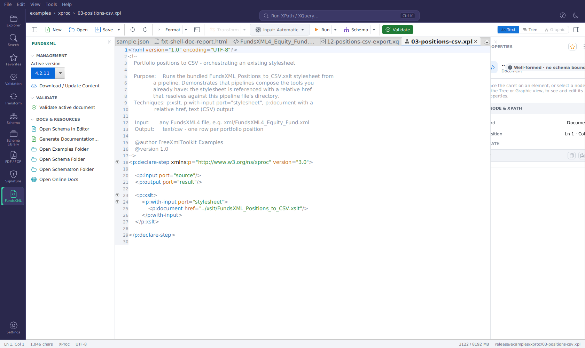

The panel offers three collapsible sections whose actions are labelled rows (icon + name):

- **MANAGEMENT** - Pick the **Active version** among the downloaded schema releases, or
  click **Download / Update Content** to force a manual refresh. A **progress bar with
  stage text** at the bottom tracks any running download - including the automatic
  background ones triggered at startup or by the daily update check.
- **VALIDATE** - **Validate active document** checks the open XML against the active
  FundsXML schema.
- **DOCS & RESOURCES** - **Open Schema in Editor** opens the active version's
  `FundsXML4.xsd` as a normal editor tab (Text or Graphic/diagram view);
  **Generate Documentation…** produces browsable HTML docs; the **Open … Folder**
  rows show the cached examples, schema and Schematron files; **Open Online Docs**
  opens fundsxml.org.

See the [FundsXML Extensions guide](fundsxml-extensions.md) for the full feature
description, cache locations and troubleshooting.

## Schema Library Page {#schema-library-page}

The **Schema Library** activity (icon: collection) manages namespace → schema mappings used
to auto-bind XML, XSD and JSON documents that don't carry an explicit schema reference.
Like Settings, it opens as a **page** - a tab named **Schema Library** in the main editor
area, where all table columns fit. The page has three tabs - **Mappings**, **Catalogs** and
**Cache** - each with clearly labelled action buttons, and a shared status line at the bottom.
The side panel on the left lists the same three sections: click one to jump to that tab; the
tab you are on is highlighted. **Settings → Manage schema cache…** opens the page directly on
the **Cache** tab. See the [Schema Library guide](schema-library.md) for the full reference,
including the resolution order, the bundled standards list and troubleshooting.

## Help Menu & About {#help-menu-about}

Help is not a side panel - it lives in the **Help** menu of the menu bar. The **?** button in
the header bar and the **F1** key open the same menu as a popup, right where you are working.
It contains:

| Item | What it does |
|------|--------------|
| **Documentation** | Opens the online documentation |
| **Keyboard Shortcuts** | Lists all keyboard shortcuts |
| **FundsXML Website** / **FundsXML Schema Docs** | Only while the [FundsXML extension](fundsxml-extensions.md) is enabled |
| **Report a Problem…** | Sends an anonymous error report (only while error reporting is enabled, see below) |
| **GitHub Repository** | Opens the project page on GitHub |
| **Sponsor this Project** | Opens the GitHub Sponsors page |
| **Check for Updates…** | Looks for a newer version |
| **About FreeXmlToolkit** | Shows the version and build, licenses and links |

On **macOS**, **Check for Updates…** and **About FreeXmlToolkit** are in the **FreeXmlToolkit**
application menu instead (see [macOS](#macos)). To find out which version you are running, open
**About FreeXmlToolkit**.

- **Sponsor this Project** opens the project's [GitHub Sponsors](https://github.com/sponsors/karlkauc)
  page in your browser. The same link is in the **About** dialog, as a small banner on the
  **Welcome** page and under **Settings → Support the Project**.

- **Report a Problem…** opens the **Send Error Report** dialog. Describe what you were doing,
  optionally leave an email address if you would like a reply, and click **Send**. The report
  is sent anonymously - no GitHub account is needed. The collapsible **Preview of the data that
  will be sent** shows exactly what is transmitted.
- The **About** dialog offers the same **Report a problem…** button next to **Report an issue**
  (which opens the GitHub Issues page).
- When an **error dialog** appears, it has a **Send error report…** button that opens the same
  dialog. Tick **Include technical details** to attach the anonymous error signature (exception
  type and code locations - never messages, paths or content).

These buttons are only shown while **Send anonymous error reports** is enabled in
[Settings](#settings-page). See [Privacy & Anonymous Telemetry](telemetry.md) for details.

## Settings Page

> Settings open as a **full page** (a tab in the main editor
> area) rather than in the narrow left side panel. The options are presented
> as **color-coded cards**, sorted into seven groups.

Click the gear icon at the bottom of the activity bar (or press **Ctrl+,**): the **Settings page
opens as a tab in the main editor area**, where there is room for all options.

**Finding a setting** - the side panel on the left lists the seven groups. Click a group to
scroll the page to it; the group you are looking at is highlighted. Type into the **search field** at the top of the side panel to filter both
the group list and the cards on the page down to the matching settings; if nothing matches, the
page shows *"No settings match the search."*.

**Saving** - a save bar stays fixed at the bottom of the page:

- **Unsaved changes** appears as soon as you change an option that has not been saved yet.
- **Save Settings** stores and applies your changes.
- **Reset to Defaults…** asks for confirmation and then puts the default values into the
  controls. Nothing is stored until you click **Save Settings**, so you can still review or
  adjust the values first. The reset leaves your privacy / usage statistics choices, your user
  info, your templates, the file associations and the extension settings (FundsXML, Developer)
  unchanged.
- A few actions take effect **immediately**, without Save: switching the **theme**, registering
  or unregistering **file associations**, and creating, editing or deleting **templates**.

| Group | Cards and options |
|-------|-------------------|
| **Appearance** | **Theme** - switch between **Light** and **Dark**. **Layout** - **Show toolbar button labels**; **Show activity bar labels**; **Use small icons**; toolbar icon size (**Small** / **Large**); **Show left side panel**; **Show Properties (inspector) panel**. **Rendering** - JavaFX graphics pipeline: **Auto** / **Hardware** / **Software** (takes effect after restart), with the active pipeline and GPU status; see [Rendering mode (hardware vs. software)](#rendering-mode) below. **Memory** - **Maximum memory** for the application: **Automatic** (half of the installed memory) or a fixed limit (takes effect after restart); see [Memory and large files](#memory) below. |
| **Editor** | **Editor** - XML indent and JSON indent (spaces); **Auto-format after loading**; **Pretty-print XSD on save**; **Pretty-print Schematron on load**; **Recent files to remember** (1–100, default 20) - every file opened in the editor, opened in the background or saved with **Save As** goes into File → Recent, the Explorer's **RECENT** list and the Welcome page. **Templates** - a configurable **templates directory**, plus a **New / Edit / Delete** list of your own templates; see [Managing your templates](#managing-your-templates) below. **User Info** - **Name**, **Email** and **Company**, used for example when generating documentation or signing. |
| **Schemas & Validation** | **XSD** - **Auto-save** (with an interval in minutes); **Create backups on save** (with the number of versions to keep, and an optional **separate backup directory**). **Schema Library** - **Use the Schema Library to bind schemas automatically**; shows the library file's location and a **Manage schema cache…** link; see [Schema Library](schema-library.md). **Parser** - **XML parser** engine (Xerces or Saxon); **Allow XSLT extension functions**. |
| **Files & Cache** | **Temp & Cache** - **Use system temp folder** or a custom temp folder; **Clear Temp Folder** to free disk space; **Clear Cache Folder** to delete cached files (downloaded schemas etc.); **Manage schema cache…**. **Log Files** - **Delete old log files automatically at startup** (on by default) with **Keep for (days)** (default 14) and **Maximum total size (MB)** (default 100; 0 = no limit); **Clean Up Now** applies the limits at once, **Open log folder** shows the folder, and the card names the folder with its file count and size. The log file in use is never deleted. **File Associations** - make FreeXmlToolkit the **default application** for XML, XSD, XSLT, Schematron and JSON files (per user, no admin rights); see [File Associations](file-associations.md). |
| **Network & Security** | **HTTP Proxy** - **Use system proxy**, or enter a proxy host and port. **Security** - **Trust all certificates**: accept any TLS certificate for HTTPS downloads (schemas, updates); use with care. **Updates** - **Check for updates on startup**. |
| **Privacy** | **Usage Statistics** - **Enable usage tracking** (local, anonymous feature-usage counters shown on the Welcome page) and **Clear statistics**. Below them: **Send anonymous usage statistics** and **Send anonymous error reports** (both on by default) and a **What is sent?** link that shows the exact data and your anonymous installation ID. See [Privacy & Anonymous Telemetry](telemetry.md). |
| **Extensions** | **FundsXML** - **Enable FundsXML extensions** adds the [FundsXML activity](fundsxml-extensions.md) to the activity bar. **Developer** - **Record execution statistics** collects duration, CPU and memory per XSLT/XQuery/validation run; view them in the **Execution Statistics** tool tab or via the "last run" item in the status bar. **Support the Project** - a **Sponsor on GitHub** link. |

### Clearing the Cache Folder

The **Clear Cache Folder** button in the **TEMP & CACHE** section deletes the contents of the
application's local cache folder (`~/.freeXmlToolkit/cache`) - for example downloaded schemas,
including schemas fetched automatically for missing `xs:import` references. Clearing is safe:
such schemas are simply re-downloaded the next time they are needed. A confirmation dialog is
shown first, because the action cannot be undone. The cache folder itself is kept; only its
contents are removed.

### Memory and large files {#memory}

> The **MEMORY** card sets how much memory the application may use, so that large files
> can be opened on machines with plenty of RAM.

The editor keeps a whole document in memory several times over (text, line model,
highlighting, structured views), roughly **16 times the file size**. The memory limit
therefore decides how large a file can be:

| Maximum memory | Largest file that opens |
|----------------|-------------------------|
| 4 GB | about 256 MB |
| 8 GB | about 512 MB |
| 16 GB | about 1 GB |

- **Automatic** *(default)* uses half of the installed memory.
- A fixed value (2 GB up to the installed memory) applies from the **next start**; the
  application restarts itself once with that limit. The card shows the limit of the current
  session and the installed memory.
- If the chosen limit cannot be used, the application falls back to **Automatic** on its own.
- In a development run (`./gradlew run`) the setting has no effect; the Gradle task sets the memory.

Opening a file of **50 MB or more** asks for confirmation first, because editing it will be
slow. A file that does not fit into the current memory limit is not opened; the message names
the limit and points to this card.

### Rendering mode (hardware vs. software) {#rendering-mode}

> The **RENDERING** card lets you choose how JavaFX draws the UI,
> per machine, without relying on a fixed JVM flag.

JavaFX can render either on the **GPU** (hardware-accelerated, faster) or purely in
**software**. On machines with only an integrated GPU, hardware rendering can become
unstable on very large diagrams/grids, while machines with a dedicated GPU benefit from it.
The **Mode** dropdown controls this:

| Mode | Behaviour |
|------|-----------|
| **Auto** *(default)* | The application detects the graphics adapter at startup and picks **hardware** rendering on a dedicated GPU (and on macOS), or **software** rendering on integrated/unknown adapters. The detection result is cached. |
| **Hardware** | Always prefer GPU rendering (with an automatic software fallback if the GPU pipeline cannot start). Use this if **Auto** does not recognize your dedicated GPU. |
| **Software** | Always use software rendering. Use this if hardware rendering causes display glitches or crashes on your machine. |

Below the dropdown the card shows the **current run's** rendering status:

- **Active pipeline** - what JavaFX is *actually* using right now: *Hardware — Direct3D*,
  *Hardware — OpenGL ES2*, *Hardware — Metal*, or *Software*. This is read from the live
  graphics pipeline, so with **Auto** you can see at a glance whether you ended up on
  hardware or software rendering.
- **Detected GPU** - the graphics adapter(s) the application found on this machine.

Notes:

- **A restart is required** for a change to take effect - the graphics pipeline is chosen
  once when the application starts. The **Active pipeline** line always reflects the
  pipeline of the *running* session, not an unsaved dropdown change.
- An explicit `-Dprism.order=...` JVM flag (command line) still **overrides** this setting,
  so power users can force a specific pipeline for troubleshooting.
- **Auto** is intentionally conservative: any adapter it cannot confidently identify as a
  dedicated GPU falls back to software rendering. If your dedicated GPU is not detected,
  switch the mode to **Hardware**.

### Managing your templates

> The **TEMPLATES** card lets you keep your own starting templates,
> which then show up (filtered by file type) in the [New File dialog](#new-file-dialog).

- **Templates directory** - Use **Browse…** to point the application at the folder where your
  templates live. Leave it empty to use the default location. Changing the directory takes
  effect immediately, **without restarting** the application.
- **Your templates** - The card lists your own (non-built-in) templates. Use:
    - **New** - Create a template. A dialog asks for its **Name**, **Category**,
      **Description**, **File type**, and **Content**.
    - **Edit** - Change the selected template.
    - **Delete** - Remove the selected template.

Each template is stored as a `.template` file in the templates directory. Once saved, your
templates appear in the **New File** dialog whenever their file type is selected. For the wider
template and XPath-snippet system, see [Template Management](template-management.md).

## Welcome / Dashboard

> The welcome screen starts from **tasks**, not tools: a short list titled
> *"What do you want to do?"* takes you straight to the right panel. On a first start it stays
> uncluttered and offers a ready-made example to try.

When no document is open, the editor shows a welcome dashboard with:

- **Quick cards** - **New File**, **Open File**, **Open Folder** and **From URL**. While you
  have no recent files yet, a fifth card **Open an Example** is shown (see
  [Trying the bundled example](#trying-the-bundled-example) below).
- **Stat cards** - At-a-glance counts of your **Recent files**, **Favorites**, **Templates**,
  and **Saved queries**. They appear only once at least one of them is above zero, so a
  fresh installation does not show a row of zeros.
- **Activity trend** - The **ACTIVITY (LAST 7 DAYS)** chart appears only once you have used
  the application in the last seven days.
- **Tips banner** - A short hint banner with handy shortcuts (for example, drag a file onto the
  window to open it, or use Ctrl+F / Ctrl+H to find and replace).
- **Recent files** list - Click an entry to reopen it. While the list is still empty it
  shows a hint: files you open or create appear here - start with **Open File** or
  **New File** above.
- **What do you want to do?** - A task list with six rows:

    | Task | What happens |
    |------|--------------|
    | **Validate an XML file** | Asks for a file, opens it, shows the [Validation panel](#validation-panel) and validates it as soon as it is loaded |
    | **Run an XSLT transformation** | Asks for an XML file, opens it and shows the [Transform panel](#transform-panel), where you choose the stylesheet |
    | **Query a document** | Asks for an XML file, opens it and opens the [Query Console](#query-console) for XPath / XQuery |
    | **Edit a schema** | Asks for an XSD file, opens it and shows the Schema panel |
    | **Create a PDF** | Asks for an XML file, opens it and shows the **PDF / FOP** panel, where you pick the XSL-FO stylesheet |
    | **Sign or verify a document** | Opens the **Signature** page directly (no file needed first) |

    If you cancel the file chooser, nothing happens. The other activities (Explorer, Search,
    Favorites, Settings, …) are always one click away in the Activity Bar.

- **FUNDSXML quick access** - When the optional
  [FundsXML extension](fundsxml-extensions.md) is enabled and its content is cached, an
  extra row with three cards appears: **Open Example** (opens a compact starter sample),
  **Open Schema** (opens `FundsXML4.xsd` in the editor) and **Browse Examples** (opens the
  cached examples folder). The row shows up live as soon as the automatic background
  download finishes.

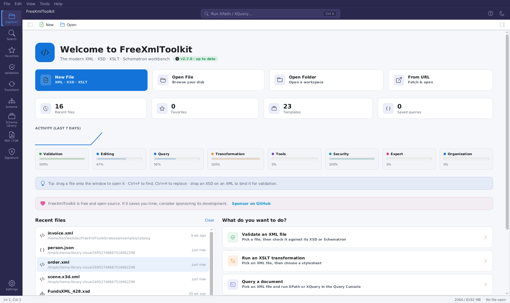

### Trying the bundled example {#trying-the-bundled-example}

**Open an Example** gives you something to experiment with right away. It copies a small
example set into `~/.freeXmlToolkit/examples/getting-started/` in your home folder and opens
`order.xml`:

- `order.xml` - an order document that already points to its schema, so it is
  **validated against `order.xsd` immediately** - no need to bind a schema yourself.
- `order.xsd` - the schema for the order.
- `order-summary.xslt` - a stylesheet that turns the order into an HTML summary.

If the files already exist there (for example because you edited them), they are kept and
not overwritten. A comment at the top of `order.xml` suggests what to try next:

1. Press **F8** to validate the document.
2. Switch between the **Tree** and **Graphic** views.
3. Choose **Tools → Transform with XSLT…** and pick `order-summary.xslt`.
4. Open the **Query Console** (Ctrl+Shift+X) and run `sum(//item/(@quantity * @price))` to
   get the order total.

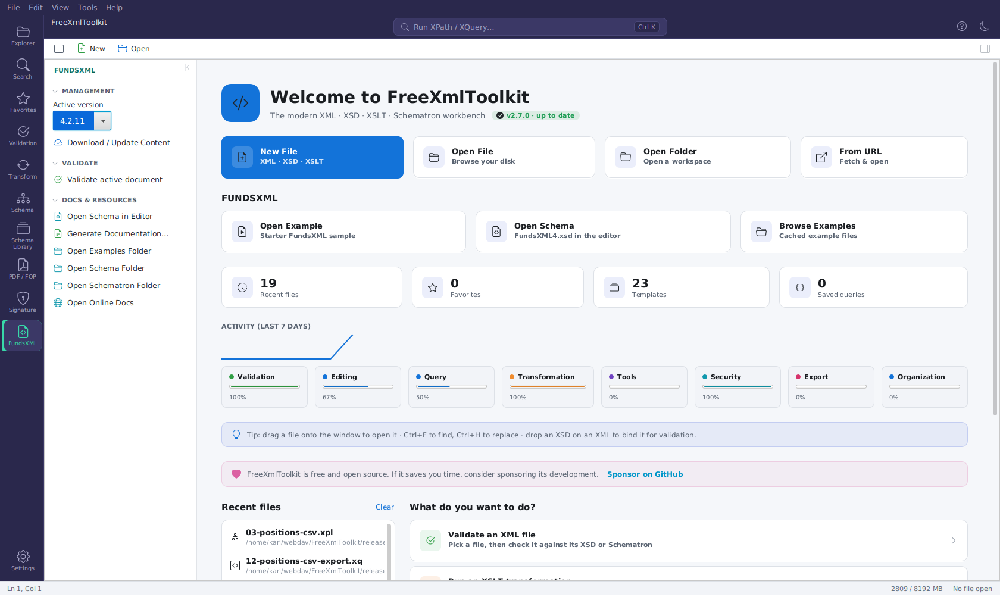

## Tools that read the saved file {#tools-that-read-the-saved-file}

Some tools read the document **from disk** rather than from the editor: **Generate Sample
XML…** and **Sample XML with Options…** (Schema panel), **Generate Documentation…** and
**signing** a document (Signature). If the document has **unsaved changes**, they first ask
*"Save changes to <file> first?"*:

- **Save and Continue** - saves the document, then runs the tool on the saved file.
- **Use Saved Version** - runs the tool on the file as it is on disk; your unsaved editor
  changes are not included.
- **Cancel** - does nothing.

## Status Bar

> The schema indicator shows the schema *loading lifecycle*, so you can
> tell exactly when IntelliSense (XML) or schema validation (JSON) becomes available.

The status bar at the bottom of the window includes (left to right):

- The **caret position** (`Ln 1, Col 1`), the **character count** of the active document and
  its **file type** label (XML, XSD, XSLT, …).
- A **schema indicator** showing the schema-binding state of the active document — an
  **XSD** for XML-family documents, a **JSON Schema** for JSON documents:

    | State | Meaning |
    |-------|---------|
    | **Detecting XSD…** (hourglass) | The linked schema is being detected and parsed in the background - IntelliSense is not available *yet*. |
    | **XSD: name** (green check) | The schema is loaded - **IntelliSense and schema validation are available**. |
    | **No XSD** (clickable chip) | The document references no schema - IntelliSense is limited. Click the chip to bind one. |
    | **XSD 1.1 schema** / **XSD 1.0 schema** | The active document **is** an XSD schema itself. The version comes from `vc:minVersion` on `xs:schema`; without it the schema counts as XSD 1.0 (1.1 features still validate). Clicking it does nothing. |
    | **XSD error** (amber warning) | The document references a schema that could not be found or parsed - IntelliSense is unavailable. Bind one manually to fix it. |

    For JSON documents the same four states read **"Detecting JSON Schema…"**,
    **"JSON Schema: name"**, **"No JSON Schema"** and **"JSON Schema error"**, and refer
    to schema *validation* (JSON has no schema-driven IntelliSense).

    A loaded schema's label also shows *how* it was bound: a plain **"XSD: name"** when the
    document declared the location itself, **"XSD: name (catalog)"** when an XML catalog
    entry resolved it (bookmark icon), **"XSD: name (library)"** when a Schema Library
    mapping resolved it (collection icon), and **"XSD: name (manual)"** when you picked it
    by hand — the tooltip adds the resolved catalog target or matched namespace/root
    element plus the schema's absolute path.

    **Click the indicator** (in any state except for an open XSD schema) to choose a schema file (`.xsd`, or `.json` for
    JSON documents) and bind it to the active
    document; for XML the binding drives both **IntelliSense** and **schema validation**,
    for JSON it drives **validation**. (The editor
    toolbar's **Schema** button - **Set XSD Schema…** - does the same.) Hovering shows a tooltip explaining
    what the binding currently provides.

    The indicator is also a **drop target**: drop an `.xsd` file (or a `.json` schema,
    for JSON documents) from
    your file manager onto it to bind the schema to the active document in one move - it
    glows **green** while a loadable file hovers over it and **red** for a wrong file type
    (which is rejected).
- An **encoding label**: the character encoding the file was read in - taken from a byte order
  mark or the XML declaration's `encoding="…"`, otherwise **UTF-8** (a file that is not valid
  UTF-8 and declares nothing is read as **windows-1252**). Saving writes the file back in that
  encoding; change the `encoding` of the XML declaration to save in another one. Characters the
  encoding cannot hold are saved as character references such as `&#x20AC;`.
- A **last run** item (right-hand side) showing the last recorded XSLT/XQuery/validation run -
  it appears only while **Record execution statistics** (Settings → **DEVELOPER**) is on;
  **click it** to open the **Execution Statistics** tool tab.
- A **memory monitor** showing the JVM heap usage as **used / max MB**. **Click it** to run
  garbage collection, which can free memory after working with large files.
- The **file path** of the active document (or *No file open*).

## Keyboard Shortcuts

| Shortcut | Action |
|----------|--------|
| Ctrl+N | New file (opens the guided New File dialog) |
| Ctrl+O | Open file |
| Ctrl+S | Save current tab |
| Ctrl+Shift+S | Save As (the Save ▾ menu also offers Save All) |
| Ctrl+W (Windows/Linux also Ctrl+F4) | Close the active tab (asks to save unsaved changes) |
| Ctrl+Tab / Ctrl+Shift+Tab | Next / previous tab |
| Ctrl+Q | Quit FreeXmlToolkit (**Cmd+Q** on macOS; Alt+F4 on Windows works as usual). With unsaved documents one dialog lists them and offers **Save All** / **Don't Save** / **Cancel** - the same when the window is closed |
| Ctrl+, | Open the Settings page |
| Ctrl+Z / Ctrl+Y (or Ctrl+Shift+Z) | Undo / Redo (works from the Text, Tree and Graphic views) |
| Ctrl+F | Find (in the active document) |
| Ctrl+H | Find and Replace (in the active document); **Alt+Cmd+F** on macOS |
| Ctrl+Shift+F | **Find in Files** - opens the [Search panel](#search-panel), prefilled with the editor selection |
| Ctrl+Shift+H | **Replace in Files** - opens the Search panel with the replace row expanded |
| F8 | Validate the active document (same run as Tools → Validate, the toolbar's **Validate** button and the Validation panel's **Run Validation**) |
| F9 | Toggle the breakpoint on the caret line of a saved XSLT document (also **Tools → Toggle Breakpoint**) - see [Debugging a Stylesheet](#xslt-debugger) |
| Shift+Alt+F | Format (pretty-print) the active document |
| Ctrl+D | Add the active document to favorites |
| Ctrl+Shift+D | Show the Favorites panel (press again to collapse the side panel) |
| Ctrl+Shift+X | Toggle Query Console (XPath/XQuery) |
| Ctrl+K | Open the Query Console and focus its input (same as the header search pill) |
| Ctrl+Enter | Run the active XPath/XQuery, XSLT or XProc document (Run Query / Run Transform / Run Pipeline) |
| F5 | Run the active XQuery / XPath / XSLT / XProc document (does nothing for other documents - use F8 to validate) |
| Shift+F5 | **Debug with XSLT** - the active XSLT document, the PDF / FOP panel's stylesheet, or the Transform panel's (asks for one if none is set) - see [Debugging a Stylesheet](#xslt-debugger) |
| F5 / F7 / F8 / Shift+F8 | While the debugger is **paused**: Continue / Step Into / Step Over / Step Out (F5 and F8 keep their normal meaning otherwise) |
| Shift+F7 | While the debugger is paused: Smart Step Into - choose which call on the line to step into |
| F1 | Show the Help menu (as a popup, like the header's **?** button) |
| F11 | Toggle full screen (also **Ctrl+Cmd+F** on macOS) |
| Ctrl+L | Show/hide the left side panel |
| Ctrl+Shift+P | Show/hide the Properties inspector |
| Ctrl+E | Spreadsheet Converter… (Excel / CSV ↔ XML) |
| Ctrl+T | Insert Template… (needs an open document) |
| Alt+Enter / Ctrl+. | Quick Fix - apply a [Schematron Quick Fix](schematron-quick-fixes.md) on the caret line |
| Ctrl++ / Ctrl+- | Zoom in / out (Text view: font size; Graphic view: the grid in 10 % steps, 50-300 %) |
| Ctrl+0 | Reset the zoom to 100 % (Text view: font size, Graphic view: the grid) |
| Ctrl+Alt+X | Graphic view: copy the XPath / JSONPath of the selected node |
| Ctrl+Alt+C | Graphic view: copy the selected node as XML / JSON |
| Ctrl+Shift+C | Graphic view: copy the cell content |
| Ctrl+mouse wheel | Zoom (Text view: font size, Graphic view: the whole grid) |

On macOS use **Cmd** instead of Ctrl for the shortcuts above (see [Menu Bar → macOS](#macos)).

!!! warning "Changed shortcut"
    **Ctrl+Shift+F no longer formats the document.** Following the VS Code convention, it
    now opens **Search (Find in Files)**, and **Ctrl+Shift+H** opens **Replace in Files**.
    **Format Document moved to Shift+Alt+F** - the toolbar's **Format** button works
    unchanged. The in-editor find/replace stays on **Ctrl+F / Ctrl+H**.

> **Search in all view modes:** Pressing **Ctrl+F** opens an inline search bar with up/down chevron arrows for Find Previous / Find Next (Enter / Shift+Enter work too). The search works in the **Text**, **Tree** and **Graphic** views. In the structured views it searches the nodes themselves — for XSD schemas that is element/attribute/type names, documentation and appinfo, type references, fixed/default values, enumeration and facet values, and comments; for XML instances in the Graphic grid it is element names, attribute names, and values (also inside embedded table cells); for JSON documents (Tree and Graphic) it is keys and values. A match hidden inside a collapsed branch is revealed automatically (ancestors expand), selected, and scrolled into view; matches wrap around when you reach the end. Switching the view mode or tab while the bar is open re-targets the search to the active view. **Replace** is available in the Text view only — in Tree/Graphic views the replace toggle is disabled. In an HTML document's **Preview**, Ctrl+F searches the underlying markup text, not the rendered page. See [XML Editor Features](xml-editor-features.md#search-find) for details.

## Compare & Merge

**Tools → Compare with File…** compares the active document (XML, XSD or any other text file)
with another file, side by side, and lets you merge the differences.

1. Choose **Tools → Compare with File…** and pick a file to compare against the current document.
2. A new tab opens titled `Compare: <left> ↔ <right>` with synchronized scrolling and live re-diff.
3. Changed lines are highlighted, with intra-line word-level coloring.

Merge controls let you reconcile the two files:

| Control | Shortcut | Action |
|---------|----------|--------|
| **Prev** / **Next** | Alt+Up / Alt+Down | Jump between changed chunks |
| Per-chunk arrows | - | Apply a single change left→right or right→left |
| **All →** / **All ←** | - | Apply every change in one direction |
| **Re-compute** | - | Recompute the diff manually |
| **Save Left** / **Save Right** | - | Write a pane back to its file |

The diff recomputes automatically about 300 ms after you stop typing.

## Jump to Validation Errors

Validation errors appear in the **Properties / Validation** sidebar (Ctrl+Shift+P). **Double-click**
any error to jump straight to its location:

- In the **Text** view the caret moves to the exact line and column, with the offending text highlighted.
- In the **Graphic** view the matching element is selected, flashed, and scrolled into view.
- In split mode both views navigate at once.

## Properties Inspector

> Property editing works in **all** views - for XML files in Text, Tree, and
> Graphic, and for XSD files in the **Text** view as well as the Tree and Graphic views
> (see [XSD Files](#xsd-files) below). For JSON files the inspector edits keys and values
> from the Tree and Graphic views (see [JSON Files](#json-files) below).
>
> The inspector is not fixed-width: drag the divider line
> between the editor and the inspector to make it wider (handy for long XPaths, attribute
> values, or documentation). The width is remembered across restarts - see
> [Resizing and collapsing the side panels](#collapsing-the-side-panels).

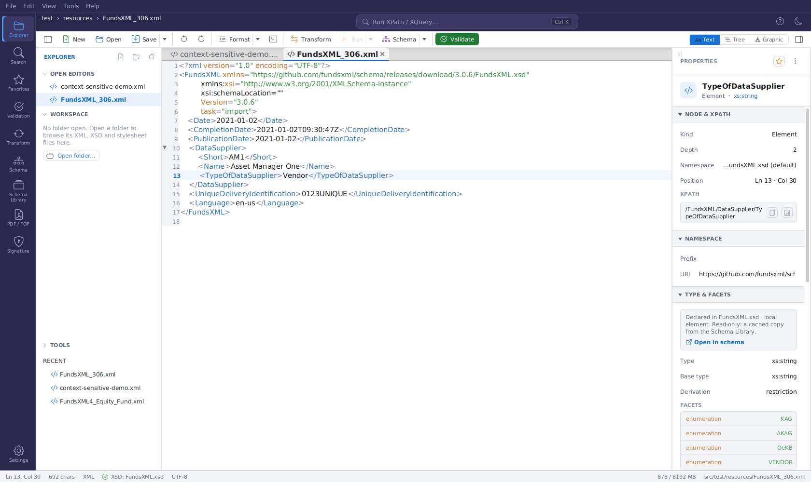
*The Properties inspector for an XML element with a bound schema: node header with validation
pill, NODE & XPATH, schema facts, and documentation with example values and valid children.*

While nothing is selected, the inspector shows a short hint instead of empty sections:
*"Open a document to see the properties of its nodes here."* when no document is open, and
*"Select a node in the Tree or Graphic view to see and edit its properties."* (or, in the
Text view, a hint to place the caret on an element) when no node is selected.

### Layout of the inspector

From top to bottom:

- **Top bar** - the title **PROPERTIES**, a **star** button and a **⋮** menu.
  - The **star** adds the active file to [Favorites](favorites-system.md) (or removes it, when it
    is already a favorite). It is greyed out for a document that has never been saved.
  - The **⋮** menu offers **Copy XPath**, **Copy Node (XML)**, **Expand All Sections** and
    **Collapse All Sections** (the two copy actions are also buttons in **NODE & XPATH**).
- **Node header** - an icon for the kind of node, the node's **name**, a subtitle such as
  *Element · xs:string* (kind · type), and the **validation pill**: **Valid**, the number of
  errors, or *Well-formed · no schema bound*. **Click the name to rename the node** in place
  (only for nodes that have a name).
- **Sections** - collapsible sections with a full-width title bar. Each row shows the property
  name on the left and its value on the right.

**Editing in place:** editable values (type, minOccurs/maxOccurs, use, form, fixed, default, …)
look like plain text until you point at them or click them - then the field frame, the
drop-down arrow or the spinner buttons appear. Values without that hover effect are read-only.

The sections appear in this order. A section is shown only when it has content for the
selected node - empty sections are left out:

| Section | Content |
|---------|---------|
| **NODE & XPATH** | **Kind**, **Namespace**, **Depth** (the nesting level; the root element is 0), **Position** *Ln x · Col y* (Text view only), and the **XPath** in a code box with the **Copy XPath** and **Copy Node (XML)** buttons |
| **NAMESPACE** | Edit the element's namespace **prefix** and **URI** (expanded by default) |
| **TYPE & FACETS** | **Type**, **Base type**, **Derivation** (restriction / extension / list / union) and the list of **facets**; for an XML element with a bound schema it starts with the declaration box (see [Editing the bound schema from the XML document](#editing-the-bound-schema)) |
| **CARDINALITY & USE** | minOccurs / maxOccurs, Use, and **Order** - the node's position in its parent compositor, e.g. *3 of 3 · sequence* |
| **VALUE & ATTRIBUTES** | The element text and the list of **attributes** |
| **CONTENT** / **PROCESSING INSTRUCTION** / **XML DECLARATION** | The text of comments, CDATA sections, processing instructions and the XML declaration |
| **DOCUMENTATION & REFS** | Documentation, value check, example values, valid children and **USED IN** (see below) |
| **ADVANCED**, **SCHEMA**, **CONSTRAINTS** | Further schema-node properties (fixed/default, nillable, form, final, appinfo, identity constraints, assertions, …) |

The **Namespace** row in NODE & XPATH shows the URI, marked *(default)* for an unprefixed
namespace, otherwise *prefix → URI*. An undeclared prefix shows as *prefix → (unbound)*, an
element without a namespace as *(no namespace)*. For an XSD declaration the row shows the target
namespace for global and qualified declarations, and *(no namespace)* for unqualified local ones.

### Copying the XPath or the node

The **NODE & XPATH** section shows the selected node's XPath in a code box:

- **Copy XPath** - click the **Copy XPath** button next to the code box, or **click the XPath
  itself**, to copy the positional XPath (e.g. `/root/item[2]`) to the clipboard.
- **Copy Node (XML)** - the second button next to the code box; copies the selected node's XML
  serialization.

Both actions are also in the **⋮** menu of the top bar. In the Text view they act on the element
enclosing the caret; in the Tree/Graphic views they act on the selected node. For an **XSD** node
selected in the Tree or Graphic view, Copy XPath copies the schema XPath and Copy Node copies the
XSD source of that node; for **JSON** they copy the JSONPath and the JSON source.

### Facets and attributes lists

Facets (in **TYPE & FACETS**) and attributes (in **VALUE & ATTRIBUTES**) are shown as framed
lists that you edit directly:

- **Click a value** to edit it. **Enter** saves the change, **Esc** cancels it.
- For attributes, **click the name** to rename the attribute.
- **Point at a row** to show its **trash** icon; click it to delete the facet or attribute.
- **Add** a new entry with the row below the list (facet kind or attribute name, value, **Add**).
- **Inherited facets** (from a base type) are shown in *italics* and cannot be edited here.
- **Long values wrap** onto several lines instead of being cut off. The row's tooltip shows the
  full value, plus where it comes from (*inherited from the referenced named type* or
  *defined by the schema*).
- **Keyboard:** press **Tab** to move to a row; **Enter** edits its value and **Delete** removes
  the row.

### XML Files

When an XML file is open, the Properties sidebar (Ctrl+Shift+P) shows the selected node and
lets you edit it from whichever view you are in:

- **Text view** - Move the text caret into an element to select it. The inspector shows the
  element's name, namespace, attributes, and text as editable fields. Edits round-trip into the
  source as a minimal change that preserves your caret and scroll position. If the caret is not
  inside a well-formed element, the inspector falls back to a read-only name/XPath view. When you
  switch back to the Text view, the inspector shows the node at the caret again right away.
- **Tree view** - Click any node (element, text, comment, CDATA, or processing instruction) to
  edit its properties.
- **Graphic view** (the grid) - Select a row to edit its properties. The grid also handles
  structural editing (adding, deleting, and moving nodes) through its right-click context menu.

All three views share one in-memory model per open document, so your edits and Undo/Redo
history are preserved when you switch between Text, Tree, and Graphic.

**With a bound XSD schema**, the inspector also shows what the schema says about the selected
element: Type, Base type, Derivation (including the **list item type** or the **union member
types**), the facets (including the **enumeration** values), minOccurs/maxOccurs/Use, Order,
**nillable**, **default** and **fixed** values, *Since …* / *Deprecated: …* from the schema's
documentation tags, the schema's **appinfo**, and in **CONSTRAINTS** the identity constraints,
assertions and type alternatives. Where the declaration is editable you can change many of these
right here - see [Editing the bound schema from the XML document](#editing-the-bound-schema).
The **DOCUMENTATION & REFS** section adds:

- the element's **documentation** from the schema, or *"No documentation in the schema"* when
  the schema has none;
- a **value check** - *"Value matches the schema facets"* in green, or an amber warning such
  as *"Value should be one of: …"* when the current text breaks a facet;
- **EXAMPLE VALUES** as chips - click one to set it as the element's text;
- **VALID CHILDREN** as chips - click one to add that child element (*None* for a container
  element that allows no children);
- **USED IN** - the containing element and its type.

**Attributes with a bound schema:** each attribute row shows its declared type as a small badge
(`*` marks a required attribute). Attributes the schema does not declare are marked
**undeclared**. For an attribute with enumerated values, the value editor is a drop-down. Below
the list, **DECLARED, NOT SET** shows chips such as **+ id \*** for declared attributes that are
missing - click one to add the attribute. Required ones are highlighted, and a default or fixed
value is filled in for you.

#### Editing the bound schema from the XML document {#editing-the-bound-schema}

For an XML element with a bound XSD, **TYPE & FACETS** starts with a box such as
*Declared in order.xsd · local element · type AmountType* and an **Open in schema** link. The
link opens the XSD in the **Graphic** view, expanded along the element's path in the document
(root element › … › element), and selects exactly this card - also when the schema has several
local elements with the same name or the element sits in a named type used in several places.

When the declaration is editable, these inspector fields change **the declaration in the XSD**
(not the XML): **Type**, **minOccurs/maxOccurs**, **Nillable**, **Fixed**, **Default** (in
ADVANCED), the **facets** (add, edit, delete) and the **documentation/appinfo**. What happens:

1. The XSD opens as a background tab - your XML document stays in front.
2. The change is one undo step in the XSD tab, and the XSD tab shows as unsaved.
3. Save the XSD. The XML document's schema facts (value check, example values, attribute
   information) are then reloaded.

Things to know:

- The **Type** field here is the same [type picker](#type-picker) as in the XSD inspector: it
  lists the schema's own types and the XSD built-in datatypes and explains the highlighted one.
- If the element uses a **named simple type**, its facets are the facets of that type. The list
  says so: *"Facets of the named type T – a change applies to every element of that type"*.
- Before you change a type or a global declaration that is used in several places, the inspector
  asks once for confirmation (**Change T**).
- Some declarations are **read-only**, with a note:
  - *"Read-only: declared in an included or imported schema."*
  - *"Read-only: a cached copy from the Schema Library."* (also for read-only files)

### XSD Files

When an XSD (schema) file is open, the Properties sidebar shows the selected schema node and
lets you edit it from whichever view you are in. XSD files have the same three views - **Text**,
**Tree**, and **Graphic** (for XSD, the Graphic view shows the schema diagram):

- **Tree** and **Graphic** views - Select a schema node to edit its name, type,
  cardinality/occurrence, use, form, constraints, documentation, and facets.
  Compositors (`xs:sequence`, `xs:choice`, `xs:all`), group references and `xs:any` show
  editable **minOccurs/maxOccurs** and their **Order** in **CARDINALITY & USE**. A simple type
  shows its **final** value (read-only) in **ADVANCED**. When all facets of an element or
  attribute come from a named type, the add row is replaced by the hint *"Facets come from T –
  click to edit them there."*; clicking it selects that type.
- **Text** view - Move the text caret into an XSD construct (such as an `xs:element`,
  `xs:complexType`, `xs:simpleType`, `xs:attribute`, a compositor, or a facet) to select the
  matching schema node and edit the same properties you would in the Tree and Graphic views -
  without leaving the source editor. Edits round-trip into the schema text as a minimal change
  that preserves your caret and scroll position. If the caret is not inside a recognizable
  construct (for example inside an `xs:annotation`, a comment, or blank space), the pane falls
  back to a read-only caret/XPath view.

#### Choosing a type with the type picker {#type-picker}

The **Type** row of an element or attribute is a text field with a chevron button that opens a
list of every type you can reference - in the Text, Tree and Graphic view alike. The same field
sits in the small dialog behind **Change Type…** in the right-click menu of the Graphic view (the
schema diagram) and of the Tree view, pre-filled with the current type, and in the
[SimpleType Editor](xsd-tools.md#simpletype-editor) for the base type, the list item type and new
union member types - there it offers simple types only.

The list is grouped under section headers:

- **Simple types** and **Complex types** defined in the schema itself, in included schemas and
  in imported schemas. Imported types carry the namespace prefix your schema declares for their
  namespace (for example `cmn:Money`). If the schema declares no prefix for that namespace, the
  bare name is shown and the detail pane reminds you to add an `xmlns` prefix for it before
  referencing the type.
- **Built-in XSD datatypes** - all of them, grouped by category: Any, String, Numeric, Date &
  Time, Binary, Boolean, URI & Names, IDs & References. They use the prefix your schema actually
  uses (`xs:` or `xsd:`). The XSD 1.1 additions (`dateTimeStamp`, `dayTimeDuration`,
  `yearMonthDuration`, `precisionDecimal`) are included and marked as *XSD 1.1 only*.

Each row shows the type's name and a one-line summary - a short description for a built-in
type, otherwise its make-up such as *restriction of xs:string*, *extension of BaseType* or
*sequence*. The **detail pane** on the right explains the highlighted type: what kind of type it
is (built-in with its category, simple or complex), its description or `xs:documentation`
(English preferred), base type and derivation (restriction / extension / list / union), facts
such as enumeration values, patterns, length limits, *abstract*, *mixed content*, the content
model and the number of attributes, where it comes from (*Imported from common.xsd*, *Included
from …*), an example value for built-in types, and notes such as *XSD 1.1 only* or *not
supported by Xerces* (for `precisionDecimal`). Point at a row to read its explanation; click it
or press **Enter** to pick it.

Working with the field:

- **Type to filter.** The list opens as you type and narrows to matching names. Exact matches
  come first, so typing `xs:int` highlights `xs:int`, not `xs:integer`.
- **Open the full list** with the chevron button, **↓** or **Ctrl+Space** - the current type is
  highlighted.
- **↑ / ↓** move through the list, **PageUp / PageDown** jump eight rows at a time, **Enter**
  picks the highlighted type, **Esc** closes the list; a second **Esc** reverts an edit you have
  not committed yet.
- **Free text still works.** When nothing in the list matches, **Enter** commits exactly what
  you typed - useful for a type reference the picker does not know.

A picked type is applied like every other inspector edit: one undo step (Ctrl+Z), written into
the schema text right away. If the element defines its own content (for example a sequence of
child elements), a dialog asks before the type replaces it, and **Cancel** shows the previous type
again. For an element or attribute reference the field is locked. See
[Only Valid Changes](xsd-tools.md#only-valid-changes).

> The type picker arrived in version 2.6.0; earlier versions took the type as plain text.

**USED IN** (in **DOCUMENTATION & REFS**) shows where a node is used:

- For a **global** type, element or group, it lists every place that references it. Click an
  entry to select the referring node in the Tree or Graphic view.
- For a **local** declaration, it shows the global component that contains it.

All three XSD views share one in-memory schema model, so your edits and Undo/Redo history are
preserved when you switch between Text, Tree, and Graphic. Structural editing (adding, deleting,
and moving nodes) remains a Tree/Graphic capability through the right-click context menu.

### JSON Files

When a JSON file is open, select a node in the **Tree** or **Graphic** (grid) view and the
Properties sidebar shows it:

- **NODE & XPATH** shows the node's **JSONPath** (e.g. `$.items[1]`) instead of an XPath;
  click the value to copy it.
- The **key** is editable for object properties - click the name in the node header to rename
  the key (duplicate keys are refused). Array items (`[0]`, `[1]`, …) and the root `$` have no key.
- The **Value** field is editable for scalars (strings, numbers, booleans, `null`); the type
  is kept, so a number must stay a number. Objects and arrays show a summary instead.
- The node **kind** (object, array, string, …) is shown for information.

The inspector shares the document model with the grid, the tree and the text, so an edit here
is one undo step (Ctrl+Z) and is written back into the text immediately. Structural editing
(adding, deleting, moving or duplicating nodes, changing a value's type) is done in the grid's
right-click context menu - see [The Grid for JSON](#json-grid). In the Text view the inspector
shows only the document type for JSON files.

## Editor Toolbar Document Actions

> Trigger per-document operations from the editor toolbar without leaving
> the editor or switching the left activity bar.

The editor toolbar includes a group of **document actions** that act on the **active
document**. They are arranged as follows: **Validate**
and **Transform with XSLT…** are their own buttons; **Run Query / Run Transform / Run Pipeline**
are the **Run ▾** split button (the primary click runs whichever of the three the active file
type supports); **Generate Documentation…** and **Type Editor…** sit in the **Schema ▾** split
button's menu next to **Set XSD Schema…**. Each action is **type-gated**: it is enabled only
when it applies to the active document's type, and disabled (greyed out) otherwise.
**Tools → Run** and **F5** follow the same rule: they only run XQuery, XPath, XSLT and XProc
documents (Tools → Run is greyed out for other documents, and F5 does nothing). To validate,
use **F8**, **Tools → Validate**, the toolbar's **Validate** button or the Validation panel's
**Run Validation** - all four start the same validation run.

| Action | Applies to | What it does |
|--------|-----------|--------------|
| **Validate** | XML, XSD, XSLT, Schematron, JSON | Validates the active document and lists any problems (or reports it is valid / well-formed). For an XML document this uses the bound XSD/Schematron if one is set; a JSON document uses its bound JSON Schema if one is set, otherwise it is checked for syntax only. |
| **Transform with XSLT…** | XML | Opens the [Transform panel](#transform-panel) on the active XML document, asks you to pick a stylesheet if none is set, and runs it there - with the panel's parameters and output method; the result appears in the [OUTPUT panel](#the-output-panel-results) (including **Save**). Also available as **Tools → Transform with XSLT…**. |
| **Generate Documentation…** (Schema ▾ menu) | XSD | Lets you choose a format - **HTML**, **PDF**, or **Word** - and an output location, then generates the schema documentation there. |
| **Type Editor…** (Schema ▾ menu) | XSD | Lets you pick one of the schema's named types and opens it in a focused Type Editor tab. |
| **Input** (dropdown) | XQuery, XPath, XSLT, XProc | Selects the XML document the next run works on: Automatic (last active XML document), any open XML-family tab, or a file chosen from disk. Remembered per document. |
| **Run Query** (Run ▾) | XQuery, XPath | Runs the active query against the selected target and shows the result in the [OUTPUT panel](#the-output-panel-results) (`Ctrl+Enter`). |
| **Run Transform** (Run ▾) | XSLT | Runs the active stylesheet against the selected target, output format auto-detected from `xsl:output` (`Ctrl+Enter`). |
| **Run Pipeline** (Run ▾) | XProc | Runs the active pipeline with XML Calabash, the selected target feeding the `source` port (`Ctrl+Enter`). |

These actions reuse the same engines as the corresponding activity-bar panels - they are simply a
faster way to reach them.

!!! tip
    Generate Documentation works from the schema's **last-saved** version on disk so that relative
    `xs:include` / `xs:import` references resolve correctly. **Save** the XSD first to document your
    latest edits.

## Query Console

> Run XPath, XQuery and JSONPath against the open document right from the editor. This is
> the one place for queries - the Transform panel links here with its **Open Query Console**
> button.

The **Query Console** is a panel that opens along the **bottom of the editor**. Toggle it with the
**terminal icon** in the editor toolbar or with **Ctrl+Shift+X**; **Ctrl+K** (or a click on the
header search pill) opens it and focuses the query input. It runs against whichever
document is currently active, so it is the fastest way to probe an XML or JSON file while you work.

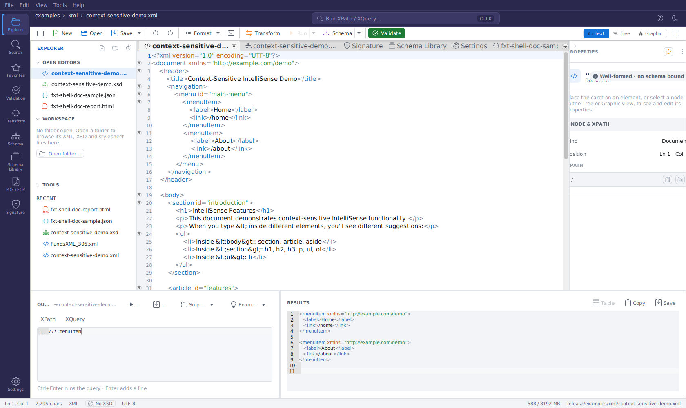
*The Query Console with IntelliSense: typing `/` in the XPath input opens the completion popup
(document elements and axes). The mode toggle and Run are on the left; on the right, the results
pane shows the previous run's XML result with syntax highlighting.*

### Layout

- **Left - the query:**
  - An **XPath / XQuery** mode toggle. While a JSON document is active, the XPath toggle
    reads **JSONPath**.
  - The query input **with IntelliSense** (autocomplete): suggestions pop up as you type after
    `/`, `//`, `@`, `[`, `(`, `$` and `::`, or on demand with **Ctrl+Space**. It suggests element
    and attribute names from the active document, XPath/XQuery functions, axes, operators and
    (in XQuery mode) FLWOR keywords. Use ↑/↓ to navigate and **Enter**/**Tab** to accept.
  - The query is **syntax-highlighted** as you type: keywords, functions, axes, variables,
    strings, numbers and comments each get their own color.
  - To run: press **Ctrl+Enter** in either mode (Enter inserts a new line, so queries can
    span several lines; a hint below the query says so). The **Run** button works in both modes.
  - **Run** - Execute the query against the active document.
  - **Save** - Save the current expression as a reusable snippet (see below).
  - **Snippets** - A menu of your saved XPath and XQuery snippets; pick one to load it (the console
    switches to the matching mode automatically).
  - **Examples** - Inserts a built-in XQuery example: **Simple**, **FLWOR**, **HTML report** or
    **Data-quality check**.
- **Right - the results:**
  - A read-only, selectable results editor with **line numbers** showing the query
    result. **XML results are
    syntax-highlighted** (tags, attributes, values, comments), and **JSON results** (e.g. from
    JSONPath queries) get JSON highlighting; scalar results and messages stay plain.
  - **Copy** - Copy the full result to the clipboard.
  - **Table** - Shows the last XQuery result as a table in the
    [OUTPUT panel](#the-output-panel-results) (enabled after an XQuery run whose result can be
    shown as a table).

Like the text editor, every console area zooms with the mouse: hold **Ctrl** and scroll the
**mouse wheel** over the query input or the results to change that area's font size
(**Ctrl+0** resets it).

### Running a Query

1. Open the console (**Ctrl+K**, the header search pill, the terminal icon, or **Ctrl+Shift+X**) - it opens focused on the query input.
2. Choose **XPath** or **XQuery** with the mode toggle.
3. Type your expression, then click **Run** (in XPath mode, **Enter** also runs).
4. The result appears on the right. Use **Copy** to put it on the clipboard.

The console always runs against the **active** document. For an **XML** document it evaluates the
expression directly; for a **JSON** document the toggle reads **JSONPath** and the input is
evaluated as a **JSONPath** expression. When no document is open, **Run** is disabled and the results pane shows
*"No document open."*

The `map:`, `array:` and `math:` function namespaces are
**pre-declared** in the console, so XPath 3.1 expressions using `map:merge()`,
`array:size()`, `math:pow()` etc. run directly - no namespace prolog needed.

!!! note
    The Query Console is an additional, faster access point - it does not replace the **Transform**
    activity. For XSLT transformations, parameters, recent-stylesheet history, watch-and-rerun, and
    the OUTPUT panel's result table and HTML preview, use the [Transform Panel](#transform-panel).

### Saving and Loading Snippets

Reusable XPath **and** XQuery expressions are saved as **snippets**:

- **Save** - Prompts for a name and stores the current expression. XPath snippets are saved as
  `.xpath` files and XQuery snippets as `.xquery` files.
- **Snippets** - Lists every saved snippet, prefixed with its kind (*XPath* / *XQuery*). Selecting
  one loads it into the console and switches to the matching mode.

Snippets are kept in the shared query folder.

Saved snippets can be **managed** directly from the menu. Each snippet's
submenu offers, next to *Load into console* and *Open in editor*:

- **Overwrite with current query** - Replaces the saved expression with the console's current
  input of the snippet's kind (an `.xpath` snippet always takes the XPath input, an `.xquery`
  snippet the XQuery input), after a confirmation.
- **Rename…** - Prompts for a new name (pre-filled with the current one). Names already in use
  are refused.
- **Delete…** - Deletes the snippet file, after a confirmation.

The entries in the **FUNDSXML** section (see below) are read-only - they are re-registered from
the FundsXML content cache on every start and therefore offer no management actions.

Looking for ready-made queries? The installation's `examples/xpath/` folder contains
**32 XPath 3.1 examples** and `examples/xquery/` contains **17 XQuery 3.1 scripts**
(data-quality checks plus a reporting series producing CSV, ASCII tables/charts,
Markdown and JSON), all written for the FundsXML4 sample files in `examples/xml/`.
Paste them into the console, or copy the `.xpath` files into your query folder to have
them appear in the **Snippets** menu. See the `README.md` in each folder for details.

When the optional [FundsXML extension](fundsxml-extensions.md) is
enabled, the **Snippets** menu also shows a **FUNDSXML** section with the XPath/XQuery
example queries shipped with the FundsXML examples (for example *fund-summary*,
*top-holdings*, *look-through*, *aggregate-by-assettype*). Selecting one loads it into the
console and switches the XPath/XQuery mode to match. These entries come from the FundsXML
content cache and are re-registered automatically on every start.

## XPath / XQuery Autocomplete

The XPath/XQuery inputs of the Query Console offer context-aware
autocomplete in both the XPath and
XQuery input fields. Suggestions appear automatically after trigger characters (`/`, `[`, `@`, `(`,
`$`, `::`) or on demand with **Ctrl+Space**. Depending on context it suggests element names, attribute
names, XPath axes, functions, and (in XQuery) variables. Navigate with the arrow keys and press
**Enter** or **Tab** to insert; **Escape** dismisses the popup. Functions and axes are inserted with
their parentheses / `::` automatically.

### Saving, Loading and Examples

Saved queries are the Query Console's **Snippets** menu, and its **Examples** menu inserts the
built-in XQuery examples - see [Saving and Loading Snippets](#saving-and-loading-snippets).

## Drag and Drop

Drag files from your file manager directly into the editor to open them. Multiple files can be dropped at once.

The file **pickers and source rows** across the shell are **drop
targets too**:

- Drop an `.xsl` / `.xslt` file onto the Transform panel's **[STYLESHEET](#stylesheet)** row
  to make it the current stylesheet.
- Drop an `.xml` file onto the Transform panel's **[INPUT](#input)** row to make it the
  transform's input file. On both Transform panel rows a drop behaves like picking a
  favorite: the file is loaded into the editor and the transform **runs automatically** once
  both a stylesheet and an input are ready (while **Run automatically** is checked).
- Drop a `.sch` / `.schematron` file onto the Validation panel's
  **[SCHEMATRON source row](#sources)** to make it the current
  Schematron (and bind it to the active document). Like every schema, stylesheet or input
  dropped on a panel row, it is also loaded into the editor - schemas behind the document
  they are bound to, inputs as the active tab.
- Drop an `.xsd` file onto the Validation panel's **[XSD source row](#sources)** or onto
  the **[schema indicator in the status bar](#status-bar)** (shown for XML-family documents)
  to bind that schema to the active document.
- Drop a `.json` schema onto the Validation panel's **[JSON Schema source row](#sources)**
  or onto the **[schema indicator in the status bar](#status-bar)** (while a JSON document
  is active) to bind it for JSON validation.
- Drop an `.xml` file onto the **[PDF / FOP panel](#pdf-fop-panel)**'s XML input row, or
  an `.xsl` / `.xslt` file onto its XSL-FO stylesheet row, to set the PDF rendering
  sources.
- Drop a keystore file (`.jks`, `.keystore`, `.p12`, `.pfx`) onto the
  **[Signature page](#signature-panel)**'s KEYSTORE row or Expert Mode's trust store row.
- Drop an `.xsd` file anywhere on the **[Schema panel](#the-schema-panel)** (Type
  Library) to **open it as a document** - unlike the targets above, this drop *opens* the
  file instead of binding or selecting it; the panel shows a **dashed** green/red border
  while you drag.

While you drag, the target shows **green** feedback when the file can be loaded there and
**red** feedback when the extension does not match - a red drop is rejected and does
**not** open the file in the editor. On the picker and source-row targets, a valid drop
behaves exactly like choosing the file via **Change** or a favorite: it is recorded in
the recent list (where the target has one) and shared between the Explorer bars and the
panels. The feedback colors follow the light and dark theme.

## Where the former tabs went

The Unified Shell consolidates what used to be separate sidebar tabs. The earlier
standalone editors - XSD Editor, XSD Validation, JSON Editor, XSLT Viewer, Schematron,
Schema Generator, Digital Signatures and FOP/PDF - have been **retired** and their
functionality now lives in the shell:

| Former tab | Now in the shell |
|------------|------------------|
| XSD Editor / Tools | Open an `.xsd`: Text/Tree/Graphic views + inspector; **Schema** activity (Type Library panel) for type editing, documentation, flatten and schema analysis |
| XSD Validation | **Validation** activity (single + batch, XSD & Schematron) |
| JSON Editor | Open a `.json` / `.jsonc` / `.json5`: Text / Tree / Graphic (grid) views + inspector; JSONPath via the Query Console; JSON Schema validation in the **Validation** activity |
| XSLT Viewer | **Transform** panel (set stylesheet, transform, preview, browser) |
| Schematron | **Validation** activity: check rules, templates, tester, builder, documentation, CSV/JSON export |
| Schema Generator | Editor toolbar **Schema ▾** → Generate XSD from XML |
| Digital Signatures | **Signature** activity (sign, validate, trust validation, certificate creation) |
| FOP / PDF | **FOP** activity (XSL-FO → PDF + preview) |
| XSLT Developer | **Transform** panel + editor: run/live transform, parameters, and the OPTIONS & TOOLS section (batch, profile, trace, debugger) — see [XSLT Developer](xslt-developer.md) |
| XML Editor | The shell's editor itself: every XML document opens with IntelliSense, Text/Tree/Graphic views and the Properties inspector |
