# XML Editor

The XML Editor is the main feature of FreeXmlToolkit. It provides a powerful and easy-to-use interface for working with XML files.

---

## Overview

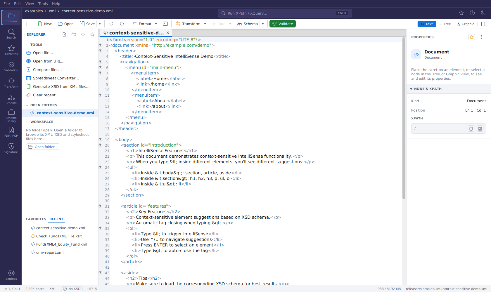
*The XML Editor in text mode with syntax highlighting*

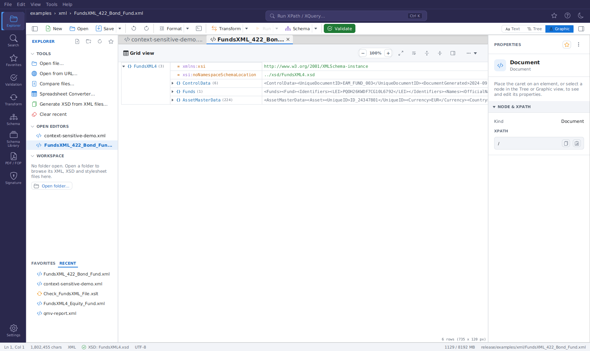
*The XML Editor in the Graphic view (grid) for structured editing*

---

## Toolbar

> The editor toolbar is a single slim row. Related actions sit in
> **split buttons** with a visible **▾** arrow menu (e.g. **Save As / Save All** under
> **Save ▾**, **Minify** under **Format ▾**); secondary tools are icon-only buttons with
> tooltips. See [Unified Shell - Toolbar](unified-shell.md#toolbar) for the full reference.

With an XML file active, the toolbar offers:

| Button | Shortcut | Description |
|--------|----------|-------------|
| **New** | Ctrl+N | Open the guided New File dialog |
| **Open** | Ctrl+O | Open one or more files |
| **Save ▾** | Ctrl+S | Save the current file; the arrow menu holds **Save As…** (Ctrl+Shift+S) and **Save All** |
| **Undo** / **Redo** | Ctrl+Z / Ctrl+Y | Undo / redo the last change (icon buttons) |
| **Format ▾** | Shift+Alt+F | Pretty-print the document; the arrow menu holds **Minify**. (Note: Ctrl+Shift+F opens [Find in Files](unified-shell.md#search-panel), not document search.) |
| **Query Console** | Ctrl+Shift+X | Toggle the bottom XPath/XQuery console (icon button) |
| **Transform XSLT** | - | Pick a stylesheet and transform the active XML (icon button) |
| **Schema ▾** | - | **Set XSD Schema…** for IntelliSense and validation; the arrow menu also holds **Generate Documentation…** and **Type Editor…** (enabled for XSD files) and **Generate XSD from XML** / **Generate XSD from XML Files…** |
| **Validate** | F8 | Validate the document (the toolbar's primary action, filled in Validation green - see [Colours: workflows and actions](unified-shell.md#colours-workflows-and-actions)) |

**Insert Template…** (Ctrl+T, **Edit** menu), **Compare with File…** and **Spreadsheet
Converter…** (Ctrl+E, both in the **Tools** menu) are menu commands, not toolbar buttons.
Without an open document (for example on the Welcome page) the toolbar shows only **New** and
**Open**.

The **Run ▾** button and the **Input** dropdown (*"Input: …"*) appear when a query, XSLT, or XProc document
is active - see [Query Documents](query-console.md#query-documents-the-target-selector).

---

## Working with Files

### Opening and Saving Files

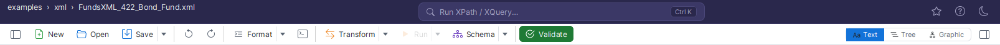
*The shell header and the editor toolbar with the New, Open, Save ▾, and Format ▾ buttons*

- **Open Files**: Click "Open" or use `Ctrl+O` to browse for XML files
- **Save Files**: Click "Save" or use `Ctrl+S` to save changes to the current file
- **Save As**: Use `Ctrl+Shift+S` (or the **Save ▾** arrow menu) to save the current file with a new name
- **Save All**: Pick **Save All** from the **Save ▾** arrow menu to save every open document tab at once (untitled tabs prompt you for a file name)
- **Create New**: Click "New" (Ctrl+N) to open the guided [New File dialog](unified-shell.md#new-file-dialog) - pick a file type, an optional template or schema, and start editing
- **Drag & Drop**: Drag files from your file explorer into the editor
- **Recent Files**: Reopen recently used files from the Explorer panel's **RECENT** section or the Welcome page

### Multiple Files

Open multiple XML files in separate tabs. Each tab shows the file name and indicates unsaved changes with an asterisk (*).

---

## Editing Modes

### Text Mode


*Text editor with syntax highlighting*

The text editor provides:

- **Syntax Highlighting**: XML elements, attributes, and values are color-coded
- **Line Numbers**: Every line is numbered for easy reference
- **Code Folding**: Click arrows to collapse or expand sections
- **Auto-Completion**: Type `<` to see suggestions for valid elements
- **Error Highlighting**: Invalid XML is highlighted in red
- **Edit Properties**: Move the text cursor into an element and edit its properties in the
  Properties inspector - see [Properties Inspector](#properties-inspector)

### Tree View

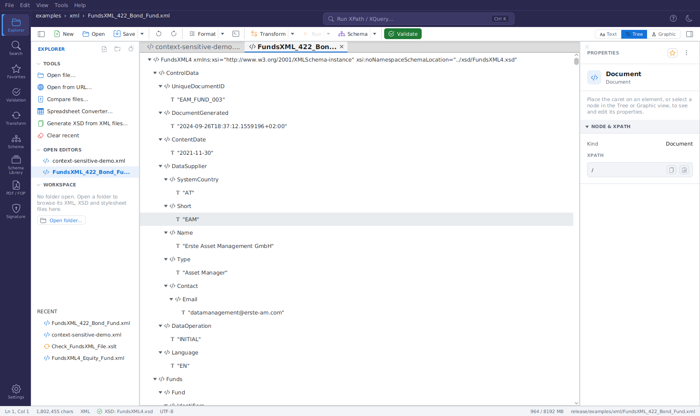
*Tree view showing XML structure*

- See your XML document as a hierarchical tree
- Click any node (element, text, comment, CDATA, or processing instruction) to select it
- Edit the selected node's properties in the Properties inspector - see
  [Properties Inspector](#properties-inspector)
- Right-click for context menu options

### Graphic View (Grid)

> For XML documents (and XSLT / Schematron), the **Graphic** view shows the editable XMLSpy-style grid.

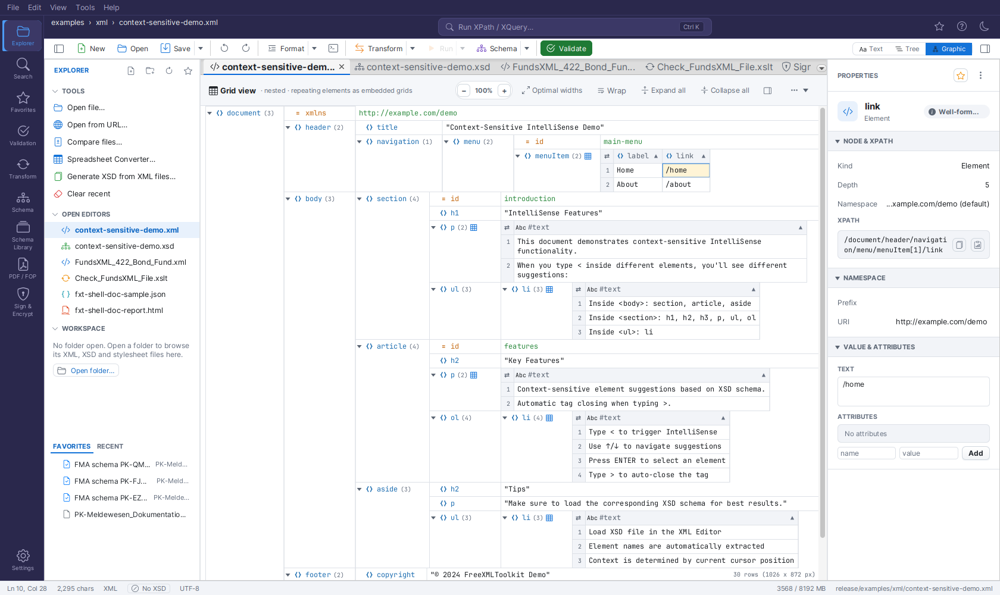
*An XML document in the Graphic view (XMLSpy-style grid editing)*

1. Open an XML file and switch to the **Graphic** view with the view switch
2. Click cells to edit values directly; move with the arrow keys
3. Add, delete, wrap or move nodes through the right-click context menu or drag & drop
4. Select a row to view and edit its properties in the [Properties inspector](#properties-inspector)

Repeating elements appear as **embedded tables** (sortable, flippable, copy/paste with
spreadsheets), cells can be **opened** to show their nested content as a grid of their own, and
the **entry helpers** side panel offers the siblings, children and values the bound XSD allows.
All views share one model, so changes show up in the Text view immediately.

See the **[Grid View](grid.md)** page for every grid feature.

### Code Folding

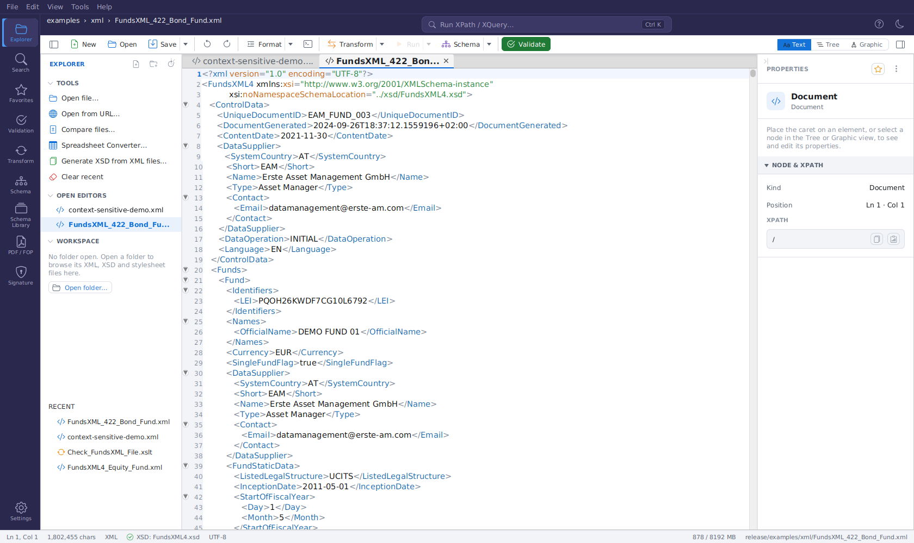
*Code folding - collapse XML sections to focus on the parts that matter*

For large XML files, you can collapse sections to focus on what you're working on:

- **Collapse**: Click the minus (-) icon next to an element
- **Expand**: Click the plus (+) icon to show the content again
- **Nested Folding**: Collapse parent elements to hide all children


---

## Properties Inspector

> The Properties inspector lets you view **and edit** a node's
> properties in **all three** XML views - Text, Tree, and Graphic.

The Properties inspector shows the details of the currently selected node and lets you change
them. Toggle the panel with the toggle at the right end of the editor toolbar; it appears on
the right side of the editor. The [Properties Inspector](inspector.md) page describes it for every
document type.

### Selecting a Node

How you select a node depends on the active view:

- **Text view** - Move the text caret into an element. That element is selected automatically
  and shown in the inspector. If the caret is not inside a well-formed element, the inspector
  shows a read-only view with the node's name and XPath. In large files (from 8 MB) the
  inspector follows the caret right away after edits in the grid. After you type, it shows no
  node until you pause for about 1.5 seconds. The file is then parsed again in the background,
  which takes a few seconds for very large files (about 5 seconds for 150 MB).
- **Tree view** - Click a node in the tree (element, text, comment, CDATA, or processing
  instruction).
- **Graphic view** - Select a row in the grid.

### What You Can Edit

Depending on the node type, the inspector lets you edit:

- **Element name** - click the name in the node header at the top of the inspector to rename it
- **Namespace** (prefix and URI) - in the **NAMESPACE** section, right below NODE & XPATH
- **Attributes** - in the framed list of the **VALUE & ATTRIBUTES** section: click a name to
  rename it, click a value to edit it (**Enter** saves, **Esc** cancels), point at a row and
  click the trash icon to delete it, and use the row below the list to add one. You can also
  reach the rows with **Tab**: **Enter** edits the value, **Delete** removes the row
- **Text content** of leaf elements
- **Text** of comments, CDATA sections, and processing instructions

Editable values look like plain text; the field frame appears when you point at or click them.
Long values wrap instead of being cut off. **NODE & XPATH** shows the element's **Depth** (the
root element is 0) and has **Copy XPath** and **Copy Node (XML)** buttons next to the XPath.
Sections without content are not shown.
The **⋮** menu at the top of the inspector offers **Copy XPath**, **Copy Node (XML)**,
**Expand All Sections** and **Collapse All Sections**, and the **star** next to it adds the file
to your Favorites. For the full layout, see
[Properties Inspector](inspector.md).

Your edits are written straight back to the document, so the source text always stays in sync.
In the Text view, edits are applied as a minimal change that keeps your caret and scroll
position in place.

### Schema Information

When the XML file is bound to an XSD schema, the inspector also shows what the schema says
about the selected element. The node header's validation pill shows **Valid**, the number of
errors, or *Well-formed · no schema bound* when no schema is bound.

- **Schema facts** - Type, Base type, Derivation (with list item type / union member types),
  the facets including enumeration values, minOccurs/maxOccurs, Use, **Order** (the element's
  position in its parent sequence or choice, e.g. *3 of 3 · sequence*), nillable, default and
  fixed values, *Since …* / *Deprecated: …*, the schema's appinfo, and identity constraints,
  assertions and type alternatives in **CONSTRAINTS**.
- **Declaration box** - *Declared in X.xsd · local element · type T* with an **Open in schema**
  link that opens the XSD in the Graphic view, expanded along the element's path in the
  document, and selects this element there.
- **Editing the schema from here** - where the declaration is editable, Type,
  minOccurs/maxOccurs, Nillable, Fixed, Default, the facets and the documentation/appinfo change
  the declaration **in the XSD**. The XSD opens as a background tab (your XML stays in front),
  the change is one undo step there, and after you save the XSD the XML document's schema facts
  are reloaded. Declarations from included/imported schemas and cached Schema Library copies are
  read-only. See
  [Properties Inspector - Editing the bound schema](inspector.md#editing-the-bound-schema).
- **Documentation** - the element's documentation from the schema (*"No documentation in the
  schema"* when there is none).
- **Value check** - *"Value matches the schema facets"* in green, or an amber warning such as
  *"Value should be one of: …"* when the current text breaks a facet.
- **EXAMPLE VALUES** - shown as chips; click one to use it as the element's text.
- **VALID CHILDREN** - shown as chips; click one to add that child element (*None* when the
  element allows no children).
- **USED IN** - the containing element and its type.
- **Attributes** - each row shows its declared type as a badge (`*` = required); attributes the
  schema does not declare are marked **undeclared**; enumerated attributes get a drop-down.
  **DECLARED, NOT SET** chips (e.g. **+ id \***) add a missing declared attribute, with a
  default or fixed value filled in.

### Shared Across Views

All three views share a single in-memory model for each open document. This means your edits -
and your full **Undo / Redo** history - are preserved when you switch between the Text, Tree,
and Graphic views.

> **Note:** Adding, deleting, or moving whole nodes (structural editing) is done in the
> **Graphic** view (the grid) via its right-click context menu. The Text and Tree views provide
> property editing through the inspector.

---

## Search (Find)

> Search works in **every view mode** — Text, Tree and Graphic — for XML documents, XSD schemas and JSON documents.

### Finding Text in Your Document

Press **Ctrl+F** to open the Find feature and type the text you are looking for. Use the up and down arrows (**Find Previous** / **Find Next**, or Enter / Shift+Enter) to move between matches. When you reach the last match, the search wraps around and continues from the beginning.

### Search Works in All Views

You can search in the **Text**, **Tree** or **Graphic** view of a document:

- **Text view** - Matches are highlighted in the source code. **Replace** is available here.
- **Graphic view (XML instances)** - The search looks through element names, attribute names, and values across the whole document, including the cells of embedded tables. When you press the up/down arrows, the editor jumps directly to the matching node: if the match is inside a collapsed node, its parent nodes are expanded automatically, the matching row is selected, and it is scrolled into view.
- **Tree and Graphic views (XSD schemas)** - The search looks through the schema nodes themselves: element/attribute/type names, documentation and appinfo, type references, fixed/default values, enumeration and facet values, and comments. Matching nodes are revealed (collapsed branches expand), selected, and scrolled into view — in the Graphic diagram this includes loading lazily rendered subtrees.
- **Tree and Graphic views (JSON documents)** - The search looks through the keys and values of the document. Matches inside collapsed objects or arrays are revealed, selected, and scrolled into view, the same way as in the XML grid.

Searching is **case-insensitive** in all views.

### Switching Views While Searching

If you switch the view mode (Text / Tree / Graphic) or the file tab while the search bar is open, the search automatically re-targets the view you switched to, so you can keep navigating without retyping your search term.

### Where Search Is Available

Pressing **Ctrl+F** opens an **inline search bar** at the top of the editor, with up/down
chevron arrows for Find Previous / Find Next and a replace toggle (Text view only). The same
bar works in every view mode, for every XML-family document type and for JSON documents.

> **Note:** In the **Tree** and **Graphic** views, search is for finding and navigating only - **Replace** is not available there (the replace toggle is disabled). To replace text, use the **Text** view.

> **Note:** HTML documents have a rendered, read-only **Preview** view instead of Tree/Graphic (see [HTML Preview](unified-shell.md#html-preview)). Pressing **Ctrl+F** there searches the document's underlying markup text, not the rendered page.

### Searching Across Many Files

Ctrl+F searches the **active document**. To search - and replace -
across **all files of a folder**, by plain text or by an XPath expression, use the
**Search** activity in the Unified Shell: press **Ctrl+Shift+F** (Find in Files) or
**Ctrl+Shift+H** (Replace in Files), or click the magnifying-glass icon in the activity
bar. See the [Search Panel](unified-shell.md#search-panel) guide.

> **Changed shortcut:** Ctrl+Shift+F used to format the document - **Format Document is
> now Shift+Alt+F**.

---

## Auto-Completion (IntelliSense)

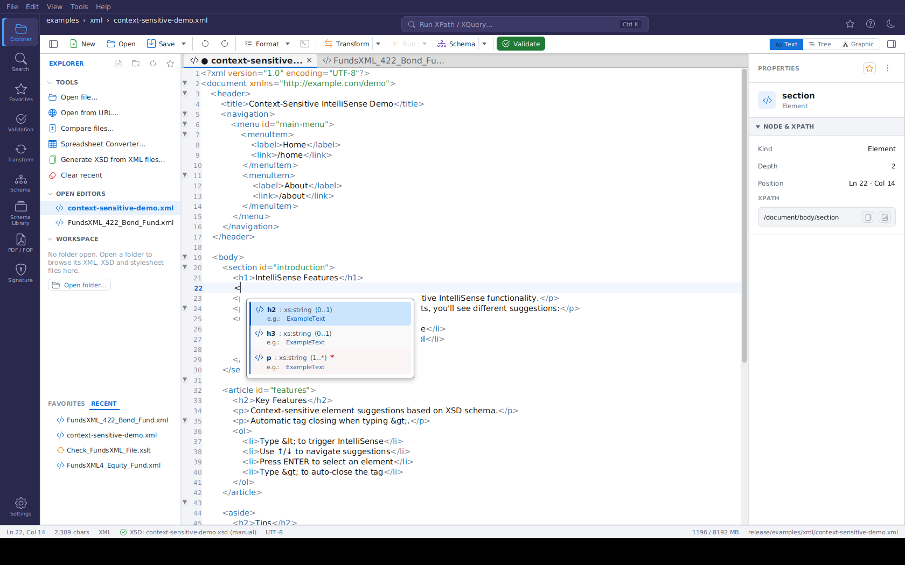
*Auto-completion popup showing element suggestions*

The editor automatically suggests valid elements and attributes based on your XSD schema:

1. **Type `<`** to see a list of valid child elements
2. **Navigate** through suggestions with arrow keys
3. **Press Enter** to insert the selected element
4. **Press Escape** to close the suggestions

The suggestions are context-sensitive - only elements valid at your current position are shown.

### Attribute Suggestions

Inside a start tag, type a space (or press **Ctrl+Space**) to see the element's attributes:

- **Schema-bound XML** - the attributes your XSD declares for the element (including attribute
  groups), required ones first, with type and documentation in the tooltip
- **XSLT stylesheets** - the attributes of every XSLT 3.0 element from a built-in catalog, no
  schema needed
- Attributes with fixed values (XSD enumerations and booleans, XSLT values such as `xml`, `html`,
  `text` for `xsl:output method`) show their values right after insertion; **Ctrl+Space** inside
  the quotes brings them back
- Attributes already in the tag are not offered again; accepting one inserts `name=""` with the
  cursor between the quotes

### Auto-Closing Tags

When you type an opening tag like `<element>`, the editor automatically adds the closing tag `</element>` and places your cursor between them.


Learn more: [Auto-Completion Guide](context-sensitive-intellisense.md)

---

## Binding an XSD Schema

> Bind an XSD to the active document directly from the editor.

If your XML does not reference its schema (or you want to use a different one), you can bind an
XSD by hand:

1. Click the **"No XSD"** indicator in the **status bar** (it shows **"XSD: name"** once a
   schema is bound), or click the toolbar's **Schema** button (**Set XSD Schema…**).
2. Choose an `.xsd` file.

The binding applies to the active document and drives **both** features at once:

- **IntelliSense** - auto-completion suggests the elements and attributes the schema allows.
- **Schema validation** - Validate (F8) and continuous validation check against the bound XSD.

### Go to Definition {#go-to-definition}

Jump from an element in your XML document to the place in the bound XSD that declares it:

- **Graphic view (grid)** and **Tree view:** right-click an element → **Go to Definition**
- **Text view:** right-click inside an element → **Go to Definition (Ctrl+Click)**, or hold
  **Ctrl** and click the element

The XSD opens in front (in its own tab, if it was not open yet) in the **Graphic** view. The
diagram is expanded along the element's path from the document root, and the card of the
declaration is selected. Because the path is followed, elements with the same name in different
places - for example a `Name` inside `Customer` and a `Name` inside `Product` - each lead to their
own declaration. If the path cannot be found in the schema (for example an element allowed by a
wildcard), the first declaration with that name is selected instead.

The entry is available for elements only, and only when a schema is bound to the document.

---

## Formatting Tools

### Pretty Print

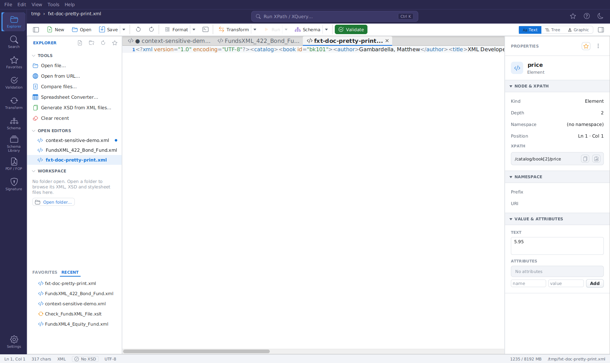
*Before pretty print*

Click **Format** or use `Shift+Alt+F` to format your XML with proper indentation. (The
**Format ▾** arrow menu also offers **Minify** to strip all insignificant whitespace.)

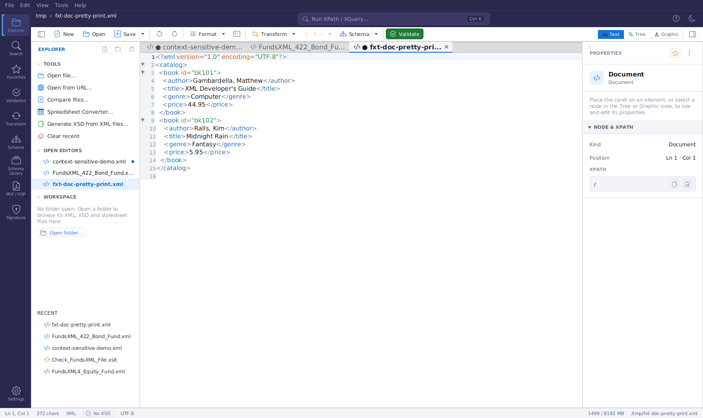
*After pretty print*

---

## Validation

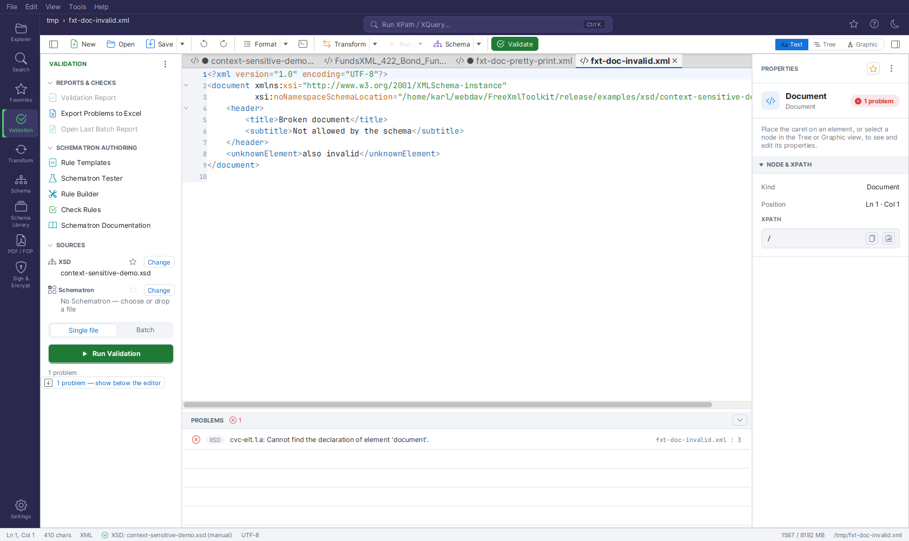
*Validation panel showing errors and warnings*

### How to Validate

1. Click **Validate** or press **F8**
2. If your XML references a schema, it's loaded automatically - or bind one yourself, see
   [Binding an XSD Schema](#binding-an-xsd-schema)
3. Errors and warnings appear in the **PROBLEMS** panel below the editor (and in the
   Validation activity's PROBLEMS list)
4. Click an error to jump to the problem location

### Supported Validation Methods

| Method | Description |
|--------|-------------|
| **Well-Formed Check** | Ensures basic XML syntax is correct |
| **XSD Validation** | Validates against XML Schema files |
| **Schematron** | Validates against business rules |

### Supported Schema Formats

| Format | Support |
|--------|---------|
| XSD (XML Schema) | Full support (1.0 and 1.1) |
| Schematron | Full support |
| DTD | Not supported |
| RelaxNG | Not supported |

---

## Schematron Integration

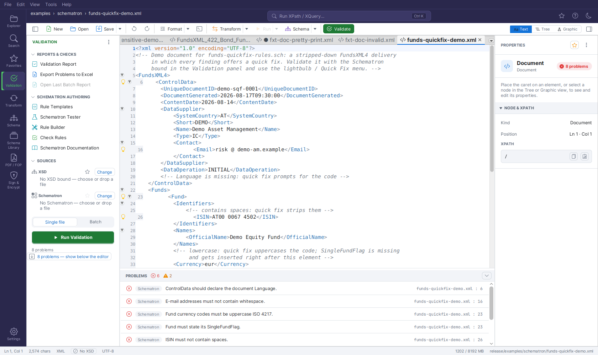
*Schematron validation in the Validation panel - the bound rules file in SOURCES, the
findings in the PROBLEMS list*

### What is Schematron?

Schematron lets you create custom validation rules for your XML documents. While XSD schemas validate the structure, Schematron validates business rules - for example, "if field A contains X, then field B must not be empty."

### How to Use Schematron

1. Open an XML file in the editor
2. Open the **Validation** panel from the activity bar
3. In the **SOURCES** section, click **Change** on the Schematron row and pick a `.sch`
   file - or pick a favorited Schematron from the row's **star** menu, or simply drop a
   `.sch` file onto the row
4. Click **Run Validation** - the findings appear in the **PROBLEMS** list (each row tagged
   with a **Schematron** badge); click a problem to jump to the offending element
5. Enable **Validate while typing** (the panel's ⋮ menu) to check as you type

Problems whose rules define **quick fixes** can be corrected in place: click the yellow
lightbulb in the editor gutter (or press **Alt+Enter** / **Ctrl+.**), or right-click the
problem row and pick a fix from the **Quick Fix** submenu. See
[Schematron Quick Fixes](schematron-quick-fixes.md).

### Saving Schematron Files as Favorites

Save frequently used Schematron files for quick access:
- Add them to your [Favorites](favorites-system.md) (for example with **Add current** in the
  Favorites panel while the `.sch` file is open)
- Organize them in favorites folders like "Business Rules"
- Bind a saved rules file in one click via the **star** menu on the Validation panel's
  Schematron row - or via **Validate with Other Schematron ▸ Favorites** in the Explorer's
  right-click menu

Learn more: [Schematron Support](schematron-support.md) | [Favorites System](favorites-system.md)

---

## XPath and XQuery

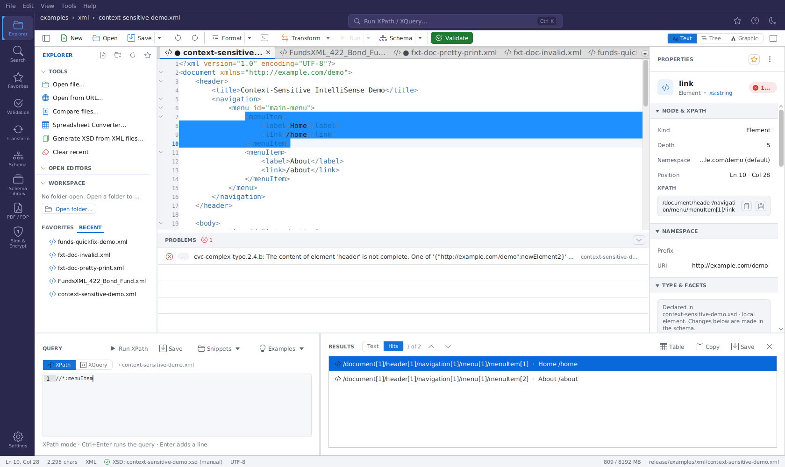
*The Query Console docked below the editor - XPath query on the left, the result on the right*

Use XPath and XQuery to find and extract data from your XML documents. The fastest way is
the **Query Console**, a panel that docks along the bottom of the editor and always runs
against the **active** document.

### Using the Query Console

1. Toggle the console with **Ctrl+Shift+X** or the toolbar's terminal icon
2. Choose **XPath** or **XQuery** with the mode toggle
3. Enter your expression - it is syntax-highlighted, and IntelliSense suggests element
   names, functions, and axes as you type (or on **Ctrl+Space**)
4. Click **Run** or press **Ctrl+Enter** (Enter inserts a new line; the hint below the query says so)
5. The result appears in the read-only results pane on the right, with syntax highlighting;
   **Copy** puts it on the clipboard

**Save** stores the current expression as a named snippet, and the **Snippets** menu loads
any saved XPath or XQuery snippet back into the console. See
[Query Console](query-console.md#query-console) for the full reference.

### XPath Examples

| Expression | Description |
|------------|-------------|
| `//element` | Find all elements named "element" |
| `//element/@attr` | Find all "attr" attributes on "element" |
| `/root/child[1]` | Find the first child of root |
| `count(//item)` | Count all item elements |
| `//text()` | Find all text nodes |

### XQuery Examples

| Expression | Description |
|------------|-------------|
| `for $x in //item return $x` | Return all items |
| `for $x in //item where $x/@id='1' return $x/name` | Filter and return |

Use the **Examples** menu for quick insertion of common expressions.

### Bundled Example Collections

Your FreeXmlToolkit installation ships ready-to-run query
collections in the `examples` folder next to the application:

- **`examples/xpath/`** - 32 XPath 3.1 expressions (one per file, each with a comment
  header). Files 01-20 cover the basics; files 21-32 are a **reporting series** that
  joins positions, asset master data and transactions and outputs CSV, ASCII
  tables/charts, Markdown tables or JSON.
- **`examples/xquery/`** - 17 XQuery 3.1 scripts. Files 01-11 are data-quality checks
  with HTML reports; files 12-17 are **reporting/export examples** (CSV export, ASCII
  dashboard, Markdown fund report, JSON export, pivot table, two-fund comparison).
- **`examples/xproc/`** - 8 XProc 3.0 pipelines, from a minimal identity pipeline to
  multi-step chains: slimming with `p:delete`, CSV/JSON export by orchestrating the
  bundled stylesheets, metadata stamping, `p:for-each` iteration, `p:choose`
  branching and a Schematron SVRL report. See the folder's `README.md`.

All examples target the FundsXML4 sample documents in `examples/xml/`. The simplest way
to run one: **open the file directly** and press the toolbar's **Run** button
(`Ctrl+Enter`) - query, XSLT and XProc files are first-class editor documents that run
against the [Input dropdown](query-console.md#query-documents-the-target-selector)'s
selection (by default the most recently active XML document). Alternatively paste a query
into the query panel or the [Query Console](query-console.md#query-console) - the
`map:`, `array:` and `math:` function namespaces are pre-declared, so expressions using
`map:merge()`, `array:size()` etc. run without any prolog. Each folder contains a
`README.md` describing every example.

---

## XML/Excel/CSV Converter

Choose **Tools → Spreadsheet Converter…** (Ctrl+E) to open the converter dialog:

- **XML to Excel**: Export XML data to Excel spreadsheet
- **XML to CSV**: Export XML data to CSV file
- **Excel to XML**: Import Excel data as XML
- **CSV to XML**: Import CSV data as XML

The Excel workbook looks like the Data Dictionary export: a dark header row that stays in
view while you scroll, striped rows, XPaths in a monospace font, and container elements in
bold. It also has an AutoFilter and prints one page wide.

When an **XSD is bound** to the document, each value goes into a cell of its schema type.
The type is followed through derived simple types, `xs:simpleContent` and imported schemas:

| Schema type | Excel cell |
|-------------|------------|
| `xs:integer`, `xs:int`, `xs:long`, … | Number, format `0` |
| `xs:decimal` | Number, showing as many decimals as the XML value (`10.50` → `10.50`) |
| `xs:double`, `xs:float` | Number, General format |
| `xs:boolean` (`true` / `false`) | TRUE / FALSE |
| `xs:date`, `xs:dateTime`, `xs:time` | Date / time, `yyyy-mm-dd` / `yyyy-mm-dd hh:mm:ss` / `hh:mm:ss` |

Some values stay text, so that importing the workbook gives back exactly the same XML:

- values with more than 15 digits;
- leading zeros or `+`;
- `0` / `1` booleans;
- dates with a timezone or before 1900;
- times more precise than milliseconds;
- lists, unions and values that do not match their type.

Without a schema, every value is text.

**Excel to XML** turns typed cells back into their XML form. It also uses an XSD, so that cells
you entered or changed by hand still give valid values:

- the date cell `31.01.2024` under `xs:dateTime` becomes `2024-01-31T00:00:00`;
- a plain number such as `45322` under `xs:date` becomes `2024-01-31`;
- a date-formatted cell under `xs:decimal` stays a number;
- `1` / `0` or the text `TRUE` under `xs:boolean` become `true` / `false`;
- `42.0` under `xs:int` becomes `42`;
- blanks around a number or date are removed;
- a formula gives its result instead of the formula text (this also applies without a schema).

**CSV to XML** uses the XSD too. A CSV holds only text, so the import repairs values that do not
fit their type yet. This is typical after the file went through a spreadsheet application:

| In the CSV | XSD type | Imported |
|------------|----------|----------|
| `1.234,50` · `1,234.50` · `1 234,50` | `xs:decimal` | `1234.50` |
| `31.01.2024` · `2024/01/31` | `xs:date` | `2024-01-31` |
| `31.01.2024 10:15` | `xs:dateTime` | `2024-01-31T10:15:00` |
| `9:05` | `xs:time` | `09:05:00` |
| `TRUE` · `WAHR` · `yes` | `xs:boolean` | `true` |

A value that is already valid for its type is never changed. For example, `007` under `xs:int`
and `1.234` under `xs:decimal` stay as written. Text values are not touched.

The delimiter decides ambiguous values. In a semicolon file (as European Excel writes it) a
single comma is the decimal separator and `01/02/2024` is 1 February. In a comma file it is
the other way round. Values that stay ambiguous (`1,234` in a tab file) are imported as
written, and validation shows the error. Text cells in an Excel import are repaired the same
way, as far as that is unambiguous.

The import (Excel or CSV) takes the XSD from the **Schema (XSD)** field of the converter dialog. If you leave
the field empty, it uses the schema the file declares: the root element's
`xsi:noNamespaceSchemaLocation` / `xsi:schemaLocation`, resolved relative to the workbook's
folder, or the Schema Library entry for its namespace. The imported document is bound to that
XSD. Without a schema, the cells' own types and formats decide, as before. A value that does
not fit its type is imported as written, and validation shows the error.

The **CSV** export uses the bound XSD as well. CSV has no cell types, so the file gets an extra
**Data Type** column with each value's XSD built-in type (`decimal`, `date`, `dateTime`, …).
Values that are valid for their type are written without quotes; all text fields are quoted:

```
"XPath";"Value";"Type";"Data Type"
"/FundsXML4/ControlData/ContentDate";2021-11-30;"element";"date"
"/FundsXML4/ControlData/DataSupplier/Name";"Erste Asset Management";"element";"string"
```

Values are written exactly as in the XML. A timezone or a leading zero stays as it is.
A value that contains the delimiter, a quote or a line break is always quoted, with inner
quotes doubled. **CSV to XML** reads such values back correctly, including line breaks
inside a value, and ignores the Data Type column. Without a schema, the CSV keeps the plain
format: no Data Type column, and quotes only where needed.

---

## Templates

Choose **Edit → Insert Template…** (Ctrl+T) to insert a snippet:

- Insert pre-defined XML snippets
- Create your own templates (**Settings → Editor → TEMPLATES**)
- Organize templates by category

Learn more: [Template Management](template-management.md)

---

## Schema Generator

With the XML document active, open the editor toolbar's **Schema ▾** menu (click the small
arrow next to the **Schema** button) and choose **Generate XSD from XML** (or **Generate XSD
from XML Files…** for several files) to generate an XSD schema from your XML. Both entries are
also in the menu bar's **Tools** menu; **Generate XSD from XML Files…** works there even without
an open document, because it asks for its files itself:

- Analyze XML structure
- Generate matching XSD schema
- Customize type detection

---

## Favorites

Save frequently used files for quick access:

- **Add Favorite** (Ctrl+D) - Save the current file to favorites
- **Favorites activity** - Click the star icon in the activity bar to open the Favorites
  panel; click any entry to open it as a tab
- Your favorites appear as **star menus** next to the file rows of the Transform, Validation, PDF/FOP panels and the Signature page

Learn more: [Favorites System](favorites-system.md)

---

## Keyboard Shortcuts

The complete list is on the **[Keyboard Shortcuts](keyboard-shortcuts.md)** page (and in the app under **Help → Keyboard Shortcuts**).

Especially useful while editing XML:

| Shortcut | Action |
|----------|--------|
| Ctrl+Space or `<` | Open auto-completion |
| Shift+Alt+F | Format / pretty-print |
| F8 | Validate |
| Ctrl+T | Insert a template |
| Ctrl+Alt+X / Ctrl+Alt+C | Grid view: copy the XPath / the node as XML |
| Ctrl+Click | Text view: [Go to Definition](#go-to-definition) in the bound XSD |
| Ctrl+mouse wheel, Ctrl+0 | Zoom (Text: font size, Graphic: the grid) / reset |

---

## Tips

- **Multiple Files**: Open multiple XML files in different tabs
- **Remember Location**: The editor remembers the last folder you used
- **Font Size / Zoom**: Hold `Ctrl` and scroll the mouse wheel to adjust the font size in the Text view (`Ctrl+0` resets); in the Graphic view the same gesture zooms the whole grid
- **Quick Validation**: Errors are highlighted as you type
- **Drag & Drop**: Drag files directly into the editor window
- **Recent Files**: Reopen recent files from the Explorer panel's **RECENT** section or the Welcome page
