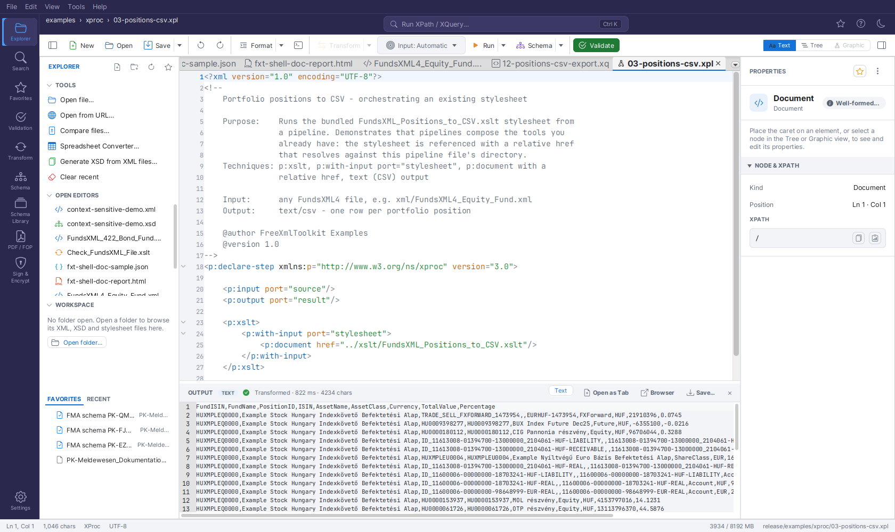

# XProc Pipelines

XProc 3.0 pipelines (`.xpl`, `.xproc`) are first-class editor
documents, executed with the embedded **XML Calabash 3** engine:

*The bundled `03-positions-csv.xpl` example after **Run Pipeline**: the pipeline runs
the CSV export stylesheet (referenced with a relative href) against the Automatic
target and streams the result into the OUTPUT panel.*

- **Run Pipeline** (the toolbar's **Run** button or its ▾ menu, or `Ctrl+Enter`) runs the active pipeline. The
  primary input (`source` port) is the document chosen in the **Input** dropdown —
  by default the most recently active XML document, exactly like
  [Run Query and Run Transform](query-console.md#query-documents-the-target-selector).
- Relative `href`s in the pipeline (`p:document`, `p:xslt` stylesheets, Schematron
  schemas) resolve against the pipeline file's directory.
- Results appear in the **OUTPUT panel**; XML, HTML, text/CSV and JSON outputs are
  routed to the matching view automatically.
- Self-contained pipelines (no input ports, or ports with default bindings) run
  without a target.
- **File → New** offers an XProc skeleton (`p:declare-step` with `source`/`result`
  ports and `p:identity`).
- Ready-to-run examples ship in `examples/xproc/` — see
  [Bundled Example Collections](xml-editor.md#bundled-example-collections).

!!! note "Saxon-HE limitations"
    `p:validate-with-xml-schema` and `p:xsl-formatter` require Saxon-EE and are not
    available; use the Validation activity (Xerces, full XSD 1.1) and the PDF/FOP
    activity instead. `p:validate-with-json-schema` is not supported in this bundle.
