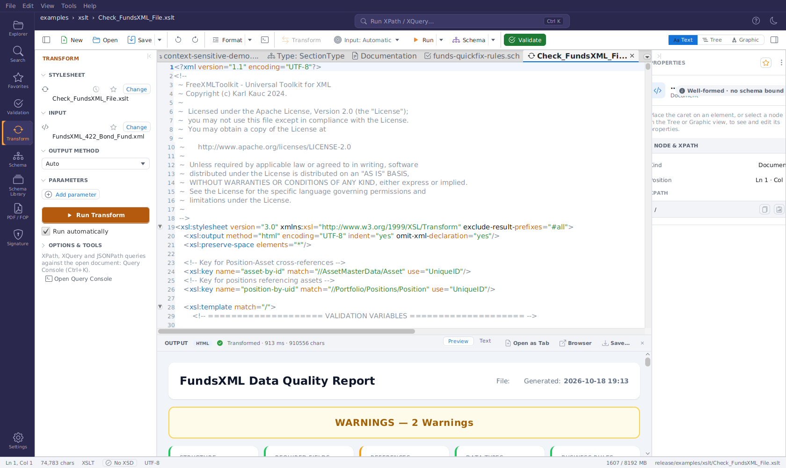

# XSLT Developer

> **Version:** 2.1.0

> **Note:** The standalone *XSLT Developer* tab has been retired. Its
> capabilities now live in the **[Unified Shell](unified-shell.md)'s Transform panel**
> (stylesheet, input, output method, parameters) together with the
> **Debug** button next to **Run Transform** (the interactive debugger with breakpoints,
> stepping, variables, call stack, watches and live messages in a dock below the editor;
> also **Tools → Debug with XSLT…** / **Shift+F5**), and the run options and advanced tools
> in the panel's collapsed **OPTIONS & TOOLS** section — **Batch Transform…**,
> **Profile run**, and **Trace run**. This page describes how to do XSLT and XQuery
> development in the shell, plus a collection of ready-to-use XSLT and XQuery patterns.
> XPath / XQuery queries against the open document run in the
> [Query Console](unified-shell.md#query-console).

FreeXmlToolkit is a full-featured environment for creating and testing XSLT stylesheets and
XQuery scripts. It includes live transformation, parameter support, batch processing, and
debugging tools.

---

## Overview


*An XSLT stylesheet open in the editor, the Transform panel on the left with the stylesheet
and input selected, and the transformation result in the OUTPUT panel below the editor*


XSLT/XQuery development in the Unified Shell provides:

- **Full code editors** for XML, XSLT, and XQuery — every file opens as a normal editor tab
- **Live preview and watch modes** for instant feedback while you edit
- **XSLT Parameters** for reusable stylesheets
- **Multi-file batch processing** for XSLT and XQuery
- **Performance metrics, profiling, and tracing**
- **An interactive debugger** with breakpoints, stepping, and variable inspection
- **Favorites integration** for quick access to stylesheets and input files

---

## Where Everything Lives

| Capability | Where to find it |
|------------|------------------|
| **Edit the stylesheet / query** | Open the `.xsl` / `.xq` file — it is a normal editor tab with syntax highlighting |
| **Choose stylesheet & input** | The **Transform** panel (activity bar → **Transform**): **STYLESHEET** and **INPUT** rows, each with a **Change** link, a **star** (favorites) menu, and **◀ / ▶** browse buttons |
| **Run a transformation** | The panel's **Run Transform** button (with **Run automatically** checked, dropping or browsing a stylesheet/input runs it right away) — or, with the XSLT file active, the toolbar's **Run** button (`Ctrl+Enter` / `F5`). From an XML document, the toolbar's **Transform with XSLT…** opens the Transform panel and runs it there |
| **See the result** | The **OUTPUT panel** docked below the editor (Text / Preview / Table views, open-in-browser, save) |
| **Parameters, output method** | The Transform panel's **PARAMETERS** and **OUTPUT METHOD** sections |
| **XPath / XQuery queries** | The bottom [Query Console](unified-shell.md#query-console) (`Ctrl+Shift+X`, or the Transform panel's **Open Query Console** button) |
| **Debugger** | The **Debug** button next to **Run Transform** (also **Tools → Debug with XSLT…**, `Shift+F5`) - see [Interactive Live Debugger](#interactive-live-debugger) |
| **Batch, profile, trace** | The Transform panel's **OPTIONS & TOOLS** section (below **Run Transform**, collapsed by default; it lists **Debug XSLT…** again) |

---

## Getting Started

### Step 1: Choose Your Files

1. Open the **Transform** panel from the **Transform** icon in the activity bar.
2. In the **STYLESHEET** section, click **Change** to pick an `.xsl` / `.xslt` file — or pick
   one from the **clock** (recent) or **star** (favorites) menu, or drop a stylesheet file
   onto the row.
3. Check the **INPUT** section: by default it follows the **active editor document**, so
   simply open the XML you want to transform. **Change → Select XML file…** fixes the input
   to a file from disk instead.

### Step 2: Transform

Click **Run Transform**. (With the stylesheet itself as the active document, the toolbar's
**Run** button or `Ctrl+Enter` runs it against the document selected in the
[Input](unified-shell.md#query-documents-the-target-selector) dropdown.)

### Step 3: View Results

The output appears in the **OUTPUT panel** docked below the editor. The header shows a
format badge and the run status (`Transformed · N ms · M chars`). For HTML output, switch
the panel to the **Preview** view to see the rendered page, or click **Open in browser**.

---

## Live Preview and Watch Mode

Two checkboxes in the Transform panel's **OPTIONS & TOOLS** section re-run the transformation automatically:

- **Live preview** — re-runs (debounced) whenever you edit the **input document**.
- **Watch stylesheet file** — re-runs whenever the chosen **stylesheet** changes on disk,
  which is handy while editing the stylesheet in another tab or tool.

This is ideal for developing and debugging stylesheets: make a change, and the OUTPUT panel
updates by itself.

---

## Using XSLT Parameters

XSLT stylesheets can accept parameters to make them more flexible. The **PARAMETERS**
section of the Transform panel lets you define these values.

### Defining Parameters in XSLT

```xslt
<?xml version="1.0" encoding="UTF-8"?>
<xsl:stylesheet version="1.0"
                xmlns:xsl="http://www.w3.org/1999/XSL/Transform">

  <!-- Define a parameter with a default value -->
  <xsl:param name="title" select="'Default Title'"/>
  <xsl:param name="show-prices" select="true()"/>
  <xsl:param name="currency" select="'EUR'"/>

  <xsl:template match="/">
    <html>
      <head><title><xsl:value-of select="$title"/></title></head>
      <body>
        <h1><xsl:value-of select="$title"/></h1>
        <xsl:if test="$show-prices">
          <!-- Show prices in the specified currency -->
        </xsl:if>
      </body>
    </html>
  </xsl:template>

</xsl:stylesheet>
```

### Setting Parameter Values

1. Expand the **PARAMETERS** section in the Transform panel
2. Click **Add parameter** to create a new row
3. Enter the parameter name (e.g., `title`)
4. Enter the value (e.g., `My Custom Report`)

Each row has its own remove button, and the values are passed to the stylesheet on every run.

---

## XQuery Development

XQuery is powerful for querying and transforming XML data. There are two ways to work with
it:

- **XQuery documents** — open (or create) a `.xq` / `.xquery` file; it gets its own editor
  with highlighting and autocomplete. Press the toolbar's **Run** button (`Ctrl+Enter`) to
  run it against the selected [Input](unified-shell.md#query-documents-the-target-selector);
  the result appears in the OUTPUT panel.
- **The [Query Console](unified-shell.md#query-console)** — switch it to **XQuery** mode and
  run a query against the active document.

### Basic XQuery Example

```xquery
for $book in /books/book
where $book/price > 30
order by $book/title
return <result>{$book/title}</result>
```

### Built-in XQuery Examples

The Query Console's **Examples** menu inserts sample queries:

| Example                | Description                |
|------------------------|----------------------------|
| **Simple**             | Basic element selection    |
| **FLWOR**              | For-Let-Where-Order-Return |
| **HTML report**        | Generate HTML output       |
| **Data-quality check** | Validate data completeness |

!!! tip
    The installation ships **17 ready-to-run XQuery scripts** in `examples/xquery/` and
    **32 XPath expressions** in `examples/xpath/` — open any of them and press
    `Ctrl+Enter`. See [Bundled Example Collections](xml-editor.md#bundled-example-collections).

---

## Multi-File Batch Processing

**Batch Transform…** (Transform panel, **OPTIONS & TOOLS** section) runs the chosen stylesheet
over many XML files at once - or, when no stylesheet is set, the active XQuery document.

1. Open the stylesheet (or XQuery file) you want to apply, then pick
   **OPTIONS & TOOLS → Batch Transform…** — a **Batch** tool tab opens.
2. Add the XML files to process (each file is transformed/queried **independently**).
3. Run the batch: the table shows one row per file with its status, and selecting a row
   shows that file's **RESULT**.
4. **Save All…** writes every result to a folder you choose.

The Explorer offers an even faster route: select **several XML files** in the workspace tree
(Ctrl/Shift+click), right-click and choose
[Transform with *&lt;stylesheet&gt;*](unified-shell.md#explorer-context-menu) — the Batch tool
tab opens pre-loaded with those files and starts automatically.

---

## XSLT 3.0 Examples

FreeXmlToolkit supports XSLT 3.0 via Saxon HE. Here are some advanced patterns:

### For-Each-Group (XSLT 2.0/3.0)

Group items without the Muenchian method:

```xslt
<?xml version="1.0" encoding="UTF-8"?>
<xsl:stylesheet version="3.0"
                xmlns:xsl="http://www.w3.org/1999/XSL/Transform">

  <xsl:output method="html" indent="yes"/>

  <xsl:template match="/">
    <html>
      <body>
        <h1>Books by Author</h1>
        <xsl:for-each-group select="books/book" group-by="author">
          <xsl:sort select="current-grouping-key()"/>
          <h2><xsl:value-of select="current-grouping-key()"/></h2>
          <ul>
            <xsl:for-each select="current-group()">
              <li><xsl:value-of select="title"/></li>
            </xsl:for-each>
          </ul>
        </xsl:for-each-group>
      </body>
    </html>
  </xsl:template>

</xsl:stylesheet>
```

### Using Maps and Arrays (XSLT 3.0)

```xslt
<?xml version="1.0" encoding="UTF-8"?>
<xsl:stylesheet version="3.0"
                xmlns:xsl="http://www.w3.org/1999/XSL/Transform"
                xmlns:map="http://www.w3.org/2005/xpath-functions/map">

  <xsl:output method="text"/>

  <xsl:variable name="config" select="map {
    'title': 'Report',
    'format': 'detailed',
    'max-items': 100
  }"/>

  <xsl:template match="/">
    <xsl:text>Title: </xsl:text>
    <xsl:value-of select="map:get($config, 'title')"/>
  </xsl:template>

</xsl:stylesheet>
```

### JSON Output (XSLT 3.0)

```xslt
<?xml version="1.0" encoding="UTF-8"?>
<xsl:stylesheet version="3.0"
                xmlns:xsl="http://www.w3.org/1999/XSL/Transform">

  <xsl:output method="json" indent="yes"/>

  <xsl:template match="/">
    <xsl:map>
      <xsl:map-entry key="'books'">
        <xsl:array>
          <xsl:for-each select="books/book">
            <xsl:map>
              <xsl:map-entry key="'title'" select="string(title)"/>
              <xsl:map-entry key="'author'" select="string(author)"/>
              <xsl:map-entry key="'price'" select="number(price)"/>
            </xsl:map>
          </xsl:for-each>
        </xsl:array>
      </xsl:map-entry>
    </xsl:map>
  </xsl:template>

</xsl:stylesheet>
```

### Text Value Templates (XSLT 3.0)

```xslt
<?xml version="1.0" encoding="UTF-8"?>
<xsl:stylesheet version="3.0"
                xmlns:xsl="http://www.w3.org/1999/XSL/Transform"
                expand-text="yes">

  <xsl:output method="html" indent="yes"/>

  <xsl:template match="/">
    <html>
      <body>
        <xsl:for-each select="books/book">
          <p>{title} by {author} - ${price}</p>
        </xsl:for-each>
      </body>
    </html>
  </xsl:template>

</xsl:stylesheet>
```

---

## Performance and Profiling

Every run shows compact statistics in the OUTPUT panel's status line:
`Transformed · N ms · M chars` — the **execution time** and the **output size**.

For a deeper look, enable **Profile run** in the Transform panel's **OPTIONS & TOOLS** section: the next
transformation additionally opens a read-only **Profile** tool tab with overall timings and
**per-template execution times**, so you can see exactly where the time goes.

---

## Tracing and Messages

Enable **Trace run** in **OPTIONS & TOOLS** to open a **Trace** tool tab with the next run. It
shows the sequence of **template matches** and all `xsl:message` output:

```xslt
<xsl:message>Processing book: <xsl:value-of select="title"/></xsl:message>
```

### Tips for Debugging

1. Use `<xsl:message>` to output debug information and read it in the Trace tab
2. Enable **Trace run** to see which templates actually fire, and in what order
3. For stepping through the stylesheet interactively, use the debugger (below)

---

## Interactive Live Debugger

**Debug** (Transform panel, next to **Run Transform**), **Tools → Debug with XSLT…**, the
**Transform ▾** toolbar menu, **Run ▾ → Debug Transform** (active XSLT document) or **Shift+F5**
start a full interactive debugger that lets you pause a transformation, step through your
stylesheet, and inspect state - similar to debugging in an IDE. It opens the stylesheet as a
document (every saved stylesheet already shows its **breakpoint gutter**, see below) and the
**DEBUG** dock *below* the editor, so the stylesheet stays visible while you step. The dock shares its space with the OUTPUT panel
(**OUTPUT | DEBUG** strip).

The debugger runs the **saved** stylesheet file - a new, unsaved stylesheet must be saved first
(relative `xsl:include` / `xsl:import` hrefs resolve, every module reports its own location). It
uses a Saxon processor of its own, so a normal transformation started during a paused session is
not affected. Started from the Transform panel, the input is the panel's **INPUT** (the file set
there, otherwise the active document) - exactly as for **Run Transform**; started with
**Run ▾ → Debug Transform** on an XSLT document, it is the toolbar's **Input** target.

### Setting Breakpoints

- Every **saved** XSLT document has a breakpoint gutter in the editor's left margin, whether or
  not the debugger is running: click the slot next to a line to toggle a red breakpoint, or
  press **F9** (**Tools → Toggle Breakpoint**) on the caret line. The click does not move the caret. Set your breakpoints first, then start the debugger - the run
  stops at the first one instead of pausing on entry. An unsaved stylesheet has no gutter
  (the debugger runs the saved file).
- Breakpoints match the **file and line**, so a line in `lib/a.xsl` never triggers a breakpoint
  set in another `a.xsl`.
- Breakpoints are **persisted per file**: they are back when you reopen or debug the same file,
  they survive **Restart**, and they stay in the gutter after the session ends.
- Breakpoints in **included modules** count too: open `lib/a.xsl`, set a breakpoint, debug the
  main stylesheet - the run pauses there. The debugger scans the main stylesheet's
  `xsl:include` / `xsl:import` hrefs at start to pick them up; a module it could not find that
  way joins as soon as it is opened during the session (pause, jump, or opening it yourself).
- The **Breakpoints** panel lists every breakpoint of the session (file · line, its condition,
  its hit-count rule and how often it was hit in this run); **Remove**, **Edit…** and **Clear
  all** sit in a small toolbar above the list, and the **Delete** key removes the selected
  entry. Double-click an entry to jump to that line.
- Breakpoints are anchored to line numbers: inserting or deleting lines above one does not move it.
- **Disable** a breakpoint to keep it (with its condition and hit rule) without it stopping the
  run: untick its checkbox in the **Breakpoints** panel, or right-click its gutter slot →
  **Disable Breakpoint** / **Enable Breakpoint**. A disabled breakpoint shows a **hollow
  marker** in the gutter and a greyed row; it counts no hits. Clicking a hollow marker removes
  the breakpoint, as for any other.
- **Mute** in the DEBUG header switches all breakpoints off at once for the session (they are
  drawn hollow); stepping and pausing still work. Muting is not saved - the breakpoints'
  enabled state is.
- When a run **completes**, breakpoints it **never reached** are flagged: their gutter dot turns
  **amber** and the Breakpoints panel marks the row *⚠ … not reached in the last run*. Usually
  the line has no instruction Saxon traces (a closing tag, a comment, an attribute on its own
  line) - move the breakpoint to the instruction's first line - or the code there did not run
  for this input. A stopped or failed run flags nothing; the next run clears the flags.
- A breakpoint stops **once per execution of its line**: an instruction nested inside another one
  on the same line (e.g. `<x><xsl:value-of select="@n"/></x>`) does not stop the run a second
  time. Stepping (Step Into) still visits every instruction.

#### Conditional Breakpoints

A breakpoint can carry an **XPath condition**: the run pauses at that line only when the
condition is true at that moment - for example `@id = '4711'` inside a template that runs for
every item, `$total > 1000`, or `position() = last()`.

- **Right-click the gutter slot** of a line → **Add Conditional Breakpoint…** (a line without a
  breakpoint) or **Breakpoint Properties…** (a line with one), **Remove Condition**, **Remove Hit
  Count Rule**, **Remove Breakpoint**. In the **Breakpoints** panel select an entry and press
  **Edit…**. Both open the *Breakpoint Properties* dialog with the condition and the hit count.
- An empty condition makes the breakpoint unconditional again.
- A breakpoint with a condition or a hit-count rule shows a **question-mark marker** in the
  gutter; its tooltip names the rules and the hits of the current run.
- The condition is evaluated **like `xsl:if test`** (effective boolean value): the context item
  and every variable in scope at that line are available, plus the stylesheet's namespace
  prefixes. A non-empty node sequence is true, an empty one false.
- When the run pauses because of a condition, the status says so (*· condition: @id = '4711'*).
  If the condition **cannot be evaluated** (a typo, an undeclared variable), the run **pauses
  anyway** and the status shows the error in red - a broken condition never silently skips the
  breakpoint.
- The condition is checked every time the line runs, so a breakpoint inside a large loop costs
  time on each pass. Conditions are saved with the breakpoint (per file, like all breakpoints).

#### Hit Counts

Every breakpoint **counts its hits** during a run - a hit is a pass of its line where its
condition (if any) held. The count is shown in the **Breakpoints** panel (*· 5 hits*) and in the
gutter tooltip, and starts over with every run and **Restart**.

In *Breakpoint Properties* → **Pause on** you can restrict pausing by the count:

| Pause on | Pauses at hit |
|----------|---------------|
| **every hit** | 1, 2, 3, … (default) |
| **exactly the N-th hit** | N only - e.g. the 500th item of a loop |
| **the N-th hit and later** | N, N+1, … |
| **every N-th hit** | N, 2N, 3N, … |

Condition and hit count combine: *condition `@type = 'B'`, exactly the 3rd hit* pauses at the
third item of type B. When a hit-count rule makes the run pause, the status says so
(*· hit 3 (hit = 3)*). Hit-count rules are saved with the breakpoint, the counts are not.

### Starting and Stepping

Without breakpoints the run **pauses at the first instruction** (**Pause on entry**, a toggle in
the header - switch it off to run straight to the first breakpoint). The header controls:

| Control | Key | Description |
|---------|-----|-------------|
| **Continue** | F5 | Resume until the next breakpoint |
| **Run to Cursor** | Ctrl+F10 (⌘F10) | Run to the caret line of the stylesheet (Tools → Run to Cursor, or right-click a gutter slot → **Run to Here**). A one-shot stop: breakpoints on the way still pause and cancel it; it works while breakpoints are muted. Without a running session it **starts the debugger** (like Run ▾ → Debug Transform) and runs to that line instead of pausing on entry |
| **Pause** | F6 | While the run is going: break in at the next instruction - e.g. to look into a long loop or an endless recursion without a breakpoint (the status reads *paused by request*) |
| **Step Into** | F7 | Step into the current instruction |
| **Step Over** | F8 | Execute the current instruction without descending |
| **Step Out** | Shift+F8 | Run until the current template/function returns |
| **Restart** | | Run again from the start with the same breakpoints; the stylesheet is re-read from disk, so edits you saved meanwhile are picked up |
| **Stop** | | Abort the running transformation |
| **Mute** | | Toggle: the run does not stop at any breakpoint (steps still pause) |
| **Show in editor** | | Jump the editor to the currently paused line |
| **✕** | | End the session and close the DEBUG dock (OUTPUT stays) |

The step keys only act while the debugger is paused and F6 only while it runs; otherwise F5 and
F8 keep their usual meaning. A single long evaluation (one huge XPath expression) is not
interrupted - Pause takes effect at the next instruction.
The paused line is **tinted** in the editor and a green arrow marks it in the gutter; a hit
breakpoint shows a yellow arrow over the red circle.

### Inspecting State

Below the header, the paused state is shown in **two tab groups** side by side: **Variables |
Watch** on the left (the state at the pause point), **Call Stack | Messages | Breakpoints** on
the right (navigation and log). Drag the divider between the groups to give one side more room -
the position is remembered. **Messages** and **Breakpoints** show a **count badge** on their tab;
Messages is highlighted when output arrives while another tab of its group is in front, and a
**failed run brings Messages to the front** so the error is readable at once. In Watch and
Breakpoints the **Delete** key removes the selected row.

#### Inspecting an Outer Frame

At every pause the innermost frame is selected in **Call Stack**, and **Variables** shows the
pause as described above. **Select another frame** to see the state of a calling template or
function: Variables then lists **that frame's context item (`.`), its own local variables and
the globals**, under a banner such as *Frame 3 of 5: template match="/" · main.xsl:4*, and the
**Watch** expressions are re-evaluated in that frame (its context item and variables). Opening a
value, Copy Value and the value window's XPath use the selected frame as well. Select the top
frame to return to the pause. `position()` / `last()` are shown for the innermost frame only.
The 32 innermost frames carry values; a deeper frame shows an empty table with a note.

#### Viewing a Value in Full

The Value column of **Variables** and **Watch** shows only the start of a value (a node can be
thousands of characters long). **Click a value** - or select the row and press **Enter**, or
right-click → **Open Value…** - to open it in its own **value window**:

- The **complete value**, pretty-printed (toggle **Pretty print**), with XML **syntax
  highlighting** and line numbers; **Wrap** wraps long lines, **Copy** copies the whole value.
  A sequence shows one item per line and its item count.
- An **XPath** field below that runs **against this value**: a single node is the context item
  (`item[1]/price`, `count(//item)`), `$value` is the whole value (`$value[2]` for a sequence),
  and every variable of the pause stays in scope. **Run** (or Enter) shows the result with its
  item count and time; **Copy result** copies it.
- Value windows are separate, resizable windows - keep several open next to the editor. They
  show the pause they were opened at (*paused at file:line*), stay open while you step, and
  close when the debug session ends. Clicking the same value of the same pause again brings
  its window to the front.
- Right-click → **Copy Value** copies the full value without opening a window.
- A Watch value is re-evaluated in full for the window (the table keeps a shortened version).
- **Call Stack frames** open the same way (select a frame and press **Enter**, or right-click →
  **Open Value…**; double-click still jumps to the line): the window shows **that frame's context
  item**, and its XPath field sees **that frame's own local variables** plus the globals - so
  you can inspect the state of a calling template, not just the innermost one. The 32 innermost
  frames carry these values; deeper frames show only their name and location.

| Panel | Shows |
|-------|-------|
| **Variables** | The context item (`.`), `position()` / `last()`, every local variable in scope, and every global variable evaluated so far - with their real values and XDM types (globals not yet evaluated are not forced, that would change the evaluation order). Click a value to open it in full |
| **Watch** | Your XPath expressions, evaluated **against the paused context item** with all variables in scope: `count(item)`, `$total`, `string(@id)`, `position()`; the stylesheet's namespace prefixes are available. Type an expression into the field above the table and press **Add**, or right-click a variable → **Add to Watches**; **Remove** (or the Delete key) drops the selected one, a double-click or **F2** edits an expression in place. Watches are **saved per stylesheet** and come back with its next debug session. Re-evaluated at every pause; errors are shown in the row. Click a value to open it in full |
| **Call Stack** | Template and function frames, innermost first, each with its module and line (the instructions nested inside them are dimmed); double-click a frame to jump to it - also into an included module. **Selecting a frame switches Variables and Watch to that frame** (see below). **Enter** or **Open Value…** opens the frame's context item and variables |
| **Messages** | `xsl:message` output and Saxon warnings **live, as they happen**, with their location; double-click jumps to the line. A failed run shows its error here too. The toolbar filters by level (**Messages** / **Warnings** / **Errors** - `terminate="yes"` counts as an error) and by text, **Copy** copies the selected messages (or all shown ones), **Clear** empties the list. The tab badge always counts all messages |
| **Breakpoints** | All breakpoints of the session with **Remove** / **Clear all** above the list, see above |

### The Result

When the run ends the status reads *Finished · N ms · M chars → OUTPUT* and the result is shown
in the **OUTPUT** panel. DEBUG stays in front so Messages remain readable - the OUTPUT toggle
lights up to show it has new content. A stopped run shows *Stopped*, a failed one *Error: …*.

### Debugging XSL-FO stylesheets

The **PDF / FOP** panel's **TOOLS → Debug stylesheet…** runs an XSL-FO stylesheet in the same
debugger (the page-size parameters are passed on). The FO it produces lands in OUTPUT and can be
rendered with the panel's **Render PDF from FO…** - see [PDF Generator](pdf-generator.md).

---

## Output Format

The Transform panel's **OUTPUT METHOD** section is a single dropdown with
**Auto, XML, HTML, XHTML, Text, JSON**. **Auto** (the default) detects the format from
the stylesheet's `xsl:output` declaration; pick a concrete format to override the detection.

> XSLT version selection (1.0/2.0/3.0) is intentionally not offered: Saxon HE auto-detects
> the version from the stylesheet's `version` attribute.

---

## Keyboard Shortcuts

| Shortcut     | Action                 |
|--------------|------------------------|
| Ctrl+Enter   | Run the active XSLT / XQuery / XPath document against the selected Input |
| F5           | Run the active XQuery / XPath / XSLT / XProc document |
| Shift+F5     | Debug with XSLT - the active XSLT document, or the Transform / PDF panel's stylesheet |
| F5 / F7 / F8 / Shift+F8 | While the debugger is paused: Continue / Step Into / Step Over / Step Out |
| Ctrl+Shift+X | Toggle the bottom Query Console |
| F8           | Validate the active document |
| Shift+Alt+F  | Format (pretty-print) the active document |
| Ctrl+D       | Add the active file to favorites |

---

## XQuery Examples

### Data Extraction

```xquery
(: Extract all customer emails :)
for $customer in /customers/customer
return <email>{$customer/email/text()}</email>
```

### Transformation

```xquery
(: Transform to HTML table :)
<table>
  <tr><th>Name</th><th>Email</th></tr>
  {
    for $c in /customers/customer
    return <tr>
      <td>{$c/name/text()}</td>
      <td>{$c/email/text()}</td>
    </tr>
  }
</table>
```

### Aggregation

```xquery
(: Calculate statistics :)
let $orders := /orders/order
return <stats>
  <count>{count($orders)}</count>
  <total>{sum($orders/amount)}</total>
  <average>{avg($orders/amount)}</average>
  <min>{min($orders/amount)}</min>
  <max>{max($orders/amount)}</max>
</stats>
```

### Conditional Logic

```xquery
(: Categorize items :)
for $item in /items/item
return <categorized>
  <name>{$item/name/text()}</name>
  <category>{
    if ($item/price > 100) then "Premium"
    else if ($item/price > 50) then "Standard"
    else "Budget"
  }</category>
</categorized>
```

---

## Tips

- **Start with Live preview off** for large files to avoid slow updates
- **Use the Examples menu** to insert working XQuery templates
- **Enable Profile run** if transformations are slow — the per-template timings show where
- **Star your stylesheets** as favorites, then page through them with the STYLESHEET row's
  **◀ / ▶** buttons
- **Use Batch Transform** for processing multiple files efficiently
- **Enable Trace run** when troubleshooting complex stylesheets
- **Only process trusted stylesheets** - see [Security Features](SECURITY.md) for details on XSLT extension security

---

## Troubleshooting

| Problem                           | Solution                                                                                                               |
|-----------------------------------|------------------------------------------------------------------------------------------------------------------------|
| No output                         | Check the STYLESHEET row shows a stylesheet and the INPUT row shows the XML you expect                                 |
| Syntax error                      | Read the red error status in the OUTPUT panel header                                                                   |
| Slow transformation               | Enable **Profile run** (OPTIONS & TOOLS) and check the per-template timings                                                          |
| Batch results empty               | Ensure files were added to the Batch tab and the run has finished                                                      |
| Parameters not working            | Verify parameter names match exactly                                                                                   |
| Java extension function not found | Java extensions are disabled by default for security. See [Security Features](SECURITY.md#xsltxquery-extension-security) |

---

## Navigation

| Previous                      | Home             | Next                                    |
|-------------------------------|------------------|-----------------------------------------|
| [XSLT Viewer](xslt-viewer.md) | [Home](index.md) | [PDF Generator (FOP)](pdf-generator.md) |

**All Pages:** [Unified Shell](unified-shell.md) | [XML Editor](xml-editor.md) | [XML Features](xml-editor-features.md) | [JSON Editor](json-editor.md) | [XSD Tools](xsd-tools.md) | [Profiled XML Generation](profiled-xml-generation.md) | [XSD Validation](xsd-validation.md) | [XSLT Viewer](xslt-viewer.md) | [XSLT Developer](xslt-developer.md) | [FOP/PDF](pdf-generator.md) | [Signatures](digital-signatures.md) | [IntelliSense](context-sensitive-intellisense.md) | [Schematron](schematron-support.md) | [FundsXML Extensions](fundsxml-extensions.md) | [Favorites](favorites-system.md) | [Templates](template-management.md) | [Tech Stack](technology-stack.md) | [Security](SECURITY.md) | [Licenses](licenses.md)
